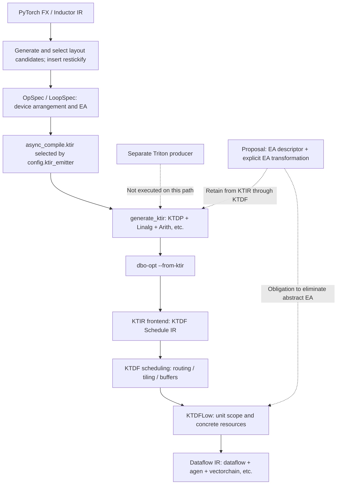

# Element Arrangement: Investigation and Optimization Design for OpSpec–KTIR–KTDF–Dataflow

## 1. Summary of Design Decisions

**The recommended design separates EA state from the operations that change EA, preserves that state from KTIR through KTDF, and materializes it into existing Dataflow IR once resources and transfer granularity are known.** For the medium to long term, use `RankedTensorType` encoding for the state of tensor values together with an explicit transformation op for arrangement changes (EA-P003, candidates H10 + H6). Encoding alone, however, cannot pass through FIFOs and memrefs. Adoption requires transferring a shared EA descriptor into KTDF FIFO and read/write contracts as well, and preventing its loss during bufferization, type reconstruction, and vector flattening. [KF4][S3][S4][D1]

Preserve numerical casts as semantic operations distinct from EA transformations (EA-P001). `dl16tofp32` means “numerical widening + an output-EA constraint,” and `fp32todl16` means “numerical rounding + an output-EA constraint”; restickify is not a substitute. Also distinguish PyTorch bf16, DLFloat16, and IEEE f16. Currently, bf16 uses DLFloat16 as its device representation, and the KTIR emitter then spells that type as `f16`. This two-stage mapping must not itself be used as proof of numerical equivalence. [TS3][TS5][TS11][KF6]

Adopt EA-P002 in the short term. Establish contracts and diagnostics, then address the casts, mean, grid, fp32 stick compatibility, and output-EA materialization that block the four examples. Do not remove EA tags or move casts without justification. If the migration burden of cross-dialect encoding is too high, a strong alternative is **EA-P004 (H7 + H6), which carries the same descriptor in attributes on existing ops and also uses explicit transformations**. It requires verifiers at every boundary to detect missing attributes.

| Design decision | Conclusion | Conditions and the minimum verification that could change the decision |
| --- | --- | --- |
| What EA guarantees | The mapping from logical indices to arrangement coordinates, valid elements, order, and the distinction between replication and pairs. Logical dtype and numerical rounding are separate contracts | Check each EA's concrete index map, transformation direction, and tile, slice, and core boundary conditions against the backend |
| Selection and finalization stages | OpSpec retains finalized boundary arrangements. KTIR resolves legal choices and consumer requirements; KTDF finalizes resource-dependent choices | Internal optimization must preserve boundaries fixed by existing memory planning |
| Cast lowering | Preserve the original rounding points and lower to verified numerical instructions after EA selection | The existence of `vectorchain.cast` alone does not guarantee bf16/DL16 rounding. Execution tests are needed for each dtype pair |
| EA transformation optimization | Make pure, same-dtype arrangement transformations explicit, then eliminate, share, or fuse them after legality checks | Proof must account for reduction order, broadcast axes, padding, aliasing, and fanout |
| Final Dataflow | **Add no new instructions or attributes**. Eliminate abstract EA into existing views, agen loads/stores, send/receive, and vectorchain operations | Make a check for all remaining EA constructs and actual compilation using existing syntax migration gates |

**Current verification result:** CPU results were obtained for all four examples, but none completed computation through the requested bf16, `dynamic=False`, KTIR path. A stopped at unregistered `dl16tofp32`, B at work divisions that cannot fit in a single grid, C at fp32 stick compatibility, and D at unregistered `dl16tofp32`. No completed KTIR/KTDF IR was generated for the four examples. A separate addition example completed KTIR → KTDF → Dataflow generation and execution on Spyre. Thus, downstream connectivity was verified, but the correctness of the four examples and the implementability of the proposed design remain unverified (§8).

This recommendation is a structural design decision, not a measured performance improvement. In particular, if existing backend operations cannot satisfy a required EA map or bf16 numerical contract, exclude that combination from the legal set. Treat the user-specified Triton epic [#229](https://github.com/torch-spyre/triton/issues/229) as **the future premise itself** that downstream restickify is available for fp16, dlfloat16, float32, int16, and int32. It is not evidence of the current implementation or a guarantee for arbitrary shapes, arrangement pairs, numerical casts, or negligible cost.

## 2. Overall Policy and Processing Overview

### 2.1 Current Path and Proposed Responsibilities



Solid lines are paths verified through source, calls, and generated artifacts from the addition example. Dotted lines indicate a relationship to another producer or a new proposal; they do not show completed paths for the four examples. `SuperDSCScheduling`, despite SDSC in its name, is included in the investigation because it is a shared implementation that constructs OpSpecs and contains the KTIR branch. [TS2][TS15][S1]

Where an arrangement can be described without moving data, represent it using a view's index map; where actual movement is necessary, retain a transformation. Before starting EA optimization, define for each op how logical input indices correspond and which EAs, numerical formats, and valid lanes are allowed. Performance search must use only the results of these legality checks.

| Stage | Current input → output | Information retained and responsible component | Additional responsibility in the proposal |
| --- | --- | --- | --- |
| Inductor → OpSpec | Logical IR → Python dataclass | torch-spyre layout passes; device_size/coordinates, EA, allocation, work division | Make explicit the relationship between logical dtype/shape and physical format, finalized boundaries, and transformation provenance |
| OpSpec → KTIR | Finished specs → verified MLIR | `KernelPlan` performs all derivation and rejection; `KtirBuilder` emits output | Map casts to independent semantic operations and existing finalized EAs to initial contracts. Do not reinterpret them implicitly |
| KTIR | Tensors, memory views, access tiles, linalg | Currently mainly shape/stride/element type | Handle EA state, candidate sets, and per-use requirements; optimize pure arrangement transformations |
| KTIR → KTDF | Bufferize, mapping, pipeline | Scheduler FIFOs, stages, routing | Explicitly convert encoding into FIFO/read/write contracts. Detect information loss |
| KTDF → KTDFLow | Tiles, transfer granularity, concrete units, addresses | Select resources using the architecture | Finalize remaining EA transformations as shuffles, views, or transfer plans. Reserve required resources before eliminating abstract EA |
| KTDFLow → Dataflow | Per-unit memrefs/vectors → DFIR | Views, agen, send/receive, vectorchain | Leave zero EA-specific ops or attributes. Verify that existing syntax alone realizes the intended mapping |

## 3. Investigation Scope, Baselines, Environment, Target Path, and Terminology

### 3.1 Baseline Commits and Version Alignment

The investigation began at 17:55 UTC on 2026-10-25. Retrieval and cross-checks were performed from 17:55 UTC on the same day. The recording time for each repository falls within the UTC interval in the table below. The baselines were not chosen by aligning every repository to its latest HEAD.

| Repository | Source and reference | Full baseline SHA | Selection rationale and alignment with torch-spyre |
| --- | --- | --- | --- |
| torch-spyre | `/home/ishizaki/aiu-src/dt-agents/torch-spyre`, main | `f1e0145364392eab4d5bfe1975429726f30becea` | HEAD at the start of the investigation. No tracked changes. The untracked materials described below were excluded from the baseline |
| RFCs | `/home/ishizaki/aiu-src/dt-agents/RFCs`, KtirSpec_for_td | `f4f8efd13578b4fe9de70f3f946f751fc32e4b3b` | No dependency pin. Local HEAD used as a reference version. Origin is kiszk/RFCs; upstream is torch-spyre/RFCs. The same SHA also exists upstream |
| triton | `/home/ishizaki/aiu-src/dt-agents/triton`, main | `44180f966037962b5106594877cc86f254709cb2` | No dependency pin was verified for the direct OpSpec path; local HEAD used as a reference version. Investigated as a separate KTIR producer |
| ktir-mlir-frontend | Temporary archive of the pinned revision from the checkout in the same parent directory | `1f96e5790a99b7aaf9a445b039044467c66e4e0a` | torch-spyre `tools/ktir-mlir-frontend.pin:13`. The explicitly specified version for testing was prioritized |
| dataflow-scheduler | `/home/ishizaki/aiu-src/dt-agents/deeptools/dataflow-scheduler`, detached | `9ceb2a8279098034c0819cf712fce6146fee2dbd` | Prioritized the version corresponding to the dbo build's CMake source path and the deeptools gitlink identified during the investigation. This alignment comes from the downstream build; torch-spyre itself has no pin |
| dataflow-scheduler-mlir-dialects | Submodule under scheduler and a temporary clone from the remote, detached | `5df926aa2472d169dfd11a8f3f658387dba361d2` | Fixed by the scheduler gitlink. Source alignment with scheduler was verified |

| Repository | Recording and selection time in UTC (2026-10-25) |
| --- | --- |
| torch-spyre | 17:55–17:56 (initial HEAD/status established) |
| RFCs | 17:57–18:15 (local baseline and supplementary remote cross-checks) |
| triton | 17:56–18:14 (local baseline, submodules, and discussion retrieval) |
| ktir-mlir-frontend | 17:56–18:14 (pinned archive and local/installed comparison) |
| dataflow-scheduler | 17:57–18:16 (initial HEAD; baseline updated to build-linked 9ceb; diff comparison) |
| dataflow-scheduler-mlir-dialects | 18:00–18:16 (pinned clone, local state, and submodule comparison) |

The initial state of each checkout is shown below. Separate HEADs used for reference must not be confused with the primary baseline.

| Checkout | Local HEAD and branch | Uncommitted state and treatment |
| --- | --- | --- |
| torch-spyre | SHA above, main | Many untracked files and directories (existing EA reports, `ea/`, `tmp/`, `ktdp/`, diffs, etc.). Existing contents were not edited or reused as evidence |
| RFCs | SHA above, KtirSpec_for_td | No tracked differences. TD, PDF, and STRATEGY documents under `0682-KtirSpec/` are untracked. Excluded from the baseline specification |
| triton | SHA above, main | No tracked differences. PR_BODY, evaluation scripts, spike/test materials, etc. are untracked. Preserved and excluded |
| Standalone frontend | `ed47a3ff691e49f30e4a49e75d7ac19995cff2ea`, main | Clean. Differences from the torch pin concern workflow permissions only. The pin remains the baseline |
| Standalone scheduler | `4a40dc1933fc44a3c5a0ae202fa33a559d6e2c06`, main | Clean. Used in the initial investigation, then compared against build-linked 9ceb. 4a40 is an ancestor of 9ceb |
| Standalone dialects | `8f02cb50e245be67c6f09ac9d06999d9de6fd364`, main | Tracked changes in `KTDFArchIntrinsics.td`. Not used as the primary baseline |
| Three submodules under the dbo build | Scheduler 9ceb, frontend `0a4601d7bdba3df33bee7b5a3ab9c18e42930a1a`, dialects 5df | All detached and clean. The frontend differs from the torch pin |

Supplementary RFC2971 is absent from the local RFC baseline, so remote `main` at `4013fa96799d2d3a6cbfeb4a138ea52b5ded8357` was retrieved. This is **supplementary remote material**, not part of the primary baseline. [R3]

To verify connectivity, the local deeptools repository outside the six requested repositories was also consulted on a limited basis. Its clean HEAD is `6c653c15262c77881a8ff7b3cc81c513c299fef9`. `dbo/tools/dbo-opt/dbo-opt.cpp:66–78` declares `--from-ktir`, and `dbo/src/Pipeline/Pipeline.cpp:153–184` directly calls the scheduler's three pipelines. `/home/ishizaki/aiu-src/dt-agents/build/deeptools/CMakeCache.txt:355,375,411` identifies the three submodules above as source directories. No speculative public GitHub URLs were attached to these local materials.

### 3.2 Scope of Execution-Environment Alignment

| Item | Observation | Applicability |
| --- | --- | --- |
| Python | `/home/ishizaki/aiu-src/dt-agents/.venv/bin/python3`, 3.12.15 | Same environment for all executions |
| PyTorch | `2.13.0+cpu`, git `cf30153c4c131c8164ee7798e5022d810682e2cb` | Matches the 2.13 series in pyproject. PrivateUse1 Spyre is available even with a CPU wheel |
| torch-spyre Python | Imported from the baseline checkout | No tracked differences. The Python-side failures observed here correspond directly to the baseline source |
| `_C.so` | Same checkout, built on 2026-10-25. SHA256 `9d228746d252125dc882cb9eeecf99358d446d436a28d745c082265a249d510c` | Commit alignment through a build manifest is unproven. Verified only to the extent that type enums, transfers, and addition worked |
| mlir_ktdp | Distribution `ktir_mlir_frontend` 0.1.0, site-packages | direct_url points to the frontend under Triton, with no VCS SHA. Current source code is identical to the torch pin, but the build-time SHA is unconfirmed |
| Triton | `3.7.0+git44180f96`, editable | Does not imply that Triton passes ran on this path |
| dbo-opt | `sentient/deeptools/bin/dbo-opt`, LLVM22.1.3, assertions enabled | SHA256 `78e781eba5bad0396a9c91134e39e3e11de1d936a1b401578a1ea85d48de47c1`. Supports alignment with the CMake source, but is not a binary commit attestation |
| Runtime indication | `LIB_VERSION_FILE=/opt/ibm/spyre/components.txt` | Installed manifest lists deeptools from the `e73131e6` series and flex from the `75a1fa3d` series. Alignment with the local sentient build is unproven; CI compatibility is also unverified |
| Device settings | `KTIR_DEVICE_MLIR` and `SENCORES` unset | dbo default spyre_dd2_basic. Generated OpSpecs use 32-core division. Addition ran through the Spyre runtime, but the device model was not independently cross-checked |

The four examples were run through a common harness in a temporary directory, preserving the same definitions, seeds, shapes, dtypes, and tolerances. Only CPU export capture and stage reporting were added. As in the appendix, C uses int64 `position_ids` and fp32 `inv_freq`; these were not changed to satisfy the general “bf16 inputs and weights” condition. C's `x` is bf16, the weights in A/B are bf16, and D has no weight. The requirement to compare each example against its own CPU result was preserved.

### 3.3 Evidence Identifying the Target Path

1. At import time, `config.ktir_emitter` checks whether the environment-variable string **exactly equals `"1"`**. Changing only the environment variable later does not necessarily update the setting in the same module. [TS1]
2. `SuperDSCScheduling.define_kernel` selects `"ktir" if config.ktir_emitter else "sdsc"` and emits `async_compile.ktir(...)` into the wrapper. [TS2]
3. `SpyreAsyncCompile.ktir` passes finished `OpSpec/LoopSpec` objects to `generate_ktir` and saves successfully generated MLIR in a `.ktir` file. Empty KTIR files for the four examples that failed before generation must not be mistaken for completed IR. [TS15]
4. `generate_ktir` consists of `build_kernel_plan` → `KtirBuilder.create` → `emit` → module verification. It separates planning from emission and rejects unsupported cases in the Python plan. [TS14]
5. dbo receives `--from-ktir --export-dir=... --kEmitSpyreCode <file>.ktir`. `BUNDLE_SYMBOLIC_ARGS` defaults to 1, and normal invocation at the current baseline uses symbolic bases. The remaining comment about baking addresses to work around #65 must not be confused with the default behavior. The independent add IR probe in §8 deliberately used a baked fixture. [TS15][TS23]
6. The scheduler order is pre_mapping patterns → KTIR legality → mapping/tiling/bufferization/pipeline → KTDF scheduling → KTDFLow → DFIR. pre_mapping is enabled at 9ceb; it was commented out at the older 4a40. Do not establish the order solely from an old README or descriptions of a local HEAD. [S1]

**What the names denote:** OpSpec is a Python dataclass in torch-spyre. KTIR is Kernel Tile IR, a language composed of multiple dialects; KTDP (`ktdp`) is its access/memory component. KTDF is the scheduler's internal Schedule IR, and KTDFLow is the stage where unit scopes and related details become concrete. Final DFIR also comprises multiple dialects: `dataflow` handles communication, units, and memory views; `agen` handles addresses and loads/stores; and `vectorchain` handles vector computation. Their definitions reside in dataflow-scheduler-mlir-dialects. [KF1][S1][D0]

### 3.4 Terminology and Definitions for Invariants

| Term | Meaning in this report | Not synonymous with |
| --- | --- | --- |
| Logical tensor | PyTorch shape, indices, dtype, and the value at each index | device_size or FIFO depth |
| Geometry | The shape and axis structure that decompose logical indices into tile/stick and other coordinates | Element order within a stick itself |
| Layout | The overall arrangement description, including geometry, stride/address mapping, format, EA, valid elements, etc. Document-specific meanings are stated alongside this definition | EA alone |
| EA | The current enum represents element ordering in device coordinates. It also mixes in modes involving semantic pairs/packing, such as EXX2/QFP8 variants | Numerical dtype conversion or a mere shape change |
| Order | The arrangement order of the same valid logical elements | The number of copies of a value |
| Multiplicity (replication) | How many locations hold one logical value. Splat replication is distinct from the two different statistics in EXX2 | Treating everything as a bijective permutation |
| Packing | Rules for fitting multiple values or bit fragments into physical words/lanes | Numerical casts. The meaning of sign/zero extension requires a separate contract |
| Permutation | A one-to-one reordering over the set of valid elements | Arbitrary mappings including padding, splats, or reductions |
| Restickify | An actual data-arrangement transformation that changes stick axes, tiles, etc. | Rewriting EA metadata or all numerical casts |
| Shuffle | A concrete operation for lane selection, reordering, or replication. Existing vectorchain checks for the same element type | float32 → bf16 rounding |
| Grid | Work distribution across kernel instances/cores | Ordering within a stick |
| Valid region V | The set of logical indices excluding padding; a set notation used in this report | A new dialect or an implemented domain attribute |

RFC0047/0682 provide the background for tiled layouts and the KTIR interface. [R1][R2] For format conversion between host and device, `generate_dci` passes the two formats separately. [TS22]

Consider the decomposition: logical index `i∈V` → geometry coordinates `g(i)` → lane/word arrangement `e(g(i))` according to EA → memory address or register/FIFO position. The implementation does not necessarily retain this function composition directly. EA-P001 proposes making this meaning verifiable.

The following **hypothetical eight-element permutation** is illustrative. It does not speculate about the actual Spyre DL16_TO_FP32 arrangement.

```text
logical index       0  1  2  3  4  5  6  7
STANDARD storage    a0 a1 a2 a3 a4 a5 a6 a7
hypothetical EA     a0 a2 a4 a6 a1 a3 a5 a7
logical→slot        0  4  1  5  2  6  3  7
```

A limited example whose concrete index map is verifiable in the code is `stagger_to_standard_ea`. It targets 64-lane FP32_TO_DL16: the value at physical position `8k+w` corresponds to logical position `4k+w` (w<4) or `4k+w-4+32` (w≥4). It constructs a matrix in which the first 16 physical lanes correspond to logical positions `0,1,2,3,32,33,34,35,4,5,6,7,36,37,38,39`. This is restricted to fp16, multiples of 64, and a particular direction; it is not evidence for generalization to upcasts or arbitrary slices/cores. [TS18]

### 3.5 Categories of Claims and Examples; Working Assumptions

In this report, “code fact” refers to baseline source, “execution fact” to the records in §8, “design intent” to RFCs/READMEs, “discussion” to issues/PRs, “analysis” to inferences from these sources, “proposal” to EA-P-numbered items, and “unverified” to checks that have not been performed. Each IR block is labeled as actually generated, quoted from existing material, verification of current syntax, proposed IR, or schematic IR.

The task contained conflicting output instructions: an earlier single-file restriction and a later two-file requirement. After clarification, the user selected the two files specified in §11, so only the full report and summary were created as new deliverables. The earlier `...-10.md` was preserved. Also, although the task requested “eight viewpoints,” it enumerated only through viewpoint 7; viewpoint 8 was therefore defined as **short-term incremental improvements**, as required by the objective and common proposal format. These are working defaults, distinct from the design's technical premises.

## 4. Analysis of the Eight Viewpoints

### 4.1 Viewpoint 1: Why EA Is Necessary

As a code fact, a 128B stick contains 64 elements at 16 bits and 32 elements at 32 bits; changing type width therefore affects both geometry and lane correspondence. `DtypeOpTable` assigns different output EAs to the same logical cast depending on the input EA. Ignoring this can place numerically correct elements at the wrong indices, causing errors in subsequent weight multiplication, slicing, or D2H transfer. [TS4][TS5]

The design intent of RFC2971 is to exploit differences in wiring between 16-bit and 32-bit operations/data paths cheaply by keeping intermediates staggered. However, its scope restrictions—“fp32 is ephemeral and is not stored” and “no rearrange required”—do not accommodate current fp32 mapping or the fp32 output in Appendix D. Hardware-derived ordering must be distinguished from the compiler policy at the time that fp32 would be used only for intermediates. [R3][TS3]

The analysis is that always returning EA to STANDARD simplifies local reasoning but repeatedly moves large tensors immediately after casts or between ops. Conversely, propagating EA as an opaque enum makes it impossible to determine legality for slices, reduction axes, and different consumers. A meaningful descriptor and explicit transformations bridge these two approaches.

### 4.2 Viewpoint 2: Problems to Solve and Required Conditions

| Issue ID | Concrete example | Required invariant | Consequence of violation |
| --- | --- | --- | --- |
| EA-I001 | bf16 → f32 → bf16 in A/B; i64 → f32 in C | Preserve logical dtype, device format, rounding points, and type promotion independently. A cast is a numerical operation | Changing A into B, confusing bf16 with DL16/IEEE16, or changing the value range |
| EA-I002 | 64 lanes → 32 lanes, a partial stick in 4×96, slices, EXX2 | Mapping and coverage of all valid indices, padding masks, multiplicity, pair semantics, address units | Missing lanes, padding contamination, confusing the two statistics |
| EA-I003 | `dl16tofp32` in A/D, staggered inputs | A cast contract allowing different input/output formats, an emitter capable of representing EA, and downstream lowering | Fixing recipe rejection only to encounter EA or dtype rejection next |
| EA-I004 | Broadcasting RMS [1,128,1] to [1,128,4096]; row sums in D | Supply the correct scalar to each logical row. Preserve reduction axes, valid lanes, accumulation precision, and order | Mixing rows, using zero/undefined lanes, changing sums |
| EA-I005 | The same f32 value branches to a reduction and a STANDARD consumer | Distinguish the producer's EA from each use's requirements. Insert transformations on necessary edges, respecting aliasing and lifetimes | Fixing one consumer breaks another; unnecessary whole-tensor copies |
| EA-I006 | B's weight transformation of 4096 versus activation 128×4096; conversion to FIFOs | Keep grid/ownership/address/EA consistent across stage boundaries. Do not infer contracts across version differences | Mixed-grid rejection, duplicate writes by cores, loss of EA during type reconstruction |
| EA-I007 | Mean in A/B, trig decomposition/casts/concat in C, output in D | Complete all four examples against their own CPU oracles. Legalize required non-EA ops on the path as well | Mistaking removal of one rejection for feature completion |
| EA-I008 | Transforming the full activation versus only the weight | Separate legality from cost. Evaluate bytes, transfer count, padding, scratchpad, and register pressure | Selecting an illegal edge because it appears cheap; mistaking an element-count proxy for time |

For example, matching `numElements` alone is insufficient for EA-I002. Check that two valid indices do not collide in the same output slot, that copies have equal values when replication is allowed, that the mask matches the original V, and that EXX2's mean and mean-square are not interchanged. For EA-I004, saying that “reduction is independent of order” describes real-number arithmetic only; it does not authorize reassociation of float32 additions.

### 4.3 Viewpoint 3: Current Solutions

#### 4.3.1 Layout/Cast Decisions and OpSpec

The shared passes proceed through `split_multi_ops` → `propagate_spyre_tensor_layouts` → `validate_ops` → `optimize_restickify_locations` → `reorder_nonstick_dims` → `finalize_layouts` → `insert_restickify` → padding/constants/coarse tiling/work division/LX planning. Candidate enumeration, legality, cost-based selection, and transformation insertion are separate processes. [TS6]

For casts, `_single_arg_op_layout` reuses the original geometry and adjusts it to the element width with `rescale_stl_for_dtype`. However, this applies only when the access covers the same extent as the entire original buffer; slices are not unconditionally returned to the same layout. Rescaling a partial stick is explicitly rejected. [TS7][TS17]

| Logical cast | Input EA | Output EA (current table) |
| --- | --- | --- |
| fp16/bf16 → f32 | STANDARD | DL16_TO_FP32 |
| fp16/bf16 → f32 | FP32_TO_DL16 | STANDARD |
| f32 → fp16/bf16 | STANDARD | FP32_TO_DL16 |
| f32 → fp16/bf16 | DL16_TO_FP32 | STANDARD |

`SpyreOpFuncs.to_dtype` selects an OpSpec op name from this logical dtype pair. The EA table describes arrangement transitions; it does not imply numerical cancellation with the inverse cast. [TS5][TS24]

For multi-input pointwise operations, EA can propagate when all inputs are STANDARD or share the same staggered EA. Mixed EAs are allowed only if one side supports stick broadcasting. The check depends on device-index correspondence such as `stride_map[-1]==-1`, not merely a last shape dimension of 1. [TS31] For edges requiring restickify, baseline `compute_restickify_needed` restricts the device format to SEN169_FP16. Thus, for native-fp32 C, geometry candidates can be enumerated but legal edges cannot be constructed. [TS8][TS20]

OpSpec's TensorArg contains device dtype/size/coordinates, EA, allocation, tile advance, name, kernel_local, replicated_scalar, and other fields. Logical dtype and shape do not remain as independent contracts. `replicated_scalar` is evidence provided by the producer that all lanes of the physical stick hold the same value; it cannot be inferred from a tensor shape of 1. [TS10][TS25]

#### 4.3.2 Mapping to KTIR and Loss of Information

`ElemTypes.of` maps SEN169_FP16 and IEEE_FP16 to `f16`, IEEE_FP32 to `f32`, and BFLOAT16 to `bf16`. However, ordinary PyTorch bf16 inputs have already been mapped to SEN169_FP16. EXX2 maps to dedicated pair types, `!spyreop.fp16_fused`/`fp32_fused`. The layernorm reader also has a special rule for reading the same buffer as unfused scalars. These current implementation details cannot be expressed by uniformly attaching an EA string. [TS11][TS26]

The current layout function passes through extents/strides for STANDARD/QFP8CH/EXX2, but rejects staggered EA as `staggered-element-arrangement`. The fact that QFP8CH passes this function is not evidence that all quantized ops work on this path. [TS12]

`dtype_of` requires all arguments in one OpSpec to have the same device format. Implementing casts therefore requires changing this single-format assumption as well as registering cast recipes. This does not mean that ordinary pointwise operations should be allowed unrestricted mixed formats. [TS13]

KTIR load results are plain ranked tensors; the builder does not attach encoding. Views have sizes, strides, and coordinate sets, while access tiles have coordinates and order. Without EA in the type, the original memory arrangement must be inferred again for SSA values after fusion. [KF3][KF4]

#### 4.3.3 Connectivity from KTDF to Dataflow

The scheduler maps, tiles, and bufferizes KTIR, converting it into stages, FIFOs, reads/writes, and data transfers within `ktdf.pipeline`. FIFO slot types contain only the source/destination, element count, and element type. Bufferization's `convertFromTensorToMemref` and the final `getFlattenedVectorType` also reconstruct types from shape and element type. Simply adding tensor encoding to the current implementation would not propagate it automatically. [S3][S4][D1]

The existing splat implementation provides a useful precedent. Based on the architecture's access granularity, `SplatLegalizationPass` widens an fp32 scalar load from 1 to 2 elements when necessary and attaches `#ktdf.splat<first_subsimd_lane_to_each_subsimd>` to each FIFO read. Downstream lowering inserts an existing `vectorchain.shuffle` immediately after `dataflow.receive`. It rejects the case if the sub-SIMD width is unknown or does not divide the vector length. This demonstrates why EA information should be retained through KTDF, but it does not complete a general EA transformation implementation. [S5][S6]

#### 4.3.4 Tracing the Four Examples by Stage

The following **OpSpec summaries come from actually generated wrappers**; they are not completed KTIR. `S` = STANDARD, `U` = DL16_TO_FP32, and `D` = FP32_TO_DL16.

```text
A Granite: x:DL16/S -> dl16tofp32 -> f32/U
  -> mul(x,x):U -> mean[-1]:S -> add(eps):S -> rsqrt:S
  -> mul(x, broadcast(scale)):U -> fp32todl16:DL16/S
  -> mul(weight:DL16/S):DL16/S
B GptOss: same as A through f32 normalization
  weight:DL16/S -> dl16tofp32 -> f32/U
  -> mul(normalized:U, broadcast(weight):U):f32/U
  -> fp32todl16:DL16/S
D Softmax: x:DL16/S -> dl16tofp32:f32/U
  -> max[-1]:S -> sub(x,broadcast(max)):U -> exp:U
  -> sum[-1]:S -> realdiv(exp,broadcast(sum)):f32/U -> output
```

A's first actual OpSpec has input `device_size=[128,64,64]`, output `[128,128,32]`, output EA=U, and LX placement. The logical shape is [1,128,4096] for both; device rank and stick width must not be confused with logical shape. The wrappers confirmed 8 ops for A, 9 for B with the additional weight cast, and 6 for D.

C stopped before OpSpec generation. The following is a **trace derived from CPU export and the baseline lowering**, not a completed OpSpec that was observed.

```text
x:bf16[1,128,4096] (used only for dtype/device)
position:i64[1,128] -> device i32 -> candidate int32tofp32
inv_freq:f32[64] --broadcast-mul--> freqs:f32[1,128,64]
 -> cat(freqs,freqs):f32[1,128,128]
 -> cos / sin (currently decomposed into fp32 approximation operations)
 -> candidate fp32todl16:DL16/D -> EA materialization required for bf16 CPU output
```

In C's actual error, the position side is `[1,4,1,32]`, with the sequence axis as the stick axis, while the frequency side is `[2,32]`, with the frequency axis as the stick axis. The output candidates are `[1,4,64,32]` and `[1,2,128,32]`; neither has an fp32 restickify edge that aligns the other input (§8).

### 4.4 Viewpoint 4: Difficulties with the Current Approach

**EA-I001/I003: The coupling between type and arrangement changes across boundaries.** Upstream knows logical bf16, but OpSpec centers on device DL16, and KTIR maps it to `f16`. Single-format recipe selection and width casts whose behavior depends on input EA do not fit the same framework. Mechanically replacing `dl16tofp32` with `arith.extf` would misinterpret DL16 as IEEE16 and would also be rejected by scheduler legality. The current-syntax probe in §8 verified rejection of extf/truncf. [TS11][TS13][S2]

**EA-I002/I005: The same information is decomposed early into different mechanisms.** Device shape/coordinates, EA enums, EXX2 special types, and per-op unfused overrides each reside in local mechanisms. Handling arrangements expressible by geometry together with opaque lane order through general shape/stride reconstruction loses information. Conversely, forcing every EA into a type risks mistaking EXX2's “two statistics” for mere ordering. State, semantic pairs, and transformations must be separated.

**EA-I004: A scalar needs information about which row and lane holds its value.** Valid lanes in a reduction result differ from a constant replicated across an entire stick. The emitter has separate handling for scalars replicated to all lanes and for per-row scalars; the scheduler also has splat handling based on load granularity. With this dual structure, matching EA enums alone cannot establish broadcast legality. Physical arrangement must be resolved, including masks and partial tiles. [TS16][S5]

**EA-I006: Fusible SSA values and ownership across stages are separate problems.** The emitter duplicates views per stage even for the same buffer. A source comment reports a case where the backend aborts during stage extraction with a shared view, so intermediates are not unconditionally threaded into another stage. That abort was not reproduced in this investigation, but a design that mechanically applies CSE to views while sharing EA transformations is a potential regression. [TS21] B's weight-only cast and 32-core activation division belong to the same issue group. The short-term default is to separate weight preparation into another kernel/function and specify buffer synchronization, reuse, and ownership, rather than forcing the grids to match. Splitting stages within the same kernel does not bypass the single-grid check; additional implementation is needed to represent different owners/grids.

**EA-I008: The cost metric is insufficient.** The current upstream beam search uses the element-count proxy `prod(device_size)` as the cost of required transformations. One such metric cannot compare f16 with f32, HBM with LX, padding, and register shuffles. The documentation explicitly states that KTIR has no general cost model. The existence of the current search must be distinguished from the ability to optimize overall EA performance. [TS9][TS27]

Illustrative schematic IR for transformations:

```text
Problem at the current boundary:
  OpSpec cast(DL16/S -> f32/U)
    -> rejected because no recipe exists
    -> even if only a recipe were added, contracts for mixed dtype / U-layout are missing

Proposed separation of responsibilities:
  numerical_cast(x, bf16->f32, storage=DL16->IEEE32, outputEA=U)
  ... legal compute preserving the same EA ...
  convert_ea(value, U->S)       # preserve dtype and logical values
  store_with_concrete_layout(value)
```

### 4.5 Viewpoint 5: Unsupported or Unresolved Cases

| Issue | Status category | Conditions and evidence | Required changes and related discussion |
| --- | --- | --- | --- |
| I003/I007, A/D | **Verified by execution** | The first `dl16tofp32` is rejected as unregistered in `KernelPlan._stages`. Both casts and mean were also unregistered in unit probes | EA-P001/P002. Design recipes, mixed-type contracts, and downstream casts together |
| I006, B | **Verified by execution** | The weight-only op for 4096 and the activation op for 128×4096 are in the same kernel. `_divisions` rejects mixed work division | Separate kernel/function plus buffering/synchronization is the default. Extending broadcast ownership within the same kernel is an alternative. Cast/mean support is still required after splitting |
| I004/I007, C | **Verified by execution** | `beam_global_min_cost` cannot find a legal edge for incompatible fp32 sticks | Connect the #229 premise to upstream capabilities and verify concrete maps. Trig and integer casts are subsequent gates |
| I003, U/D EA | **Verified in isolation** | `_arrangement_layout` rejects both staggered EAs | Add maps/descriptors and lowering, rather than deleting the enum |
| I003, plain extf/truncf | **Verified by IR execution** | Frontend parsing/verification succeeds, then dbo rejects them as unsupported compute | Add support in `KTIRLegalityCheck`, patterns, and numerical lowering |
| I002/I004, partial sticks | **Code restriction / discussion** | Rescaling rejects nonintegral stick counts. Nonprefix valid lanes are a padding-mask issue | TS #3999/#4014. Not reproduced with the aligned shapes in the four examples |
| I002/I005, staggered D2H | **Discussion + static comparison; not reproduced here** | TS #4393 reports D2H that ignores EA. C/D stopped for other reasons before output | Materialize output to S or lower it to the correct map in an existing transfer. Do not treat this issue as closed |
| I002, nonstick reduction/slicing | **Discussion + static concern** | TS #5553/#5580 concern output-EA propagation and its timing relative to the writer | Axis/validity tests in EA-P001/P003. Do not describe this as a reproduced wrong result in the appendix examples |
| I004, reduction iterator/shape correspondence | **Historical issue with version differences** | Older 4a40 in scheduler #179 directly references input dimensions. Primary baseline 9ceb has been fixed to use static loop ranges | Do not list this as an unfixed bug in the current baseline. Use it for permuted-indexing regression tests when introducing encoding |

The current `restickify` recipe was confirmed to be unregistered, but the absence of recipes named simply sin/cos does not establish that all trig computation in C is unsupported. The current implementation has Cody–Waite/Taylor-style decompositions, so the generated primitives and approximation error must be examined. [TS28]

The existing `stagger_to_standard_ea` is a limited workaround containing a concrete index map. Because it uses an N×N permutation matrix and matmul, at 4096 the weight alone requires 32MiB (16-bit). Arithmetic effects such as NaN×0, KTIR matmul support, and unnecessary computation also make it unsuitable as the primary general EA transformation strategy. [TS18]

### 4.6 Viewpoint 6: Representation and Lowering in Each Dialect

The basic policy is to compare two axes: **state carriers** (attributes, types, encoding) and **transformation carriers** (explicit ops or transformation contracts on existing ops). State alone cannot move actual data, while transformation ops alone do not necessarily make the state of all values, branches, and boundaries verifiable at all times. The shared examples, mandatory conditions, modification points, and adoption decisions for the 11 candidates are consolidated in §5.

KTIR-only approaches are possible in principle, but they require fully expanding all EA into existing shapes/strides and concrete operations before entering KTDF. At that point, they cannot fully exploit the scheduler's choices of transfer granularity, units, and buffering. Retaining EA through KTDF opens more optimization opportunities, in exchange for responsibility for consistency across FIFOs, bufferization, cloning, and type inference. This responsibility must remain explicit in the implementation plan.

### 4.7 Viewpoint 7: Medium- and Long-Term Improvements

EA-P003 preserves a shared descriptor and explicit transformations from KTIR to KTDF; EA-P005 uses them for arrangement selection across uses and transfer fusion. Instead of starting with a global solver for every EA and op, expand coverage in order: pointwise + reduction in A/B, output in D, then the two broadcast axes in C. For an EA lacking a complete concrete index map, retain only an opaque name and capability conditions, and prohibit optimizations that require the map.

Following the epic, sub-issue, and PR units in §7, share the EA-P001 contract between both carriers. Allow the contracts to be verified with EA-P004 before fully introducing encoding, but do not maintain two independent sources of truth simultaneously: check consistency with the same descriptor at adapter entry and exit.

### 4.8 Viewpoint 8: Short-Term Improvements to Adopt

EA-P002 preserves the current separation between Python planning and emission and does not defer unsupported-case detection into emission. Introduce cast-specific input/output format contracts and legality diagnostics first; do not indiscriminately relax the traditional single-format constraint for pointwise operations. If an EA's concrete index map, transformation capabilities, or padding conditions are unresolved, report the reason during planning.

Use separate acceptance gates for separating B's weight transformation into another kernel/function, fp32 restickify capability for C, mean and broadcast for A/B, and fp32 output EA for D. Working around B with `SENCORES=1` does not complete the specified default 32-core path. Do not enable transformation-count reduction or movement of arrangement transformations across casts by default until all four examples run correctly on the baseline path. Share the descriptor, capability checks, and test oracles so that future encoding can replace the short-term changes.

## 5. Detailed Comparison of Design Candidates and Adoption Decisions

### 5.1 Common Contracts and Comparison Input for All Candidates

**All EA-specific syntax from this point onward is proposed or schematic IR, not output from the current compiler.** In particular, `NUMCAST`, `convert_ea`, `bind_ea`, `#ktdp.ea`, and slots carrying EA introduce new semantics. Even the `linalg` notation that resembles current syntax is design notation with regions and outs omitted below.

The common fragment O is a small logical [2,64] excerpt of the normalization portion of A/B. A STANDARD consumer is added **for design evaluation** to examine different requirements on the same producer; this is not an execution of the appendix program with an extra consumer added.

```text
O (schematic OpSpec):
  x : logical bf16[2,64], device DL16, EA=S
  u = dl16tofp32(x)       # logical f32, EA=U
  q = mul(u,u)           # f32/U
  r = mean_last(q)       # reduction assumed to accept U input
  z = standard_consumer(q)  # requires non-broadcast S input
```

Branch notation in KTDF means supplying each use from a retained buffer or planning explicit duplicate channels; it does not mean unconditional reuse of a FIFO read that consumes the same state. [D6]

All candidates use the same assumptions: one EA transformation is required on `q→z`, and `q→r` can legally process U. If the latter condition does not hold, every candidate must also repair the reduction edge. When comparing carriers, no candidate is given additional backend capabilities or a different cast position. The four complete evaluation graphs are defined in §5.5; **only the carrier is replaced for each candidate on the same graphs**.

NUMCAST has the same meaning in all candidates. It expresses the logical dtype, storage format, original rounding position, overflow/NaN/denormal rules, and result EA. An existing standard cast may be used for a pair whose semantics match, but DL16 must not be treated as IEEE16 and replaced with `arith.extf`. Support for missing numerical cast specifications is counted as shared additional implementation work, not as an advantage or disadvantage of any particular carrier.

The minimum contents of the EA descriptor (EA-P001) are a schema version, EA/order name, affected axes and grouping unit, correspondence between logical indices and the physical tensor shape, valid-region and padding rules, distinctions among single values/replication/pairs, and required alignment and slice/core boundary conditions. Numerical dtype, storage format, and rounding are associated with the descriptor but are not stored in the same field as EA order. Rather than duplicating addresses themselves or the entire STL, references and mappings to existing geometry provide an unambiguous interpretation.

**Shape migration condition**: current KTIR tensor shapes are device-coordinate shapes. The initial implementation retains these shapes and places the corresponding logical index map and validity information in the encoding. It must not simply rewrite the shape to `tensor<1x128x4096xf32>`. §5.5 explicitly separates device shape, element type, and encoding, as in `!X32U = tensor<128x128x32xf32, #XU>`, while the encoding contract records logical shape. Conversion to FIFOs/views requires adapters to checked contracts. Any future migration to logical tensor shapes must change KTDP load/access-tile, linalg indexing, and padding/reduction in separate groups of PRs.

Candidate sets, costs, and preferred arrangements belong in analysis state. A single SSA value must not be declared to have multiple resolved EAs simultaneously. Consumer requirement sets are represented separately through an op interface and checked against the actual EA after resolution. This allows fanout to introduce `convert_ea` at the uses that need it without arbitrarily rewriting the producer.

### 5.2 Screening Against Mandatory Conditions

`Conditional` means that the design has a plausible path to satisfying the conditions once downstream numerical casts and the required EA pairs/shapes are demonstrated, information preservation is implemented, and materialization into existing Dataflow is implemented. **No candidate has yet been proven to fully implement all four examples**.

| Candidate | State carrier / transformation carrier | Mandatory-condition assessment | Main reason |
| --- | --- | --- | --- |
| H1 New ops in KTIR only | bind/propagation contracts + convert | Conditional | Feasible if fully materialized before KTDF. Unknown EA is rejected |
| H2 Attributes on existing KTIR ops | result/use attributes + concrete transfers | Conditional | Attribute changes alone are insufficient. Existing ops need layout-aware lowering |
| H3 New types in KTIR only | EA tensor wrapper + adapters | Conditional, extensive | Current Linalg/KTDP RankedTensorType constraints must change |
| H4 Extend existing KTIR types | AccessTile/DF16 extensions | **Fails on its own** | Does not cover f32 data SSA regions and fanout. Builtin schema extensions cannot be dialect-local |
| H5 Tensor encoding in KTIR only | encoding + concrete transfers/convert | Conditional | Limited to cases where all EA can be consumed before KTDF. Combining with H1 is natural |
| H6 New ops in KTIR and KTDF | bind/convert and contract analysis | Conditional | Explicit transformations are useful, but combining them with a state carrier for all values is preferable |
| H7 Attributes on existing ops in both stages | result/use/FIFO attributes | Conditional | clone/region/FIFO verification is mandatory. Combining with H6 is the recommended alternative |
| H8 New types in both stages | wrapper + EA slot | Conditional, extensive | Expressive, but requires migrating almost all type interfaces |
| H9 Extend existing types in both stages | AccessTile + FIFO extensions, etc. | **Fails on its own** | Same gap as H4 on the KTIR side. The FIFO part is useful as support for H10 |
| H10 Tensor encoding in both stages | encoding → checked FIFO/memory contracts | Conditional, recommended | Viable only when combined with H6 and adapters at non-tensor boundaries |
| H11 Other approaches | analysis tables, use contracts, Triton-style descriptor attributes | Adopt as support | An analysis table must not be the sole repository of semantics |

Every row prohibits new EA ops/attributes in final Dataflow. Leaking types into Dataflow is also not an acceptable workaround.

### 5.3 Concrete Designs, IR, and Implications of the 11 Candidates

#### H1: Add New Operations to KTIR Only

The approach declares an existing arrangement at a boundary with `bind_ea`, expresses an actual transformation with `convert_ea`, and propagates state through analysis within KTIR. It targets I002/I003/I005. A bind is valid only when it agrees with the ABI or producer contract; declaring an arbitrary EA cannot count as changing the data.

```text
OpSpec : O
KTIR   : a=bind_ea(x,S); u=NUMCAST(a, bf16->f32, out=U)
         q=mul(u,u); r=mean_last(q)
         v=ktdp.convert_ea(q,U->S); z=standard_consumer(v)
KTDF   : cast_compute -> square -> reduction
         square -> transfer/compute with a concrete layout -> z
         # All bind/abstract EA ops have been materialized
```

A convert can be placed on each edge when uses differ. Because types are plain, a walking verifier is needed to prevent state from being lost at block arguments or unknown ops. Changes to type/shape inference are small, but binding CSE/DCE must be contract-aware. Changes belong in the torch emitter, new frontend ops/bindings/verifiers, and dialect conversion at the scheduler entry. Fixing all arrangements before KTDF restricts transformations that depend on later tile/resource choices. This is an alternative for short, fixed pipelines or when KTDF cannot be changed, and is not the primary medium- to long-term choice. Validation covers fanout in O, rejection of false bind declarations, bitwise agreement under retiling after early materialization, and the four graphs in §5.5.

#### H2: Add Attributes to Existing Operations in KTIR Only

The approach uses result attributes on existing load/compute ops for actual EA and operand attributes for requirements, and also attaches contracts to existing func arg_attrs and region argument positions. SSA names are not used as string keys.

```text
OpSpec : O
KTIR   : u=NUMCAST(x){ea_in=[S],ea_out=[U]}
         q=linalg.mul(u,u){ea_in=[U,U],ea_out=[U]}
         r=reduce(q){ea_in=[U]}
         z=consumer(q){ea_in=[S]}   # Detect mismatch and insert materialization
KTDF   : cast; square; reduce; materialized_source(U)->target(S); z
         # Attributes have been consumed into actual processing and do not remain here
```

An attribute rewrite alone must not resolve a mismatch. In a standalone variant without a dedicated new EA op, existing copy/transfer/view ops must be lowered with layout awareness, ensuring that identity canonicalization does not remove a non-identity operation. A disadvantage is that pure register values tend to be forced through memory. Although conflicts with Linalg type constraints are limited, attributes must be transferred during cloning, fusion, and shape changes. Residual-attribute checks are added to frontend load/store verifiers and the scheduler's KTIR entry. Because arrangements are finalized earlier than in H7, this is not adopted for the medium to long term. Validation covers missing attributes, multiple results, scf iter_arg, fanout, negative tests for copy elimination, and the four graphs.

#### H3: Introduce New Types in KTIR Only

The approach places state in a new aggregate type such as `!ea.tensor<device-shape,element,EA>` and converts it to a plain representation before KTDF. Representing EA as a scalar numeric type such as `!ea.f32_U` is rejected because it compromises separation from axes, shape, and packing.

```text
OpSpec : O
KTIR   : u=NUMCAST(x): !ea.tensor<...,DF16,S> -> !ea.tensor<...,f32,U>
         q=EA_mul(u,u); r=EA_reduce(q)
         v=convert_ea(q): !ea.tensor<...,f32,U> -> !ea.tensor<...,f32,S>
         z=EA_consumer(v)
KTDF   : plain tensor/memref/FIFO + cast/reduce/concrete rearrange. No new types remain
```

The existing KTDP load verifier casts to RankedTensorType, and Linalg/Tensor also assume existing types, so adding a new type alone is insufficient. [KF4] New families of ops or conversion adapters effectively become necessary as well. All builders, shape inference, constants, func/scf signatures, Python bindings, canonicalization, and bufferization must migrate. With the same runtime plan as H5, there is no performance difference; the larger change scope is the reason for rejecting this candidate. If adopted, full op coverage for the new type and equivalence of all four examples before and after conversion to plain representations must be gates.

#### H4: Extend Existing Types in KTIR Only

AccessTile is a type for index coordinates; it does not retain the EA of loaded values. Extending the DF16 type also does not cover f32/i32 values. Adding a new parameter to builtin RankedTensorType changes the schema of LLVM/MLIR itself and is not the small dialect extension considered here. Using its existing encoding is H5. [KF2][KF6]

```text
OpSpec : O
KTIR   : access: !ktdp.access_tile<...,EA=S>  # Hypothetical extension
         x=load(access): tensor<...xDF16>    # The carrier of the data EA disappears
         u=NUMCAST(x): tensor<...xf32>       # No place to retain U
KTDF   : Cannot provide IR whose semantics are guaranteed by this standalone design
```

This is a **schematic example of where the design fails**, not a presentation of an implementable design. Rejected as a standalone approach. It may have a partial role in strengthening access contracts at boundaries, but this alone cannot solve I003/I005.

#### H5: Use RankedTensorType Encoding in KTIR Only

The approach associates EA with tensor types while retaining tensors, and materializes all EA at the end of KTIR. A dedicated EA attribute and verifier require new implementation. The fact that a dictionary encoding can be parsed does not guarantee its semantics (§8).

```text
OpSpec : O
KTIR   : u=NUMCAST(x): tensor<P16xDF16,#S> -> tensor<P32xf32,#U>
         q=mul(u,u): tensor<P32xf32,#U>; r=reduce(q)
         v=convert_ea(q): tensor<P32xf32,#U> -> tensor<P32xf32,#S>
         z=consumer(v)
KTDF   : Ordinary tensor/FIFO/transfer. All encodings have been verified and materialized
```

`P16/P32` are syntactic variables for device shapes representing the same logical [2,64]. Combining this with H1's transformation op is natural. H5 alone can also materialize transformations through layout-aware bufferization, but it remains responsible for preserving the semantics of non-identity copies. Changes are needed to load builders, reshape/slice/cat, encoding inference for linalg results/outs, and conversion targets. This is a strong choice when KTDF cannot be changed, but is not the default recommendation because EA cannot be changed in later scheduler stages.

#### H6: Add New Operations to KTIR and KTDF

The approach retains KTIR's `convert_ea` in KTDF as an explicit outstanding obligation and lowers it according to resources. A standalone variant with plain types has bind/propagation verifiers as in H1. **The recommended combination uses H10 as its state carrier; the strong alternative uses H7.**

```text
OpSpec : O
KTIR   : u=NUMCAST(x,S->U); q=mul(u,u); r=reduce(q)
         v=ktdp.convert_ea(q,U->S); z=consumer(v)
KTDF   : producer_fifo(U) -> q
         q -> reduction_stage
         q -> ktdf.convert_ea(U->S) -> consumer_stage
         # Do not rewrite the same q to S for all consumers
```

Ops/interfaces are added to the frontend and KTDF dialect, with legality, tiling, bufferization, cost, and lowering support added to the scheduler. The transformation is a separate op from a numerical cast and verifies the same logical shape/dtype and bit preservation for valid values. Identity arrangements, inverse transformations, and sharing of identical transformations can be defined as op canonicalizations. New stages/routes/transfers must be introduced before PathExpansion, tiling, and parallelization, or the affected planning passes must be rerun. Additional buffers must be reflected in capacity before AddressAssignment. Only fixed register shuffles within a unit may remain until KTDFLow. Adding an op does not justify inventing an exit into final DFIR. Cases that cannot be expressed with the existing operations in §5.6 are rejected. [D2][D3][D4][D5]

#### H7: Add Attributes to Existing Operations in KTIR and KTDF

The approach also transfers H2's result/use contracts to KTDF FIFO allocations, data_transfer, and reads/writes. Existing splat implementation provides a precedent. In the standalone variant, existing data_transfer materializes differing source/target contracts; combined with H6, register-value transformations become explicit.

```text
OpSpec : O
KTIR   : Same result/use attributes as H2
KTDF   : fifo_q{ea_out=U}; read(q){ea_out=U}
         reduce{ea_in=U}
         transfer(q,target){ea_src=U,ea_dst=S}; consumer{ea_in=S}
         # When combined with H6, convert_ea(q,U->S) precedes transfer planning
```

Typed/intrinsic attributes or mandatory op interfaces reject missing information. These must not remain mere discardable attributes whose preservation is left to CSE/cloning. Axis changes require rewriting the descriptor rather than using copyAllAttrs. This imposes less burden on type inference and allows gradual migration, but requires external checks for correspondence with func/block arguments, multiple results, and buffer owners. H7 + H6 is adopted as the strong alternative EA-P004. Validation adds FIFO fanout and attribute preservation after KTDF bufferization, stage coarsening, and reduction splitting to the H2 checks.

#### H8: Introduce New Types in KTIR and KTDF

The approach combines H3's EA tensor with a new `!ktdf.ea_slot` or similar type, keeping contracts in types through non-tensor stages.

```text
OpSpec : O
KTIR   : H3's EA tensor/cast/compute/convert
KTDF   : u:!ktdf.ea_slot<...,f32,U>; q:!ktdf.ea_slot<...,f32,U>
         reduce(q); v=convert_ea(q):!ktdf.ea_slot<...,f32,S>; z=consumer(v)
Immediately before Dataflow : Fully convert every new type into concrete arrangements in existing memory/register/vector representations
```

This is highly expressive and makes it easier to unify FIFO contracts than tensor encoding alone. However, it changes not just the new slot but all allocations/transfers/reads/writes, SCF signatures, memory planners, tiling, and Linalg adapters. Regression risks for existing parser compatibility, pass compatibility, and Python APIs are substantial. Reconsider it if H10's necessary adapters ultimately amount to an almost complete redesign; it is not adopted at present. The type form itself provides no performance advantage.

#### H9: Extend Existing Types in KTIR and KTDF

Adding an EA parameter to KTDF FIFO slots is feasible, but the KTIR side still lacks a data SSA carrier if it remains as in H4.

```text
OpSpec : O
KTIR   : H4's gap in data SSA coverage remains
Proposal for the KTDF portion : !ktdf.fifo.slot<src->dst,count x f32,EA=U>
                                read -> compute -> slot(...,EA=S)
Full path : No verifiable end-to-end example exists for H9 alone
```

Rejected as a standalone approach. A hybrid of **H5 in KTIR + a KTDF FIFO extension + H6** is reasonable and is one implementation option for H10. A slot extension must check parse/print, cloning, source/destination endpoints, and count/EA consistency during splitting and merging. Memory space or route must not be repurposed as an EA carrier.

#### H10: Use RankedTensorType Encoding in KTIR and KTDF

The approach uses type uniqueness for tensor SSA and explicitly transfers the same descriptor only when converting to non-tensor representations. Encoding describes actual EA; a separate interface handles the set of EAs accepted by a use.

```text
OpSpec : O
KTIR   : Same encoded tensors as H5 + explicit convert (H6)
KTDF tensor stage : q:tensor<P32xf32,#U>
                    reduce(q); v=ktdf.convert_ea(q): #U -> #S; consumer(v)
KTDF FIFO stage   : checked_contract(q_fifo,descriptor=U)
                    # Transfer into a type parameter or mandatory read/write attributes
KTDFLow           : Consume all descriptors into concrete footprints/maps/existing operations
```

H10 does not propose making everything in KTDF a RankedTensorType. It is not viable without adapters to current slots and memrefs. Audit frontend load/store, shape inference, scheduler KTIRBufferize, CustomLinalgBufferization, FIFO construction, `convertFromTensorToMemref`, and flattening. It is conditionally recommended because types capture SSA-value/block-argument consistency more readily than H7's attributes alone, but the recommendation changes to EA-P004 if encoding support requires overly broad changes to standard passes. A small prototype preserving the descriptor across every boundary in O and the four examples is the decision gate. [KF4][S3][S4]

#### H11: Other Approaches—Analysis Tables, Use Contracts, and Descriptor Attributes

The approach uses analysis tables for sets of legal EA candidates, costs, and producer/consumer relationships, allowing facts in the IR to be recomputed. Triton's `tts.tensor_layout` is a precedent for carrying logical/physical mappings in attributes with builtin values, but it does not currently support EA and is not a pass on the direct OpSpec path. [TR3][TR4]

```text
OpSpec : O
KTIR   : q is an ordinary tensor
Analysis : actual(q)=U; accepts(reduce,q)={U,S}; accepts(z,q)={S}
           choose edge(q,z)=convert(U->S)
KTDF   : Write chosen contracts back into H7/H10/H6 before transferring them
         # Do not proceed to Dataflow with only an external table
```

A table alone loses semantics across serialization, separate processes, or pass reconstruction, so it is rejected as the final carrier. It is adopted as support for selection and cost analysis in H6/H7/H10. Legality must not be determined solely by whether `getEncoding` exists; a shared descriptor interface applies the same rules across different producers.

### 5.4 Conditions for Optimization

Let `R(A→B)` denote a pure EA transformation with the same logical dtype, and `C(t→u)` a numerical cast.

| Optimization | Conditions for permitting it | Prohibitions / additional validation |
| --- | --- | --- |
| Insertion | Consumer requirement differs from producer state, and a legal map and backend recipe exist | Unknown information must not be assumed to be S |
| Identity elimination | Source/target maps, validity, replication, and owner are identical | Matching enums alone are insufficient |
| Inverse-transformation elimination | Composition is identity over the valid region, no lanes have been lost, and intervening uses remain consistent | Do not apply bijection rules to EXX2 or splat. Numerical cast roundtrips are outside this rule |
| Sharing/CSE | Same source SSA, map, mask, target, owner, and execution point; no value changes through aliases | Do not merge across different loop lifetimes or across mutations of a buffer |
| Movement across pointwise ops | Position-independent, identical scalar operation; all non-broadcast inputs correspond under the same logical map, with broadcast projections also updated | In A, the weight input spans the full weight dimension. Do not replace only the activation and leave the weight unchanged |
| Movement across reduction | Same reduction set, axes, valid mask, identity, accumulation type, and permitted operation order | Real-number commutativity of a full reduction or allclose alone does not permit floating-point reassociation |
| Fusion with casts | Preserve the original cast's per-element numerical conversion and number/position of roundings, and prove composition of the EA maps for the respective widths | Distinct from moving a cast across arithmetic. DL16 and bf16 must not be equated |
| Fusion into load/store | Satisfy address maps, alignment, transfer granularity, coalescing, validity, and ownership | Evaluate cost when replacing an in-register shuffle with a memory copy |
| Hoisting out of a loop | Input and map are loop-invariant, and additional lifetime/capacity/synchronization requirements are satisfied | Do not overflow LX in exchange for fewer transformations |

The rounding difference between A/B is observable. In a **small example executed on CPU**, with `u=1.00390625f32, w=1.5bf16`, `w*u.to(bf16)` differed from `(w*u).to(bf16)` (§8 V7). Therefore, moving A's cast after weight multiplication to make it match B's form is not an accepted optimization.

### 5.5 Recommended KTIR/KTDF Examples for the Four Programs

The following makes **EA-P003's proposed IR closer to MLIR syntax**; it is not IR generated by the current compiler from the four programs. `func.func`, `func.call`, `arith`, and `math` use existing MLIR syntax. New ops use the generic forms `"ktdp.numeric_cast"`, `"ktdp.convert_ea"`, and `"ktdf.convert_ea"`, with a **`// NEW OP (proposal)` comment at every use**. Their names, attributes, verifiers, and lowering are unimplemented proposals.

**Reading types and encodings:** encoding is part of a tensor type, but is shown as a third component distinct from shape and element type.

| Notation | Meaning |
| --- | --- |
| `tensor<128x128x32xf32, #XU>` | Device shape `[128,128,32]`, element type `f32`, encoding attribute `#XU` |
| `#XU = {...}` | Attribute alias carrying EA order, logical shape, and references to map/validity contracts |
| `!X32U = tensor<128x128x32xf32, #XU>` | Type alias for the complete tensor type, not a new dialect type |
| `!spyreop.df16` | Existing frontend DLFloat16 element type; neither PyTorch `bf16` nor IEEE `f16` |
| `memref<...xf32>` / `!ktdf.fifo.slot<..., 64xf32>` | No tensor encoding; transfer information into proposed checked contracts such as `ea.contract` |

This does not mean that the current torch emitter's spelling of DL16 as `f16` has been changed. These examples explicitly use the existing `!spyreop.df16` to avoid conflating numerical semantics, and place logical bf16 conversion/rounding in cast attributes and helper contracts. Implementing this requires the numerical contracts and type adapters in EA-P001/P002.[KF6][TS11]

**Scope of shapes and maps:** A/B activations use the confirmed device shapes (16-bit `[128,64,64]`, f32 `[128,128,32]`), and D's f32 shape is `[4,128,32]`. Other weight/reduction shapes and C intermediates are **proposed physical storage envelopes** chosen to make the examples concrete, not claimed as generated shapes. Reduction encodings `#RS/#MS` and C's `#PB` are candidates with one valid scalar per row; exact lanes are specified by the contract referenced by `valid_ref`. A `map_ref` names a concrete map not supplied here; no map has been inferred from shape alone. Implementation must check OpSpec coordinates and backend capabilities and reject lowering if a contract is unresolved. This does not propose replacing device tensor shapes with logical shapes in the initial implementation.

**Boundary of the KTDF examples:** these are structural examples at the stage where tensor values remain. Actual `ktdf.pipeline`/stage/route regions, tiling, and resource allocation are omitted. `func.call @..._stage` and `retain/reload` name **helper functions** standing for omitted bodies; they are neither new stage instructions nor a claim that the current scheduler accepts these calls. FIFO conversion transfers encoding into checked contracts as illustrated by the adapter below. Per-use reloads from retained buffers produce separate channels, not unlimited rereading or CSE of FIFO reads.[D6] Introduce new routes/stages before the affected planning passes and leave no new EA instructions or attributes in final Dataflow.

Common encoding/type aliases (the illustrative dictionary schema is proposed; MLIR alias syntax is existing):

```mlir
// PROPOSED encoding schema: builtin DictionaryAttr, not a current EA attribute.
// map_ref / valid_ref name contracts to be supplied and verified; they are not maps.
#XS = {order = "STANDARD", logical_shape = array<i64: 1, 128, 4096>, map_ref = "X.S64", valid_ref = "all"}
#XU = {order = "DL16_TO_FP32", logical_shape = array<i64: 1, 128, 4096>, map_ref = "X.U32", valid_ref = "all"}
#RS = {order = "STANDARD", logical_shape = array<i64: 1, 128, 1>, map_ref = "R.rows", valid_ref = "one_scalar_per_row"}
#WS = {order = "STANDARD", logical_shape = array<i64: 4096>, map_ref = "W.S64", valid_ref = "all"}
#WU = {order = "DL16_TO_FP32", logical_shape = array<i64: 4096>, map_ref = "W.U32", valid_ref = "all"}

// Existing scalar type !spyreop.df16 denotes physical DLFloat16, NOT bf16.
// !... aliases denote COMPLETE types; #... aliases denote encoding ATTRIBUTES.
!X16S = tensor<128x64x64x!spyreop.df16, #XS>
!X32U = tensor<128x128x32xf32, #XU>
!R32S = tensor<128x1x32xf32, #RS>
!W16S = tensor<64x64x!spyreop.df16, #WS>
!W32U = tensor<128x32xf32, #WU>
!MX32 = memref<128x128x32xf32>  // No tensor encoding on a memref.
!MR32 = memref<128x1x32xf32>
!MW32 = memref<128x32xf32>

#P0 = {order = "STANDARD", logical_shape = array<i64: 1, 128>, map_ref = "P.sequence_stick", valid_ref = "all"}
#P1 = {order = "STANDARD", logical_shape = array<i64: 1, 128, 1>, map_ref = "P.unsqueeze", valid_ref = "all"}
#PB = {order = "STANDARD", logical_shape = array<i64: 1, 128, 1>, map_ref = "P.frequency_stick", valid_ref = "one_scalar_per_row"}
#IS = {order = "STANDARD", logical_shape = array<i64: 64>, map_ref = "inv_freq.S32", valid_ref = "all"}
#FS = {order = "STANDARD", logical_shape = array<i64: 1, 128, 64>, map_ref = "F.S32", valid_ref = "all"}
#ES32 = {order = "STANDARD", logical_shape = array<i64: 1, 128, 128>, map_ref = "E.S32", valid_ref = "all"}
#ED16 = {order = "FP32_TO_DL16", logical_shape = array<i64: 1, 128, 128>, map_ref = "E.D16", valid_ref = "all"}
#ES16 = {order = "STANDARD", logical_shape = array<i64: 1, 128, 128>, map_ref = "E.S16", valid_ref = "all"}
!P0I = tensor<1x4x32xi32, #P0>
!P1I = tensor<1x4x1x32xi32, #P1>
!P1F = tensor<1x4x1x32xf32, #P1>
!PBF = tensor<1x1x128x32xf32, #PB>
!IF = tensor<2x32xf32, #IS>
!F32S = tensor<1x2x128x32xf32, #FS>
!E32S = tensor<1x4x128x32xf32, #ES32>
!E16D = tensor<1x2x128x64x!spyreop.df16, #ED16>
!E16S = tensor<1x2x128x64x!spyreop.df16, #ES16>
!MF32 = memref<1x2x128x32xf32>
!ME32 = memref<1x4x128x32xf32>

#QS16 = {order = "STANDARD", logical_shape = array<i64: 128, 128>, map_ref = "Q.S64", valid_ref = "all"}
#QU32 = {order = "DL16_TO_FP32", logical_shape = array<i64: 128, 128>, map_ref = "Q.U32", valid_ref = "all"}
#QS32 = {order = "STANDARD", logical_shape = array<i64: 128, 128>, map_ref = "Q.S32", valid_ref = "all"}
#MS = {order = "STANDARD", logical_shape = array<i64: 128, 1>, map_ref = "M.rows", valid_ref = "one_scalar_per_row"}
!Q16S = tensor<2x128x64x!spyreop.df16, #QS16>
!Q32U = tensor<4x128x32xf32, #QU32>
!Q32S = tensor<4x128x32xf32, #QS32>
!M32S = tensor<1x128x32xf32, #MS>
!MQ32 = memref<4x128x32xf32>
```

First, the shared f32 portion of A/B. Reduction helpers preserve the logical last axis, valid elements, fp32 accumulation, and original operation order; broadcasting distributes only the corresponding row's scalar along the hidden axis. Epsilon uses a shape-aware helper rather than applying `arith.addf` directly to a scalar and tensor. Syntactic validity of `arith`/`math` does not prove legal lowering for U; no fastmath or reassociation permission is added.

```mlir
// Existing func/arith/math ops. Calls name explanatory helpers, NOT new ops.
// mean_hidden_U: logical last axis, valid elements only, fp32 accumulation,
// original reduction-order contract, division by 4096, one result per row.
func.func @rms_f32_ktir(%x: !X32U) -> !X32U {
  %sq = arith.mulf %x, %x : !X32U
  %v = func.call @mean_hidden_U(%sq) : (!X32U) -> !R32S
  %eps = arith.constant 1.0e-5 : f32
  %ve = func.call @add_epsilon_rows(%v, %eps) : (!R32S, f32) -> !R32S
  %inv = math.rsqrt %ve : !R32S
  %scale = func.call @broadcast_rows_to_hidden(%inv) : (!R32S) -> !X32U
  %n = arith.mulf %x, %scale : !X32U
  return %n : !X32U
}

// KTDF tensor-stage skeleton: helpers stand for stage bodies and transfers.
// PROPOSED ea.contract attributes transfer the descriptor to non-tensor values.
// retain/reload are helper FUNCTIONS, not new KTDF operations or FIFO rereads.
func.func @rms_f32_ktdf(%x: !X32U) -> !X32U {
  %bx = func.call @retain_X(%x) {ea.contract = #XU} : (!X32U) -> !MX32
  %xr = func.call @reload_X(%bx) {ea.contract = #XU} : (!MX32) -> !X32U
  %sq = arith.mulf %xr, %xr : !X32U
  %v = func.call @mean_hidden_U(%sq) : (!X32U) -> !R32S
  %eps = arith.constant 1.0e-5 : f32
  %ve = func.call @add_epsilon_rows(%v, %eps) : (!R32S, f32) -> !R32S
  %inv = math.rsqrt %ve : !R32S
  %bi = func.call @retain_R(%inv) {ea.contract = #RS} : (!R32S) -> !MR32
  // After tiling, reload the matching row scalar for every hidden tile.
  %xn = func.call @reload_X(%bx) {ea.contract = #XU} : (!MX32) -> !X32U
  %ri = func.call @reload_R(%bi) {ea.contract = #RS} : (!MR32) -> !R32S
  %scale = func.call @broadcast_rows_to_hidden(%ri) : (!R32S) -> !X32U
  %n = arith.mulf %xn, %scale : !X32U
  return %n : !X32U
}
```

**A: GraniteRMSNorm.** The eight generated OpSpecs are cast→mul→mean→add→rsqrt→mul→cast→mul. Keep narrowing before weight multiplication.

KTIR (proposed):

```mlir
func.func @granite_ktir(%x: !X16S, %weight: !W16S) -> !X16S {
  // NEW OP (proposal): numerical cast; logical bf16 -> f32, DL16 storage -> IEEE32.
  %x32 = "ktdp.numeric_cast"(%x) {src_logical = bf16, dst_logical = f32}
    : (tensor<128x64x64x!spyreop.df16, #XS>) -> tensor<128x128x32xf32, #XU>
  %n = func.call @rms_f32_ktir(%x32) : (!X32U) -> !X32U
  // NEW OP (proposal): round BEFORE weight multiplication; retain this boundary.
  %h = "ktdp.numeric_cast"(%n) {src_logical = f32, dst_logical = bf16}
    : (tensor<128x128x32xf32, #XU>) -> tensor<128x64x64x!spyreop.df16, #XS>
  // Helper contract includes logical bf16 rounding; not native DL16 mul semantics.
  %y = func.call @weight_mul_bf16(%weight, %h) : (!W16S, !X16S) -> !X16S
  return %y : !X16S
}
```

KTDF tensor stage (proposed; stage bodies omitted):

```mlir
func.func @granite_ktdf_tensor(%x: !X16S, %weight: !W16S) -> !X16S {
  // Helpers contain the numerical-cast stages with the same contracts as KTIR.
  %x32 = func.call @upcast_X_stage(%x) : (!X16S) -> !X32U
  %n = func.call @rms_f32_ktdf(%x32) : (!X32U) -> !X32U
  %h = func.call @narrow_X_stage(%n) : (!X32U) -> !X16S
  %y = func.call @weight_mul_bf16(%weight, %h) : (!W16S, !X16S) -> !X16S
  return %y : !X16S
}
```

`weight_mul_bf16` is a helper contract including logical bf16 rounding; equivalence to native DL16 multiplication remains unproven. Zero additional pure EA transformations is a candidate if computation in U and the reverse cast can return to S.

**B: GptOssRMSNorm.** The nine generated OpSpecs include promotion of the weight to f32. KTIR shows the numerical graph; the KTDF example shows the repair using separate kernels/functions.

KTIR (proposed):

```mlir
func.func @gpt_oss_ktir(%x: !X16S, %weight: !W16S) -> !X16S {
  // NEW OP (proposal): numerical bf16 -> f32 cast, not restickify.
  %x32 = "ktdp.numeric_cast"(%x) {src_logical = bf16, dst_logical = f32}
    : (!X16S) -> !X32U
  %n = func.call @rms_f32_ktir(%x32) : (!X32U) -> !X32U
  // NEW OP (proposal): promote WEIGHT as required by the original multiplication.
  %w32 = "ktdp.numeric_cast"(%weight) {src_logical = bf16, dst_logical = f32}
    : (tensor<64x64x!spyreop.df16, #WS>) -> tensor<128x32xf32, #WU>
  %wb = func.call @broadcast_weight_U(%w32) : (!W32U) -> !X32U
  %p = arith.mulf %n, %wb : !X32U
  // NEW OP (proposal): round AFTER weight multiplication.
  %y = "ktdp.numeric_cast"(%p) {src_logical = f32, dst_logical = bf16}
    : (!X32U) -> !X16S
  return %y : !X16S
}
```

KTDF tensor stage (proposed; stage bodies omitted):

```mlir
// Separate kernel/function 0, with its own grid and buffer owner.
// PROPOSED result contract: preserve EA across the separate-kernel ABI.
func.func @gpt_weight_prepare_ktdf(%weight: !W16S) -> (!MW32 {ea.contract = #WU}) {
  %w32 = func.call @upcast_W_stage(%weight) : (!W16S) -> !W32U
  %bw = func.call @retain_W(%w32) {ea.contract = #WU} : (!W32U) -> !MW32
  return %bw : !MW32
}
// Separate kernel/function 1. Launch only AFTER kernel 0 completes.
// Runtime launch/completion synchronization is required and omitted here;
// func.call alone is NOT a device-kernel launch or a completion barrier.
// PROPOSED argument contract: must match the completed producer buffer.
func.func @gpt_oss_ktdf_tensor(%x: !X16S, %ready_weight: !MW32 {ea.contract = #WU}) -> !X16S {
  %x32 = func.call @upcast_X_stage(%x) : (!X16S) -> !X32U
  %n = func.call @rms_f32_ktdf(%x32) : (!X32U) -> !X32U
  // Independent channel/load per activation tile; do not reuse a consumed FIFO.
  %w32 = func.call @reload_W(%ready_weight) {ea.contract = #WU} : (!MW32) -> !W32U
  %wb = func.call @broadcast_weight_U(%w32) : (!W32U) -> !X32U
  %p = arith.mulf %n, %wb : !X32U
  %y = func.call @narrow_X_stage(%p) : (!X32U) -> !X16S
  return %y : !X16S
}
```

Separate weight preparation requires buffer ownership and completion synchronization; splitting stages within one kernel does not bypass the single-grid check. If additional EA repair is needed, compare W=4096 against activation X=524288, but choosing the smaller side does not establish ownership/broadcast legality. On the CPU, `u=1.00390625f32,w=1.5bf16` gives 1.5 for A and 1.5078125 for B, so no rewrite aligns their cast positions.

**C: RoPE.** The current implementation stopped before OpSpec generation. This proposes the required processing, preserving logical i64 positions (device i32), f32 inv_freq, and the bf16 dtype/device supplied by x.

KTIR (proposed):

```mlir
// x supplies the bf16 output dtype/device only; its tensor values are unused.
// position is logically i64; transfer stores i32. Fixed values 0..127 are exact.
func.func @rope_ktir(%x: !X16S, %position: !P0I, %inv_freq: !IF) -> (!E16S, !E16S) {
  // Existing func.call to a view helper: logical [1,128] -> [1,128,1].
  %pv = func.call @unsqueeze_position(%position) : (!P0I) -> !P1I
  // NEW OP (proposal): numerical conversion after unsqueeze, storage i32 -> f32.
  %p32 = "ktdp.numeric_cast"(%pv) {src_logical = i64, dst_logical = f32,
    input_range = array<i64: 0, 127>} : (!P1I) -> !P1F
  // Helper for checked geometry restickify, NOT an EA-only relabel or a new op.
  %pa = func.call @restick_position_to_frequency_axis(%p32) : (!P1F) -> !PBF
  %f = func.call @position_frequency_mul(%pa, %inv_freq) : (!PBF, !IF) -> !F32S
  %e = func.call @concat_last(%f, %f) : (!F32S, !F32S) -> !E32S
  %c = math.cos %e : !E32S
  %s = math.sin %e : !E32S
  // NEW OP (proposal): preserve the original cos-result rounding position.
  %c16 = "ktdp.numeric_cast"(%c) {src_logical = f32, dst_logical = bf16}
    : (!E32S) -> !E16D
  // NEW OP (proposal): preserve the original sin-result rounding position.
  %s16 = "ktdp.numeric_cast"(%s) {src_logical = f32, dst_logical = bf16}
    : (!E32S) -> !E16D
  // NEW OP (proposal): same element type/logical shape; change EA only.
  %co = "ktdp.convert_ea"(%c16)
    : (tensor<1x2x128x64x!spyreop.df16, #ED16>) -> tensor<1x2x128x64x!spyreop.df16, #ES16>
  // NEW OP (proposal): same pure EA transformation for the other output.
  %so = "ktdp.convert_ea"(%s16) : (!E16D) -> !E16S
  return %co, %so : !E16S, !E16S
}
```

KTDF tensor stage (proposed; stage bodies omitted):

```mlir
func.func @rope_ktdf_tensor(%position: !P0I, %inv_freq: !IF) -> (!E16S, !E16S) {
  %pv = func.call @unsqueeze_position(%position) : (!P0I) -> !P1I
  %p32 = func.call @position_cast_stage(%pv) : (!P1I) -> !P1F
  %pa = func.call @restick_position_to_frequency_axis(%p32) : (!P1F) -> !PBF
  %f = func.call @position_frequency_mul(%pa, %inv_freq) : (!PBF, !IF) -> !F32S
  %bf = func.call @retain_F(%f) {ea.contract = #FS} : (!F32S) -> !MF32
  // Two independent loads/channels for the two concat operands.
  %f0 = func.call @reload_F(%bf) {ea.contract = #FS} : (!MF32) -> !F32S
  %f1 = func.call @reload_F(%bf) {ea.contract = #FS} : (!MF32) -> !F32S
  %e = func.call @concat_last(%f0, %f1) : (!F32S, !F32S) -> !E32S
  %be = func.call @retain_E(%e) {ea.contract = #ES32} : (!E32S) -> !ME32
  %ec = func.call @reload_E(%be) {ea.contract = #ES32} : (!ME32) -> !E32S
  %es = func.call @reload_E(%be) {ea.contract = #ES32} : (!ME32) -> !E32S
  %c = math.cos %ec : !E32S
  %s = math.sin %es : !E32S
  %c16 = func.call @narrow_E_stage(%c) : (!E32S) -> !E16D
  %s16 = func.call @narrow_E_stage(%s) : (!E32S) -> !E16D
  // NEW OP (proposal): keep the EA obligation until existing transfers/shuffles realize it.
  %co = "ktdf.convert_ea"(%c16) : (!E16D) -> !E16S
  // NEW OP (proposal): no numerical conversion at this operation.
  %so = "ktdf.convert_ea"(%s16) : (!E16D) -> !E16S
  return %co, %so : !E16S, !E16S
}
```

`restick_position_to_frequency_axis` is a helper for geometry conversion, not merely an order change. `math.cos/sin` show the required numerical processing; current decomposition primitives, approximation error, and backend support still require validation. Arranging the f32 side before narrowing is an alternative only when the composed maps and numerical semantics agree, without moving the cast before trigonometric operations.

**D: Softmax.** The six generated OpSpecs are upcast→max→sub→exp→sum→realdiv. Restore S at the exit through a same-dtype EA transformation.

KTIR (proposed):

```mlir
func.func @router_softmax_ktir(%logits: !Q16S) -> !Q32S {
  // NEW OP (proposal): numerical bf16 -> f32 cast, retaining its induced EA.
  %u = "ktdp.numeric_cast"(%logits) {src_logical = bf16, dst_logical = f32}
    : (tensor<2x128x64x!spyreop.df16, #QS16>) -> tensor<4x128x32xf32, #QU32>
  %m = func.call @max_last_U(%u) : (!Q32U) -> !M32S
  %mb = func.call @broadcast_last_U(%m) : (!M32S) -> !Q32U
  %a = arith.subf %u, %mb : !Q32U
  %e = math.exp %a : !Q32U
  %z = func.call @sum_last_U(%e) : (!Q32U) -> !M32S
  %zb = func.call @broadcast_last_U(%z) : (!M32S) -> !Q32U
  %p = arith.divf %e, %zb : !Q32U
  // NEW OP (proposal): f32 -> f32; only the encoding changes, with actual movement as needed.
  %out = "ktdp.convert_ea"(%p)
    : (tensor<4x128x32xf32, #QU32>) -> tensor<4x128x32xf32, #QS32>
  return %out : !Q32S
}
```

KTDF tensor stage (proposed; stage bodies omitted):

```mlir
func.func @router_softmax_ktdf_tensor(%logits: !Q16S) -> !Q32S {
  %u = func.call @upcast_Q_stage(%logits) : (!Q16S) -> !Q32U
  %bu = func.call @retain_Q(%u) {ea.contract = #QU32} : (!Q32U) -> !MQ32
  %um = func.call @reload_Q(%bu) {ea.contract = #QU32} : (!MQ32) -> !Q32U
  %us = func.call @reload_Q(%bu) {ea.contract = #QU32} : (!MQ32) -> !Q32U
  %m = func.call @max_last_U(%um) : (!Q32U) -> !M32S
  %mb = func.call @broadcast_last_U(%m) : (!M32S) -> !Q32U
  %a = arith.subf %us, %mb : !Q32U
  %e = math.exp %a : !Q32U
  %be = func.call @retain_Q(%e) {ea.contract = #QU32} : (!Q32U) -> !MQ32
  %ez = func.call @reload_Q(%be) {ea.contract = #QU32} : (!MQ32) -> !Q32U
  %ep = func.call @reload_Q(%be) {ea.contract = #QU32} : (!MQ32) -> !Q32U
  %z = func.call @sum_last_U(%ez) : (!Q32U) -> !M32S
  %zb = func.call @broadcast_last_U(%z) : (!M32S) -> !Q32U
  %p = arith.divf %ep, %zb : !Q32U
  // NEW OP (proposal): lower into existing DFIR memory/transfer/shuffle operations.
  %out = "ktdf.convert_ea"(%p) : (!Q32U) -> !Q32S
  return %out : !Q32S
}
```

The final transformation keeps f32 and the same shape, changing the encoding from U to S. It must still perform any necessary data movement, not merely rewrite an attribute. Adding fp32→DL16→fp32 to restore EA is prohibited. Design acceptance requires f32 output independently of the original script’s `check_dtype=False`.

**Additional FIFO-boundary example.** This is a separate single tile, not the full shapes above. It distinguishes existing read/write ops from the proposed encoding/contracts. `64xf32` specifies FIFO element count and element type, not EA. A verifier must check endpoints, ownership, and tile maps. FIFO and tensor element counts/types must also agree. Adding attributes to existing ops alone does not implement support; encoding-aware verifiers, builders, and bufferization are required.[D1][D6]

```mlir
// Separate one-tile adapter example; endpoint names are illustrative.
// Existing FIFO type has element count/type, NOT RankedTensorType encoding.
#tile_U = {order = "DL16_TO_FP32", map_ref = "tile.U32", valid_ref = "all"}
!TileU = tensor<2x32xf32, #tile_U>
!In = !ktdf.fifo.slot<"L1LU" -> "SFU", 64xf32>
!Out = !ktdf.fifo.slot<"SFU" -> "L1LU", 64xf32>
// PROPOSED argument contracts: verify against channel endpoints and owners.
func.func @checked_tile_adapter(%in: !In {ea.contract = #tile_U},
                                %out: !Out {ea.contract = #tile_U}) {
  // EXISTING op; PROPOSED ea.contract attribute + encoding-aware verification.
  %v = "ktdf.read_from_fifo"(%in) {ea.contract = #tile_U} : (!In) -> !TileU
  // EXISTING op; PROPOSED contract must agree with the output channel/owner.
  "ktdf.write_to_fifo"(%v, %out) {ea.contract = #tile_U} : (!TileU, !Out) -> ()
  return
}
```

**Typed helper declarations.** Place these declarations in the same module as the common aliases. They make `func.call` input/output types traceable, but declarations do not implement the bodies or lowering. Helpers must be inlined/expanded into computation, stages, and transfers before entering the current scheduler path. Retain/reload contracts require owned buffers, completion synchronization, per-use channels, and correct row/tile selection; later passes must not treat them as pure functions eligible for unconditional CSE. Numerical-cast helpers preserve original rounding positions, logical dtypes, and storage formats; buffer loads restore the corresponding tensor encoding. Argument, result, and call-site `ea.contract` attributes must agree with producer/owner contracts; adding an attribute cannot establish EA for an arbitrary buffer. D’s `max_last_U/sum_last_U` reduce all 128 logical experts per row, not just the physical trailing 32 elements. Preserve masks, fp32 accumulation, original order, and NaN/identity semantics.

```mlir
// Explanatory helper symbols, not new ops. Bodies must be expanded before scheduling.
// PROPOSED argument/result contracts below bind memrefs to producer/owner EA.
func.func private @mean_hidden_U(!X32U) -> !R32S
func.func private @add_epsilon_rows(!R32S, f32) -> !R32S
func.func private @broadcast_rows_to_hidden(!R32S) -> !X32U
func.func private @weight_mul_bf16(!W16S, !X16S) -> !X16S
func.func private @broadcast_weight_U(!W32U) -> !X32U
func.func private @unsqueeze_position(!P0I) -> !P1I
func.func private @restick_position_to_frequency_axis(!P1F) -> !PBF
func.func private @position_frequency_mul(!PBF, !IF) -> !F32S
func.func private @concat_last(!F32S, !F32S) -> !E32S
func.func private @max_last_U(!Q32U) -> !M32S
func.func private @sum_last_U(!Q32U) -> !M32S
func.func private @broadcast_last_U(!M32S) -> !Q32U
func.func private @upcast_X_stage(!X16S) -> !X32U
func.func private @narrow_X_stage(!X32U) -> !X16S
func.func private @upcast_W_stage(!W16S) -> !W32U
func.func private @position_cast_stage(!P1I) -> !P1F
func.func private @narrow_E_stage(!E32S) -> !E16D
func.func private @upcast_Q_stage(!Q16S) -> !Q32U
func.func private @retain_X(!X32U) -> (!MX32 {ea.contract = #XU})
func.func private @reload_X(!MX32 {ea.contract = #XU}) -> !X32U
func.func private @retain_R(!R32S) -> (!MR32 {ea.contract = #RS})
func.func private @reload_R(!MR32 {ea.contract = #RS}) -> !R32S
func.func private @retain_W(!W32U) -> (!MW32 {ea.contract = #WU})
func.func private @reload_W(!MW32 {ea.contract = #WU}) -> !W32U
func.func private @retain_F(!F32S) -> (!MF32 {ea.contract = #FS})
func.func private @reload_F(!MF32 {ea.contract = #FS}) -> !F32S
func.func private @retain_E(!E32S) -> (!ME32 {ea.contract = #ES32})
func.func private @reload_E(!ME32 {ea.contract = #ES32}) -> !E32S
func.func private @retain_Q(!Q32U) -> (!MQ32 {ea.contract = #QU32})
func.func private @reload_Q(!MQ32 {ea.contract = #QU32}) -> !Q32U
```

All candidates use the same numerical graphs above. KTIR-only designs must materialize EA at the KTDF entry; EA-P003/P004 retain the illustrated contracts through KTDF. Unresolved shape, map, or cast contracts prevent declaring these examples implementable. The prohibition on adding instructions or attributes to final Dataflow remains in force.

**Syntax check for this revision (2026-10-26):** the combined aliases, helper declarations, and four examples passed the installed mlir_ktdp parser/verifier after temporarily renaming only the three proposed operation kinds into the unregistered `ea_doc` namespace. This checked shape/element-type/encoding notation, SSA, existing arith/math operations, and func.call type consistency. The original `ktdp.numeric_cast` name is rejected as unregistered. This does not validate EA maps, new-op semantics, helper bodies, KTDF scheduling, Dataflow lowering, or execution of the four examples, and does not update the report’s historical execution results. The FIFO adapter also passed parse/verify with `dbo-opt --allow-unregistered-dialect`, which registers existing KTDF, without running passes; this does not validate the meaning or preservation of the new `ea.contract`.

### 5.6 Materialization into Existing Dataflow and Its Deadlines

The proposal leaves no new EA ops or attributes in final DFIR. Two deadlines apply to consuming new descriptors.

1. **Transformations requiring new stages/routes/transfers**: introduce them before PathExpansion, tiling, double buffering, and parallelization, or explicitly rerun the affected legalization/planning passes. Merely being before post_scheduling may be too late. Finalization of local moves/buffers with mappings and routes already reserved must be reflected before CustomLinalgBufferization and AddressAssignment. Do not silently add temporary buffers after allocation.
2. **Transformations confined to registers with resources already reserved**: once unit/sub-SIMD widths are fixed, these may lower to concrete shuffles at KTDFLow→DFIR. If additional allocation or a new route proves necessary, return to an earlier stage or reject the case. [S1][S6]

| Abstract information/processing | Confirmed existing representation | Scope of what is established / gaps |
| --- | --- | --- |
| Concrete addresses in multidimensional memory | Existing `layout_map` of `dataflow.get_logical_memory_view`, and agen load/store order/set [D4] | Cases satisfying affine maps and address units. This does not necessarily express arbitrary non-affine lane wiring |
| FIFO/route | `dataflow.send/receive`, existing units, registers/memrefs | Lowering checks correspondence of source/target, count, and numerical type |
| Same-type lane selection/replication | `vectorchain.shuffle` [D2][D3] | The verifier checks matching element types, index bounds, and result count. It does not guarantee implementation of all shuffles on particular hardware |
| Numerical casts | `vectorchain.cast` [D5][D3] | Syntax and element-count verification exist. DL16/bf16 numerical semantics, rounding, and implementation of individual dtype pairs remain unverified |
| Packing | `vectorchain.pack` [D5] | Follows existing bit/lane selection. Must not substitute for numerical conversion |
| Large restickify | Combination of existing memory views/agen/transfers and future capability assumed by #229 | A minimal prototype is needed to establish the connection for the target EA pairs/shapes/alignment |
| Opaque processing | `dataflow.opaque` itself exists | Do not invent unverified `func_name=restickify` or similar names and call them existing capabilities |

**Excerpt of addition DFIR actually generated** (V4; SSA names retained, surrounding unit/route definitions omitted):

```mlir
%9 = dataflow.receive %8 : vector<64xf16>
%12 = dataflow.receive %11 : vector<64xf16>
%13 = vectorchain.binary %9, %12
  {binary_op = #vectorchain<binary_operator add>,
   op_specific_map = affine_map<(d0) -> (d0)>}
  : vector<64xf16>, vector<64xf16>, vector<64xf16>
dataflow.send %15, %13 : vector<64xf16>
```

The same generated artifact also contained the following existing view and load.

```mlir
%9 = dataflow.get_logical_memory_view %5, %c0
  {layout_map = affine_map<(d0, d1, d2) -> (d0 * 64 + d1 * 64 + d2)>}
  : index, index, memref<1x1x64xf16>
```

**Structural excerpt from an existing test, not executed in this investigation**: materialization exists from a KTDF splat read through `dataflow.receive` → `vectorchain.shuffle` (indices repeat the first lane of each subgroup) → `agen.vector_store`. [S6][S8][D2] For EA restoration in the four examples, indices must not be inferred from this limited example; complete IR using existing shuffles/transfers must be built after establishing the maps. Accordingly, this report does not present “generated final Dataflow” for the four examples.

### 5.7 Fair Comparison and Adoption Decisions

| Approach | Representation/optimization | Compilation/maintenance burden | Adoption risk and decision |
| --- | --- | --- | --- |
| KTIR-only H1/H2/H5 | Expresses local transformations and fanout. Selection ends before KTDF | Medium. Early materialization must remain consistent with retiling | H5 + H1 if KTDF changes are difficult. Limits later resource-level fusion |
| H3 | Retains state in types but departs from standard ops | High. Adapters for all types/shapes | Not adopted at present |
| H4/H9 alone | Does not cover the required data SSA range | Small changes cannot solve the gap | Fails mandatory conditions. The FIFO part of H9 can be used in a hybrid |
| H6 + H7 (EA-P004) | Naturally expresses use requirements. Allows optimization through KTDF | Medium to high. All clone/region/FIFO attributes require verification | Strong alternative. Easier gradual introduction, but detection of lost attributes is essential |
| H6 + H10 (EA-P003) | SSA type contracts + use interfaces + explicit transformations | Medium to high. Encoding support and non-tensor adapters | Conditional primary recommendation. Same performance as the attribute approach with the same materialization |
| H6 + H8 | Unifies broad type contracts | Highest. Full migration of existing IR | Reconsider if a major redesign is independently required |
| H11 | Suited to analysis of legal sets, costs, and shared uses | Solver complexity must be bounded | Adopt as support, not as the sole semantic carrier |

Execution cost is not determined by the kind of carrier. With the same concrete schedule, H7 and H10 have the same transformation count and transfer volume. The following values are **statically calculated** from logical payloads, excluding padding, transfer granularity, replication across cores, caches, and fusion. Independent read+write for a pure EA transformation is `2*N*bytes`; an additional output buffer is `N*bytes`. These are distinct from the actual required scratchpad peak.

| Evaluation | Number of numerical casts | Read+write for independently materialized numerical casts | One candidate for additional EA restoration |
| --- | --- | --- | --- |
| O, 2×64 f32 fanout | 1 | 128×(2+4)=768B | 1 transformation, 1024B, additional buffer 512B |
| A, N=524288 | 2 | `2*N*(2+4)`=6MiB | 0 if each op accepts U and the reverse cast returns to S |
| B, N, W=4096 | 3 | 6MiB + W×6=24KiB | 0 if a weight with the same U is usable. If needed, compare a W-side EA transformation of 32KiB with an N-side transformation of 4MiB |
| C, 16384 per output | 2 output casts + 1 position cast | 192KiB for output casts alone. Position: 128×(4+4)=1024B | Two D16→S16 transformations total 128KiB, with total output buffers of 64KiB. Input geometry transformation is separate |
| D, 16384 | 1 | 96KiB | One U32→S32 transformation, 128KiB, buffer 64KiB |

In C, simple traffic for transforming the f32 side before narrowing totals 256KiB, but instruction cost and fusion could reverse its ranking against 16-bit postprocessing. The PR's coefficient that “multiplies f32 cost by 4” is not a measured value. These figures must not be converted into execution times or performance improvement percentages.

The recommendation changes from EA-P003 to EA-P004 if a prototype shows that encoding preservation and shape-inference changes spread widely into standard passes, while op attributes can retain the same contracts more reliably with a smaller change. Conversely, retain EA-P003 if detecting attribute loss becomes complex and type-based detection proves effective. Neither can claim support for the four examples unless numerical cast/EA map materialization is viable.

## 6. Mapping from Issues to Validation

| Issue | Current solution | Remaining constraints | Proposal | Success criteria |
| --- | --- | --- | --- | --- |
| I001 | dtype tables, device formats, special types | Logical bf16 semantics and f16 aliases | P001, P002 | A/B rounding positions, ties/NaNs/ranges, D's f32 output |
| I002 | STL/EA/valid_elements, limited matrix workaround | General maps, padding, pair/slice/core conditions | P001, P003 | Exact correspondence for ramps/bit patterns/partial masks, including negative inverse-transformation tests |
| I003 | Plan rejection, single-format recipes | Casts/EA cannot be represented | P002 → P003 or P004 | Standalone casts and A/D reach existing DFIR |
| I004 | Pointwise exceptions, sparse scalars, splat | Axes and granularity, reduction order | P001/P002/P005 | Per-row oracles for A/B/D, non-identity indexing, C's broadcast |
| I005 | Per-consumer restickify, upstream beam search | Insufficient SSA/fanout/late resource optimization | P003/P004/P005 | Two EA users of the same producer, negative alias/loop tests |
| I006 | One-grid plans, stage-specific views, FIFOs | B rejection, carrier loss, version differences | P001/P002/P003 | B on 32 cores, dumps at every boundary, manifest of compatible versions |
| I007 | Primitive decomposition/unsupported-case diagnostics | Another blocker after one rejection is fixed | P002 | A–D each run to completion, meet CPU tolerances, and have the required dtype/shape |
| I008 | Element-count proxy, limited fusion | Does not include bytes/resources/numerical legality | P005 | Measure transformation count/bytes/peak space/compile time under the same conditions |

## 7. Implementation plan (all proposals are new; nothing has been created or posted on GitHub)

### 7.1 EA-P001: A shared contract for numerical semantics and EA

**Targets I001/I002/I004/I006; priority P0.** The overall policy is to agree on what must be preserved before optimizing it. Rather than discard the EA enums and lose their meaning, map the existing enums to versioned descriptors. Separate logical dtype, storage format, and rounding from order, validity, and multiplicity. The alternative of forcing all EA information into a single numerical scalar type is rejected because it cannot handle the f32 axis, EXX2, and splat together.

Proposed epic: **“Define a verifiable contract for numerical types and EA from OpSpec through KTDF.”** Its scope covers the specification, adapters, verifiers, and capability tables. It excludes a performance solver.

| Proposed sub-issue/PR | Scope and dependencies | Acceptance criteria |
| --- | --- | --- |
| P001-1 Contract specification and version manifest | RFCs, torch `op_spec.py`, frontend attributes/interfaces. No prerequisites | Dumps make the logical dtype/shape, physical format, EA, validity, and cast positions traceable for A–D. Reject unknown EA or missing contracts |
| P001-2 EA maps and capability registry | P001-1; concrete index-map review with backend maintainers | Define legality/rejection and recipes for S/U/D, 64/32 lanes, slice/core boundaries, and partial shapes. List assumptions beyond #229 |
| P001-3 Numerical-contract tests | C++ host/device formats, frontend DF16, scheduler numerical lowering | Distinguish bf16, DF16, and IEEE16. Define oracles for ties, negative numbers, signed zero, NaN/Inf, subnormals, overflow, and i32/f32 boundaries |

Split PRs into specification → dumps/verifiers → capabilities → numerical tests. Their descriptions must explain the compatibility period with the existing f16 alias, whether exact bf16 rounding can be implemented, and, if an approximate contract is adopted, what explicitly requires approval. Keep bit preservation for pure EA transformations separate from tolerance-based floating-point tests. If existing DFIR operations cannot implement the numerical semantics, leave the corresponding cast in P002 pending rather than declare the capability available.

### 7.2 EA-P002: A short-term end-to-end implementation for the four examples

**Targets I003/I004/I006/I007; priority P0; depends on P001.** Preserve the current separation between planning and emission, and carry a narrow legal subset from OpSpec through existing DFIR. Reject alternatives that change the evaluation examples by deleting EA tags, fixing `SENCORES=1`, or moving casts.

Proposed epic: **“Run the four bf16 evaluation programs through the KTIR path while preserving their numerical semantics.”**

| Proposed sub-issue/PR | Changes and ordering | Acceptance criteria |
| --- | --- | --- |
| P002-1 End-to-end cast support | torch `dtype_of/Recipe/ComputeStep/ElemTypes`, frontend numerical contract, scheduler legality/device mapping, DFIR lowering | Execute DL16→f32 and f32→logical bf16 for 64 elements, 4×64, and 128×4096. Preserve required casts and EA through every stage; emit only existing DFIR |
| P002-2 Weight preparation and grid for B | scheduler/SpyreKernel, OpSpec kernel splitting, ownership/synchronization | Split conversion of the 4096-element weight into a separate kernel/function with a buffer and completion synchronization; execute the 128×4096 activation on 32 cores without duplication or omission. Match B’s own CPU result |
| P002-3 Reduction/broadcast and mean | Emitter recipes, KTIR reduction, KTDF splat/validity | Lower the mean in A/B with correct fp32 accumulation and scaling. Produce the correct value for each row. Test negative cases for initial values/partial masks |
| P002-4 fp32 geometry and primitives for C | `compute_restickify_needed`, target layout, emitter, scheduler, verification of trig decomposition | Materialize the sources’ different stick axes using existing operations. All generated primitives for int32tofp32, concat, and trig must be legal. Compare C’s two outputs separately |
| P002-5 Output EA for C/D | Output boundary, existing DFIR shuffle/transfer | Meet the S output contract while retaining bf16 for C and f32 for D. Do not introduce a new numerical cast for pure EA restoration |
| P002-6 Integration and CI coverage | Tests, `tests/configs`, documentation | Meet all conditions in §8.3. Run `make check-all-configs` for added/renamed tests, run tests in combination, and compare against CI/nightly results |

Do not treat P002-1 alone as completion. Make P002-2/3/4/5 reviewable against their respective failure causes. PR descriptions must state the previous first failure and the stage reached after the change, dtype/shape restrictions, actual generated IR, and differences between the installed stack and CI. If a backend map is unsupported, keep the corresponding issue incomplete; a successful CPU fallback does not count as KTIR acceptance.

### 7.3 EA-P003: Preserve encoding and explicit transformations through KTDF

**Targets I002/I003/I005/I006; priority P1; P001 is a prerequisite. A prototype can proceed alongside the small graphs in P002.** Adopt H10 + H6: use the uniqueness of tensor types while explicitly transferring the contract at the transition to FIFO/memref representations. Compare against the main alternative, P004, using the same descriptors, graphs, and concrete schedules.

Proposed epic: **“Preserve EA in typed tensors and KTDF transformation contracts, then fully lower it into existing Dataflow.”**

| Proposed sub-issue/PR | Changes and dependencies | Acceptance criteria |
| --- | --- | --- |
| P003-1 Tensor carrier/interface | Frontend KTDP load/store, EA attribute, Python builder. P001 | O and A cuts preserving physical shape parse/print/verify. Reject incorrect EA and mismatched logical maps |
| P003-2 Semantic convert op | Frontend/KTDF dialect, canonicalization, effects. P003-1 | Preserve logical dtype, shape, and valid bits; establish legal identity/inverse-transformation rules; do not modify the original value at fanout |
| P003-3 Shape/compute propagation | torch emitter, Linalg/Tensor/SCF interfaces, map/tile | Update or explicitly reject reshape/slice/cat/transpose/reduce. Do not include padding in computation |
| P003-4 Non-tensor adapters | Scheduler KTIRBufferize, FIFO types/attributes, `convertFromTensorToMemref`, CustomLinalgBufferization | Detect lost encodings. Check the same descriptor across FIFO split/merge, reads/writes, block arguments, and owners |
| P003-5 Materialization with resource planning | Before KTDF structural planning / replanning when needed, before AddressAssignment, KTDFLowToDFIR | Introduce new routes/stages before the relevant planning passes or rerun planning. Finalize buffers before allocation. Zero remaining EA ops/attributes/types; existing DFIR parsing/verification succeeds |
| P003-6 Compatibility and rollout | Feature flag, adapter from legacy EA enums to descriptors | No regressions in existing STANDARD/fused tests, A–D, specified behavior for legacy input formats, or serial test groupings |

Split PRs by boundary and do not silently accept unsupported inputs. Do not erase contracts by calling conversion to plain types “backward compatibility.” Retain the existing EXX2 scalar types initially, and distinguish a general order descriptor from a semantic pair. If the minimal prototype requires extensive changes to standard passes, switch to P004. A further move to logical tensor shapes belongs in a separate epic and must not be bundled into the encoding-introduction PRs.

### 7.4 EA-P004: Existing-op attributes plus explicit transformations as a strong alternative

**Targets I002/I005/I006; priority P1; P001 is a prerequisite.** Adopt H7 + H6. Reduce the type-compatibility burden of encoding by checking actual/result against required/operand through mandatory attributes and interfaces. Generalize the existing splat implementation, but do not apply splat’s map to every EA.

Proposed epic: **“Preserve EA contracts in mandatory attributes on existing ops and FIFOs, with incremental adoption.”**

| Proposed sub-issue/PR | Scope and dependencies | Acceptance criteria |
| --- | --- | --- |
| P004-1 Attribute schema and verifier | Frontend load/compute, func/SCF, P001 | Match contracts for O, two results, block arguments, and calls/returns. Treat missing information as unknown and reject it |
| P004-2 KTDF attribute transfer | FIFO allocation/read/write/transfer, generic cloning | Recompute descriptors when axes change; retain consistency after fanout and stage coarsening |
| P004-3 Explicit transformations and materialization | Implementation can be shared with P003-2/5 | With the same A–D graphs and cost conditions, leave no new EA attributes in final DFIR |
| P004-4 Comparison with P003 | Identical O/A/D cuts, canonicalize/CSE/bufferize | Compare the number of modified locations, loss detection, compile time, and interfaces to maintain. Compare runtime under identical schedules |

The reason to choose P004 is reliable incremental adoption, not a claim that type-based consistency checks are unnecessary. P003 and P004 must not hold independent sources of truth at the same time; cross-check their dual representations only during the period when mutual adapters are used. If attribute preservation is unreliable, return to a type carrier.

### 7.5 EA-P005: Cost optimization among legal candidates

**Targets I004/I005/I008; priority P2; after acceptance of P002 and P003/P004.** Fix legality first, then compare per-use transformations, sharing, fusion with loads/stores, and layout selection by cost. Begin with pointwise chains, branches, and regions around reductions rather than an unbounded whole-graph search.

Proposed epic: **“Optimize EA transformation sharing and fusion using byte counts and resource constraints.”**

| Proposed sub-issue/PR | Scope and dependencies | Acceptance criteria |
| --- | --- | --- |
| P005-1 Cost measurement | Upstream torch proxies, scheduler transfer/capacity information | Record transformation counts, logical/physical bytes, HBM/LX traffic, padding, peak register/scratchpad usage, and compile time separately |
| P005-2 Local rewrites | H6 canonicalization, alias/use analysis | Positive and negative tests for identity/inverse transformations/CSE/movement across pointwise operations. Preserve numerical cast positions |
| P005-3 Layout selection | Per-use candidate analysis, bounded beam/DP, scheduler capability queries | Compare W versus N transformations for B, restoration before/after casts for C, and store fusion for D under identical conditions. Eliminate illegal edges before cost evaluation |
| P005-4 Performance evaluation and gradual enablement | Aligned and tail shapes, 1/32 cores, CI/device runs | Preserve correctness for A–D. Separate measured latency from static proxies, and record cases with no improvement |

Until the required backend costs are available, use only proxies such as byte counts, transformation counts, and additional storage. If capacity or transfer granularity is unknown, fall back to an existing legal schedule rather than choosing excessive fusion. Do not loosen tolerances or xfails to conceal changes in existing behavior.

## 8. Execution verification results

### 8.1 Methods, commands, and scope of verification

The temporary working directory was `/tmp/ea-report-13-EeyQBB`. The `evaluate.py` harness preserved the four forward definitions, initialization, shapes, seeds, and tolerances from the appendices, and collected CPU results and exports before execution. The compilation target for D remained the original `router_softmax` function. For A/B, weights were copied before conversion to bf16; C’s `inv_freq` and position dtype were unchanged. Logs, exports, wrappers, and IR were saved in this temporary directory; no verification code was added to the repository.

Representative commands are shown below. Each case used a separate cache, and device tests ran sequentially.

```bash
PYTHONDONTWRITEBYTECODE=1 TORCH_SPYRE_KTIR=1 \
  TORCHINDUCTOR_CACHE_DIR=/tmp/ea-report-13-EeyQBB/cache-A \
  TORCH_COMPILE_DEBUG_DIR=/tmp/ea-report-13-EeyQBB/debug-A \
  timeout 120s python3 -u /tmp/ea-report-13-EeyQBB/evaluate.py A
# For B/C/D, use the same conditions and change the case name and cache/debug directories.
```

The actual cache name for A was `cache`; B/C/D used `cache-B/C/D`. Only the artifact locations differ. Every case printed `config.ktir_emitter=True`. Traces confirmed the wrapper’s `async_compile.ktir` call for A/B/D, and C’s failure in a shared pass before that call. Setting the environment variable alone is not taken as evidence that C generated KTIR.

| Verification ID | Issue and category | Expected result | Actual result and applicability |
| --- | --- | --- | --- |
| V1-A | I001/I003/I007; transfer to Spyre and compilation attempt | Complete comparison against A’s own CPU result | CPU succeeded; KTIR planning rejected `dl16tofp32`. No Spyre computation result |
| V1-B | I006/I007; same category | Complete comparison against B’s own CPU result | CPU succeeded; `_divisions` rejected mixed work division. No Spyre computation result |
| V1-C | I004/I007; same category | Complete separate comparisons for cos and sin | CPU succeeded; stick incompatibility in `optimize_restickify_locations` → beam search. KTIR/OpSpec incomplete |
| V1-D | I001/I003/I007; same category | Complete comparison against D’s own CPU result | CPU succeeded; KTIR planning rejected `dl16tofp32`. Execution verification of the output f32 EA was not reached |
| V2 | I002/I003; existing unit tests | Meet rejection/emitter expectations | `test_ktir_validate` + `test_ktir_emitter`: **191 tests, OK, no skips**. The 0.241s is unittest test-body time, excluding imports |
| V3 | I003; planning unit probes | Establish current cast/EA behavior | Confirmed missing recipes for both casts, mean, restickify, and others; U/D rejection and S acceptance. Does not establish whether all subsequent ops work |
| V4 | I006; compilation and IR inspection | OpSpec addition → KTIR → KTDF → DFIR | Succeeded for a tiny baked add with device shape [1,1,64], generating through spyrecode.json/init_binary.bin. No actual-data execution |
| V5 | I006; Spyre runtime execution | Compare bf16 [1,64] addition with CPU | Executed `arange(64)+ones` with `dynamic=False`: **MATCH at atol=rtol=0**, bf16 output. Device model and alignment with the CI version remain unproven |
| V6 | P003; MLIR syntax/verification | Distinguish an encoding carrier from semantic checking | A load with a builtin dictionary encoding parsed/verified successfully. Invented dedicated `#ktdp.ea` and `#df.ea` encodings failed. EA semantics, propagation, and DFIR were not verified |
| V7 | I001; CPU numerical counterexample | Demonstrate that moving the cast between A/B is not equivalent | With u=1.00390625f32 and w=1.5bf16, A=1.5 and B=1.5078125. A concrete counterexample to unrestricted cast movement |
| V8 | I003; compilation of casts in current syntax | Determine whether inserting standard casts alone succeeds | Both extf/truncf passed frontend verification, then exited with code 1 at dbo legality checking. They are not automatically connected to existing DFIR casts |

The first V2 `unittest discover` attempt failed during collection because importing torch_spyre first caused a circular import. Importing `torch` first and then running the same two modules with unittest resolved it. This was an issue with the initial runner setup, not an EA bug or 191 test failures. These were direct unit-test runs without pytest’s shard/xfail conversions; they do not imply that the full CI test suite passed.

To reproduce V2:

```python
# Executed runner. Existing test bodies were unchanged.
import torch
import sys
import unittest
sys.path.insert(0, "/home/ishizaki/aiu-src/dt-agents/torch-spyre/tests/inductor")
suite = unittest.TestSuite(
    unittest.defaultTestLoader.loadTestsFromName(name)
    for name in ("test_ktir_validate", "test_ktir_emitter")
)
result = unittest.TextTestRunner().run(suite)
assert result.wasSuccessful()
```

The V2 runner was also launched with `PYTHONDONTWRITEBYTECODE=1 TORCH_SPYRE_KTIR=1`. Entry points for rerunning the additional probes and their artifacts are listed below. The scripts/IR reside in temporary storage; the excerpts, conditions, and results in this report are the artifacts retained long term.

| ID | Command (working directory: `/tmp/ea-report-13-EeyQBB`) | Artifacts |
| --- | --- | --- |
| V3 | `TORCH_SPYRE_KTIR=1 python3 probes.py` | `probes.log`, `add.ktir`. Creates a plan for each name via `make_op_spec` and calls the S/U/D layout helpers |
| V5 | `TORCH_SPYRE_KTIR=1 TORCHINDUCTOR_CACHE_DIR=/tmp/ea-report-13-EeyQBB/cache-smoke DBO_DEBUG=1 python3 smoke.py` | `smoke.log`, `cache-smoke/`. When reusing the same cache, reconfirm the path with force-disable-cache or an equivalent mechanism |
| V6 | `TORCH_SPYRE_KTIR=1 python3 frontend/encoding_probe.py` | `frontend/encoding_probe.log` |
| V7 | `TORCH_DEVICE_BACKEND_AUTOLOAD=0 python3 rounding.py` | `rounding.log` |
| V8 | `python3 cast_probe.py`, internally invoking `dbo-opt --from-ktir --export-dir=<case> --kEmitSpyreCode <extf-or-truncf>.ktir` | `extf.ktir`, `truncf.ktir`, `cast-ir.log` |

For V3/V5/V7/V8, the inline Python used in the initial runs was saved with the same content as scripts for rerunning. Existing logs were not copied and presented as new execution results. V8 is direct IR verification without torch compilation, so `--from-ktir`, rather than the environment variable, selects the target path.

### 8.2 Important observations and artifacts

All CPU outputs were finite. A’s shape/dtype was [1,128,4096]/bf16, with sum=66.25578308105469. B had the same shape/dtype, with sum=65.07072448730469. Both C outputs were [1,128,128]/bf16, with sums of cos=8420.9658203125 and sin=2774.7880859375. D was [128,128]/f32, with sum=128.0. These sums are supplementary records for input reproducibility, not substitutes for correctness checks. A and B are not required to produce identical outputs.

The final diagnostic for A/D was as follows; both failed before KTIR generation.

```text
OpSpec->KTIR: op 'dl16tofp32' is not supported yet
```

B reported:

```text
OpSpec->KTIR: the ops in this kernel ask for different work divisions,
so they cannot share one grid; mixed work division within a kernel is not supported
```

C produced the following diagnostic and candidate geometries. The int64→int32 warning during position transfer was also recorded. The appendix’s values 0..127 lie within the int32 range; this does not establish support for the full int64 range.

```text
buf1 (Pointwise): no mechanism to resolve stick incompatibility
position cast: device_size=[1,4,1,32], stick coordinate=Mod(d0,32)
inv_freq:     device_size=[2,32],     stick coordinate=Mod(d1,32)
output STL0:  [1,4,64,32]  / STL1: [1,2,128,32]
```

V4 artifacts: `add.ktir`, `add-dbo/debug/00_ktir.mlir`, `01_after_ktir_frontend.mlir` (KTDF pipeline/FIFO), `02_after_scheduler_opt.mlir`, `03_after_dfir_lowering.mlir` (dataflow/agen/vectorchain), `spyreCodeDir/spyrecode.json`, and `init_binary.bin`. The command was:

```bash
DBO_DEBUG=1 timeout 60s dbo-opt --from-ktir \
  --export-dir=/tmp/ea-report-13-EeyQBB/add-dbo --kEmitSpyreCode \
  /tmp/ea-report-13-EeyQBB/add.ktir
```

The V4 input was generated by passing the existing `make_op_spec(baked=True,size=[1,1,64])` to `generate_ktir`. V5 used a separate torch.compile path and saved `ktir_emitter True` and `RESULT MATCH torch.bfloat16 (1,64)` in `smoke.log`. The former verified compilation; the latter compared results at runtime.

V6 **example actually parsed/verified**:

```mlir
func.func @load(%arg0: !ktdp.access_tile<2x32xindex>)
  -> tensor<2x32xf32, {axis = 1 : i64, ea = "standard"}> {
  %0 = ktdp.load %arg0 : <2x32xindex>
    -> tensor<2x32xf32, {axis = 1 : i64, ea = "standard"}>
  return %0 : tensor<2x32xf32, {axis = 1 : i64, ea = "standard"}>
}
```

The dictionary’s `ea` string is not a current EA specification. V8 placed `arith.extf`/`arith.truncf` inside linalg.generic for conversion from `tensor<1x1x64xf16>` to f32 and in the reverse direction. Both stopped with:

```text
V1 only supports add/mul/sub compute ops; found unsupported compute op
```

Do not generalize this outdated diagnostic wording into a claim that only add/mul/sub are supported. The actual allow-list is broader; this verification established **rejection when these two cast forms remain**. [S2]

### 8.3 Acceptance criteria for future implementation

| Example | Inputs/settings (unchanged) | Numerical/shape conditions | Additional IR checks |
| --- | --- | --- | --- |
| A | bf16 x/weight, [1,128,4096], seed42, eps1e-5, dynamic=False | Compare against A’s own CPU result at atol=rtol=0.1; bf16 output, same shape | Normalize in f32; retain rounding to bf16 before weight multiplication. EA optimization must not remove the cast |
| B | Same settings as A, B’s forward | Compare against B’s own CPU result at 0.1/0.1; bf16, same shape | Promote the weight to f32; convert to bf16 after multiplication. Correctly separate/share weight ownership/grids on 32 cores |
| C | x bf16, position i64 0..127, inv_freq f32, batch1/seq128/head128, theta10000, seed0 | Compare cos/sin separately against their CPU results at 0.02/0.02; both bf16 [1,128,128] | Preserve int cast/trig/concat ordering, restore output EA, and verify independence from x’s values. Check geometry and order separately |
| D | bf16 logits [128,128], scale4, seed0, dynamic=False | Compare against D’s own CPU result at atol0.001/rtol0.01; [128,128] | f32 max/sum/exp/div and **f32 output**. No added narrowing for EA restoration |

D’s original script uses `check_dtype=False` and reports a dtype difference as a note. Retain its numerical comparison conditions, but explicitly require f32 output for design acceptance to meet the PyTorch function’s `dtype=torch.float32` contract. Record row-sum error and argmax match rate as diagnostics, as in the original script; do not introduce new pass/fail thresholds without justification.

For every example, separately record `TORCH_SPYRE_KTIR=1`, evidence of wrapper → KTIR → KTDF → DFIR traversal, computation completion, and host comparison. Pure EA tests must check the correspondence of all valid values with index ramps/bit patterns; a tolerance must not excuse incorrect ordering. Additional tail-validation candidates include shapes just below/above 64/128 boundaries, non-stick reductions, slice offsets, multiple uses, and 1/32 cores. For unsupported shapes, assert the exact exception/message; known-bug xfails must be strict and specify the exception and an open issue. No new repository tests were added in this work.

### 8.4 Verification not performed

The following were not performed: rebuilding the full six-repository stack; comparison with CI/nightly JUnit results; implementation of the proposed ops/encodings/slots; DFIR execution of the four examples; execution of restickify for all five formats; and exhaustive shape/EA-pair testing or performance benchmarks. Existing skips/xfails alone were not used as evidence of unsupported functionality. Within this work’s no-implementation-change scope, verification focused on identifying the principal rejection stages and confirming pipeline connections.

## 9. Unverified matters and discrepancies between sources

| Item | Observed discrepancy or gap | Effect on the judgment and minimal additional verification |
| --- | --- | --- |
| bf16/DL16 numerical semantics | Host BFLOAT16, device SEN169, KTIR `f16`, and a separate DF16 type in the frontend | Highest priority in P001. Identify which existing operations can implement the original rounding through small cast tests and comparison with backend specifications |
| Complete EA maps | U/D exist as enums/transitions, and a limited D16 map exists. Composition rules for arbitrary widths/shapes/cores are not established | Do not permit unconditional stride representations or transformation fusion. Obtain pair/group-level maps and legality conditions |
| RFC2971 | The remote supplemental version describes ephemeral fp32, no RMS support, and no need for rearrangement. Its scope differs from current code/tests and Appendix D | Use it as historical design intent, not a current invariant. OPEN RFC PR39 is a revision proposal |
| Scheduler baseline differences | The initial 4a40 baseline’s reduction-dimension assumption and disabled pre_mapping have changed in the main 9ceb baseline | Do not present old problems as current bugs. Although issue179 remains OPEN, the relevant code location is fixed |
| issue82 | The OPEN issue title refers to zero reset, but the main baseline uses a combiner-specific identity | Distinguish this from the separate discussion of arbitrary initialization. Do not describe the current behavior as “always 0” |
| Symbolic bases | A torch comment explains avoiding baking, whereas the configuration defaults to symbolic arguments | Prioritize defaults and actual arguments. The source comment and OPEN issue65 alone do not establish lack of support |
| triton PR164/165 | PR164’s description also mentions EA documentation, but the merged files contain only LX documentation. EA documentation is in OPEN PR165 | Do not cite PR164 as evidence that EA is implemented. The names in PR165 are not current EA attributes either |
| issue5729 | Its description includes a non-STANDARD guard from OPEN PR5486. The baseline has a dtype guard | Separate baseline code from proposed changes. Removing the guard alone does not make every EA legal |
| Installed stack | No frontend build SHA; the dbo manifest differs from the local build | V1’s Python-level rejections are strong evidence. Do not generalize a successful small example to all baseline features or CI |
| Encoding preservation | Parsing succeeds, but builders/FIFOs/memrefs/vectors do not automatically preserve it | Finalize the P003/P004 choice with a minimal end-to-end prototype |
| Cost | Only byte proxies; no measured device-specific asymmetric shuffle/restickify costs | Limit the recommendation to structure. Reassess performance rankings in P005 |

For numerical semantics, matching within the specified tolerances is necessary to accept the four examples, but insufficient to justify arbitrary cast movement. Distinguish existing project contracts that permit approximate operations or device-format limitations from the compiler rewrite’s obligation to preserve the original cast boundaries.

## 10. References and investigation scope

### 10.1 Relationship between issues/PRs and the baseline implementation

States are as retrieved on 2026-10-25. The following are existing issues/PRs, distinct from the new proposals in §7. Their descriptions and comments are not reused as results reproduced in this investigation.

| Repository, number, state, and URL | Content and relationship to the baseline |
| --- | --- |
| torch-spyre [#4393 OPEN](https://github.com/torch-spyre/torch-spyre/issues/4393), [diagnostic comment](https://github.com/torch-spyre/torch-spyre/issues/4393#issuecomment-6102366261) | D2H ignores EA; historical reports of incorrect values. Material for testing the output boundary not reached in C/D |
| torch-spyre [#4142 OPEN](https://github.com/torch-spyre/torch-spyre/issues/4142) | Discussion of the policy: EA legality → required transformations → optimization |
| torch-spyre [#4080 OPEN](https://github.com/torch-spyre/torch-spyre/issues/4080), [comment](https://github.com/torch-spyre/torch-spyre/issues/4080#issuecomment-5437652199) | Use cases including normalization, comparison, and indices |
| torch-spyre [#3999 OPEN](https://github.com/torch-spyre/torch-spyre/issues/3999), [#4014 OPEN](https://github.com/torch-spyre/torch-spyre/issues/4014) | Cast widths/padding and valid lanes in staggered reductions. Not reproductions for the aligned shapes in the appendices |
| torch-spyre [#5553 OPEN](https://github.com/torch-spyre/torch-spyre/issues/5553), [PR5598 OPEN](https://github.com/torch-spyre/torch-spyre/pull/5598), [#5580 OPEN](https://github.com/torch-spyre/torch-spyre/issues/5580) | EA propagation through reduction/slice/clone. Treated as a separate implementation proposal |
| torch-spyre [#5729 OPEN](https://github.com/torch-spyre/torch-spyre/issues/5729), [PR5486 OPEN](https://github.com/torch-spyre/torch-spyre/pull/5486) | Proposals for staggered restickify and f32/i32 extensions. The non-STANDARD guard and 4× cost are not measurements of the baseline |
| torch-spyre [#5673 OPEN](https://github.com/torch-spyre/torch-spyre/issues/5673), [PR5495 OPEN](https://github.com/torch-spyre/torch-spyre/pull/5495) | A shuffle proposal preserving shape/dtype. Not treated as a general API in the baseline |
| torch-spyre [PR5697 OPEN](https://github.com/torch-spyre/torch-spyre/pull/5697) | Proposal to express KTIR restickify through an input strided view and identity generic. Limited to untiled/undivided f16; absent from the baseline |
| torch-spyre [#3580 CLOSED](https://github.com/torch-spyre/torch-spyre/issues/3580), [comment](https://github.com/torch-spyre/torch-spyre/issues/3580#issuecomment-5436580567) | Closed after adding a B-style RMS test. Does not imply that this investigation’s KTIR B case runs to completion |
| torch-spyre [#4227 CLOSED](https://github.com/torch-spyre/torch-spyre/issues/4227) | Historical small-shape RoPE cast report for SDSC/DXP. Distinguished from the cause of C’s failure here |
| RFCs [PR31 MERGED](https://github.com/torch-spyre/RFCs/pull/31), [PR39 OPEN](https://github.com/torch-spyre/RFCs/pull/39), [comment](https://github.com/torch-spyre/RFCs/pull/39#issuecomment-5601835728) | RFC2971 and its revision. PR31 is absent from the local RFC baseline but included in the remote supplement. PR39’s group/view/core constraints remain discussion |
| triton [#114 OPEN](https://github.com/torch-spyre/triton/issues/114), [comment](https://github.com/torch-spyre/triton/issues/114#issuecomment-5503715855) | Discussion that an EA hint describes state rather than a transformation. Uses names different from current attributes |
| triton [PR164 MERGED](https://github.com/torch-spyre/triton/pull/164), [PR165 OPEN](https://github.com/torch-spyre/triton/pull/165), [comment](https://github.com/torch-spyre/triton/pull/165#issuecomment-5883017288) | Merged changes cover LX only. EA order/multiplicity, two forms of stagger, and broadcast exceptions are unmerged design discussions |
| triton [#221 OPEN](https://github.com/torch-spyre/triton/issues/221), [historical report](https://github.com/torch-spyre/triton/issues/221#issuecomment-6181418446) | RMS/encoding investigation closely related to this task, but from a different point in time than V1 |
| triton [#229 OPEN](https://github.com/torch-spyre/triton/issues/229), [#232 OPEN](https://github.com/torch-spyre/triton/issues/232) | Restickify epic and fusion discussion. Adopted as the user’s future five-format assumption. Do not reuse figures for the description’s fp16 example as performance figures for the four examples |
| triton [#90 CLOSED](https://github.com/torch-spyre/triton/issues/90), [#91 CLOSED](https://github.com/torch-spyre/triton/issues/91), [#129 CLOSED](https://github.com/torch-spyre/triton/issues/129) | History checked through all-state searches. Closure is not evidence that the four examples are complete |
| frontend [#35 OPEN](https://github.com/torch-spyre/ktir-mlir-frontend/issues/35), [#56 OPEN](https://github.com/torch-spyre/ktir-mlir-frontend/issues/56), [#70 OPEN](https://github.com/torch-spyre/ktir-mlir-frontend/issues/70) | Issues with KTIR legality, scheduler canonical form, and dual memory carriers. Not evidence of a completed EA verifier |
| frontend [PR78 MERGED](https://github.com/torch-spyre/ktir-mlir-frontend/pull/78), [PR77 MERGED](https://github.com/torch-spyre/ktir-mlir-frontend/pull/77) | PR78’s merge is the torch pin; PR77’s merge, 0a460, is its ancestor. Types/ops were checked against the code |
| scheduler [PR170 MERGED](https://github.com/torch-spyre/dataflow-scheduler/pull/170), dialects [PR45 MERGED](https://github.com/torch-spyre/dataflow-scheduler-mlir-dialects/pull/45) | Splat contract and late shuffle. Merge commits bd41f541448c8f51f5972bf599b1811569d6e81d / 9b3d15520f2270957c79f8762e5b094efa93ae8b are ancestors of the respective baselines; implementations were checked |
| scheduler [#179 OPEN](https://github.com/torch-spyre/dataflow-scheduler/issues/179), [PR200 OPEN](https://github.com/torch-spyre/dataflow-scheduler/pull/200) | Axis interpretation for reduction chunks. The relevant extent lookup is fixed in the main baseline; broader concerns are not presented as reproduced |
| scheduler [#82 OPEN](https://github.com/torch-spyre/dataflow-scheduler/issues/82), [PR178 OPEN](https://github.com/torch-spyre/dataflow-scheduler/pull/178) | Initial-value discussion. Current behavior uses an op-specific neutral value; preserving arbitrary initialization is a separate proposal |
| scheduler [#36 OPEN](https://github.com/torch-spyre/dataflow-scheduler/issues/36), [update comment](https://github.com/torch-spyre/dataflow-scheduler/issues/36#issuecomment-5342698032) | Historical discussion of moving artificial precision brackets into spyreop intrinsics. Not a justification for deleting explicit casts in a program |
| scheduler [#41 OPEN](https://github.com/torch-spyre/dataflow-scheduler/issues/41), [#51 OPEN](https://github.com/torch-spyre/dataflow-scheduler/issues/51), [#65 OPEN](https://github.com/torch-spyre/dataflow-scheduler/issues/65) | Shuffle, performance-oriented decomposition, and symbolic addresses. Partial implementations are identified from the code even where issues remain OPEN |
| dialects [PR19 OPEN](https://github.com/torch-spyre/dataflow-scheduler-mlir-dialects/pull/19) | Proposal to refine shuffle syntax/verifiers. Future syntax is not mixed into current examples |

For merged torch-spyre PRs, merge-base relationships and relevant code were checked. [PR2892 MERGED](https://github.com/torch-spyre/torch-spyre/pull/2892) (`a31289852145a59099edccc3e506cf5336e8e2e0`), [PR3571 MERGED](https://github.com/torch-spyre/torch-spyre/pull/3571) (`381861f9d9403cb7cd9c7407c1126314e1a93d07`), [PR4238 MERGED](https://github.com/torch-spyre/torch-spyre/pull/4238) (`191c35bbf3919fca30356b8428a6ee7058f2836c`), [PR4475 MERGED](https://github.com/torch-spyre/torch-spyre/pull/4475) (`ba268cd3211e059145c25f22aa89f907c2ceacfe`), [PR5355 MERGED](https://github.com/torch-spyre/torch-spyre/pull/5355) (`5fe58af64d84da617796a524b5b8041f3f49a2a4`), and [PR5360 MERGED](https://github.com/torch-spyre/torch-spyre/pull/5360) (`0747bd603dc1fd5890b7283745afbeb0490e8f2b`) are ancestors of the baseline. Confirming inclusion does not mean that each resolves the four examples or all KTIR EA issues.

### 10.2 Search methods, division of work, and stopping criteria

Four slots were used. The lead handled baselines, environment, execution, the emitter, and integration; three investigators covered “torch-spyre/RFCs,” “frontend/triton,” and “scheduler/dialects.” After the initial findings, common IDs, the four examples, and the Dataflow constraints were shared, followed by parallel comparisons of new types/encodings, attributes, and explicit ops/analysis tables. Once the scheduler’s build-linked baseline was identified, it was shared and compared with the old HEAD. Only the lead edited the final reports.

Searches used `rg`/`rg --files`, `git show/ls-tree/log/diff/merge-base`, `gh search`, all-state lists, and retrieval of issue/PR descriptions and comments. Main terms included `TORCH_SPYRE_KTIR`, `ktir_emitter`, `OpSpec`, `ElementArrangement`, `element_arrangement`, `stagger`, `restickify`, `shuffle`, `packing`, `geometry`, `dl16tofp32`, `fp32todl16`, `bfloat16`, `DF16`, `fp32`, `extf`, `truncf`, `encoding`, `getEncoding`, `RankedTensorType`, `RMSNorm`, `RoPE`, and `softmax`. Beyond definitions, callers and uses of symbols such as `generate_ktir`, `dtype_of`, `_arrangement_layout`, `to_dtype`, `compute_restickify_needed`, `buildKTDPToDFIRPipeline`, `convertFromTensorToMemref`, `getFlattenedVectorType`, and `SplatLegalizationPass` were traced.

| Repository group | Directories and materials investigated | GitHub search counts and limits |
| --- | --- | --- |
| torch-spyre/RFCs | `_inductor`, `execution`, `csrc`, related tests, docs/source/rfcs, RFC0047/0682/0601, supplemental 2971 | TS EA: 49 issues/55 PRs; KTIR: 28 issues; RFC KTIR: 5 PRs; 2971: 1 PR; EA: 0 issues/3 PRs (limit100 each). Descriptions/comments of 18 selected TS issues, 9 PRs, and 5 RFC PRs. Zero results are not proof of absence |
| frontend/triton | include/lib/python/test, Spyre backend/compiler/pipeline/TTS/layout, README/CLAUDE/skills | Frontend: 29 issues/52 PRs (limit100, all states). Triton related-term searches: 60 issues/72 PRs (limit100). Key items including 114/221/229/164/165 were followed through descriptions/comments |
| scheduler/dialects | Frontend/backend conversion, KTDF transforms/analysis/utils, Dataflow/VectorChain/Agen definitions, splat/reduction tests, CMake/submodules | Scheduler: 50 issues (36 open/14 closed), 150 PRs (limit reached; older PRs not comprehensively covered). Dialects: 3 issues (closed), 58 PRs (47 merged/4 closed/7 open). Selected relevant items were investigated in depth |

No GitHub retrieval was denied. The investigation did not cover every comment on every issue/PR, unrelated Triton GPU code, every RFC PDF/figure, every DeepTools instruction implementation, or all historical nightly results. torch-spyre’s CLAUDE referred to AGENTS; the project-overview, Inductor overview/logging, and debug-compilation skills were read as structural/policy references. Triton’s AGENTS/CLAUDE were also consulted. No corresponding files were found in RFC/frontend/scheduler/dialects within the searched target trees. Baseline code took precedence over older documentation centered on KernelSpec/SDSC. Instructions in reference materials to post externally or build software were not treated as additional authorization for this work.

The search ended and integration review began once evidence was available for the representative path, stopping stages of the four examples, numerical semantics, gaps in the main carriers, existing DFIR exits, and related discussions. Remaining unverified matters are recorded in §9. Completion of this report is distinct from implementation of the proposals, device verification of every example, or a final performance judgment.

### 10.3 Integration review and artifact checks

The three initial investigators reviewed the text, and the lead integrated the evidence, numerical semantics, candidate comparisons, and Dataflow constraints. Both reports specifically reflect four points: FIFO reads cannot be reused as persistent values; merely splitting B into stages does not resolve the single-grid restriction; introducing a new route requires more than occurring before allocation; and C includes an explicit unsqueeze and retained buffers for the cos/sin branches.

Before saving, heading structure, the eight perspectives, eleven candidates, proposal IDs, proposed IR and verification categories for the four examples, reference definitions, and code fences were checked. Of the 55 baseline-code links, all except the remote supplemental RFC were checked against local git objects to verify that the files and line ranges exist at the specified SHAs. An investigator also confirmed the additional FIFO-effects citation and the remote existence of scheduler9ceb. Markdown passed a pymarkdown scan excluding long-line rule MD013. Long lines preserve Japanese paragraphs, comparison tables, and fixed links; this does not mean that all pre-commit checks or the full test suite were run.

The initial git status and hashes of existing untracked files were recorded and compared before and after saving. The only repository artifacts created by this work were the two specified full and summary reports; there were no compiler implementation changes, overwrites of existing reports, or GitHub posts. The recommendations, numerical conditions, lowering deadlines, and verification scopes of the full and summary reports were cross-checked. The investigation and design reports are complete; implementation/execution acceptance of the four examples and full confirmation of backend capabilities remain work listed in §7–§9.

### 10.4 Code source index

The links below are pinned to full SHAs. Line ranges identify the locations supporting the symbols and claims; citations to other locations in the same file are noted in the text.

| ID | Repository / path / symbol / lines |
| --- | --- |
| [TS1] | torch-spyre / `torch_spyre/_inductor/config.py` / ktir_emitter / 117–127 |
| [TS2] | torch-spyre / `torch_spyre/_inductor/scheduler.py` / SuperDSCScheduling.define_kernel / 648–670 |
| [TS3] | torch-spyre / `torch_spyre/csrc/types_mapping.h` / stringToDTDataFormatPair / 57–100 |
| [TS4] | torch-spyre / `torch_spyre/csrc/spyre_tensor_impl.h` / ElementArrangement / SpyreTensorLayout / 36–101 |
| [TS5] | torch-spyre / `torch_spyre/_inductor/dtype_ops.py` / _build_ea_map / DtypeOpTable / 51–154 |
| [TS6] | torch-spyre / `torch_spyre/_inductor/passes.py` / pre-scheduling pass order / 484–527 |
| [TS7] | torch-spyre / `torch_spyre/_inductor/propagate_layouts.py` / _single_arg_op_layout; multi-input rules at 1574–1711 / 594–703 |
| [TS8] | torch-spyre / `torch_spyre/_inductor/pass_utils.py` / compute_restickify_needed / 2476–2552 |
| [TS9] | torch-spyre / `torch_spyre/_inductor/optimize_restickify.py` / EdgeCostMap._compute_and_cache_cost / 88–119 |
| [TS10] | torch-spyre / `torch_spyre/_inductor/op_spec.py` / TensorArg / OpSpec / 234–370 |
| [TS11] | torch-spyre / `torch_spyre/_inductor/codegen/ktir.py` / ElemTypes.of / 205–258 |
| [TS12] | torch-spyre / `torch_spyre/_inductor/codegen/ktir.py` / _arrangement_layout / 689–737 |
| [TS13] | torch-spyre / `torch_spyre/_inductor/codegen/ktir.py` / dtype_of / 502–520 |
| [TS14] | torch-spyre / `torch_spyre/_inductor/codegen/ktir.py` / KernelPlan._stages; generate_ktir at 3722–3754 / 1672–1740 |
| [TS15] | torch-spyre / `torch_spyre/execution/async_compile.py` / SpyreAsyncCompile.ktir / _compile_ktir_with_dbo / 616–713 |
| [TS16] | torch-spyre / `torch_spyre/_inductor/codegen/ktir.py` / sparse scalar/broadcast layout rules / 875–950 |
| [TS17] | torch-spyre / `torch_spyre/_inductor/pass_utils.py` / rescale_stl_for_dtype / 205–269 |
| [TS18] | torch-spyre / `torch_spyre/_inductor/customops.py` / stagger_to_standard_ea / 1281–1334 |
| [TS19] | torch-spyre / `tests/inductor/test_inductor_normalization_scalars.py` / RMS cast-before/after tests / 151–219 |
| [TS20] | torch-spyre / `torch_spyre/_inductor/optimize_restickify.py` / beam_global_min_cost / optimize_restickify_locations / 800–847 |
| [TS21] | torch-spyre / `torch_spyre/_inductor/codegen/ktir.py` / KtirBuilder.view / 3124–3155 |
| [TS22] | torch-spyre / `torch_spyre/csrc/spyre_mem.cpp` / generate_dci format pair / 389–426 |
| [TS23] | torch-spyre / `torch_spyre/_inductor/config.py` / bundle_symbolic_args / pool allocation / 277–306 |
| [TS24] | torch-spyre / `torch_spyre/_inductor/spyre_kernel.py` / SpyreOpFuncs.to_dtype / 379–408 |
| [TS25] | torch-spyre / `torch_spyre/_inductor/spyre_kernel.py` / create_tensor_arg / replicated_scalar / 818–854 |
| [TS26] | torch-spyre / `torch_spyre/_inductor/codegen/ktir.py` / EXX2 / layernorm recipe and unfused reads / 3440–3545 |
| [TS27] | torch-spyre / `torch_spyre/_inductor/codegen/ktir.py` / PlanFusion cost-model limitation / 2066–2099 |
| [TS28] | torch-spyre / `torch_spyre/_inductor/decompositions.py` / sin/cos decomposition / 2923–3039 |
| [TS29] | torch-spyre / `tools/ktir-mlir-frontend.pin` / frontend dependency pin / 1–13 |
| [TS30] | torch-spyre / `tests/inductor/test_ktir_emitter.py` / EXPECTED_ADD_KTIR / 61–103 |
| [TS31] | torch-spyre / `torch_spyre/_inductor/propagate_layouts.py` / _multi_arg_pointwise_layouts / 1574–1711 |
| [KF1] | ktir-mlir-frontend / `include/ktir/Dialect/KTDP/KTDPDialect.td` / KTDP / KTIR identity / 16–43 |
| [KF2] | ktir-mlir-frontend / `include/ktir/Dialect/KTDP/KTDPTypes.td` / AccessTileType / 38–84 |
| [KF3] | ktir-mlir-frontend / `include/ktir/Dialect/KTDP/KTDP.td` / LoadOp / StoreOp / 588–669 |
| [KF4] | ktir-mlir-frontend / `lib/Dialect/KTDP/KTDPOps.cpp` / LoadOp::build / verify / StoreOp::verify / 1104–1137 |
| [KF6] | ktir-mlir-frontend / `include/ktir/Dialect/SpyreOp/SpyreOpTypes.td` / DF16 and fused scalar types / 39–87 |
| [S1] | dataflow-scheduler / `lib/Pipeline.cpp` / buildKTIRFrontendPipeline / scheduling / DFIR backend / 40–172 |
| [S2] | dataflow-scheduler / `lib/Conversion/frontend/KTIRToScheduleIR/KTIRLegalityCheck.cpp` / generic body legality / 52–81 |
| [S3] | dataflow-scheduler / `lib/Dialect/KTDF/Utils/Utils.cpp` / convertFromTensorToMemref / cloneLinalgGenericAsBufferOp / 225–249 |
| [S4] | dataflow-scheduler / `lib/Conversion/backend/ScheduleIRToDFIR/KTDFLowToDFIR/Utils.cpp` / getFlattenedVectorType / 36–43 |
| [S5] | dataflow-scheduler / `lib/Transforms/SplatLegalizationPass.cpp` / SplatLegalizationPass / 81–133 |
| [S6] | dataflow-scheduler / `lib/Conversion/backend/ScheduleIRToDFIR/KTDFLowToDFIR/OperationLowerings.cpp` / FIFO receive / splat lowering / 111–175 |
| [S7] | dataflow-scheduler / `lib/Dialect/KTDF/Analysis/ReductionChunkAnalysis.cpp` / reduction extent from loop ranges / 64–76 |
| [S8] | dataflow-scheduler / `test/Conversion/backend/ScheduleIRToDFIR/KTDFLowToDFIR/read-from-fifo-subsimd-splat.mlir` / existing splat lowering test / 1–64 |
| [D0] | dataflow-scheduler-mlir-dialects / `README.md` / dialect roles / 15–27 |
| [D1] | dataflow-scheduler-mlir-dialects / `include/dataflow-scheduler/Dialect/KTDF/KTDFTypes.td` / FifoSlotType / 75–122 |
| [D2] | dataflow-scheduler-mlir-dialects / `include/dataflow-scheduler/Dialect/VectorChain/VectorChain.td` / ShuffleOp / 458–493 |
| [D3] | dataflow-scheduler-mlir-dialects / `lib/Dialect/VectorChain/VectorChain.cpp` / CastOp::verify / ShuffleOp::verify / 186–251 |
| [D4] | dataflow-scheduler-mlir-dialects / `include/dataflow-scheduler/Dialect/Dataflow/Dataflow.td` / LogicalMemoryView / send / receive / opaque / 242–360 |
| [D6] | dataflow-scheduler-mlir-dialects / `lib/Dialect/KTDF/KTDFOps.cpp` / ReadFromFifoOp memory effects / 1073–1081 |
| [D5] | dataflow-scheduler-mlir-dialects / `include/dataflow-scheduler/Dialect/VectorChain/VectorChain.td` / PackOp / CastOp / 226–259 |
| [TR3] | triton / `third_party/spyre/lib/Pipeline.cpp` / Spyrecode physicalization pipeline / 173–214 |
| [TR4] | triton / `third_party/spyre/include/Dialect/TTS/IR/TTSDialect.td` / builtin-valued TTS attributes / 13–107 |
| [R1] | RFCs / `0047-TiledTensors/0047-TiledTensorsRFC.md` / tiled logical/device mapping / 59–127 |
| [R2] | RFCs / `0682-KtirSpec/0682-KtirSpecRFC.md` / KTIR interface design / 19–103 |
| [R3] | RFCs / `2971-FP32ElementArrangement/2971-FP32ElementArrangementRFC.md` / EA historical design; remote supplemental SHA / 18–94 |

[TS1]: https://github.com/torch-spyre/torch-spyre/blob/f1e0145364392eab4d5bfe1975429726f30becea/torch_spyre/_inductor/config.py#L117-L127
[TS2]: https://github.com/torch-spyre/torch-spyre/blob/f1e0145364392eab4d5bfe1975429726f30becea/torch_spyre/_inductor/scheduler.py#L648-L670
[TS3]: https://github.com/torch-spyre/torch-spyre/blob/f1e0145364392eab4d5bfe1975429726f30becea/torch_spyre/csrc/types_mapping.h#L57-L100
[TS4]: https://github.com/torch-spyre/torch-spyre/blob/f1e0145364392eab4d5bfe1975429726f30becea/torch_spyre/csrc/spyre_tensor_impl.h#L36-L101
[TS5]: https://github.com/torch-spyre/torch-spyre/blob/f1e0145364392eab4d5bfe1975429726f30becea/torch_spyre/_inductor/dtype_ops.py#L51-L154
[TS6]: https://github.com/torch-spyre/torch-spyre/blob/f1e0145364392eab4d5bfe1975429726f30becea/torch_spyre/_inductor/passes.py#L484-L527
[TS7]: https://github.com/torch-spyre/torch-spyre/blob/f1e0145364392eab4d5bfe1975429726f30becea/torch_spyre/_inductor/propagate_layouts.py#L594-L703
[TS8]: https://github.com/torch-spyre/torch-spyre/blob/f1e0145364392eab4d5bfe1975429726f30becea/torch_spyre/_inductor/pass_utils.py#L2476-L2552
[TS9]: https://github.com/torch-spyre/torch-spyre/blob/f1e0145364392eab4d5bfe1975429726f30becea/torch_spyre/_inductor/optimize_restickify.py#L88-L119
[TS10]: https://github.com/torch-spyre/torch-spyre/blob/f1e0145364392eab4d5bfe1975429726f30becea/torch_spyre/_inductor/op_spec.py#L234-L370
[TS11]: https://github.com/torch-spyre/torch-spyre/blob/f1e0145364392eab4d5bfe1975429726f30becea/torch_spyre/_inductor/codegen/ktir.py#L205-L258
[TS12]: https://github.com/torch-spyre/torch-spyre/blob/f1e0145364392eab4d5bfe1975429726f30becea/torch_spyre/_inductor/codegen/ktir.py#L689-L737
[TS13]: https://github.com/torch-spyre/torch-spyre/blob/f1e0145364392eab4d5bfe1975429726f30becea/torch_spyre/_inductor/codegen/ktir.py#L502-L520
[TS14]: https://github.com/torch-spyre/torch-spyre/blob/f1e0145364392eab4d5bfe1975429726f30becea/torch_spyre/_inductor/codegen/ktir.py#L1672-L1740
[TS15]: https://github.com/torch-spyre/torch-spyre/blob/f1e0145364392eab4d5bfe1975429726f30becea/torch_spyre/execution/async_compile.py#L616-L713
[TS16]: https://github.com/torch-spyre/torch-spyre/blob/f1e0145364392eab4d5bfe1975429726f30becea/torch_spyre/_inductor/codegen/ktir.py#L875-L950
[TS17]: https://github.com/torch-spyre/torch-spyre/blob/f1e0145364392eab4d5bfe1975429726f30becea/torch_spyre/_inductor/pass_utils.py#L205-L269
[TS18]: https://github.com/torch-spyre/torch-spyre/blob/f1e0145364392eab4d5bfe1975429726f30becea/torch_spyre/_inductor/customops.py#L1281-L1334
[TS19]: https://github.com/torch-spyre/torch-spyre/blob/f1e0145364392eab4d5bfe1975429726f30becea/tests/inductor/test_inductor_normalization_scalars.py#L151-L219
[TS20]: https://github.com/torch-spyre/torch-spyre/blob/f1e0145364392eab4d5bfe1975429726f30becea/torch_spyre/_inductor/optimize_restickify.py#L800-L847
[TS21]: https://github.com/torch-spyre/torch-spyre/blob/f1e0145364392eab4d5bfe1975429726f30becea/torch_spyre/_inductor/codegen/ktir.py#L3124-L3155
[TS22]: https://github.com/torch-spyre/torch-spyre/blob/f1e0145364392eab4d5bfe1975429726f30becea/torch_spyre/csrc/spyre_mem.cpp#L389-L426
[TS23]: https://github.com/torch-spyre/torch-spyre/blob/f1e0145364392eab4d5bfe1975429726f30becea/torch_spyre/_inductor/config.py#L277-L306
[TS24]: https://github.com/torch-spyre/torch-spyre/blob/f1e0145364392eab4d5bfe1975429726f30becea/torch_spyre/_inductor/spyre_kernel.py#L379-L408
[TS25]: https://github.com/torch-spyre/torch-spyre/blob/f1e0145364392eab4d5bfe1975429726f30becea/torch_spyre/_inductor/spyre_kernel.py#L818-L854
[TS26]: https://github.com/torch-spyre/torch-spyre/blob/f1e0145364392eab4d5bfe1975429726f30becea/torch_spyre/_inductor/codegen/ktir.py#L3440-L3545
[TS27]: https://github.com/torch-spyre/torch-spyre/blob/f1e0145364392eab4d5bfe1975429726f30becea/torch_spyre/_inductor/codegen/ktir.py#L2066-L2099
[TS28]: https://github.com/torch-spyre/torch-spyre/blob/f1e0145364392eab4d5bfe1975429726f30becea/torch_spyre/_inductor/decompositions.py#L2923-L3039
[TS29]: https://github.com/torch-spyre/torch-spyre/blob/f1e0145364392eab4d5bfe1975429726f30becea/tools/ktir-mlir-frontend.pin#L1-L13
[TS30]: https://github.com/torch-spyre/torch-spyre/blob/f1e0145364392eab4d5bfe1975429726f30becea/tests/inductor/test_ktir_emitter.py#L61-L103
[TS31]: https://github.com/torch-spyre/torch-spyre/blob/f1e0145364392eab4d5bfe1975429726f30becea/torch_spyre/_inductor/propagate_layouts.py#L1574-L1711
[KF1]: https://github.com/torch-spyre/ktir-mlir-frontend/blob/1f96e5790a99b7aaf9a445b039044467c66e4e0a/include/ktir/Dialect/KTDP/KTDPDialect.td#L16-L43
[KF2]: https://github.com/torch-spyre/ktir-mlir-frontend/blob/1f96e5790a99b7aaf9a445b039044467c66e4e0a/include/ktir/Dialect/KTDP/KTDPTypes.td#L38-L84
[KF3]: https://github.com/torch-spyre/ktir-mlir-frontend/blob/1f96e5790a99b7aaf9a445b039044467c66e4e0a/include/ktir/Dialect/KTDP/KTDP.td#L588-L669
[KF4]: https://github.com/torch-spyre/ktir-mlir-frontend/blob/1f96e5790a99b7aaf9a445b039044467c66e4e0a/lib/Dialect/KTDP/KTDPOps.cpp#L1104-L1137
[KF6]: https://github.com/torch-spyre/ktir-mlir-frontend/blob/1f96e5790a99b7aaf9a445b039044467c66e4e0a/include/ktir/Dialect/SpyreOp/SpyreOpTypes.td#L39-L87
[S1]: https://github.com/torch-spyre/dataflow-scheduler/blob/9ceb2a8279098034c0819cf712fce6146fee2dbd/lib/Pipeline.cpp#L40-L172
[S2]: https://github.com/torch-spyre/dataflow-scheduler/blob/9ceb2a8279098034c0819cf712fce6146fee2dbd/lib/Conversion/frontend/KTIRToScheduleIR/KTIRLegalityCheck.cpp#L52-L81
[S3]: https://github.com/torch-spyre/dataflow-scheduler/blob/9ceb2a8279098034c0819cf712fce6146fee2dbd/lib/Dialect/KTDF/Utils/Utils.cpp#L225-L249
[S4]: https://github.com/torch-spyre/dataflow-scheduler/blob/9ceb2a8279098034c0819cf712fce6146fee2dbd/lib/Conversion/backend/ScheduleIRToDFIR/KTDFLowToDFIR/Utils.cpp#L36-L43
[S5]: https://github.com/torch-spyre/dataflow-scheduler/blob/9ceb2a8279098034c0819cf712fce6146fee2dbd/lib/Transforms/SplatLegalizationPass.cpp#L81-L133
[S6]: https://github.com/torch-spyre/dataflow-scheduler/blob/9ceb2a8279098034c0819cf712fce6146fee2dbd/lib/Conversion/backend/ScheduleIRToDFIR/KTDFLowToDFIR/OperationLowerings.cpp#L111-L175
[S7]: https://github.com/torch-spyre/dataflow-scheduler/blob/9ceb2a8279098034c0819cf712fce6146fee2dbd/lib/Dialect/KTDF/Analysis/ReductionChunkAnalysis.cpp#L64-L76
[S8]: https://github.com/torch-spyre/dataflow-scheduler/blob/9ceb2a8279098034c0819cf712fce6146fee2dbd/test/Conversion/backend/ScheduleIRToDFIR/KTDFLowToDFIR/read-from-fifo-subsimd-splat.mlir#L1-L64
[D0]: https://github.com/torch-spyre/dataflow-scheduler-mlir-dialects/blob/5df926aa2472d169dfd11a8f3f658387dba361d2/README.md#L15-L27
[D1]: https://github.com/torch-spyre/dataflow-scheduler-mlir-dialects/blob/5df926aa2472d169dfd11a8f3f658387dba361d2/include/dataflow-scheduler/Dialect/KTDF/KTDFTypes.td#L75-L122
[D2]: https://github.com/torch-spyre/dataflow-scheduler-mlir-dialects/blob/5df926aa2472d169dfd11a8f3f658387dba361d2/include/dataflow-scheduler/Dialect/VectorChain/VectorChain.td#L458-L493
[D3]: https://github.com/torch-spyre/dataflow-scheduler-mlir-dialects/blob/5df926aa2472d169dfd11a8f3f658387dba361d2/lib/Dialect/VectorChain/VectorChain.cpp#L186-L251
[D4]: https://github.com/torch-spyre/dataflow-scheduler-mlir-dialects/blob/5df926aa2472d169dfd11a8f3f658387dba361d2/include/dataflow-scheduler/Dialect/Dataflow/Dataflow.td#L242-L360
[D5]: https://github.com/torch-spyre/dataflow-scheduler-mlir-dialects/blob/5df926aa2472d169dfd11a8f3f658387dba361d2/include/dataflow-scheduler/Dialect/VectorChain/VectorChain.td#L226-L259
[TR3]: https://github.com/torch-spyre/triton/blob/44180f966037962b5106594877cc86f254709cb2/third_party/spyre/lib/Pipeline.cpp#L173-L214
[TR4]: https://github.com/torch-spyre/triton/blob/44180f966037962b5106594877cc86f254709cb2/third_party/spyre/include/Dialect/TTS/IR/TTSDialect.td#L13-L107
[R1]: https://github.com/torch-spyre/RFCs/blob/f4f8efd13578b4fe9de70f3f946f751fc32e4b3b/0047-TiledTensors/0047-TiledTensorsRFC.md#L59-L127
[R2]: https://github.com/torch-spyre/RFCs/blob/f4f8efd13578b4fe9de70f3f946f751fc32e4b3b/0682-KtirSpec/0682-KtirSpecRFC.md#L19-L103
[R3]: https://github.com/torch-spyre/RFCs/blob/4013fa96799d2d3a6cbfeb4a138ea52b5ded8357/2971-FP32ElementArrangement/2971-FP32ElementArrangementRFC.md#L18-L94

[D6]: https://github.com/torch-spyre/dataflow-scheduler-mlir-dialects/blob/5df926aa2472d169dfd11a8f3f658387dba361d2/lib/Dialect/KTDF/KTDFOps.cpp#L1073-L1081
