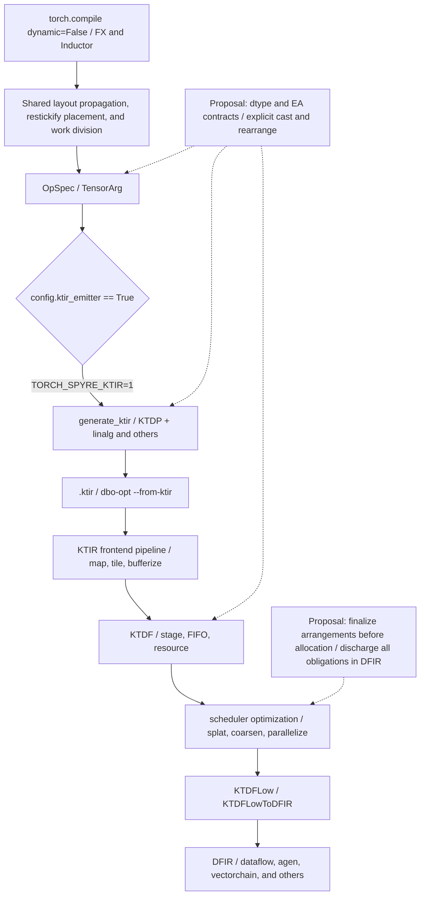
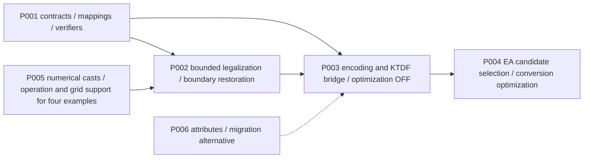

# Element Arrangement: Design Investigation and Optimization Proposals from KTIR to DFIR

## 1. Summary of Design Decisions

**Retain EA as a mapping between logical elements and their runtime arrangement, separate from numerical dtype, and represent arrangement-changing operations explicitly. The leading medium- to long-term candidate uses builtin tensor encoding in KTIR and combines that encoding with verified attributes at buffer/FIFO boundaries in KTDF. Keep EA-only conversions and numerical casts as separate operations. In KTDF, expose resource and type-width requirements by pre_scheduling, finalize the arrangement plan after TileSizeSelection and before allocation, and expand it into concrete instructions in KTDFLowToDFIR.** Add no new EA-specific instructions or attributes to Dataflow/DFIR.

Start with the smallest part of this design in the short term. First establish boundary contracts and verifiers that distinguish logical dtype, device format, EA, valid lanes, and owning cores (EA-P001), and implement numerical cast support and bounded restoration to STANDARD (EA-P002). Then proceed to information preservation across KTIR and KTDF (EA-P003) and arrangement selection that accounts for multiple uses (EA-P004). Manage the numerical, operation, and grid support required to run the four examples in parallel under EA-P005. **Adding EA tags alone, adding cast recipes alone, or supporting restickify alone is insufficient to accept all four examples.**

Here, S=STANDARD, U=DL16_TO_FP32, and D=FP32_TO_DL16. These abbreviations are not hardware EA numbers.

|Decision|Recommendation and rationale|Conditions and minimum validation that could change the decision|
|---|---|---|
|What EA represents|A value-representation contract with separate fields for position mapping, packing, and valid/replicated lanes. Verify its relationship to geometry, dtype, and core ownership without treating them as equivalent. Current EXX2 packs two statistics, so a permutation-only type is insufficient. [S3][S4][F6]|Verify mappings, inverse mappings, and padding using labeled inputs of 64/32 elements. Reject undefined mappings.|
|Where to select EA|Pass existing constraints and fixed boundaries through OpSpec. Select candidates across operations in KTIR, then legalize them for resources and tiles in KTDF. Resolve undecided EAs and capacities before allocation; already-planned shuffle obligations may remain until KTDFLowToDFIR. [S1][D1]|If information-preservation tests through bufferization, coarsening, and FIFOs fail, the fallback configuration must concretize the required STANDARD normalization by the KTIR boundary.|
|Casts and EA conversions|A cast defines logical numerical semantics; an EA conversion changes the positions of the same values. Keep these meanings separate in IR even when hardware `dl16tofp32` performs both. [S5]|Validate casts among bf16/df16/f32, including rounding, overflow, and NaNs. The existence of `vectorchain.cast` alone does not establish implementation support. [D5]|
|Basis for optimization|Apply transformations after proving identity, composition, and dominance properties of pure rearrangements and the operations' index mappings. Preserve floating-point reduction order and cast rounding independently.|The cast positions in A/B cannot be exchanged. A CPU counterexample gives A=1.5 and B=1.5078125 (§8).|
|Dataflow constraint|Concretize EA through existing `dataflow.get_logical_memory_view`, send/receive, `agen`, `vectorchain.shuffle`/cast, and related operations. Existing splat lowering provides a limited demonstration. [D3]–[D6]|Do not claim general conversion support until every column of U↔S and D↔S is validated on hardware. Implement backend numerical semantics using existing cast/opaque or other operations if needed. Cases whose connection to those representations cannot yet be demonstrated remain conditional; do not fill the gap by extending Dataflow.|

The recommendation is conditional. Adopt the user-specified future premise that **triton#229 means downstream restickify is available for fp16, dlfloat16, float32, int16, and int32**. Do not infer supported arrangement pairs, shapes, alignment, same-core conditions, costs, or numerical type conversions from that premise. EA-P005 uses the separate premise that numerical type conversions can be implemented downstream.

Execution conclusions are stated separately. All of Appendices A–D stopped during compilation in local runs using the baseline Python source (§8). The first failure points were missing cast recipes for A/D, a grid mismatch for B, and a pre-KTIR stick-compatibility problem for C. In contrast, 191 existing KTIR unit tests and compilation of an existing add example through KTIR→KTDF→DFIR→SpyreCode succeeded. **Numerical agreement on hardware for the four examples, performance improvements from EA optimization, and a toolchain configuration matching all baseline commits remain unverified.**

## 2. Overall Approach and Processing Overview

First establish a contract that lets downstream stages interpret existing upstream layout decisions unambiguously, without immediately redesigning that selection. Then extend arrangement-selection freedom into KTDF. Do not add or remove numerical type conversions for performance reasons; compare costs only among legal arrangement candidates.



Solid lines show the path verified in source; generated IR also confirmed the connection for the existing add example. Dotted lines indicate new proposals. The diagram does not claim that the four examples passed through E–K. The detailed SDSC path is omitted, but B is shared code also used by KTIR and is therefore included in the investigation.

|Stage|Input→output / information retained|EA responsibility and boundary|Owner and key symbols|
|---|---|---|---|
|Shared Inductor passes|Loop IR→IR with `SpyreTensorLayout`: shape/stride, device format, EA candidates, allocation/core|Currently, cast EA transitions, broadcast compatibility, and restickify feasibility are decided upstream. The proposal fixes numerical semantics and legality first|torch-spyre: `_single_arg_op_layout`, `_multi_arg_pointwise_layouts`, `compute_restickify_needed`, `beam_global_min_cost` [S6]–[S8]|
|OpSpec|`OpSpec`/`LoopSpec`, per-argument device_size/coordinates/format/EA/allocation, grid and ownership|Current TensorArg lacks logical dtype and cast-rounding contracts; EA-P001 adds them. Distinguish fixed HBM boundaries from changeable internal EAs|torch-spyre: `SpyreOpFuncs.to_dtype`, `create_tensor_arg` [S2]–[S5]|
|KTIR generation|OpSpec→plan→MLIR text: memref views, access tiles, tensor SSA, linalg/spyreop|Currently accepts only STANDARD and certain other arrangements; staggered arrangements are rejected. EXX2 uses fused element types. The proposal uses tensor encoding and explicit conversions|torch-spyre `build_kernel_plan`, `KtirBuilder`; frontend KTDP/SpyreOp definitions [S9][F1]–[F8]|
|KTIR→KTDF|KTIR→mapped/tiled/bufferized pipelines, stages, and FIFOs|Existing bufferization does not guarantee encoding preservation. EA-P003 adds verified transfer of information from tensors to memrefs/FIFOs|dataflow-scheduler: `KTIRMapAndTile`, `KTIRBufferize`, `KTIRPipeline` [D1][D2]|
|KTDF optimization|Resources, transfer paths, FIFO capacities, tensors/memrefs, splat obligations, tiles/loops|The proposal retains legal EA candidates and selects after paths/widths are determined. Numerical casts retain their original positions relative to reductions/promotions|scheduler: `MaterializeRegisters`, `SplatLegalizationPass`, coarsening, and others [D1][D3]|
|KTDFLow→DFIR|Concrete resources and linalg, etc.→Dataflow programs|Leave no abstract EA. Concretize it as existing address maps, vector/register arrangements, and transfers/shuffles. Lower numerical casts under a separate contract|scheduler: `KTDFToKTDFLowering`, `KTDFLowToDFIR`, `LowerReadFromFifoPattern` [D4]|
|After DFIR|DFIR→backend artifact|This investigation ends at DFIR generation. SpyreCode generation for the existing add example strengthens the connection evidence; it does not prove output accuracy for the four examples|The dialects repository defines DFIR|

## 3. Investigation Targets, Baseline Commits, Environment, Target Path, and Terminology

### 3.1 Baseline Commits and Acquisition Conditions

Local source was obtained for all repositories, and related issues/PRs were consulted through the GitHub API. No repository was selected solely from a remote HEAD. The local paths below are relative to the common prefix `/home/ishizaki/aiu-src/dt-agents/`. Source at the baseline SHAs was read with `git show` or `git archive`, excluding uncommitted changes.

|Repository / source (GitHub organization: torch-spyre)|Baseline: full SHA|Reference and local state|Selection rationale and consistency with torch-spyre|Baseline recorded, UTC|
|---|---|---|---|---|
|[torch-spyre](https://github.com/torch-spyre/torch-spyre) / `torch-spyre`|`64870622fc39cda7e344a271decb901e7088c6c6`|main; HEAD matches the baseline. Two tracked modifications plus untracked documents and other files|HEAD at investigation start. Existing changes in `pass_utils.py`/`test_restickify.py` preserved; executed Python came from the baseline archive|18:50:38|
|[RFCs](https://github.com/torch-spyre/RFCs) / `RFCs`|`f4f8efd13578b4fe9de70f3f946f751fc32e4b3b`|KtirSpec_for_td; HEAD matches the baseline. Nine untracked KTIR documents|No pin; local HEAD used as a reference version. Branch predates addition of the EA RFC. Later PR material treated separately|18:51:10|
|[triton](https://github.com/torch-spyre/triton) / `triton`|`77984beaaf253d6636da8f1a4f7acd0f32838e93`|main; HEAD matches the baseline. Tracked files clean; untracked documents, scripts, and other files|No direct torch-spyre pin; local HEAD used as a reference version. Not the frontend executed on the target path|Around 18:54|
|[ktir-mlir-frontend](https://github.com/torch-spyre/ktir-mlir-frontend) / `ktir-mlir-frontend`|`1f96e5790a99b7aaf9a445b039044467c66e4e0a`|main; local HEAD=`ed47a3ff691e49f30e4a49e75d7ac19995cff2ea`; clean|Prioritized the version specified by torch-spyre `tools/ktir-mlir-frontend.pin`. Source correspondence verified; installed-build correspondence unverified|18:51:10|
|[dataflow-scheduler](https://github.com/torch-spyre/dataflow-scheduler) / `dataflow-scheduler`|`8893e6c62a8e3cbe159f4e8b446c1ca9b42db2da`|main; HEAD matches the baseline; clean|Direct pin unknown; local HEAD used as a reference version. Specifies gitlinks for the two repositories discussed below|18:53:32|
|[dataflow-scheduler-mlir-dialects](https://github.com/torch-spyre/dataflow-scheduler-mlir-dialects) / directory of the same name|`c3066e3f8d24168765fe25d541136979b6dd1d8b`|main; local HEAD=`a55523e23abaf6d76c243da4c074ed4ac0686c90`; KTDFArchIntrinsics.td modified|Prioritized the scheduler gitlink. Source correspondence with the scheduler verified; overall correspondence with torch-spyre unverified|18:53:33|

The scheduler's frontend gitlink is `0a4601d7bdba3df33bee7b5a3ab9c18e42930a1a`. It differs from the torch-spyre pin in only two files, concerning Python enum TD references and tests; the C++ dialect definitions and conversion code were identical. This is strong compatibility evidence, but not proof of matching builds for the entire package. Triton's frontend gitlink, `ed47a3ff691e49f30e4a49e75d7ac19995cff2ea`, is a different version. [S10][F10][T1]

### 3.2 Execution Environment and Applicability

|Item|Verified details|Applicability|
|---|---|---|
|Python|3.12.15; `/home/ishizaki/aiu-src/dt-agents/.venv/bin/python3`|Used the existing environment; no installation changes|
|PyTorch|`2.13.0+cpu`; git=`cf30153c4c131c8164ee7798e5022d810682e2cb`|Version series matches the `torch~=2.13.0` requirement. PrivateUse1 Spyre is registered even with a CPU build|
|torch-spyre|Installed distribution=`0.6.0.dev331+main.g64870622`; editable local repository|Prioritized Python from the baseline archive at `/tmp/ea15-research/torch-spyre-base`. Only `_C.so`/`_hooks.so` were linked from the existing build. Exact C++ build reproducibility unverified|
|Frontend Python|Distribution name `ktir-mlir-frontend 0.1.0`; import name `mlir_ktdp`|direct_url points to triton/third_party/spyre/ktir-mlir-frontend. No SHA recorded. Missing `mlir-ktdp` metadata does not mean the package is absent|
|ktir-opt|frontend/build/bin; LLVM22.1.2 with assertions|CMakeCache points to a separate `dt-inductor` source directory. Pin match unknown; used only for syntax validation|
|Execution settings|`TORCH_SPYRE_KTIR=1`; normally `SENCORES` unset, meaning 32; `dynamic=False`; cache/debug output under /tmp|Read `config.ktir_emitter=True` and observed A/B/D reach the `generate_ktir` call. C stopped before it|
|Device|`torch.spyre.is_available()`=True; ran all four examples, including input transfers|None of the four examples completed compilation or reached numerical validation of a device kernel|

The existing worktree state was preserved in `status-before.txt`, a tracked diff, and SHA256 hashes for 219 modified/untracked files. Earlier EA reports were not used as primary evidence. Work proceeded under the policy of making no repository changes outside the deliverables.

### 3.3 Target-Path Selection and Connections

`config.py:117–121` evaluates `os.environ.get("TORCH_SPYRE_KTIR", "0") == "1"` at import time. Neither `"true"` nor changing the environment after import is equivalent. `define_kernel` in `scheduler.py:648–667` selects `method = "ktir" ... else "sdsc"` and emits `async_compile.ktir(...)` into the wrapper. `SpyreAsyncCompile.ktir:615–678` calls `generate_ktir` and saves `.ktir`. `_compile_ktir_with_dbo:680–740` executes `dbo-opt --from-ktir [--device=...] --export-dir=... --kEmitSpyreCode file.ktir` and checks `spyreCodeDir/spyrecode.json` as well as the return code. [S1][S1b][S2]

`generate_ktir` follows `build_kernel_plan`→`KtirBuilder.create`→MLIR generation; the plan also contains rejection checks before dialect import. A's observed failure therefore occurred neither in the MLIR parser nor in the backend. `bake_addresses` is a call-boundary workaround originating from scheduler#65, not EA itself. [S9][I-D65]

Triton is a separate frontend with `ttir→ktir→spyrecode` stages and the same `dbo-opt --from-ktir` invocation. There is no evidence that the target OpSpec path passes through Triton; torch-spyre's `SpyreAsyncCompile.triton` also raises an unimplemented exception. Triton is relevant as a source for investigating shared KTIR, backend capabilities, and issues. [T1][S11]

### 3.4 Terminology and Claim Categories

This report uses seven evidence categories: **[Implementation]** baseline code, **[Execution]** observations from this investigation, **[Design documentation]** RFCs, **[Discussion]** issues/PRs, **[Analysis]** inferences from that evidence, **[Proposal]** new designs, and **[Unverified]**. Use these together with citation context and the tables' validation categories.

|Term|Meaning and distinctions in this report|
|---|---|
|Logical tensor|PyTorch shape, index set, dtype, and the numerical value at each index. Physical padding is not a logical element|
|Geometry|The correspondence between logical axes and multidimensional device coordinates, expressed through device_size, stick-splitting axes, stride_map, and related information. Includes tiling at a coarser granularity than EA|
|Layout|An umbrella term that can include geometry, dtype, EA, memory space, and other information depending on context. `SpyreTensorLayout` and an MLIR memref layout are not the same structure|
|EA|Describes where elements/payloads reside in sticks, lanes, and similar locations. Inclusion of validity/replication is part of this report's proposed contract; the current enum alone does not contain that information. The current enum mixes conversion-derived order, EXX2 packing, QFP8, and other concepts|
|Packing|Combining multiple payloads or elements of different widths into storage units. An EXX2 statistics pair is not a pure permutation of the same shape|
|Permutation|A one-to-one change in the positions of the same set of logical values. Padding, replication, and differing payload counts require separate conditions|
|Numerical type conversion|An operation that changes a value's representation, range, precision, or rounding. `bf16`, `!spyreop.df16`, and IEEE f16 are distinct numerical types|
|EA conversion / rearrange|An operation that changes arrangement without changing logical numerical values. It is not merely retagging or a type cast|
|Restickify|In existing documentation, data movement that changes the stickification axis or layout. This is not synonymous with the ability to change order within an EA. Future support extends only to the user's premise plus explicitly stated additional conditions|
|Shuffle|A concrete lane-selection/replication operation in existing vectorchain. Not synonymous with a general rearrange across multiple cores and arbitrary shapes|
|Grid / ownership|Parallel kernel instances and the index set handled by each core. Matching EA does not permit direct sharing when owning cores or FIFO order differ|
|KTIR|Kernel tile IR composed of KTDP, standard dialects, SpyreOp, and others. It is not a standalone `ktir` dialect|
|KTDF|The Kernel Tile Dataflow `ktdf` dialect: pipelines, stages, FIFOs, tokens, transfers, and others. Defined in the dialects repository; transformed by the scheduler|
|DFIR|Final Dataflow IR, including `agen`, `vectorchain`, `uniform`, `symbol`, and others in addition to `dataflow`. The fixed constraint requires concretization through these existing representations without introducing EA extensions|
|Candidate set|A finite set of legal EAs satisfying a value's logical semantics and boundary conditions. This report uses this term instead of introducing an undefined “domain”|

Numerical type is a separate axis. In `types_mapping.h:65–72`, PyTorch bfloat16 has CPU format BFLOAT16 and device format SEN169_FP16. [S3b] The frontend's `!spyreop.df16` is 1/6/9, whereas bf16 is 1/8/7. Furthermore, the current KTIR emitter spells SEN169_FP16 as `f16`. **This f16 notation is an alias used by the current emitter, not numerical equivalence among IEEE fp16, bf16, and df16.** [S3b][S9][F6]

## 4. Analysis from Eight Viewpoints

Because only viewpoints 1–7 were numbered and described in the request, viewpoint 8 is defined here as “Short-Term Improvements and Acceptance Validation.” This assumption covers both short- and medium- to long-term design decisions; it does not expand the scope.

### 4.1 Viewpoint 1: Why EA Is Necessary

[Implementation / Design documentation] A 128-byte stick contains 64 elements at 16 bits or 32 elements at 32 bits. A 16→32-bit conversion requires twice the capacity for the same number of logical elements, and hardware lane grouping need not match contiguous logical order. `DtypeOpTable._EA_MAP` retains the resulting state. Even with correct geometry, losing the order within sticks can multiply the wrong broadcast columns or return the wrong lanes to the CPU. [S5][R5]

Geometry example (an existing RFC example restated as equations): placing a logical `[1024,256]` f16 tensor in device `[4,1024,64]` gives:

```text
logical index       (row, col) = (j, 64*i+k)
device coordinates  (i, j, k)
device element addr i*65536 + j*64 + k
host element addr   j*256 + i*64 + k
```

These equations describe stick partitioning and axis order, which are distinct from permutation within an EA. [R3]

The current `stagger_to_standard_ea` contains a formula **only for the FP32_TO_DL16 side**: for physical lane `p=8*k+w`, the logical lane is `4*k+w` (w<4) or `4*k+w-4+32` (w≥4). [S12]

```text
physical lane   0  1  2  3 | 4  5  6  7 | 8  9 10 11 |12 13 14 15 ...
logical value   0  1  2  3 |32 33 34 35 | 4  5  6  7 |36 37 38 39 ...
                 group 0    group 8       group 1      group 9
```

[Execution] Expanding this formula to 64 elements on the CPU confirmed that every element appears exactly once. This was not a hardware measurement across all shapes. Do not derive the DL16_TO_FP32 correspondence across two sticks solely from this inverse mapping. RFC PR39 describes distribution across two sticks in groups of four elements, but that description is part of an OPEN design discussion. [R7][I-R39]

[Design documentation] The older EA RFC proposed using fp32 only in temporary intervals, canceling stagger by returning to the original 16-bit format. Based on reports that rearrangement is available, the newer PR39 proposes changing the RFC policy to make those intervals a performance choice. This design shift corresponds to the need to handle not only round trips such as A/B, but also D's fp32 output and C's computation starting in fp32. Neither the older nor the newer RFC justifies freely moving floating-point casts. [R5]–[R8]

### 4.2 Viewpoint 2: Issues and Invariants

|Issue ID|Concrete example / conditions|Required invariant / impact if violated|
|---|---|---|
|EA-I001 Confusion between numerical formats|bf16→f32 in A/B/D; f32→bf16 in C|Distinguish logical dtype, device format, and rounding. Losing this distinction replaces a bf16 cast with df16 rounding and changes A/B semantics|
|EA-I002 Insufficient EA mapping and validity information|U=`DL16_TO_FP32`, D=`FP32_TO_DL16`, EXX2, partial sticks|The valid payload for every logical index must be reachable without omissions, duplicates, or padding contamination. Define EXX2's two values as separate payloads|
|EA-I003 KTIR rejection of casts/EAs|A `[1,128,4096]`; D `[128,128]`|Cast schemas for multiple dtypes, legal EAs, and lowering must be consistent. Adding recipes alone leaves `dtype_of` and layout rejections unresolved|
|EA-I004 Broadcast/reduction joins|Row scalars and column weights in A/B; C `[1,128,1]×[64]`|Operate on lanes corresponding to the same logical index. A scalar shape does not necessarily imply replication to every lane. Preserve reduced axes and operation order|
|EA-I005 Geometry, cores, and grids|B's standalone cast of weight `[4096]` and activation computation across 32 cores|Match shared values' index sets, core ownership, and FIFO order. Matching EA alone does not justify fusion into one kernel|
|EA-I006 Prohibition of non-STANDARD restick|A stick-axis change is required for U/D|Prove EA after the arrangement change; do not erase information by assigning default STANDARD to the target|
|EA-I007 Host/output boundaries|C's 16-bit D output; D's fp32 U output|Guarantee logical order and dtype as observed through D2H. An output EA tag alone does not repair the data|
|EA-I008 Information loss across dialects|KTDP load, tensor→memref, FIFO read/write|Revalidate producer/consumer EA, shape, format, and bytes. An attribute round trip alone does not guarantee semantics|
|EA-I009 Missing numerical lowering|df16↔f32, bf16 rounding, i32→f32, f32 trig/reduce|Implement and validate numerical operation semantics and EA transitions independently. The restickify premise is not a substitute|
|EA-I010 Insufficient basis for performance selection|Rearrangement fan-out, LX/HBM, matrix-based restoration|Separate legality from cost. Evaluate affected bytes, live ranges, allocation, and transfer units as well as conversion counts|

U/D in the table are abbreviations used in this report, not hardware EA numbers. Do not map the current Python enum's integer values to external terms such as EA8 without evidence. [S3]

[Proposal] Conceptually define a value contract as `(logical_shape, logical_dtype, storage_format, geometry, ea_order, payload_packing, valid_lanes, replication, ownership)`. Memory addresses are a further concretization of that contract. Every producer–consumer edge must either (1) permit direct consumption in the same representation, (2) insert a proven conversion, or (3) be rejected as unsupported. Performance search considers only legal candidates obtained through (1) and (2).

### 4.3 Viewpoint 3: Current Solutions and Tracing the Four Examples

[Implementation] EA participates in `SpyreTensorLayout` equality/hashing and passes through `create_tensor_arg` into OpSpec. [S5c] For casts, `SpyreOpFuncs.to_dtype` selects the hardware operation name through `DtypeOpTable`; layout propagation uses `rescale_stl_for_dtype` to adjust stick depth 64↔32 and outer dimensions. After EA and geometry propagate through each operation, the shared restickify optimizer compares candidates. [S3]–[S8]

|Numerical conversion|Input EA|Output EA (current EA map)|
|---|---|---|
|16-bit formats→f32 `dl16tofp32`|STANDARD|U|
|16-bit formats→f32 `dl16tofp32`|D|STANDARD|
|f32→16-bit formats `fp32todl16`|STANDARD|D|
|f32→16-bit formats `fp32todl16`|U|STANDARD|

This table does not permit omitting a cast's numerical operation. Source/destination element widths, required capacities, and rounding change even when EA is the same. [S5]

[Implementation] In KTIR, `_arrangement_layout` accepts extents/strides for STANDARD, QFP8CH, and EXX2. `ElemTypes` maps EXX2 to types such as `!spyreop.fp16_fused`. U/D are rejected. [S9c] `ktdp.construct_memory_view` interprets existing memory, `construct_access_tile` enumerates index coordinates, and `load` obtains a tensor value. None rearranges data merely by attaching an EA tag. [S9][F1]–[F6]

The four examples are traced below. `S` denotes STANDARD; `R` denotes a reduction result's “valid value per row” (a schematic symbol in this report, not a current enum value). Do not interpret `R` as replication to every lane. The OpSpec sequences for A/B/D were collected during this investigation; no KTIR or later IR was generated for C.

|Example|Numerical order confirmed on CPU|OpSpec and EA trace|Current first failure point|
|---|---|---|---|
|A Granite|`x→f32→square→mean→eps→rsqrt→normalize→bf16→weight multiply`|`dl16tofp32 S→U; mul U; mean→S/R; add; rsqrt; mul(U,R)→U; fp32todl16 U→S; mul(S,S)`|dl16tofp32 is unregistered in `_stages`. No KTIR text generated|
|B GptOss|After A's normalization, promote weight to f32, multiply, then convert to bf16|A's first half plus weight `dl16tofp32 S→U`, `mul(U,U)`, `fp32todl16 U→S`|`_divisions` on 32 cores. Weight cast is undivided; activation c0 is divided into 32 parts. With one core, proceeds to the unregistered-cast failure|
|C RoPE|positions i64→f32, multiply by f32 inv_freq, cat, cos/sin, scale=1, convert each output to bf16|Expected: device i32→f32 S, f32 S computation, output cast S→D, restoration D→S. This is an unexecuted design trace|`beam_global_min_cost` stops because it finds no stick-compatible solution for buf1. Does not reach generate_ktir|
|D Softmax|bf16→f32, max/sub/exp/sum/div, return f32|`dl16tofp32; max; sub; exp; sum; realdiv`. U interval with row reduction/broadcast; U may remain at the end|dl16tofp32 is unregistered. Adding a downcast to the fp32 output is not an acceptable fix|

The cast portion of the OpSpec actually collected for A (**runtime repr reduced to the necessary fields; a Python data representation, not MLIR**):

```python
OpSpec(op="dl16tofp32",
       iteration_space={c0: (128, 32), c1: (4096, 1)},
       args=[
           TensorArg(device_dtype=DataFormats.SEN169_FP16,
                     device_size=[128, 64, 64],
                     element_arrangement=ElementArrangement.STANDARD),
           TensorArg(device_dtype=DataFormats.IEEE_FP32,
                     device_size=[128, 128, 32],
                     element_arrangement=ElementArrangement.DL16_TO_FP32),
       ])  # Required constructor arguments omitted in this abbreviated display
```

A's mean has `scaling_factor=0.000244140625=1/4096`. Its input EA was U, output EA was STANDARD, and output coordinates were `[0,c0,0]`. After the normalization multiplication, device geometry changes to `[floor(c1/32),c0,Mod(c1,32)]`, so EA alone cannot replace address calculation. B's weight-cast iteration_space is `{c0:(4096,1)}`, which does not require the same grid as the other operations' `{c0:(128,32),c1:(4096,1)}` (§8).

For C, the appendix program itself takes precedence as the specification. Input x is bf16, but its values are unused; it supplies dtype/device. `position_ids` is int64, and the `inv_freq` buffer is float32. These were not changed to satisfy the general “bf16 weights” condition. D returns float32; `check_dtype=False` does not authorize reducing the future implementation's output to 16 bits.

An existing positive example was traced through add. The following is an **excerpt of DFIR generated during this investigation**; the enclosing program/unit, including value definitions, is omitted. There are no new EA instructions or attributes.

```mlir
%41 = dataflow.get_logical_memory_view %32, %40
  {layout_map = affine_map<(d0, d1) -> (d0 * 64 + d1)>}
  : index, index, memref<96x64xf16>
// Computation in a separate program_unit. SSA numbers are unchanged from the generated output.
%39 = dataflow.receive %38 : vector<64xf16>
%42 = dataflow.receive %41 : vector<64xf16>
%43 = vectorchain.binary %39, %42
  {binary_op = #vectorchain<binary_operator add>,
   op_specific_map = affine_map<(d0) -> (d0)>}
  : vector<64xf16>, vector<64xf16>, vector<64xf16>
dataflow.send %45, %43 : vector<64xf16>
```

### 4.4 Viewpoint 4: Difficulties Created by the Current Solutions

**(a) One-op/one-format dispatch conflicts with the nature of conversion (EA-I001/I003).** `dtype_of` requires the set of all TensorArg formats to contain exactly one member. [S9b] This is useful for ordinary same-type addition, but casts have different source and destination formats. Exempting casts from the check without giving them a dedicated schema could incorrectly allow incompatible broadcasts or output widths. Conversions need a contract that verifies `(input formats, output format, EA transition)`. [S9]

**(b) Geometry and EA propagate separately, but construction of a conversion target can drop EA (EA-I002/I006).** `compute_restickify_needed` marks non-STANDARD inputs infeasible. Because the target constructor defaults to STANDARD, simply removing the guard can generate wrong code. In outer-product broadcasts such as C, the two inputs have different stick axes and cannot join even with the same dtype. The user's downstream restickify premise still requires an explicit update to this upstream legality model. [S8]

**(c) Scalar shape cannot express valid lanes (EA-I004).** Current `replicated_scalar` proves that the producer filled the entire stick. This differs from a buffer with only one reduction value in lane0. Labeling EA only as `S/U/D` can cause a broadcast of a reduction result to read unspecified lanes. Downstream `read_from_fifo.splat` is a useful existing example of retaining this missing replication until concretization, but is not a general mechanism for all EAs. [S4][D3]

**(d) A tensor type alone cannot carry the information through later stages (EA-I008).** The KTDP load builder constructs a RankedTensorType without encoding. KTIRBufferize creates memrefs, and KTDF distributes meaning across tensors/memrefs/FIFOs/resources. Even an encoding-based design loses the meaning unless it extracts and preserves it at boundaries. Conversely, operation attributes alone can easily produce inconsistencies at block arguments, region yields, and multiple consumers of one value. Both approaches need verifiers and conversion interfaces. [F5][D2]

**(e) Concretizing too early loses optimization opportunities, but concretizing too late also breaks correctness (EA-I010).** Normalizing every edge to STANDARD in KTIR hides cancellation of round trips through A/B's U intervals and opportunities to convert the smaller weight operand. Deferring arrangement changes until after scheduling alters FIFO capacities, transfer widths, live ranges, and LX allocation, invalidating finalized plans. The recommended design therefore narrows candidates at tensor level, presents KTDF resource candidates by pre_scheduling, and finalizes arrangements in post_scheduling after TileSizeSelection, following coarsening and related passes. [D1]

Current versus proposed behavior (**schematic IR with a new specification, not current generated output**; numerical semantics and result-arrangement contracts are defined in §5.1):

```mlir
// The current implementation generates no MLIR at this stage; it rejects the OpSpec cast.
// The proposal separates numerical semantics and arrangement. #ea.layout and ea.* are new specifications.
%f = "ea.numeric_cast"(%x) {rounding = "exact_extension"}
  : (tensor<64xbf16, #ea.layout<S>>) -> tensor<64xf32, #ea.layout<U>>
%s = "ea.rearrange"(%f)
  : (tensor<64xf32, #ea.layout<U>>) -> tensor<64xf32, #ea.layout<S>>
```

### 4.5 Viewpoint 5: Unsupported and Unresolved Cases

|Category|Issue and triggering conditions|Evidence and impact|Baseline implementation versus discussion|
|---|---|---|---|
|Execution in this investigation + code|EA-I003: dl16tofp32 in A/D|Unregistered-operation rejection in `_stages`; no KTIR text|Reproduced. Subsequent mixed-format/EA rejections verified statically|
|Execution in this investigation + code|EA-I005: B's 32 cores and weight cast|`_divisions` rejects the grid mismatch. With one core, the cast is rejected|Reproduced. Not an execution result showing numerical error or an EA permutation|
|Execution in this investigation + code|EA-I004/I006: C's fp32 outer product|The two inputs of buf1 require conflicting stick axes; beam frontier is empty|Reproduced layout-legality failure. Does not prove whether generic trig works|
|Verified in code|EA-I003/I009: cast, mean, and restickify recipes|Collected A contains mean, but the registry does not. Three cast kinds and ReStickifyOpHBM are also unregistered [S9e]|Subsequent blockers. Conditions for upstream decomposition of mean into sum+scale or similar operations, and its numerical order, require examination|
|Verified in code|EA-I006: non-STANDARD restick|Infeasible at `compute_restickify_needed:2554–2560`|#5729 OPEN. Simply removing the guard is not an acceptable fix|
|Reported; not reproduced at the baseline|EA-I007: staggered values reordered during D2H|torch-spyre#4393 OPEN; report of 207/256 positions differing at another commit|This investigation stopped earlier and obtained no D2H output. A closed issue or the existence of a PR does not establish resolution|
|Report + static concern|EA-I002/I004: EA lost during nonstick reduction|#5553 OPEN; EA propagation in reduction-output constructors needs cross-checking|Distinct from the scalar of a full-stick reduction. Copying input EA to every reduction output would also be incorrect|
|Reported; not reproduced|EA-I002: partial-stick masks|#4014 OPEN; existing EA tests include widths 4100/68/196 and others|An xfail itself is not evidence. Rerun with labeled inputs and tails|
|Verified in code|EA-I009: emitting standard arith casts directly|Scheduler legality/linalg lowering lacks ExtF/TruncF/SIToFP support [D7]|Changing the notation to standard operations alone does not make it work|
|Code + discussion|EA-I009: reduction initial values|The current special contract lets the backend treat empty as a neutral value. Explicit fill is absent from the allowlist|The old zero-init/maxnumf reports in #82 OPEN are fixed at the baseline. Distinguish those from unresolved parts [I-D82]|

The existing restoration custom op (#3423 CLOSED, PR3571 MERGED) is present at the baseline, but uses matmul with an N×N permutation matrix and restricts N to multiples of 64. At N=4096, the 16-bit matrix alone occupies 32MiB, and the multiplication has the scale of an ordinary dense matmul. This is a static capacity calculation, not measured execution time. Effects such as NaN×0 mean that it is not a substitute for an EA conversion that preserves bits for all numerical values. [S12][I-S3423]

### 4.6 Viewpoint 6: Dialect Representation and Lowering Policy

All candidates are compared using the common example and conditions in §5. **How information is carried and which operation transforms actual data are separate choices.** Neither operations alone nor types alone satisfy every requirement. A new type/encoding does not move data, and an explicit rearrange cannot be verified without source/destination EA contracts.

Candidates retaining EA only in KTIR must concretize every conversion by the KTIR→KTDF boundary. Candidates retaining it in both KTIR and KTDF must preserve information across buffer/FIFO boundaries, resolve undecided arrangements before allocation, and discharge planned obligations by DFIR output. In either case, an approach requiring new Dataflow instructions or attributes fails the acceptance conditions.

### 4.7 Viewpoint 7: Medium- to Long-Term Improvements

Separate EA-P003, the representation infrastructure, from EA-P004, the optimization. First make numerical and arrangement contracts verifiable through EA-P001/P005, then verify an identity round trip through KTDF that preserves EA, and only then move conversions. Do not introduce a global solver and new types across all dialects simultaneously at the outset. Epic/sub-issue/PR decomposition and concrete per-input conditions are consolidated in §7.

### 4.8 Viewpoint 8: Short-Term Improvements and Acceptance Validation

In the short term, adopt EA-P002's bounded STANDARD boundaries. Do not make “STANDARD before and after every operation” a fixed specification. Retain legal U intervals in A/B and restore only at consumers or host boundaries requiring a different EA. Continue rejecting arrangement pairs without proven downstream support, with diagnostics including logical shape, source/destination EA, dtype, and core conditions.

Acceptance requires both comparison of the four examples **against their own CPU results individually** and inspection of numerical cast positions, valid lanes, and dtypes in IR. Agreement within tolerance alone is not proof that a cast may move. Incorporate the original four programs into permanent integration tests; implementation PRs must include shard registration, `make check-all-configs`, relevant pre-commit checks, one-core/32-core runs, and combined runs. No compiler code or tests were added in this work.

## 5. Detailed Comparison of Design Candidates and Adoption Decisions

### 5.1 Common Specification and Evaluation Conditions

Everything in this section is [Proposal / Analysis]. H1–H11 are design-candidate IDs; EA-P001 and similar identifiers are implementation-proposal IDs. Do not assume different backend capabilities or numerical precision for different H candidates.

The five mandatory conditions are: (G1) preserve original numerical semantics and rounding positions; (G2) make EA/conversions/validity verifiable; (G3) integrate into the verified target path; (G4) add no new EA-specific instructions or attributes to DFIR; and (G5) state additional backend conditions explicitly. Numerical cast support, operation support for the four examples, and grid fixes are common costs for every information-carrier design and must not be excluded selectively.

**New IR specification EA-v1**: the following proposals are not implemented in the current dialects.

- Use `#ea.layout<S>`, `<U>`, `<D>`, and `<R>` as builtin RankedTensorType encodings. S denotes canonical logical order, U/D the conversion-derived orders in §4.3, and R a valid scalar per row. These labels are abbreviated syntax for explanation. The implementation must carry a version, group width and phase, logical-to-slot mapping, validity, and packing, and verify compatibility with dtype/shape/ownership. Complete hardware mappings for U/D are established at the EA-P001 gate. R contains one valid scalar per row and permits both keepdim `...x1` and rank-reduced shapes with an explicit reduced-axis correspondence. It does not imply replication to every lane.
- `"ea.numeric_cast"(%x) {rounding = "rne"}` is a numerical conversion preserving shape and logical indices. Source/destination types specify logical dtype and EA. The formal schema also includes integer-input signedness, overflow, NaNs, and subnormals. Require exact bf16→f32 extension and round-to-nearest-even for f32→bf16. A hardware-specific EA change may be realized simultaneously through a verified mapping.
- `"ea.rearrange"(%x)` preserves logical shape/dtype/payload, changing only the encoding. It is pure for tensor values; a memref version explicitly states read/write effects and aliasing. The verifier checks identity of every valid element, required replication, padding, and group boundaries. Do not use `tensor.cast` or `builtin.unrealized_conversion_cast` as actual data movement.
- The proposed ea dialect is a shared namespace loaded by KTIR and KTDF. The implementation may share frontend EA attribute/operation definitions on which the scheduler depends, or use two operations in KTDP/KTDF with shared attributes. Dataflow does not depend on it.
- `ea.payload` is a new attribute representing the EA contract of the actual buffer/FIFO payload. Cross-check the producer's write-input encoding, actual column order/validity, and consumer read-result encoding. A read cannot change arrangement merely by declaring it; any conversion is recorded as a separate source/result obligation.
- In the operation-only H1/H6 approaches, `src_ea/dst_ea` on the new operations express the same contract. In the H2/H7 attribute approaches, `ea.operands` and `ea.results` follow operand/result order; `ea.source`→`ea.result` expresses a read's conversion obligation; and function arguments use `ea.value`. A value's actual EA and a use's requirement are distinct; when they differ, a legalization pass inserts a conversion. Attaching an attribute is not itself data movement.

The common OpSpec example **O** below isolates “extension of a 16-bit input, 32-bit computation, and STANDARD normalization at a boundary,” as found in the four examples. All H candidates are compared using the same `64` input elements and the same dtype/mapping/consumer conditions. Section 5.4 compares the differences: STANDARD normalization may be omitted inside A/B, C uses the reverse direction, and D needs it at the output.

```python
# Abbreviated explanatory OpSpec. A new specification adds logical_dtype/rounding in EA-P001.
cast = OpSpec(op="dl16tofp32", args=[x_16_S, x_32_U])
# Numerical semantics: logical bf16 -> f32, retained separately from device format SEN169_FP16.
# Insert U->S if the consumer requires S. This is not an existing OpSpec operation name.
consumer_requirement = {"buffer": "x_32_U", "required_ea": "S"}
```

When enclosing functions/regions or input SSA definitions are omitted in the IR fragments below, comments state the assumptions. **These are syntax examples, not output from the current compiler.** Missing numerical-conversion lowering is common to every candidate. In particular, candidates using `arith.extf/truncf` express standard MLIR numerical semantics, but are not examples that pass the current scheduler's allowlist unchanged.

### 5.2 H1–H5: Candidates Retaining the EA Abstraction Only in KTIR

#### H1: New Operations Only in KTIR (Prototype Candidate for EA-P002)

The overall approach retains existing tensor types and uses new operations to express EA origins and conversions. OpSpec is O. EA propagates through def-use analysis, with bindings also required for block arguments and loop merges. All EA conversions are concretized at the KTIR exit.

```mlir
// Proposed KTIR: new operations. %x has type tensor<64xbf16> and an S boundary contract.
%u = "ea.numeric_cast"(%x)
  {src_ea = "S", dst_ea = "U", rounding = "exact_extension"}
  : (tensor<64xbf16>) -> tensor<64xf32>
%s = "ea.rearrange"(%u) {src_ea = "U", dst_ea = "S"}
  : (tensor<64xf32>) -> tensor<64xf32>
```

```mlir
// Target KTDF fragment: EA is already concretized, assuming %slot column order is proven to be S.
%v = ktdf.read_from_fifo %slot
  : !ktdf.fifo.slot<"LXLU" -> "SFP", 64xf32> -> tensor<64xf32>
```

The cast and transfer plan leading to this KTDF fragment require new implementation; it does not mean that the existing read converts U to S. For different uses, separate edges consuming U directly from edges consuming the rearrange result. Because the types are the same, the MLIR type checker cannot catch incorrect RAUW; EAAnalysis recomputation and a dedicated verifier are required. Update canonicalization of the new operations, region-argument inference, MemoryEffect/shape inference, KTIR legality, and handling in ComputeGroupExtraction. The affected repositories are torch-spyre/frontend/scheduler. This is a strong candidate for a small initial implementation, but retaining EA outside the type leaves a maintenance burden.

#### H2: Attributes on Existing Operations Only in KTIR (Early-Concretization Form of EA-P006)

The overall approach attaches EA to existing operations' operand/result contracts and distinguishes input/output arrangements of an explicit identity copy. OpSpec is O. Preserve numerical casts independently. If avoiding new operations is the priority, use the following generic copy to represent an EA conversion.

```mlir
// Proposed KTIR: ea.* attributes are new specifications. %x has EA S.
%u = arith.extf %x {ea.operands = ["S"], ea.results = ["U"]}
  : tensor<64xbf16> to tensor<64xf32>
%e = tensor.empty() {ea.results = ["S"]} : tensor<64xf32>
%s = linalg.generic {
  indexing_maps = [affine_map<(d0) -> (d0)>, affine_map<(d0) -> (d0)>],
  iterator_types = ["parallel"]
} ins(%u : tensor<64xf32>) outs(%e : tensor<64xf32>)
  attrs = {ea.operands = ["U", "S"], ea.results = ["S"]} {
  ^bb0(%v: f32, %unused: f32):
    linalg.yield %v : f32
} -> tensor<64xf32>
```

```mlir
// As in H1, target KTDF has S column order concretized in KTIR. No EA attributes remain.
%v = ktdf.read_from_fifo %slot
  : !ktdf.fifo.slot<"LXLU" -> "SFP", 64xf32> -> tensor<64xf32>
```

Make the conditions under which identity folding may erase a copy EA-aware. Verify producer-attribute and consumer-requirement array lengths, operand reordering during cloning, and block-argument attributes; do not infer S from a missing attribute. No new type is needed and the initial change is small, but standard passes may preserve or discard discardable attributes without understanding their meaning. This requires a frontend EA-checking pass and an audit of the torch emitter and every scheduler fuse/clone/tile/inline/serialize boundary. Recommended for migration rather than as the sole primary representation. [F5][I-F17]

#### H3: A New Type Only in KTIR

The overall approach includes EA in the numerical tensor type. OpSpec is O. The proposed new syntax is `!ea.tensor<tensor<64xf32>, U>`. The inner tensor specifies shape/dtype; the second argument specifies EA, not a new numerical format.

```mlir
// New-type signature example only. Not a kernel that can connect to current linalg/KTDP.
func.func private @h3_candidate(%x: !ea.tensor<tensor<64xbf16>, S>)
  -> !ea.tensor<tensor<64xf32>, S>
```

A path to KTDF is **not established**. A new type alone does not satisfy the RankedTensorType requirements of `KTDP LoadOp/StoreOp::verify`, and many concrete-type dependencies in linalg/tensor also require changes. ShapedType/ValueSemantics interfaces alone may not resolve them. New compute operations or support in standard dialects are needed. Early unwrapping and concretization into existing representations need not require new operations, but that combines this approach with H11 and shortens the period for which EA is carried in the type. No fictitious executable IR is shown for typed reduction/broadcast/cat bodies of the four examples. Reconsider this approach if the numerical IR is comprehensively redesigned; reject it under the current policy of reusing standard dialects. [F1][F5][R2]

#### H4: Extend an Existing Type Only in KTIR

OpSpec is O. Adding EA to existing `!ktdp.access_tile` can enrich index-coordinate information, but does not cover numerical SSA values after load. Extending RuntimeArg/TileFuture types likewise does not cover the numerical values in all four examples.

```mlir
// Existing syntax illustrates the uncovered boundary. Extending the access type leaves the numerical tensor unchanged.
%v = ktdp.load %access
  : !ktdp.access_tile<64xindex> -> tensor<64xbf16>
%u = arith.extf %v : tensor<64xbf16> to tensor<64xf32>
```

This standalone approach has no representation that preserves EA into KTDF. Adding a field to builtin RankedTensorType itself would fork shared MLIR infrastructure rather than remain KTIR-only. Using its existing encoding is H5. Reject this as a standalone approach. Stronger access-side checks are useful supporting work for EA-P001, but do not substitute an unworkable extended type or KTDF IR for the missing representation.

#### H5: RankedTensorType Encoding Only in KTIR (Early-Termination Form of EA-P003)

The overall approach carries EA in existing tensor types so that types detect incorrect connections. OpSpec is O. The standalone form using an existing generic copy for arrangement conversion is shown below.

```mlir
// Only the #ea.layout encoding is a new specification. A numerical-cast lowerer must be added separately.
#S = #ea.layout<S>
#U = #ea.layout<U>
%ue = tensor.empty() : tensor<64xf32, #U>
%u = linalg.generic {
  indexing_maps = [affine_map<(d0) -> (d0)>, affine_map<(d0) -> (d0)>],
  iterator_types = ["parallel"]
} ins(%x : tensor<64xbf16, #S>) outs(%ue : tensor<64xf32, #U>) {
  ^bb0(%v: bf16, %unused: f32):
    %extended = arith.extf %v : bf16 to f32
    linalg.yield %extended : f32
} -> tensor<64xf32, #U>
%e = tensor.empty() : tensor<64xf32, #S>
%s = linalg.generic {
  indexing_maps = [affine_map<(d0) -> (d0)>, affine_map<(d0) -> (d0)>],
  iterator_types = ["parallel"]
} ins(%u : tensor<64xf32, #U>) outs(%e : tensor<64xf32, #S>) {
  ^bb0(%v: f32, %unused: f32):
    linalg.yield %v : f32
} -> tensor<64xf32, #S>
```

```mlir
// No encoding remains in KTDF; read the S payload concretized at the KTIR exit.
%v = ktdf.read_from_fifo %slot
  : !ktdf.fifo.slot<"LXLU" -> "SFP", 64xf32> -> tensor<64xf32>
```

A tensor `arith.extf` directly expressing S→U was rejected by the existing arith verifier, so the example places a scalar cast inside a generic region. The revised version parsed successfully; scheduler support for scalar casts is still needed separately. A benefit is that same-shape values with different EAs have different types. However, encoding-aware shape inference, tensor.empty, broadcast/reduce/slice, the KTDP load builder, linalg transformations, and bufferization all require updates. Encoding alone does not automatically make copy folding safe, so the adopted design also uses H1's explicit rearrange. This is a strong simplified option if measurements show that finalizing EA in KTIR is sufficient; proceed to H10 when optimization also needs KTDF resource information.

### 5.3 H6–H11: Retention into KTDF and other approaches

#### H6: Add new operations to KTIR and KTDF

The overall approach is to retain H1's numerical casts and rearranges within KTDF stages and select implementations according to concrete resources. The OpSpec is O. If a shared ea dialect is used at both stages, the syntax is the same; if conversion introduces different operations, their semantics and versions must agree.

```mlir
// Proposed KTIR: new operations, existing tensor types.
%u = "ea.numeric_cast"(%x)
  {src_ea = "S", dst_ea = "U", rounding = "exact_extension"}
  : (tensor<64xbf16>) -> tensor<64xf32>
%s = "ea.rearrange"(%u) {src_ea = "U", dst_ea = "S"}
  : (tensor<64xf32>) -> tensor<64xf32>
```

```mlir
// Fragment within a proposed KTDF stage. The EA verifier proves S ordering for the read.
%x = ktdf.read_from_fifo %slot
  : !ktdf.fifo.slot<"LXLU" -> "SFP", 64xbf16> -> tensor<64xbf16>
%u = "ea.numeric_cast"(%x)
  {src_ea = "S", dst_ea = "U", rounding = "exact_extension"}
  : (tensor<64xbf16>) -> tensor<64xf32>
%s = "ea.rearrange"(%u) {src_ea = "U", dst_ea = "S"}
  : (tensor<64xf32>) -> tensor<64xf32>
```

This makes CSE/composition of pure operations and conversions on individual edges explicit. A standalone form without EA in the types requires def-use/region analysis, an EA interface for every operation, and analysis invalidation rules. Scheduler mapping, costing, coarsening, and lowering must recognize the new operations and eliminate all of them when generating DFIR. Adopt this as a component combined with H10/H7.

#### H7: Add attributes to existing operations in KTIR and KTDF (principal alternative EA-P006)

The overall approach extends H2 into KTDF and retains an obligation to correct the arrangement at a read/transfer, as existing splat handling does. The OpSpec is O, and KTIR uses the same extf + generic copy as H2. The following abbreviated example carries the conversion obligation as far as the read.

```mlir
// Proposed KTIR: new attributes. Numerical semantics are logical bf16 -> f32.
%u = arith.extf %x {ea.operands = ["S"], ea.results = ["U"]}
  : tensor<64xbf16> to tensor<64xf32>
```

```mlir
// Proposed KTDF: ea.source/result are new attributes. The actual read must complete U->S.
%s = ktdf.read_from_fifo %slot
  {ea.source = "U", ea.result = "S"}
  : !ktdf.fifo.slot<"LXLU" -> "SFP", 64xf32> -> tensor<64xf32>
```

These attributes are not an existing general EA capability. This is a new design in which a verifier ties source ordering to the interpretation of the result, and `LowerReadFromFifoPattern`, etc., lower the obligation to existing DFIR operations. Different requirements from multiple consumers can be retained on individual use edges, limiting the scope of type migration. Duplicating a FIFO read also requires restructuring the producer's write/slot/token and preserving consumption counts (§5.5). Dedicated checks must, however, detect problems involving region yields, cloning, operand reordering, and mismatches between producer and use attributes. Adopt this as H10's buffer/FIFO bridge; if adding encoding support to existing passes is too extensive, use it as the provisional primary representation. See EA-P006 (§7) for adoption details.

#### H8: Introduce new types in KTIR and KTDF

The OpSpec is O. Carry a new EA tensor wrapper through KTIR/KTDF and enforce the state through the type. Define the shared candidate syntax as `!ea.tensor<tensor<64xf32>, U>`.

```mlir
// Signatures for a new type/operation candidate. These do not connect to the current path as written.
func.func private @h8_ktir(%x: !ea.tensor<tensor<64xbf16>, S>)
  -> !ea.tensor<tensor<64xf32>, S>
func.func private @h8_ktdf(%x: !ea.tensor<tensor<64xbf16>, S>)
  -> !ea.tensor<tensor<64xf32>, S>
```

In addition to H3's dependence on standard tensors, KTDF read/write constraints on tensors/memrefs must change. This could work with a new set of compute operations handling the type or with wrapper conversions, but the additional benefit does not justify changes broader than H10. Merely adding a new type to the current infrastructure fails mandatory condition G3 as a standalone proposal. No fictitious body is presented that appears to work with existing linalg operations. Reconsider only if a separate objective calls for a complete redesign of the numerical IR.

#### H9: Extend existing types in KTIR and KTDF

The OpSpec is O. Adding EA to `AccessTileType` and `FifoSlotType` still leaves the contract for the numerical tensors/memrefs between them unspecified. **The baseline KTDF has no general `VariableType`.** Its existing types include Token and FifoSlot; a fictitious VariableType is not a modification target. [D2]

```mlir
// Existing KTIR syntax: extending the access type alone does not express %v's EA.
%v = ktdp.load %access : !ktdp.access_tile<64xindex> -> tensor<64xbf16>
```

```mlir
// Existing KTDF syntax: extending the FIFO type alone leaves the same problem at the read result.
%u = ktdf.read_from_fifo %slot
  : !ktdf.fifo.slot<"LXLU" -> "SFP", 64xf32> -> tensor<64xf32>
```

This standalone proposal does not satisfy G2/G3. Strengthening the FIFO type's payload contract could supplement H7/H10, but capacity/endpoints must not be conflated with EA. Modifying builtin types themselves is rejected for the same reasons as H4.

#### H10: Use RankedTensorType encoding in KTIR and KTDF (preferred candidate EA-P003)

The overall approach combines EA in the types of numerical SSA values, H6's explicit operations for arrangement changes, and H7's verified bridges at buffer/FIFO boundaries. The OpSpec is O. An encoding-only standalone form could retain H5's generic copy into KTDF, but explicit operations are preferred because auditing identity folding would otherwise have a broad scope.

```mlir
// Proposed KTIR. #ea.layout and ea.* are new specifications.
%u = "ea.numeric_cast"(%x) {rounding = "exact_extension"}
  : (tensor<64xbf16, #ea.layout<S>>) -> tensor<64xf32, #ea.layout<U>>
%s = "ea.rearrange"(%u)
  : (tensor<64xf32, #ea.layout<U>>) -> tensor<64xf32, #ea.layout<S>>
```

```mlir
// Within a proposed KTDF stage. Builder/verifier support for read encodings is also new.
%x = ktdf.read_from_fifo %slot {ea.payload = #ea.layout<S>}
  : !ktdf.fifo.slot<"LXLU" -> "SFP", 64xbf16>
    -> tensor<64xbf16, #ea.layout<S>>
%u = "ea.numeric_cast"(%x) {rounding = "exact_extension"}
  : (tensor<64xbf16, #ea.layout<S>>) -> tensor<64xf32, #ea.layout<U>>
%s = "ea.rearrange"(%u)
  : (tensor<64xf32, #ea.layout<U>>) -> tensor<64xf32, #ea.layout<S>>
```

When multiple users require different EAs, create conversion results with different types from the same definition. For loops/branches, match incoming types or insert edge conversions. Recompute the EA mapping when the shape changes, rather than merely copying the type's encoding. The TypeConverter checks the correspondence between the encoding and the FifoSlot's numerical element type, count, and transfer order. After conversion to memrefs, retain EA as a separate verified contract and lower it to a physical plan before allocation. Changes and risks are consolidated under EA-P003 in §7. The carrier does not automatically confer a performance advantage: the same arrangement plan produces the same runtime processing as H7 and similar approaches.

#### H11: Early concretization into existing views/indices plus independent arrangement analysis (alternative/supplement)

The overall approach treats EA as a compiler analysis result and fully expands it into existing shapes/strides/access maps/copies before serializing KTIR. For U→S in the common OpSpec O, the mapping across two f32 sticks and its concretization into existing accesses remain unverified, so complete lowering of O is conditional. The following supplementary D→S example is distinct from O and illustrates the method in the direction for which the formula exists in the code. Passing a side table based only on Python object identity, SSA names, or locations to dbo-opt in a separate process is not adopted.

```mlir
// Validation candidate for restoring one stick of D, using existing KTIR representations.
// %base holds the stored 16-bit payload. logical=(b,k,w), physical addr=4*b+8*k+w.
%view = ktdp.construct_memory_view %base,
  sizes: [2, 8, 4], strides: [4, 8, 1]
  {coordinate_set = affine_set<(d0, d1, d2) :
    (d0 >= 0, -d0 + 1 >= 0, d1 >= 0, -d1 + 7 >= 0,
     d2 >= 0, -d2 + 3 >= 0)>, memory_space = #ktdp.memory_space<global>}
  : memref<2x8x4xf16, strided<[4, 8, 1]>>
// Load from this view in logical order and store to a canonical destination.
```

```mlir
// Concrete copy candidate after KTDF bufferization. Existing MLIR syntax; downstream legalization has not been run.
func.func @copy64(
    %src: memref<2x8x4xf16, strided<[4, 8, 1]>>,
    %dst: memref<2x8x4xf16>) {
  linalg.generic {
    indexing_maps = [affine_map<(b,k,w) -> (b,k,w)>,
                     affine_map<(b,k,w) -> (b,k,w)>],
    iterator_types = ["parallel", "parallel", "parallel"]
  } ins(%src : memref<2x8x4xf16, strided<[4, 8, 1]>>)
    outs(%dst : memref<2x8x4xf16>) {
    ^bb0(%v: f16, %old: f16):
      linalg.yield %v : f16
  }
  return
}
```

Here f16 follows the current emitter's physical notation; this is not an implementation of a BF16 numerical cast. Creating a view alone does not move data. Limit the approach to the noncontiguous loads, rank changes, group boundaries, and ownership that the existing backend can handle. Since no EA abstraction remains in KTDF, type changes are small, but using register-threaded SSA with a different EA increases materialization, and optimization across reductions/fan-out returns to index analysis. Adopt this as a lowering implementation for a limited set of aligned cases, not as the primary representation for all EAs.

The other component of H11, “legal candidate sets + cost analysis,” is used alongside H10/H7 as EA-P004. Preserve semantics in the IR and keep only candidate sets and costs in recomputable analysis.

### 5.4 Comparison under common conditions, the four examples, and adoption decisions

|Candidate|Mandatory-condition gate|Expressiveness and optimization|Compile-time/maintenance burden|Runtime and adoption risks|Decision|
|---|---|---|---|---|---|
|H1 KTIR op|Conditionally feasible with numerical lowering, analysis of all edges, and early concretization|Conversions are visible; value EA depends on analysis|Medium; preserve analysis across blocks/loops/cloning|No extra transfers for information retention; casts/copies counted as common costs. Weak type checking|Component for a short-term prototype|
|H2 KTIR attr|Conditionally feasible if every pass preserves attributes and handles copy folding|Use requirements are explicit; weak detection through types|Initially small; substantial attribute synchronization over time|Carrier itself costs zero; lost attributes risk incorrect optimization|Suitable for bridges|
|H3 KTIR new type|Fails G3 alone|Type-safe but lacks connections to standard operations|High; redesign of type system and operation families|Runtime cost not evaluated; high compatibility risk|Reject|
|H4 KTIR existing type|Fails G2/G3|Does not cover numerical SSA|Locally small; supplementation becomes another proposal|No complete path available for comparison|Reject as a standalone proposal|
|H5 KTIR encoding|Conditionally feasible with builder/shape/buffer support|EA through standard tensors and types; freedom ends before KTDF|Medium to high; can migrate to H10|Same cost for the same plan; constrained by early finalization|Strong simplified alternative|
|H6 KTIR+KTDF op|Conditionally feasible with EA analysis, resource costing, and lowering|Explicit conversions and optimization across stages|Medium; scheduler must support all conversion operations|Late expansion must not change allocation|Operation representation for the adopted design|
|H7 KTIR+KTDF attr|Conditionally feasible with checks on every edge and consumption at boundaries|Applies to tensors/memrefs/FIFOs; weak type safety|Medium; ongoing attribute-audit burden|Same cost for the same plan; easy incremental adoption|Principal alternative EA-P006 / bridge|
|H8 KTIR+KTDF new type|New types alone fail G3|Theoretically strong; requires comprehensive support|Highest; major departure from standard infrastructure|Highest compatibility and migration risks|Reject|
|H9 KTIR+KTDF existing type|Fails G2/G3 alone|Missing from values other than accesses/FIFOs|Supplementation becomes H7/H10|Cannot evaluate as a complete path|Reject as a standalone proposal|
|H10 KTIR+KTDF encoding|Conditionally feasible with H6 and buffer/FIFO bridges|Clear value EA and edge conversions; spans multiple operations|Medium to high; clear division of responsibilities|Performance depends on arrangement selection; incremental migration possible|Preferred medium-/long-term candidate EA-P003|
|H11 Early concretization|O's U mapping connection is unverified; conditional only within existing map/transfer expressiveness|Short-lived, local abstraction|Initially small to medium; later mapping reanalysis adds burden|Early materialization; easy adoption for limited shapes|Limited lowering / alternative|

“Conditionally feasible” does not mean that the current implementation works. G1/G4/G5 constrain every proposal; none bypasses them by adding new attributes to DFIR. H3/H4/H8/H9 were excluded at the gate with the required supplements stated explicitly, rather than fabricating IR for unsupported parts.

|Comparison across the four examples|Early finalization in H1/H2/H5/H11|Retention in H6/H7/H10|Conditions that change the conclusion|
|---|---|---|---|
|A|No extra copy if the f32 U interval can be closed within KTIR. Normalizing to STANDARD after every cast adds f32 and 16-bit restoration|Retain square/normalize in U, concretize the R splat, and use S after downcasting. A's earlier bf16 rounding is fixed|Restoration is needed if f32 operations do not support U. Direct S→S casts reduce the disadvantage of early approaches|
|B|Legalize the small weight cast into a separate kernel/the same grid before establishing a U interval|Verify matching groups/phases for weight U and activation U before combining them. Hoisting weights across all calls requires a version guard|The cost of distributing weights to the same cores, the 32-core grid, and liveness change the tradeoff|
|C|Keep f32 computation in S and insert D→S for both 16-bit outputs|An option may be to place shared emb in U and obtain S through casts after cos/sin. Numerical casts must remain after cos/sin|Supported EAs for f32 trig, cat group boundaries, and register costs of shared conversion. Resolving C's current upstream layout comes first|
|D|Concretize f32 U→S immediately after input extension or just before output|Prove U retention within softmax and preservation of reduction masks/trees; consider fusing final f32 restoration into loads/stores|Support for exp/reciprocal in U; reduction contracts for full and partial sticks|

The quantitative comparison is limited to **static payload accounting under stated assumptions**. Model one rearrangement as reading all elements and writing them to a separate buffer: for N elements of b bytes each, traffic is `2Nb` bytes and temporary storage is `Nb`. This excludes padding, replication across cores, communication hops, transaction widths, and LX/HBM differences. Do not convert these figures into measured bandwidth, time, or speedup.

|Example|Logical element count|Additional EA-only payload when U can be retained|Maintaining S with a physical copy immediately after every cast|Example of one f32 temporary|
|---|---:|---:|---:|---:|
|A|524,288|0 (if U operations and the reverse cast are legal)|4MiB f32 restoration + 2MiB 16-bit restoration = 6MiB|2MiB|
|B|524,288 activations; 4,096 weights|0 (if both U arrangements match)|6MiB for A's portion + 32KiB weight f32 restoration|16KiB for weights|
|C|16,384 each for cos/sin|128KiB for two 16-bit restorations|The same 128KiB|64KiB if shared emb is rearranged in f32|
|D|16,384|128KiB final f32 restoration|128KiB f32 restoration after input|64KiB|

Numerical casts themselves are mandatory common operations excluded from this table. For an unfused 16→32 cast, the minimum payload is `(2+4)N`, or 3MiB for A's N, but actual memory traffic differs for register processing. If existing operations can directly implement S→S numerical conversion, the extra copies in the table may fall to zero; the runtime advantage of retaining EA therefore remains undetermined.

### 5.5 Conditions for inserting, moving, fusing, and eliminating conversions

|Transformation|Required proof|Prohibitions/cautions|
|---|---|---|
|Insertion|The producer's actual EA differs from the consumer's requirement, and conversion is legal for the dtype/shape/phase/owner|Do not insert copies for label differences alone; treat identical mappings as identity|
|Identity elimination / composition of consecutive conversions|Same logical tensor and dtype; composition of mappings over all valid elements; agreement of padding/replicas/effects/aliases|Preserve the intermediate representation if it has another use. Matching tags alone are insufficient|
|Movement across pointwise operations|Same scalar function for unary operations; same index correspondence for every non-broadcast operand in multi-input operations|weight[4096] differs by lane even when broadcast across rows. Scalar shape ≠ physical replication|
|Movement across reductions|Preserve reduction sets, masks, initial values, arg indices, and tree/order, or satisfy a separately approved numerical contract|Equality of element sets across a full stick alone does not guarantee equivalent sum/mean rounding|
|Fusion of cast and rearrange|One existing implementation simultaneously satisfies the numerical cast and EA mapping at the same logical positions|Separating semantics does not require two instructions. Cast rounding remains even if EAs cancel|
|Movement of EA conversion alone across a cast|Same cast per element; prove a commuting diagram of mappings, including changes in group width|Distinct from moving a cast across weight multiplication or sin/cos. A/B provide a counterexample|
|Fusion into loads/stores|Compatible address units, transfer widths, alignment, spans, same-core constraints, and validity|A strided view is not a free copy. Preserve read/write effects and token order|
|Sharing across fan-out|Verify dominance, all use requirements, aliases, live bytes, and FIFO consumption counts|Do not globally retag a producer for one user. Account for the cost of longer live ranges caused by CSE|
|Fusion with cat/slice/reshape|Preserve group/offset correspondence, restricted mappings of valid indices, and phase|Do not handle odd lengths, partial sticks, or slices across groups by merely copying an enum|
|Hoisting weight conversions|Within a kernel: dependencies and dominance; across calls: freezing or version/cache guards|`.eval()`, `nn.Parameter`, or a nonpersistent buffer alone does not imply immutability|

Numerical example: for `h=f32(1.00390625)` and `w=bf16(1.5)`, `w*bf16(h)=1.5`, whereas `bf16(w*h)=1.5078125`. A pass that removes A's intermediate rounding to produce B's form cannot be justified as EA conversion elimination.

### 5.6 KTIR and KTDF for the four examples under the recommended design

The following eight examples are **proposed IR containing new specifications, not yet implemented**. Each module uses MLIR type, SSA, and function syntax, making numerical order and EA boundaries explicit. This IR was not generated by the current compiler. The private `func.call` helpers are expansion contracts that shorten the explanation, not new runtime APIs or existing backend intrinsics. An implementation must expand them into the `linalg.generic/reduce`, etc., defined in the following table before KTIR legality checking/mapping. They are not executable as helper declarations alone.

|Helper group|Definition and lowering contract|
|---|---|
|square_u|f32 `x*x` for each logical element; corresponds to the current decomposition of pow(2)|
|mean_last_4096|Mean over 4096 elements on the last axis. Explicitly specify a sum initial value of 0 and divisor 4096; fix the reduction tree and scaling position in the numerical contract. Do not read an uninitialized tensor as an accumulator|
|add_eps_1e5 / rsqrt_row / mul_rows_u|Add eps=1e-5 in f32, compute rsqrt, broadcast each row scalar along the last axis, and multiply in f32. Splat the valid values of R|
|mul_weight_bf16 / mul_weight_f32|Broadcast w[h] over batch/sequence. The former is a bf16 product with bf16 output rounding; the latter is an f32 product. Do not interchange them between A/B|
|outer_freq / duplicate_last|`positions[b,s]*inv_freq[h]`, followed by concatenating two copies of the result along the last axis. Preserve logical index order and group boundaries|
|cos_f32 / sin_f32 / scale_one|f32 trig and multiplication by f32 1.0. Do not move the output bf16 cast here|
|max_last_128 / sum_last_128|Initial values: −∞ for max, 0 for sum. Define NaN and tie contracts; preserve f32 reductions and masks|
|sub_rows / exp_f32 / div_rows|Broadcast each row maximum and subtract, compute f32 exp, then divide by the row sum in f32. D does not return to 16 bits|

The combination of logical bf16 and EA-v1 expresses the target semantics. The current H2D SEN169 conversion or KTIR f16 alias must not be treated as an implementation of this IR. Establishing a path that implements BF16 rounding and range through existing DFIR casts/integer bit operations, etc., is mandatory validation for EA-P005. The representation of C is shown after proving that its input range, positions 0..127, makes i64→device i32 exact. It does not generalize beyond that range; x's values are unnecessary, so x is omitted from the IR arguments. inv_freq remains f32.

The KTDF examples are **stage skeletons of computation graphs retaining EA**, not complete schedules placed on hardware resources. Input/output slots denote the entire logical payload; the implementation splits them into legal capacities through KTIRMapAndTile before KTDF generation and subsequent tile selection in KTDF. This does not mean rerunning KTIRMapAndTile on these skeletons. `LXLU/SFP/LXSU` quote existing resource names, not current support for mapping bf16/trig/new casts onto those resources. Proceed to executable form after decomposing row dependencies, tokens, and DMA stages and checking FIFO capacities and order. These skeletons compare H10's information preservation and A/B/C/D's numerical processing order.

#### A: Granite RMSNorm

Proposed KTIR (new specification):

```mlir
// New specification: EA-v1 encoding and ea.numeric_cast / ea.rearrange.
// Specification helpers: func.call expands to linalg, etc., as defined in the text.
#S = #ea.layout<S>
#U = #ea.layout<U>
#D = #ea.layout<D>
#R = #ea.layout<R>
module {
  func.func private @square_u(tensor<1x128x4096xf32, #U>) -> tensor<1x128x4096xf32, #U>
  func.func private @mean_last_4096(tensor<1x128x4096xf32, #U>) -> tensor<1x128x1xf32, #R>
  func.func private @add_eps_1e5(tensor<1x128x1xf32, #R>) -> tensor<1x128x1xf32, #R>
  func.func private @rsqrt_row(tensor<1x128x1xf32, #R>) -> tensor<1x128x1xf32, #R>
  func.func private @mul_rows_u(tensor<1x128x4096xf32, #U>, tensor<1x128x1xf32, #R>) -> tensor<1x128x4096xf32, #U>
  func.func private @mul_weight_bf16(tensor<4096xbf16, #S>, tensor<1x128x4096xbf16, #S>) -> tensor<1x128x4096xbf16, #S>

  func.func @granite_ktir(%x: tensor<1x128x4096xbf16, #S>, %w: tensor<4096xbf16, #S>) -> tensor<1x128x4096xbf16, #S> {
    %xf = "ea.numeric_cast"(%x) {rounding = "exact_extension"} : (tensor<1x128x4096xbf16, #S>) -> tensor<1x128x4096xf32, #U>
    %sq = func.call @square_u(%xf) : (tensor<1x128x4096xf32, #U>) -> tensor<1x128x4096xf32, #U>
    %mean = func.call @mean_last_4096(%sq) : (tensor<1x128x4096xf32, #U>) -> tensor<1x128x1xf32, #R>
    %eps = func.call @add_eps_1e5(%mean) : (tensor<1x128x1xf32, #R>) -> tensor<1x128x1xf32, #R>
    %inv = func.call @rsqrt_row(%eps) : (tensor<1x128x1xf32, #R>) -> tensor<1x128x1xf32, #R>
    %norm = func.call @mul_rows_u(%xf, %inv) : (tensor<1x128x4096xf32, #U>, tensor<1x128x1xf32, #R>) -> tensor<1x128x4096xf32, #U>
    %n16 = "ea.numeric_cast"(%norm) {rounding = "rne"} : (tensor<1x128x4096xf32, #U>) -> tensor<1x128x4096xbf16, #S>
    %y = func.call @mul_weight_bf16(%w, %n16) : (tensor<4096xbf16, #S>, tensor<1x128x4096xbf16, #S>) -> tensor<1x128x4096xbf16, #S>
    return %y : tensor<1x128x4096xbf16, #S>
  }
}
```

Proposed KTDF (new specification, stage skeleton):

```mlir
// New specification: EA-v1 encoding and ea.numeric_cast / ea.rearrange.
// Specification helpers: func.call expands to linalg, etc., as defined in the text.
#S = #ea.layout<S>
#U = #ea.layout<U>
#D = #ea.layout<D>
#R = #ea.layout<R>
module {
  func.func private @square_u(tensor<1x128x4096xf32, #U>) -> tensor<1x128x4096xf32, #U>
  func.func private @mean_last_4096(tensor<1x128x4096xf32, #U>) -> tensor<1x128x1xf32, #R>
  func.func private @add_eps_1e5(tensor<1x128x1xf32, #R>) -> tensor<1x128x1xf32, #R>
  func.func private @rsqrt_row(tensor<1x128x1xf32, #R>) -> tensor<1x128x1xf32, #R>
  func.func private @mul_rows_u(tensor<1x128x4096xf32, #U>, tensor<1x128x1xf32, #R>) -> tensor<1x128x4096xf32, #U>
  func.func private @mul_weight_bf16(tensor<4096xbf16, #S>, tensor<1x128x4096xbf16, #S>) -> tensor<1x128x4096xbf16, #S>

  func.func @granite_ktdf(%x_slot: !ktdf.fifo.slot<"LXLU" -> "SFP", 524288xbf16>, %w_slot: !ktdf.fifo.slot<"LXLU" -> "SFP", 4096xbf16>, %out0: !ktdf.fifo.slot<"SFP" -> "LXSU", 524288xbf16>) {
    ktdf.pipeline {
      ktdf.stage depends_in(none) depends_out(none) {
        %x = ktdf.read_from_fifo %x_slot {ea.payload = #S} : !ktdf.fifo.slot<"LXLU" -> "SFP", 524288xbf16> -> tensor<1x128x4096xbf16, #S>
        %w = ktdf.read_from_fifo %w_slot {ea.payload = #S} : !ktdf.fifo.slot<"LXLU" -> "SFP", 4096xbf16> -> tensor<4096xbf16, #S>
        %xf = "ea.numeric_cast"(%x) {rounding = "exact_extension"} : (tensor<1x128x4096xbf16, #S>) -> tensor<1x128x4096xf32, #U>
        %sq = func.call @square_u(%xf) : (tensor<1x128x4096xf32, #U>) -> tensor<1x128x4096xf32, #U>
        %mean = func.call @mean_last_4096(%sq) : (tensor<1x128x4096xf32, #U>) -> tensor<1x128x1xf32, #R>
        %eps = func.call @add_eps_1e5(%mean) : (tensor<1x128x1xf32, #R>) -> tensor<1x128x1xf32, #R>
        %inv = func.call @rsqrt_row(%eps) : (tensor<1x128x1xf32, #R>) -> tensor<1x128x1xf32, #R>
        %norm = func.call @mul_rows_u(%xf, %inv) : (tensor<1x128x4096xf32, #U>, tensor<1x128x1xf32, #R>) -> tensor<1x128x4096xf32, #U>
        %n16 = "ea.numeric_cast"(%norm) {rounding = "rne"} : (tensor<1x128x4096xf32, #U>) -> tensor<1x128x4096xbf16, #S>
        %y = func.call @mul_weight_bf16(%w, %n16) : (tensor<4096xbf16, #S>, tensor<1x128x4096xbf16, #S>) -> tensor<1x128x4096xbf16, #S>
        ktdf.write_to_fifo %y, %out0 {ea.payload = #S} : tensor<1x128x4096xbf16, #S>, !ktdf.fifo.slot<"SFP" -> "LXSU", 524288xbf16>
      }
    }
    return
  }
}
```

#### B: GptOss RMSNorm

Proposed KTIR (new specification):

```mlir
// New specification: EA-v1 encoding and ea.numeric_cast / ea.rearrange.
// Specification helpers: func.call expands to linalg, etc., as defined in the text.
#S = #ea.layout<S>
#U = #ea.layout<U>
#D = #ea.layout<D>
#R = #ea.layout<R>
module {
  func.func private @square_u(tensor<1x128x4096xf32, #U>) -> tensor<1x128x4096xf32, #U>
  func.func private @mean_last_4096(tensor<1x128x4096xf32, #U>) -> tensor<1x128x1xf32, #R>
  func.func private @add_eps_1e5(tensor<1x128x1xf32, #R>) -> tensor<1x128x1xf32, #R>
  func.func private @rsqrt_row(tensor<1x128x1xf32, #R>) -> tensor<1x128x1xf32, #R>
  func.func private @mul_rows_u(tensor<1x128x4096xf32, #U>, tensor<1x128x1xf32, #R>) -> tensor<1x128x4096xf32, #U>
  func.func private @mul_weight_f32(tensor<4096xf32, #U>, tensor<1x128x4096xf32, #U>) -> tensor<1x128x4096xf32, #U>

  func.func @gpt_oss_ktir(%x: tensor<1x128x4096xbf16, #S>, %w: tensor<4096xbf16, #S>) -> tensor<1x128x4096xbf16, #S> {
    %xf = "ea.numeric_cast"(%x) {rounding = "exact_extension"} : (tensor<1x128x4096xbf16, #S>) -> tensor<1x128x4096xf32, #U>
    %sq = func.call @square_u(%xf) : (tensor<1x128x4096xf32, #U>) -> tensor<1x128x4096xf32, #U>
    %mean = func.call @mean_last_4096(%sq) : (tensor<1x128x4096xf32, #U>) -> tensor<1x128x1xf32, #R>
    %eps = func.call @add_eps_1e5(%mean) : (tensor<1x128x1xf32, #R>) -> tensor<1x128x1xf32, #R>
    %inv = func.call @rsqrt_row(%eps) : (tensor<1x128x1xf32, #R>) -> tensor<1x128x1xf32, #R>
    %norm = func.call @mul_rows_u(%xf, %inv) : (tensor<1x128x4096xf32, #U>, tensor<1x128x1xf32, #R>) -> tensor<1x128x4096xf32, #U>
    %wf = "ea.numeric_cast"(%w) {rounding = "exact_extension"} : (tensor<4096xbf16, #S>) -> tensor<4096xf32, #U>
    %weighted = func.call @mul_weight_f32(%wf, %norm) : (tensor<4096xf32, #U>, tensor<1x128x4096xf32, #U>) -> tensor<1x128x4096xf32, #U>
    %y = "ea.numeric_cast"(%weighted) {rounding = "rne"} : (tensor<1x128x4096xf32, #U>) -> tensor<1x128x4096xbf16, #S>
    return %y : tensor<1x128x4096xbf16, #S>
  }
}
```

Proposed KTDF (new specification, stage skeleton):

```mlir
// New specification: EA-v1 encoding and ea.numeric_cast / ea.rearrange.
// Specification helpers: func.call expands to linalg, etc., as defined in the text.
#S = #ea.layout<S>
#U = #ea.layout<U>
#D = #ea.layout<D>
#R = #ea.layout<R>
module {
  func.func private @square_u(tensor<1x128x4096xf32, #U>) -> tensor<1x128x4096xf32, #U>
  func.func private @mean_last_4096(tensor<1x128x4096xf32, #U>) -> tensor<1x128x1xf32, #R>
  func.func private @add_eps_1e5(tensor<1x128x1xf32, #R>) -> tensor<1x128x1xf32, #R>
  func.func private @rsqrt_row(tensor<1x128x1xf32, #R>) -> tensor<1x128x1xf32, #R>
  func.func private @mul_rows_u(tensor<1x128x4096xf32, #U>, tensor<1x128x1xf32, #R>) -> tensor<1x128x4096xf32, #U>
  func.func private @mul_weight_f32(tensor<4096xf32, #U>, tensor<1x128x4096xf32, #U>) -> tensor<1x128x4096xf32, #U>

  func.func @gpt_oss_ktdf(%x_slot: !ktdf.fifo.slot<"LXLU" -> "SFP", 524288xbf16>, %w_slot: !ktdf.fifo.slot<"LXLU" -> "SFP", 4096xbf16>, %out0: !ktdf.fifo.slot<"SFP" -> "LXSU", 524288xbf16>) {
    ktdf.pipeline {
      ktdf.stage depends_in(none) depends_out(none) {
        %x = ktdf.read_from_fifo %x_slot {ea.payload = #S} : !ktdf.fifo.slot<"LXLU" -> "SFP", 524288xbf16> -> tensor<1x128x4096xbf16, #S>
        %w = ktdf.read_from_fifo %w_slot {ea.payload = #S} : !ktdf.fifo.slot<"LXLU" -> "SFP", 4096xbf16> -> tensor<4096xbf16, #S>
        %xf = "ea.numeric_cast"(%x) {rounding = "exact_extension"} : (tensor<1x128x4096xbf16, #S>) -> tensor<1x128x4096xf32, #U>
        %sq = func.call @square_u(%xf) : (tensor<1x128x4096xf32, #U>) -> tensor<1x128x4096xf32, #U>
        %mean = func.call @mean_last_4096(%sq) : (tensor<1x128x4096xf32, #U>) -> tensor<1x128x1xf32, #R>
        %eps = func.call @add_eps_1e5(%mean) : (tensor<1x128x1xf32, #R>) -> tensor<1x128x1xf32, #R>
        %inv = func.call @rsqrt_row(%eps) : (tensor<1x128x1xf32, #R>) -> tensor<1x128x1xf32, #R>
        %norm = func.call @mul_rows_u(%xf, %inv) : (tensor<1x128x4096xf32, #U>, tensor<1x128x1xf32, #R>) -> tensor<1x128x4096xf32, #U>
        %wf = "ea.numeric_cast"(%w) {rounding = "exact_extension"} : (tensor<4096xbf16, #S>) -> tensor<4096xf32, #U>
        %weighted = func.call @mul_weight_f32(%wf, %norm) : (tensor<4096xf32, #U>, tensor<1x128x4096xf32, #U>) -> tensor<1x128x4096xf32, #U>
        %y = "ea.numeric_cast"(%weighted) {rounding = "rne"} : (tensor<1x128x4096xf32, #U>) -> tensor<1x128x4096xbf16, #S>
        ktdf.write_to_fifo %y, %out0 {ea.payload = #S} : tensor<1x128x4096xbf16, #S>, !ktdf.fifo.slot<"SFP" -> "LXSU", 524288xbf16>
      }
    }
    return
  }
}
```

#### C: RoPE

Proposed KTIR (new specification):

```mlir
// New specification: EA-v1 encoding and ea.numeric_cast / ea.rearrange.
// Specification helpers: func.call expands to linalg, etc., as defined in the text.
#S = #ea.layout<S>
#U = #ea.layout<U>
#D = #ea.layout<D>
#R = #ea.layout<R>
module {
  func.func private @outer_freq(tensor<1x128xf32, #S>, tensor<64xf32, #S>) -> tensor<1x128x64xf32, #S>
  func.func private @duplicate_last(tensor<1x128x64xf32, #S>) -> tensor<1x128x128xf32, #S>
  func.func private @cos_f32(tensor<1x128x128xf32, #S>) -> tensor<1x128x128xf32, #S>
  func.func private @sin_f32(tensor<1x128x128xf32, #S>) -> tensor<1x128x128xf32, #S>
  func.func private @scale_one(tensor<1x128x128xf32, #S>) -> tensor<1x128x128xf32, #S>

  func.func @rope_ktir(%positions: tensor<1x128xi32, #S>, %inv_freq: tensor<64xf32, #S>) -> (tensor<1x128x128xbf16, #S>, tensor<1x128x128xbf16, #S>) {
    %pf = "ea.numeric_cast"(%positions) {rounding = "rne", signedness = "signed"} : (tensor<1x128xi32, #S>) -> tensor<1x128xf32, #S>
    %freqs = func.call @outer_freq(%pf, %inv_freq) : (tensor<1x128xf32, #S>, tensor<64xf32, #S>) -> tensor<1x128x64xf32, #S>
    %emb = func.call @duplicate_last(%freqs) : (tensor<1x128x64xf32, #S>) -> tensor<1x128x128xf32, #S>
    %cv = func.call @cos_f32(%emb) : (tensor<1x128x128xf32, #S>) -> tensor<1x128x128xf32, #S>
    %sv = func.call @sin_f32(%emb) : (tensor<1x128x128xf32, #S>) -> tensor<1x128x128xf32, #S>
    %cs = func.call @scale_one(%cv) : (tensor<1x128x128xf32, #S>) -> tensor<1x128x128xf32, #S>
    %ss = func.call @scale_one(%sv) : (tensor<1x128x128xf32, #S>) -> tensor<1x128x128xf32, #S>
    %cd = "ea.numeric_cast"(%cs) {rounding = "rne"} : (tensor<1x128x128xf32, #S>) -> tensor<1x128x128xbf16, #D>
    %sd = "ea.numeric_cast"(%ss) {rounding = "rne"} : (tensor<1x128x128xf32, #S>) -> tensor<1x128x128xbf16, #D>
    %co = "ea.rearrange"(%cd) : (tensor<1x128x128xbf16, #D>) -> tensor<1x128x128xbf16, #S>
    %so = "ea.rearrange"(%sd) : (tensor<1x128x128xbf16, #D>) -> tensor<1x128x128xbf16, #S>
    return %co, %so : tensor<1x128x128xbf16, #S>, tensor<1x128x128xbf16, #S>
  }
}
```

Proposed KTDF (new specification, stage skeleton):

```mlir
// New specification: EA-v1 encoding and ea.numeric_cast / ea.rearrange.
// Specification helpers: func.call expands to linalg, etc., as defined in the text.
#S = #ea.layout<S>
#U = #ea.layout<U>
#D = #ea.layout<D>
#R = #ea.layout<R>
module {
  func.func private @outer_freq(tensor<1x128xf32, #S>, tensor<64xf32, #S>) -> tensor<1x128x64xf32, #S>
  func.func private @duplicate_last(tensor<1x128x64xf32, #S>) -> tensor<1x128x128xf32, #S>
  func.func private @cos_f32(tensor<1x128x128xf32, #S>) -> tensor<1x128x128xf32, #S>
  func.func private @sin_f32(tensor<1x128x128xf32, #S>) -> tensor<1x128x128xf32, #S>
  func.func private @scale_one(tensor<1x128x128xf32, #S>) -> tensor<1x128x128xf32, #S>

  func.func @rope_ktdf(%positions_slot: !ktdf.fifo.slot<"LXLU" -> "SFP", 128xi32>, %inv_freq_slot: !ktdf.fifo.slot<"LXLU" -> "SFP", 64xf32>, %out0: !ktdf.fifo.slot<"SFP" -> "LXSU", 16384xbf16>, %out1: !ktdf.fifo.slot<"SFP" -> "LXSU", 16384xbf16>) {
    ktdf.pipeline {
      ktdf.stage depends_in(none) depends_out(none) {
        %positions = ktdf.read_from_fifo %positions_slot {ea.payload = #S} : !ktdf.fifo.slot<"LXLU" -> "SFP", 128xi32> -> tensor<1x128xi32, #S>
        %inv_freq = ktdf.read_from_fifo %inv_freq_slot {ea.payload = #S} : !ktdf.fifo.slot<"LXLU" -> "SFP", 64xf32> -> tensor<64xf32, #S>
        %pf = "ea.numeric_cast"(%positions) {rounding = "rne", signedness = "signed"} : (tensor<1x128xi32, #S>) -> tensor<1x128xf32, #S>
        %freqs = func.call @outer_freq(%pf, %inv_freq) : (tensor<1x128xf32, #S>, tensor<64xf32, #S>) -> tensor<1x128x64xf32, #S>
        %emb = func.call @duplicate_last(%freqs) : (tensor<1x128x64xf32, #S>) -> tensor<1x128x128xf32, #S>
        %cv = func.call @cos_f32(%emb) : (tensor<1x128x128xf32, #S>) -> tensor<1x128x128xf32, #S>
        %sv = func.call @sin_f32(%emb) : (tensor<1x128x128xf32, #S>) -> tensor<1x128x128xf32, #S>
        %cs = func.call @scale_one(%cv) : (tensor<1x128x128xf32, #S>) -> tensor<1x128x128xf32, #S>
        %ss = func.call @scale_one(%sv) : (tensor<1x128x128xf32, #S>) -> tensor<1x128x128xf32, #S>
        %cd = "ea.numeric_cast"(%cs) {rounding = "rne"} : (tensor<1x128x128xf32, #S>) -> tensor<1x128x128xbf16, #D>
        %sd = "ea.numeric_cast"(%ss) {rounding = "rne"} : (tensor<1x128x128xf32, #S>) -> tensor<1x128x128xbf16, #D>
        %co = "ea.rearrange"(%cd) : (tensor<1x128x128xbf16, #D>) -> tensor<1x128x128xbf16, #S>
        %so = "ea.rearrange"(%sd) : (tensor<1x128x128xbf16, #D>) -> tensor<1x128x128xbf16, #S>
        ktdf.write_to_fifo %co, %out0 {ea.payload = #S} : tensor<1x128x128xbf16, #S>, !ktdf.fifo.slot<"SFP" -> "LXSU", 16384xbf16>
        ktdf.write_to_fifo %so, %out1 {ea.payload = #S} : tensor<1x128x128xbf16, #S>, !ktdf.fifo.slot<"SFP" -> "LXSU", 16384xbf16>
      }
    }
    return
  }
}
```

#### D: fp32 Softmax

Proposed KTIR (new specification):

```mlir
// New specification: EA-v1 encoding and ea.numeric_cast / ea.rearrange.
// Specification helpers: func.call expands to linalg, etc., as defined in the text.
#S = #ea.layout<S>
#U = #ea.layout<U>
#D = #ea.layout<D>
#R = #ea.layout<R>
module {
  func.func private @max_last_128(tensor<128x128xf32, #U>) -> tensor<128x1xf32, #R>
  func.func private @sub_rows(tensor<128x128xf32, #U>, tensor<128x1xf32, #R>) -> tensor<128x128xf32, #U>
  func.func private @exp_f32(tensor<128x128xf32, #U>) -> tensor<128x128xf32, #U>
  func.func private @sum_last_128(tensor<128x128xf32, #U>) -> tensor<128x1xf32, #R>
  func.func private @div_rows(tensor<128x128xf32, #U>, tensor<128x1xf32, #R>) -> tensor<128x128xf32, #U>

  func.func @softmax_ktir(%x: tensor<128x128xbf16, #S>) -> tensor<128x128xf32, #S> {
    %xf = "ea.numeric_cast"(%x) {rounding = "exact_extension"} : (tensor<128x128xbf16, #S>) -> tensor<128x128xf32, #U>
    %mx = func.call @max_last_128(%xf) : (tensor<128x128xf32, #U>) -> tensor<128x1xf32, #R>
    %shifted = func.call @sub_rows(%xf, %mx) : (tensor<128x128xf32, #U>, tensor<128x1xf32, #R>) -> tensor<128x128xf32, #U>
    %ex = func.call @exp_f32(%shifted) : (tensor<128x128xf32, #U>) -> tensor<128x128xf32, #U>
    %sum = func.call @sum_last_128(%ex) : (tensor<128x128xf32, #U>) -> tensor<128x1xf32, #R>
    %prob = func.call @div_rows(%ex, %sum) : (tensor<128x128xf32, #U>, tensor<128x1xf32, #R>) -> tensor<128x128xf32, #U>
    %y = "ea.rearrange"(%prob) : (tensor<128x128xf32, #U>) -> tensor<128x128xf32, #S>
    return %y : tensor<128x128xf32, #S>
  }
}
```

Proposed KTDF (new specification, stage skeleton):

```mlir
// New specification: EA-v1 encoding and ea.numeric_cast / ea.rearrange.
// Specification helpers: func.call expands to linalg, etc., as defined in the text.
#S = #ea.layout<S>
#U = #ea.layout<U>
#D = #ea.layout<D>
#R = #ea.layout<R>
module {
  func.func private @max_last_128(tensor<128x128xf32, #U>) -> tensor<128x1xf32, #R>
  func.func private @sub_rows(tensor<128x128xf32, #U>, tensor<128x1xf32, #R>) -> tensor<128x128xf32, #U>
  func.func private @exp_f32(tensor<128x128xf32, #U>) -> tensor<128x128xf32, #U>
  func.func private @sum_last_128(tensor<128x128xf32, #U>) -> tensor<128x1xf32, #R>
  func.func private @div_rows(tensor<128x128xf32, #U>, tensor<128x1xf32, #R>) -> tensor<128x128xf32, #U>

  func.func @softmax_ktdf(%x_slot: !ktdf.fifo.slot<"LXLU" -> "SFP", 16384xbf16>, %out0: !ktdf.fifo.slot<"SFP" -> "LXSU", 16384xf32>) {
    ktdf.pipeline {
      ktdf.stage depends_in(none) depends_out(none) {
        %x = ktdf.read_from_fifo %x_slot {ea.payload = #S} : !ktdf.fifo.slot<"LXLU" -> "SFP", 16384xbf16> -> tensor<128x128xbf16, #S>
        %xf = "ea.numeric_cast"(%x) {rounding = "exact_extension"} : (tensor<128x128xbf16, #S>) -> tensor<128x128xf32, #U>
        %mx = func.call @max_last_128(%xf) : (tensor<128x128xf32, #U>) -> tensor<128x1xf32, #R>
        %shifted = func.call @sub_rows(%xf, %mx) : (tensor<128x128xf32, #U>, tensor<128x1xf32, #R>) -> tensor<128x128xf32, #U>
        %ex = func.call @exp_f32(%shifted) : (tensor<128x128xf32, #U>) -> tensor<128x128xf32, #U>
        %sum = func.call @sum_last_128(%ex) : (tensor<128x128xf32, #U>) -> tensor<128x1xf32, #R>
        %prob = func.call @div_rows(%ex, %sum) : (tensor<128x128xf32, #U>, tensor<128x1xf32, #R>) -> tensor<128x128xf32, #U>
        %y = "ea.rearrange"(%prob) : (tensor<128x128xf32, #U>) -> tensor<128x128xf32, #S>
        ktdf.write_to_fifo %y, %out0 {ea.payload = #S} : tensor<128x128xf32, #S>, !ktdf.fifo.slot<"SFP" -> "LXSU", 16384xf32>
      }
    }
    return
  }
}
```

### 5.7 From valid reduction values to broadcast and concretization into DFIR

To keep helpers from hiding arrangement issues, the following small expansion example broadcasts row sums. **Proposed IR containing new encodings.** A mean would apply a divisor to this sum, but the numerical contract for scaling position and the reduction tree must be fixed separately. The example uses an explicit initial value of 0 and does not read values from tensor.empty as an accumulator. R means one valid value per row, not physical replication across all lanes.

```mlir
#U = #ea.layout<U>
#R = #ea.layout<R>
module {
  func.func @row_sum_then_multiply(%x: tensor<2x64xf32, #U>) -> tensor<2x64xf32, #U> {
    %zero = arith.constant 0.0 : f32
    %empty_row = tensor.empty() : tensor<2xf32, #R>
    %init = linalg.fill ins(%zero : f32) outs(%empty_row : tensor<2xf32, #R>) -> tensor<2xf32, #R>
    %sum = linalg.generic {
      indexing_maps = [affine_map<(r,h) -> (r,h)>, affine_map<(r,h) -> (r)>],
      iterator_types = ["parallel", "reduction"]
    } ins(%x : tensor<2x64xf32, #U>) outs(%init : tensor<2xf32, #R>) {
      ^bb0(%v: f32, %acc: f32):
        %next = arith.addf %acc, %v : f32
        linalg.yield %next : f32
    } -> tensor<2xf32, #R>
    %empty = tensor.empty() : tensor<2x64xf32, #U>
    %result = linalg.generic {
      indexing_maps = [affine_map<(r,h) -> (r,h)>, affine_map<(r,h) -> (r)>, affine_map<(r,h) -> (r,h)>],
      iterator_types = ["parallel", "parallel"]
    } ins(%x, %sum : tensor<2x64xf32, #U>, tensor<2xf32, #R>) outs(%empty : tensor<2x64xf32, #U>) {
      ^bb0(%v: f32, %s: f32, %unused: f32):
        %product = arith.mulf %v, %s : f32
        linalg.yield %product : f32
    } -> tensor<2x64xf32, #U>
    return %result : tensor<2x64xf32, #U>
  }
}
```

This module passed parsing/roundtripping with an empty pipeline, but the current scheduler does not implement linalg.fill or the semantics of the new encodings; it is not currently executable KTIR as written. P005-b implements lowering that preserves initial values.

The following is a **schematic example of an existing splat obligation** in the current backend. The KTDF attribute already exists; it is not a new EA-v1 attribute. [D3][D4]

```mlir
// Unexecuted fragment using existing syntax. The enclosing stage and slot producer are omitted.
%r = ktdf.read_from_fifo %slot
  {splat = #ktdf.splat<first_subsimd_lane_to_each_subsimd>}
  : !ktdf.fifo.slot<"LXLU" -> "SFP", 64xf16> -> tensor<64xf16>
```

`LowerReadFromFifoPattern` constructs an index sequence based on the lanes of the receive result and expands it into an existing shuffle. The following **illustrative DFIR** is abbreviated to a group width of 4 and 8 lanes; it does not guarantee arbitrary EA conversions.

```mlir
%r = dataflow.receive %source : vector<8xf16>
%s = vectorchain.shuffle input(%r)
  {indices = [0 : i32, 0 : i32, 0 : i32, 0 : i32,
              4 : i32, 4 : i32, 4 : i32, 4 : i32], repetition = 1 : i32}
  : vector<8xf16>, vector<8xf16>
```

This precedent supports the structure of consuming upstream conversion obligations into existing DFIR operations. For general U/D rearrangements, P001/P002 must prove, for each resource/span/group, whether the same shuffle index sequence suffices or a different memory transfer or pack is needed. Do not introduce unknown Dataflow operation names or new EA attributes at the endpoint.

## 6. Mapping issues to current solutions, improvements, and validation

|Issue|Current solution / remaining constraints|Proposal|Validation that determines success|
|---|---|---|---|
|EA-I001|Only the device format is retained; bf16/df16/f16 aliases are mixed|EA-P001/P005|H2D values and storage format, bf16 halfway counterexample, cast placement, overflow/NaN/signed zero|
|EA-I002|Enum + geometry, EXX2 fused type; tails/validity managed separately|EA-P001/P003|Mapping of labels 0..N−1, padding sentinels, both U/D, EXX2 pairs, partial sticks|
|EA-I003|KTIR rejects casts, mixed formats, and staggered arrangements|EA-P002/P005|Positive and negative conversion-schema tests, KTIR generation for A/D, verifier after each pass|
|EA-I004|Special handling of scalar broadcasts; insufficient validity information for R|EA-P001/P003/P005|Row scalars and weights in A/B, outer product in C, nonstick/fullstick reductions|
|EA-I005|A single grid is required; B has a mismatch|EA-P002/P005|Run B on 32 cores and verify weight replication/partitioning and index ownership. Success on 1 core alone does not constitute completion|
|EA-I006|Non-STANDARD restick is marked infeasible|EA-P002/P003|A supported-type × arrangement-pair × shape matrix under the downstream premise. Verify the concrete target EA before removing guards|
|EA-I007|D2H-related issues; all four current examples stop earlier|EA-P002/P005|Both C outputs are bf16, D output is f32; compare against CPU logical order. Assert dtype separately|
|EA-I008|Preservation from tensor encoding to memref/FIFO is not guaranteed|EA-P003/P006|Parse/print, clone, fuse, bufferize, FIFO slot order, RAUW negative test|
|EA-I009|Insufficient numerical-cast/op coverage and reduction initialization|EA-P005|bf16↔f32, df16↔f32, i32→f32, f32 sin/cos/exp/rsqrt/div, explicit initialization|
|EA-I010|Early constraints, no KTIR cost model, matrix restoration|EA-P004|For the same legal graph with optimization OFF/ON, measure cast count, copy bytes, temporary storage, registers, and time separately|

## 7. Implementation plan (new issue and PR proposals; not posted)

### 7.1 Introduction order and pass responsibilities

Proceed in the following order. Prepare the P001/P005 foundations in parallel with the bounded P002 implementation, and complete the P003 migration for information preservation alone before enabling P004 optimizations.



|Point in the pipeline|Added processing and invariants|Change location|
|---|---|---|
|OpSpec generation|Preserve logical dtype, storage format, rounding/overflow, geometry, EA, validity, and fixed boundaries. Separate cast input/output schemas|torch-spyre `TensorArg`/`OpSpec`, `SpyreOpFuncs.to_dtype`, `create_tensor_arg`|
|KTIR planning/generation|Dispatch across multiple formats for casts, EA-v1 types/attributes, explicit rearrange, and use-requirement checks. Do not treat unknown EA as S|Retain ordinary-op checks in `dtype_of`; define a separate conversion Request. `_arrangement_layout`, `KtirBuilder.RECIPES`, `ElemTypes`|
|KTIR frontend pipeline|Expand reduction and other helpers into actual standard/SpyreOp operations; provide explicit initialization, EA shape inference, and legality checks. Expose conversion input/output widths and candidate resources before mapping|Frontend ODS/KTDP builder; scheduler `KTIRLegalityCheck`, `ComputeGroupExtraction`, `ConvertElementwiseToLinalg`, `KTIRMapAndTile`|
|KTIRBufferize→KTDF|Transfer encoding into memref/FIFO/read/write contracts. Distinguish actual payload from required result|Scheduler `KTIRBufferize`/`KTIRPipeline`; KTDF verifiers in the dialects repository|
|By pre_scheduling|Expose numerical-conversion implementation candidates, maximum transfer widths, temporary storage, and resource requirements. MaterializeRegisters/path expansion must know the resources required|Scheduler Pipeline and architecture mapping. Do not introduce hidden casts later|
|Intermediate KTDF optimizations|Select only legal candidates. Reverify EA when coarsening/reduction splitting/broadcast promotion/parallelization changes shape or ownership|EA interfaces and analysis invalidation in each pass|
|post_scheduling after TileSizeSelection|Finalize EA and concrete transfer, shuffle, and numerical-conversion plans. Replan to reflect arrangement changes if necessary|Finalize buffer/FIFO capacity and sequence order **before CustomLinalgBufferization, OrderFifoSlotsByUse, and AddressAssignment**|
|KTDFLowToDFIR|Expand planned obligations into existing address maps, load/store, send/receive, shuffle/pack/cast, etc.|`LowerReadFromFifoPattern`, `LinalgLowering`, and others. A terminal check ensures no new EA types/attributes/ops remain in DFIR|

Selection and expansion into instructions occur at different points. After fixing the final arrangement before allocation, local shuffle obligations, such as the existing splat obligation, may remain as attributes until KTDFLow. Required buffers and transfers must not first be discovered during DFIR conversion. Recheck differences between the reference version and the installed pipeline during porting.[D1][D4]

### 7.2 EA-P001: Establish numerical, arrangement, and boundary contracts (priority P0)

Targets: EA-I001/I002/I004/I008. Proposed epic: **“Define versioned EA and numeric-format contracts across OpSpec and KTIR.”** The objective is to make the existing enum, dtype, and geometry jointly verifiable and specify which parts of existing behavior must be preserved. Keep S/U/D, packing, and validity separate rather than reducing EA to a single staggered boolean. Introducing new types throughout numerical IR is not justified by H8's migration cost.

|Proposed sub-issue|Change targets / dependencies|Acceptance criteria|
|---|---|---|
|P001-a “Separate logical dtype from device storage format”|torch-spyre op_spec/dtype_ops/type-mapping documentation. First task|Distinguish logical bf16/f16 even when both use device SEN169. Dump cast input/output formats and rounding so the A/B distinction survives|
|P001-b “Specify U/D mapping and payload validity”|Frontend EA-v1 AttrDef/interface; torch EA enum adapter. Depends on a|Verify mappings for two groups with 64/128 elements, offsets 0/1/4/32/64, and widths 1/31/32/63/64/65. Reject unknown/illegal cases with reasons. Preserve both statistics in EXX2|
|P001-c “Verify use-edge EA and shape transformations”|KTDP load/store, linalg/broadcast/reduce, torch planning. Depends on b|Positive case using one producer with two S/U consumers; negative cases for wrong phase/owner/valid lane; mapping checks after shape transformations|

PR order: separate a's metadata and compatible reader, b's types/attributes with parser and mapping tests, and c's verifier. Each PR description must state that the source logical dtype is preserved, that new attributes do not themselves move data, and the extent to which implicit STANDARD in old IR is accepted. Do not change existing enum pickle values. Retain a compatibility mode that reads old IR lacking the new information only for existing STANDARD cases.

Unverified premise: current H2D converts BF16 to DL16. **Adding metadata cannot recover lost numerical values.** Guaranteeing the full BF16 range requires changes at the boundary, such as native BF16 or storage that preserves bits using existing integer types; do not conceal this as an EA issue. If the current approximate storage is retained, specify the supported numerical range and precision contract, and separately verify the required tolerances for the four examples. If those tolerances are not met, correct the numerical/storage boundary in P005.

### 7.3 EA-P002: Bounded EA legalization and output-boundary restoration (priority P0→P1)

Targets: EA-I003/I005/I006/I007. Proposed epic: **“Enable verified casts and bounded EA normalization on the direct KTIR path.”** The overall policy is a minimal implementation that preserves proven U intervals and restores S at boundaries where consumers or the host require it. Until preservation through KTDF is complete, use a fallback configuration that concretizes necessary conversions by the KTIR exit.

|Proposed sub-issue|Change targets / dependencies|Acceptance criteria|
|---|---|---|
|P002-a “Add conversion-specific OpSpec recipes”|Torch KtirBuilder, cast Request, frontend numerical op, scheduler mapping. Depends on P001-a/P005-a|Positive bf16/df16↔f32 and i32→f32 cases. Retain mixed-format rejection for ordinary addition. Clear diagnostics for unsupported pairs|
|P002-b “Materialize legal EA boundary conversions”|_arrangement_layout, _solve_layout, restickify target generation, existing view/transfer lowering. Depends on P001-b|Check values and positions for U→S f32, D→S 16-bit, and reverse directions, restricted to legal groups. Verify target EA and owner before removing the nonSTANDARD guard|
|P002-c “Handle weight promotion and external outputs”|B's grid boundary, kernel splitting or legal replication; C/D output contracts. Depends on a/b/P005 operation support|Run B on 32 cores; verify C's two cos/sin outputs and D's f32 logical order and dtype|

Split PRs in this order: diagnostics and schemas; bounded mapping and lowering; A/D; B's grid; C's layout/trigonometric operations. Do not hide the grid issue inside a cast patch. Initially specify a scope of offset 0, whole groups, and the same core, then add tails. The bounded restickify proposal in existing PR5697 is related material, not a merged capability on which to depend.

Additional backend conditions: U's two corresponding 32-bit regions must reside in the same slice/core; shuffle/transfer must be able to read the required span; partial groups must be correctly masked. If these premises do not hold, choose earlier normalization to S, materialization in another stage, or explicit rejection of the restricted cases. Do not extend the user's #229 premise into a guarantee for arbitrary arrangements.

### 7.4 EA-P003: Encoding + explicit conversions + KTDF bridge (priority P1; leading medium- to long-term candidate)

Targets: EA-I002/I004/I008/I010. Proposed epic: **“Preserve EA value contracts through KTIR and KTDF without extending DFIR.”** The objective is to detect incorrect connections through types and defer arrangement selection while keeping per-use conversions visible. Adopt H10 + H6, with H7 at buffer boundaries. H7 alone is a strong alternative; H8's wholesale introduction of new types is rejected because it undermines reuse of standard linalg.

|Proposed sub-issue|Repositories and main change locations / dependencies|Acceptance criteria|
|---|---|---|
|P003-a “Introduce EA encoding and pure rearrange”|Frontend KTDP/EA ODS, Python bindings, torch ElemTypes/KtirBuilder. Depends on P001|Detect type mismatches between S/U with the same shape. Parser/print roundtrip, shape/dtype preservation, positive and negative cast/rearrange tests|
|P003-b “Preserve encoding during shape and linalg rewrites”|Frontend load builder/verifier; scheduler ConvertElementwise/FuseLinalg/KTIRMapAndTile. Depends on a|Convert A/B square→mean→row broadcast, C cat/sin/cos with two uses, and D max/sum with optimization OFF. Detect dropped encodings|
|P003-c “Bridge tensors to buffer/FIFO contracts”|Scheduler KTIRBufferize, KTIRPipeline, CustomLinalgBufferization; dialects KTDF read/write verifiers. Depends on b|Preserve FIFO element counts/bytes/sequence order, memref layout, and validity. Reject negative cases where read results disagree with the producer. Preserve Token/FIFO side effects|
|P003-d “Finalize EA plans before allocation”|Scheduler Pipeline post_scheduling, before AddressAssignment, KTDFLowToDFIR. Depends on c/P002|Allocate with no unresolved EA. Zero ea.* ops/encodings/attributes in DFIR. Actually generated existing shuffles/transfers/formats agree with the mapping|

Split PRs into a, b by operation family, c, and d. In a–c, use the same S/legal U as the previous plan with performance optimization OFF, and verify that results and generated-IR semantics remain unchanged. Then enable P004. Preserve source compatibility with an old-IR reader that treats unencoded tensors as S, while writers emit versioned contracts. Align repository pins in separate PRs; do not depend on accidentally compatible unmerged HEADs across repositories.

Validation: check type/shape inference, linalg conversion, CFG arguments, region yields, clone/CSE, FifoSlot capacity, layout units, and A–D integration in sequence. Use the current 191 unit tests as the baseline, and update unsupported-test expectations in the same PR that adds the feature. For all four examples, save actual KTIR/KTDF/DFIR snapshots after helper expansion and verify numerical results.

Unverified premises: all relevant standard passes can handle encoding, and the buffer bridge can preserve sufficient mapping information. If the required changes are too broad, transition incrementally to P006's explicit attributes and provide type-safety checks through a dedicated verifier. Extending DFIR is not a fallback.

### 7.5 EA-P004: Arrangement selection and conversion optimization with legality determined first (priority P2)

Targets: EA-I004/I005/I010. Proposed epic: **“Optimize EA conversion placement with verified costs.”** The overall policy is to fix semantics in the IR and keep candidate sets and costs in analyses. Introduce deterministic per-edge legalization first, then local composition/CSE, and finally exploration across multiple uses. Do not require a global optimum; always retain a correct OFF mode as the reference.

|Proposed sub-issue|Change targets / dependencies|Acceptance criteria|
|---|---|---|
|P004-a “Define EA compatibility and cost interfaces”|Frontend/scheduler op interfaces. Requires P003 completion|Separate legality checks from cost functions. Do not assign finite costs to unsupported conversions. Record compile time and search limits|
|P004-b “Fold and fuse proven rearrangements”|KTIR/KTDF canonicalization, read/store lowering. Depends on a|Positive and negative tests from §5.5. Preserve the A/B cast counterexample and numerical-cast rounding|
|P004-c “Choose per-use arrangements across fan-out”|KTDF solver, liveness, FIFO/capacity/owner reverification. Depends on b|Identical OFF/ON results for C's two outputs, distinct S/U consumers, and B's weight-side conversion. Record both copy count and peak memory|
|P004-d “Calibrate target costs”|Scheduler cost table/architecture profiles, benchmark documentation|Measure conversion counts, payload bytes, temporary storage, and runtime separately with the same shape/seed/toolchain/core settings. Do not directly convert assumed bytes into runtime ratios|

PR descriptions must state applicability conditions, fallback behavior, floating-point reduction order, aliasing, and token dependencies. Do not include reduction reassociation or cast movement under “EA optimization” in the same PR. If preserving EA makes SFU/reduction operations more expensive, select S instead. Continuing to use short-term P002 for longer is also reasonable if S→S casts can be lowered directly.

### 7.6 EA-P005: Numerical conversions and acceptance of the four programs (priority P0; completion gate)

Targets: EA-I001/I003/I004/I005/I007/I009. Proposed epic: **“Make BF16 RMSNorm, RoPE and FP32 router softmax correct on direct KTIR.”** Distinguish EA representation from operation coverage, and guarantee the numerical semantics of all four examples through the final output. Restickify is not a substitute for numerical casts.

|Proposed sub-issue|Required processing / pass location|Acceptance criteria|
|---|---|---|
|P005-a “Implement numeric conversion contracts”|Logical bf16↔f32, device df16↔f32, i32→f32, and BF16 rounding/bit preservation if needed. Make types and obligations explicit in KTIR; expose resources/widths **by KTDF pre_scheduling**; finalize implementations in post_scheduling; connect to existing vectorchain.cast/opaque/integer operations through LinalgLowering, etc.|64/128-element cast microtests: fractional values, halfway cases, ±0, NaN/Inf, subnormals, and range boundaries. Do not unconditionally use df16 as a FloatType for arith.extf. No new DFIR ops/attributes|
|P005-b “Complete f32 reductions and broadcasts”|A mean recipe or precise sum+scale contract, zero/−∞ initial values, R splat, f32 exp/rsqrt/div|Preserve the original order in A/B/D. Explicit initial values must be lowerable. Do not read undefined values from empty accumulators|
|P005-c “Legalize weight grid and RoPE layouts”|Grid/replication for B's weight promotion, stick compatibility for C's position×inv_freq, cat and f32 trigonometric operations|B on the default 32 cores; C with its original shape/head_dim; preserve C's x dtype/device even if its values are unnecessary|
|P005-d “Validate external format and outputs”|D2H EA/dtype contracts, host-facing stores, records of corresponding pins and artifacts|All four rows below. Compare each example against its own CPU result. Do not count fallback or another execution path as KTIR success|

|Acceptance target|Fixed input, weight, and compilation conditions|Numerical and IR conditions|
|---|---|---|
|A|Shape `[1,128,4096]`, seed 42, eps 1e-5, x/weight bf16, dynamic=False|Compare with CPU A at atol=rtol=0.1; output bf16. Preserve normalization→bf16 rounding→weight multiplication|
|B|Same conditions as A, original B forward|Compare with CPU B at atol=rtol=0.1; output bf16. Weight promotion to f32→f32 multiplication→bf16 rounding. Also run on 32 cores|
|C|batch 1/seq 128/head 128/hidden 4096/theta 10000/start 0, seed 0, x bf16, inv_freq f32, positions originally int64, dynamic=False|Compare cos/sin individually with CPU C at atol=rtol=0.02; shape `[1,128,128]`, output bf16. Verify both casts and logical order|
|D|128 tokens×128 experts, scale 4, seed 0, input bf16, dynamic=False|Compare with CPU D at atol=0.001/rtol=0.01; **add an assertion that output is f32**. Record row sum/argmax as diagnostics. Do not convert the f32 output to 16-bit|

The original D's `check_dtype=False` was not changed to improve the apparent observations in this investigation. Future acceptance must separately assert the semantics of returning fp32 softmax. The specified tolerances are integration criteria for the four examples, not proof that arbitrary cast movement is legal.

PR split: a's numerical lowerings by type pair; b's reductions/initialization; c's grid and layout in separate PRs; finally d's four-example integration and pin updates. PRs requiring both backend capabilities and compiler representation changes must state their dependencies and report stable errors in environments lacking the support. Downstream numerical conversion is planned as implementable under the user's premise, but **confirming a concrete connection to existing DFIR representations is a pre-implementation gate**. The current `vectorchain.cast` verifier alone does not guarantee the rounding implementation.

### 7.7 EA-P006: Attributes without changing types (priority P1; strong alternative)

Targets: EA-I008 and P003's introduction risk. Proposed epic: **“Carry verified EA obligations with operation attributes during migration.”** Use H7 as the primary representation and verify producer/result/operand/buffer contracts without changing types. Existing splat handling provides a precedent, enabling incremental introduction around passes whose encoding support would take time. A dedicated verifier remains required.

|Proposed sub-issue|Change locations / dependencies|Acceptance criteria|
|---|---|---|
|P006-a “Define EA attribute ownership”|Frontend attributes/passes, torch emitter. Depends on P001|Index conventions for block arguments/returns/multiple results; negative tests ensuring missing attributes are not treated as S|
|P006-b “Preserve attributes across rewrites”|Scheduler clone/fuse/tile/bufferize|Check producer/use agreement immediately after every relevant pass. Detect negative cases for attribute-array length and order|
|P006-c “Consume obligations before DFIR”|KTDF read/write/transfer, LowerReadFromFifoPattern|Concretize arrangement handling for distinct S/U consumers, splat, and D2H. Zero EA attributes in final DFIR; pass P005's four examples|

PR order: schema/verifier→preservation→lowering→conversion to/from P003 encoding. If migrating to the type-based approach, use the same EA-v1 rather than creating duplicate independent enums. Retaining attributes long term is justified only if actual porting demonstrates effective verification and lower pass-audit costs than the type-based approach. Successful attribute roundtripping alone does not satisfy the adoption gate.

## 8. Execution validation results

### 8.1 Execution method and correspondence to the baseline

The working area was `/tmp/ea15-research`. Baseline Python sources were extracted into `torch-spyre-base` using `git archive HEAD`. The modified `pass_utils.py` was not used. Only the C++ extensions were symlinked from the existing build into the temporary area, so exact SHA alignment of the C++ build and all dependencies remains unverified.

The four programs were transcribed into temporary files, preserving the appendices' forward methods, input-generation order, seeds, dtypes, shapes, eps values, tolerances, and `dynamic=False`. Reporting print formatting and exception display were simplified, but neither the comparisons nor the executed computations were changed. An observation wrapper recorded calls to `generate_ktir` and the received OpSpec, forwarding the same arguments to the original function. Generated IR was saved when available. The source implementation was not patched.

Representative command (for the other examples, replace only the program name and run directory):

```bash
PYTHONPATH=/tmp/ea15-research/torch-spyre-base \
PYTHONDONTWRITEBYTECODE=1 TORCH_SPYRE_KTIR=1 \
TORCHINDUCTOR_CACHE_DIR=/tmp/ea15-research/run-A/inductor \
TORCH_COMPILE_DEBUG_DIR=/tmp/ea15-research/run-A/debug \
TORCH_COMPILE_DEBUG=1 SPYRE_KERNEL_CACHE=0 \
EA_LOG_DIR=/tmp/ea15-research/run-A \
timeout 180 python3 -u /tmp/ea15-research/run_observed.py \
  /tmp/ea15-research/granite_rmsnorm_spyre_vs_cpu.py
```

The A/B/C/D program names are, respectively, `granite_rmsnorm_spyre_vs_cpu.py`, `gpt_oss_rmsnorm_spyre_vs_cpu.py`, `granite_rotary_emb_spyre_vs_cpu.py`, and `gemma4_router_softmax_spyre_vs_cpu.py`. Device runs were executed sequentially. Only B was additionally run with `SENCORES=1` to isolate the grid cause. This does not replace the 32-core result.

### 8.2 Observations

|Validation ID / category|Target / expectation|Actual result and scope|Artifacts|
|---|---|---|---|
|V1 CPU execution / FX|Each of A/B/C/D's own CPU references and cast order|All finite. A/B bf16 `[1,128,4096]`; both C outputs bf16 `[1,128,128]`; D f32 `[128,128]`. Captured FX with different cast positions for A/B|cpu-results.json, cpu-A/B/C/D.fx.txt|
|V2 Device inputs + compilation, A|Match CPU A through the KTIR path|Exit 1; reached `generate_ktir`; dl16tofp32 unregistered in `_stages`. No device result for EA evaluation|run-A/result.log, *.opspec.txt|
|V3 Device inputs + compilation, B|Match CPU B under the same conditions|32-core exit 1: `_divisions` rejected differing work divisions. Additional 1-core run reached unregistered dl16tofp32|Logs/OpSpec in run-B and run-B-one-core|
|V4 Device inputs + compilation, C|Match CPU separately for cos/sin|Exit 1: stick incompatibility in buf1. Stopped in `optimize_restickify_locations→beam_global_min_cost`. No KTIR generated|run-C/result.log and debug IR|
|V5 Device inputs + compilation, D|Match CPU D with f32 output|Exit 1: `generate_ktir`→unregistered dl16tofp32. Collected max/sub/exp/sum/div OpSpec|run-D/result.log, *.opspec.txt|
|V6 Unit tests|Existing KTIR rejection/generation contracts|191 tests, OK, 0 skips. Baseline test_ktir_validate + test_ktir_emitter executed in one process|unit-ktir-import-torch-first.log|
|V7 Frontend parser|Existing KTDP add/SpyreOp op tests at the pin|Both parsed/verified successfully. Build SHA of the ktir-opt used is unverified. No device computation executed|frontend_rfc/add-roundtrip.mlir, spyreop-roundtrip.mlir|
|V8 Downstream compilation|Confirm KTIR→KTDF→DFIR connection with existing add|dbo-opt exit 0; generated KTDF/DFIR/SpyreCode. This is FP16 add, not proof of EA/cast support or success of the four examples|scheduler_dialects/compile/output/debug and spyreCodeDir|
|V9 CPU counterexample / mapping|Cast movement is not legal; D formula is bijective|At h=1.00390625, w=1.5: A=1.5/B=1.5078125. The 64-element D formula is bijective. Not a hardware measurement|triton_spyre/cpu-algebra-check.txt, formula in §4.1|
|V10 Proposed IR syntax|Grammar, SSA, and existing KTDF type checks for the eight proposed modules in §5.6|All eight parsed/verified/roundtripped successfully. Additional reduction/broadcast examples also passed. Semantics/lowering of unknown ea.* and numerical results of the four examples remain unverified|proposal-ir/, scheduler_dialects/parse/|

CPU-reference diagnostics were: sum after conversion to f32, A=66.25578308105469, B=65.07072448730469; C cos=8420.9658203125/sin=2774.7880859375; D sum=128.0; D maximum row-sum error=2.384185791015625e-7. Sums alone are not correctness oracles; FX order and subsequent elementwise CPU comparisons are the primary criteria. A and B are not required to produce identical outputs.

All four example logs contain `TORCH_SPYRE_KTIR 1 config.ktir_emitter True`. A/B/D additionally contain `OBSERVED generate_ktir ktir_fused_...`, confirming arrival at the selected path. C stopped in a shared pass under the same configuration, so the environment variable alone is not presented as evidence that C passed through KTIR.

V6's initial `python -m unittest` run failed because importing torch_spyre first in the tests triggered a backend-autoload cycle. The following single-process run, with `import torch` first, passed all 191 tests. The initial failure is not classified as missing EA support.

```bash
PYTHONPATH=/tmp/ea15-research/torch-spyre-base:/tmp/ea15-research/torch-spyre-base/tests/inductor \
PYTHONDONTWRITEBYTECODE=1 TORCH_SPYRE_KTIR=1 \
python3 -u -c 'import torch, unittest; unittest.main(module=None)' \
  test_ktir_validate test_ktir_emitter
```

For V8, the existing `@add` was extracted into a standalone module from `test/Conversion/frontend/KTIRToScheduleIR/ComputeGroupExtraction/basic.mlir:163–223` at the scheduler baseline. The following command succeeded, and IR stages 00→01→02→03 were inspected.

```bash
TORCH_SPYRE_KTIR=1 DBO_DEBUG=1 dbo-opt --from-ktir \
  --kEmitSpyreCode --dump-pass-pipeline \
  --export-dir=/tmp/ea15-research/scheduler_dialects/compile/output \
  /tmp/ea15-research/scheduler_dialects/compile/add.ktir
```

The generated KTDF had 1 pipeline/3 stages after the frontend and 2 pipelines/6 stages after scheduling. DFIR contained 5 program_unit, 3 receive, 3 send, 1 vectorchain.binary, and 9 logical_memory_view operations (static counts). The executable's dump differed from the reference baseline, including the absence of OrderFifoSlotsByUse, so exact correspondence to the source baseline is not claimed. The single observed compilation time of 0.14 seconds is not used to compare EA performance.

### 8.3 Unexecuted validation candidates and remaining work

V10 used `dbo-opt --allow-unregistered-dialect --verify-roundtrip --pass-pipeline='builtin.module()' input.mlir -o output.mlir`. All eight modules for the four examples succeeded. An intentional negative case changing FIFO capacity from 64→32 was rejected by the existing verifier. H5's initial tensor extf(S→U) was rejected by the existing arith verifier; a revised version placing scalar extf inside linalg.generic was confirmed to parse. The final eight examples were reverified after resource-name and signedness corrections.

The candidate IR in §5, helper expansion and EA semantics in §5.6, and P001–P006 optimizations are unimplemented. Successful parsing with unknown dialects allowed does not prove semantic verification, backend legality, or numerical execution.

The minimum next validation is: (1) BF16/DF16 numerical boundaries and U/D mappings; (2) concrete connections to existing DFIR cast/transfer/shuffle; (3) cast microtests with consistent build pins; and (4) passing the four examples in the order A/D, B on 32 cores, then C. Follow with regressions for tails/offsets, fan-out, reduction trees, and FIFO capacity. Do not infer a performance improvement ratio or success of the four examples from the current results.

## 9. Unverified matters and discrepancies between sources

|Matter|Confirmed evidence on both sides|Effect on conclusions / minimum additional validation|
|---|---|---|
|Toolchain versions|Torch frontend pin, scheduler frontend gitlink, triton gitlink, and scheduler gitlink differ|Limit source analysis to each SHA. Recheck V8 and the four examples using the installed binary's manifest or a build with aligned pins|
|EA permutation description|KTIR `_arrangement_layout` says the “numbers” are not documented, while customops at the same commit contains the D formula|Do not generalize this into “no mapping exists.” Formally specify group, offset, and core conditions for both U/D|
|Old EA RFC and PR39|The merged RFC focuses on fp32 intervals; OPEN PR39 changes direction assuming explicit rearrangement capabilities|An evolution of the discussion, not a guarantee about the baseline implementation. Verify concrete mappings separately from the user's #229 premise|
|Local RFCs branch|Baseline f4f8... lacks the later EA RFC|Reference merged/OPEN EA documents separately at their own SHAs as design material. Do not treat them as implementation included in the baseline|
|bf16, df16, f16 notation|CPU BFLOAT16→device SEN169, KTIR f16 alias, frontend df16 type|These dtypes must not be equated. Separate logical semantics from storage approximation; verify A's intermediate BF16 rounding|
|Presence of DFIR cast|vectorchain.cast exists, but its verifier checks structure such as element counts|Implement/verify rounding, overflow, and NaN behavior for required conversions. Use the premise that the backend can implement them without claiming they are already implemented|
|Reduction initial values|Part of the old zero-initialization issue in scheduler#82 has been fixed, while acceptance of explicit fill and arbitrary initialization remains incomplete|Do not copy OPEN issues wholesale into a current-bug list. Proposed helpers require well-defined initialization|
|D2H, nonstick, partial masks|Reported in issues #4393/#5553/#4014; the four examples stop earlier|Explicitly mark as not reproduced. Perform local checks with labeled inputs/tails/nonstick cases|
|General EA connection to Dataflow|Confirmed splat→receive+shuffle and the full f16 add path|Not proof of arbitrary EA/shape conversion. Verify actually generated opcodes and arrangements for each U/D case|
|Quantitative performance|Payload calculations only; no matched optimization ON/OFF measurements|Do not rate speed by carrier representation. Measure in P004|

## 10. References and investigation scope

### 10.1 Division of work, search, and integration review

The lead investigator handled the torch-spyre path, environment, four-example execution, and reports. Three parallel slots were assigned to (1) frontend + RFCs, (2) scheduler + dialects, and (3) triton + initial torch EA investigation. The common SHAs, S/U/D definitions, four examples, DFIR constraints, and stopping points were then shared, and the investigators respectively analyzed H1–H5, H6–H10, and H11/numerical legality. Each investigator saved results in a separate temporary file; only the lead edited the reports.

The integration review refined the points of concretization (resource exposure / arrangement selection / instruction expansion), BF16 information loss, the distinction between validity and the current enum, the distinction between OPEN RFCs and implementation, fair evaluation of standalone type proposals, and H11's comparison example. The lead cross-checked source evidence, logs, and key parts of actually generated DFIR.

|Target|Search / tracing scope|Retrieval counts / limits|
|---|---|---|
|torch-spyre|Baseline _inductor, codegen, execution, csrc, tests/configs, README/AGENTS/CLAUDE, and related docs. Traced the environment variable through scheduler→async_compile→emitter|`rg`/`git show`/archive. GitHub all-state searches: 49 EA-related issues/55 PRs, limit 100. Not all issues in the repository|
|RFCs|Baseline Markdown/examples, KTIR RFC, TiledTensor RFC. EA PR31/32/39 bodies/diffs/comments and cross-links|All-state: 1 issue/46 PRs, limit 100, not reached. Paginated review comments for PR31/32/39; not exhaustive for all issue comments|
|triton|third_party/spyre compiler.py/Pipeline/CMake/TTIR/TTS definitions, CLAUDE/AGENTS, shared frontend gitlink|EA searches: 2 issues/5 PRs, limit 100; followed cross-links including #114/#221/#229. Triton not executed|
|frontend|Pinned include/lib/python/test/docs/CMake/README, KTDP/SpyreOp types/builders/verifiers|All-state: 29 issues/52 PRs, limit 100. No tracked AGENT/CLAUDE/skill files found. Not all PR CI results retrieved|
|scheduler|include/lib/test, Pipeline, mapping/bufferization, splat, backend lowering, CMake/gitlinks|All-state: 50 issues (limit 100), 155 PRs (limit 250). Retrieved comments for #5/#82/#179, not all comments|
|dialects|KTDF, KTDFArch, Dataflow, VectorChain, Agen definitions/verifiers and README at the SHA corresponding to the scheduler|All-state: 3 issues/59 PRs, limit 100. No tracked AGENT/CLAUDE/skill files in the searched scheduler/dialects scope|

Search terms: `TORCH_SPYRE_KTIR`, `element arrangement`, `EA`, `stagger`, `geometry`, `layout`, `packing`, `permutation`, `restickify`, `shuffle`, `grid`, `splat`, `df16`, `bfloat16`, `dl16tofp32`, `fp32todl16`, `int32tofp32`, `encoding`, `reduction`, `broadcast`, `KTIR`, `KTDF`, `Dataflow`, `cast`, `precision`, `RMSNorm`, `RoPE`, `softmax`. Main symbols are listed in §2/§7 and the source list below.

The additional EA RFC reference SHAs (R5–R8) were absent from local Git objects and were retrieved remotely only through the GitHub contents API using full SHAs. Final checks also cross-checked the bodies and paths: 210 lines for R5/R6 and 266 lines for R7/R8. This does not mean those documents are included in the baseline RFCs checkout.

No GitHub writes, issue/PR creation, or comment posting were performed. API-retrieved bodies/comments were distinguished from baseline code; for relevant merged PRs, ancestry and implementation were cross-checked. Searching ended once the paths, constraints, and discussions needed for the main conclusions were available. The investigation did not exhaustively cover all PRs/CI/nightly JUnit or arbitrary hardware mappings. These limits do not support a conclusion that no other problems exist.

The `project-overview`, `debug-compilation`, subtree `inductor-overview`/`logging` skills, and AGENTS.md were consulted as development-policy material. Their older SDSC-centered summaries and old filenames were not used as evidence for the current KTIR path; baseline code was used to correct them. Triton development documents were likewise treated as reference material, without expanding the scope to builds or external posts.

### 10.2 Main issues and PRs (all states retrieved on 2026-10-27 UTC)

The following table lists existing sources, separate from the new proposals in §7. “Included” means that relevant code and history were cross-checked; it is not inferred from CLOSED status alone.

|Source|State|Evidence in body/comments and relationship to the baseline|
|---|---|---|
|triton #229|OPEN|[Body](https://github.com/torch-spyre/triton/issues/229). Adopted here as the user's specified future restickify premise. Not evidence of current support for arbitrary types/shapes|
|triton #114|OPEN|[Discussion of insufficient SSA coverage](https://github.com/torch-spyre/triton/issues/114#issuecomment-5454850638), [distinction between state and conversion](https://github.com/torch-spyre/triton/issues/114#issuecomment-5503715855). Descriptor hints alone cannot cover internal SSA|
|triton #221|OPEN|[Body](https://github.com/torch-spyre/triton/issues/221). Prior design investigation, not implementation evidence|
|triton PR165 / PR164 / PR233|OPEN / MERGED / CLOSED without merge|[165](https://github.com/torch-spyre/triton/pull/165) is a design document; [164](https://github.com/torch-spyre/triton/pull/164) actually changes LX documentation; [233](https://github.com/torch-spyre/triton/pull/233) is an earlier report. None is treated as completion of EA implementation|
|RFCs PR31 / PR32|MERGED / MERGED|[31](https://github.com/torch-spyre/RFCs/pull/31), [32](https://github.com/torch-spyre/RFCs/pull/32). EA RFC design material. Not included in the local RFC baseline|
|RFCs PR39|OPEN|[Body](https://github.com/torch-spyre/RFCs/pull/39), [comment on same slice/core, etc.](https://github.com/torch-spyre/RFCs/pull/39#issuecomment-5601835728). Do not present performance ratios or arbitrary conversions as measured facts|
|RFCs PR22/23/24/28|OPEN|[22](https://github.com/torch-spyre/RFCs/pull/22), [23](https://github.com/torch-spyre/RFCs/pull/23), [24](https://github.com/torch-spyre/RFCs/pull/24), [28](https://github.com/torch-spyre/RFCs/pull/28). Triton annotation/KTIR/work-slice proposals. Distinguished from implementation on the target path|
|frontend #17 / #35 / #56 / #70|OPEN|[17](https://github.com/torch-spyre/ktir-mlir-frontend/issues/17) attribute semantics, [35](https://github.com/torch-spyre/ktir-mlir-frontend/issues/35) legality, [56](https://github.com/torch-spyre/ktir-mlir-frontend/issues/56) reduction forms, [70](https://github.com/torch-spyre/ktir-mlir-frontend/issues/70) memory-space contracts. OPEN status does not imply that all support is unimplemented|
|frontend PR57/69/77/78|MERGED|[57](https://github.com/torch-spyre/ktir-mlir-frontend/pull/57), [69](https://github.com/torch-spyre/ktir-mlir-frontend/pull/69), [77](https://github.com/torch-spyre/ktir-mlir-frontend/pull/77), [78](https://github.com/torch-spyre/ktir-mlir-frontend/pull/78). df16/fused/zero-mean/enum changes confirmed in pinned code; ancestry confirmed for 77; 78 is the pin|
|torch-spyre #3423 / PR3571|CLOSED / MERGED|[Issue](https://github.com/torch-spyre/torch-spyre/issues/3423), [PR](https://github.com/torch-spyre/torch-spyre/pull/3571). Matrix-restoration customop included in the baseline (merge 381861f9… confirmed as an ancestor)|
|torch-spyre #3580|CLOSED|[Comment](https://github.com/torch-spyre/torch-spyre/issues/3580#issuecomment-5358779478). The report of B's earlier success is not success on KTIR in this investigation|
|torch-spyre #4393 / PR5484|OPEN / OPEN|[Issue](https://github.com/torch-spyre/torch-spyre/issues/4393), [PR](https://github.com/torch-spyre/torch-spyre/pull/5484). D2H EA. Not reproduced here|
|torch-spyre #5553 / #4014 / #5729|OPEN|[5553](https://github.com/torch-spyre/torch-spyre/issues/5553) nonstick, [4014](https://github.com/torch-spyre/torch-spyre/issues/4014) tail masks, [5729](https://github.com/torch-spyre/torch-spyre/issues/5729) nonSTANDARD restick. Reported issues and static confirmation are distinguished in §4.5|
|torch-spyre #5673 / PR5495 / PR5697|OPEN|[5673](https://github.com/torch-spyre/torch-spyre/issues/5673), [5495](https://github.com/torch-spyre/torch-spyre/pull/5495), [5697](https://github.com/torch-spyre/torch-spyre/pull/5697). Shuffle/bounded KTIR restickify proposals, not baseline features|
|torch-spyre PR5486 / PR4238 / PR4475 / PR5355|MERGED|[5486](https://github.com/torch-spyre/torch-spyre/pull/5486), [4238](https://github.com/torch-spyre/torch-spyre/pull/4238), [4475](https://github.com/torch-spyre/torch-spyre/pull/4475), [5355](https://github.com/torch-spyre/torch-spyre/pull/5355). Shared restick/RMS layout/cat EA confirmed through merge ancestry and baseline code. Separate from completion of KTIR casts|
|scheduler #5 / #41 / #51 / #54 / #65|OPEN|[5](https://github.com/torch-spyre/dataflow-scheduler/issues/5), [41](https://github.com/torch-spyre/dataflow-scheduler/issues/41), [51](https://github.com/torch-spyre/dataflow-scheduler/issues/51), [54](https://github.com/torch-spyre/dataflow-scheduler/issues/54), [65](https://github.com/torch-spyre/dataflow-scheduler/issues/65). Shuffle/tiles/reduction errors/symbolic addresses. Distinguished from current bounded capabilities|
|scheduler #82 / PR178 / #179|OPEN|[82](https://github.com/torch-spyre/dataflow-scheduler/issues/82), [discussion of empty initial values](https://github.com/torch-spyre/dataflow-scheduler/issues/82#issuecomment-6012068793), [178](https://github.com/torch-spyre/dataflow-scheduler/pull/178), [179](https://github.com/torch-spyre/dataflow-scheduler/issues/179). Parts of the earlier reported problems are fixed in the baseline|
|scheduler PR170 / dialects PR45 / PR18|MERGED|[170](https://github.com/torch-spyre/dataflow-scheduler/pull/170), [45](https://github.com/torch-spyre/dataflow-scheduler-mlir-dialects/pull/45), [18](https://github.com/torch-spyre/dataflow-scheduler-mlir-dialects/pull/18). Splat/shuffle code and ancestry confirmed|
|dialects PR19 / #9|OPEN / CLOSED|[19](https://github.com/torch-spyre/dataflow-scheduler-mlir-dialects/pull/19) proposes shuffle ODS cleanup; [9](https://github.com/torch-spyre/dataflow-scheduler-mlir-dialects/issues/9) concerns upstreaming DFIR definitions. The latter's PR8 is an ancestor of the baseline|

### 10.3 Commit-pinned code and design references

The source IDs below specify repository, path, symbol, and lines. Links are pinned to full SHAs. Even where the text cites a range of IDs together, each ID can be traced through this list.

|ID|Repository / path / symbol / lines|
|---|---|
|S1|torch-spyre: [torch_spyre/_inductor/config.py:117-127](https://github.com/torch-spyre/torch-spyre/blob/64870622fc39cda7e344a271decb901e7088c6c6/torch_spyre/_inductor/config.py#L117-L127) — Environment-variable check for ktir_emitter|
|S1b|torch-spyre: [torch_spyre/_inductor/scheduler.py:648-667](https://github.com/torch-spyre/torch-spyre/blob/64870622fc39cda7e344a271decb901e7088c6c6/torch_spyre/_inductor/scheduler.py#L648-L667) — define_kernel / async_compile.ktir branch|
|S2|torch-spyre: [torch_spyre/execution/async_compile.py:615-740](https://github.com/torch-spyre/torch-spyre/blob/64870622fc39cda7e344a271decb901e7088c6c6/torch_spyre/execution/async_compile.py#L615-L740) — ktir / _compile_ktir_with_dbo|
|S3|torch-spyre: [torch_spyre/csrc/spyre_tensor_impl.h:36-95](https://github.com/torch-spyre/torch-spyre/blob/64870622fc39cda7e344a271decb901e7088c6c6/torch_spyre/csrc/spyre_tensor_impl.h#L36-L95) — ElementArrangement enum / SpyreTensorLayout fields|
|S3b|torch-spyre: [torch_spyre/csrc/types_mapping.h:57-85](https://github.com/torch-spyre/torch-spyre/blob/64870622fc39cda7e344a271decb901e7088c6c6/torch_spyre/csrc/types_mapping.h#L57-L85) — stringToDTDataFormatPair / BFLOAT16→SEN169|
|S4|torch-spyre: [torch_spyre/_inductor/op_spec.py:234-386](https://github.com/torch-spyre/torch-spyre/blob/64870622fc39cda7e344a271decb901e7088c6c6/torch_spyre/_inductor/op_spec.py#L234-L386) — TensorArg / OpSpec / replicated_scalar|
|S5|torch-spyre: [torch_spyre/_inductor/dtype_ops.py:51-154](https://github.com/torch-spyre/torch-spyre/blob/64870622fc39cda7e344a271decb901e7088c6c6/torch_spyre/_inductor/dtype_ops.py#L51-L154) — _build_ea_map / DtypeOpTable|
|S5b|torch-spyre: [torch_spyre/_inductor/spyre_kernel.py:381-409](https://github.com/torch-spyre/torch-spyre/blob/64870622fc39cda7e344a271decb901e7088c6c6/torch_spyre/_inductor/spyre_kernel.py#L381-L409) — SpyreOpFuncs.to_dtype|
|S5c|torch-spyre: [torch_spyre/_inductor/spyre_kernel.py:809-912](https://github.com/torch-spyre/torch-spyre/blob/64870622fc39cda7e344a271decb901e7088c6c6/torch_spyre/_inductor/spyre_kernel.py#L809-L912) — create_tensor_arg / EA propagation|
|S6|torch-spyre: [torch_spyre/_inductor/propagate_layouts.py:523-704](https://github.com/torch-spyre/torch-spyre/blob/64870622fc39cda7e344a271decb901e7088c6c6/torch_spyre/_inductor/propagate_layouts.py#L523-L704) — _single_arg_op_layout / cast geometry|
|S6b|torch-spyre: [torch_spyre/_inductor/propagate_layouts.py:1540-1714](https://github.com/torch-spyre/torch-spyre/blob/64870622fc39cda7e344a271decb901e7088c6c6/torch_spyre/_inductor/propagate_layouts.py#L1540-L1714) — _multi_arg_pointwise_layouts / broadcast|
|S7|torch-spyre: [torch_spyre/_inductor/pass_utils.py:205-269](https://github.com/torch-spyre/torch-spyre/blob/64870622fc39cda7e344a271decb901e7088c6c6/torch_spyre/_inductor/pass_utils.py#L205-L269) — rescale_stl_for_dtype|
|S8|torch-spyre: [torch_spyre/_inductor/pass_utils.py:2544-2560](https://github.com/torch-spyre/torch-spyre/blob/64870622fc39cda7e344a271decb901e7088c6c6/torch_spyre/_inductor/pass_utils.py#L2544-L2560) — compute_restickify_needed / nonSTANDARD guard|
|S8b|torch-spyre: [torch_spyre/_inductor/optimize_restickify.py:819-853](https://github.com/torch-spyre/torch-spyre/blob/64870622fc39cda7e344a271decb901e7088c6c6/torch_spyre/_inductor/optimize_restickify.py#L819-L853) — beam_global_min_cost / optimize_restickify_locations|
|S9|torch-spyre: [torch_spyre/_inductor/codegen/ktir.py:203-258](https://github.com/torch-spyre/torch-spyre/blob/64870622fc39cda7e344a271decb901e7088c6c6/torch_spyre/_inductor/codegen/ktir.py#L203-L258) — ElemTypes / f16 alias / EXX2 fused type|
|S9b|torch-spyre: [torch_spyre/_inductor/codegen/ktir.py:502-518](https://github.com/torch-spyre/torch-spyre/blob/64870622fc39cda7e344a271decb901e7088c6c6/torch_spyre/_inductor/codegen/ktir.py#L502-L518) — dtype_of / one op one format|
|S9c|torch-spyre: [torch_spyre/_inductor/codegen/ktir.py:701-763](https://github.com/torch-spyre/torch-spyre/blob/64870622fc39cda7e344a271decb901e7088c6c6/torch_spyre/_inductor/codegen/ktir.py#L701-L763) — _arrangement_layout / _layout|
|S9d|torch-spyre: [torch_spyre/_inductor/codegen/ktir.py:1382-1413](https://github.com/torch-spyre/torch-spyre/blob/64870622fc39cda7e344a271decb901e7088c6c6/torch_spyre/_inductor/codegen/ktir.py#L1382-L1413) — _divisions / Same-grid requirement|
|S9e|torch-spyre: [torch_spyre/_inductor/codegen/ktir.py:1686-1724](https://github.com/torch-spyre/torch-spyre/blob/64870622fc39cda7e344a271decb901e7088c6c6/torch_spyre/_inductor/codegen/ktir.py#L1686-L1724) — _stages / RECIPES rejection|
|S9f|torch-spyre: [torch_spyre/_inductor/codegen/ktir.py:3722-3753](https://github.com/torch-spyre/torch-spyre/blob/64870622fc39cda7e344a271decb901e7088c6c6/torch_spyre/_inductor/codegen/ktir.py#L3722-L3753) — generate_ktir / plan→builder|
|S9g|torch-spyre: [tests/inductor/test_ktir_validate.py:2291-2302](https://github.com/torch-spyre/torch-spyre/blob/64870622fc39cda7e344a271decb901e7088c6c6/tests/inductor/test_ktir_validate.py#L2291-L2302) — test_staggered_arrangement_is_unimplemented|
|S10|torch-spyre: [tools/ktir-mlir-frontend.pin:1-13](https://github.com/torch-spyre/torch-spyre/blob/64870622fc39cda7e344a271decb901e7088c6c6/tools/ktir-mlir-frontend.pin#L1-L13) — frontend tested commit pin|
|S10b|torch-spyre: [pyproject.toml:26-51](https://github.com/torch-spyre/torch-spyre/blob/64870622fc39cda7e344a271decb901e7088c6c6/pyproject.toml#L26-L51) — torch version / frontend out-of-band dependency|
|S11|torch-spyre: [torch_spyre/execution/async_compile.py:403-407](https://github.com/torch-spyre/torch-spyre/blob/64870622fc39cda7e344a271decb901e7088c6c6/torch_spyre/execution/async_compile.py#L403-L407) — SpyreAsyncCompile.triton unimplemented|
|S12|torch-spyre: [torch_spyre/_inductor/customops.py:1281-1334](https://github.com/torch-spyre/torch-spyre/blob/64870622fc39cda7e344a271decb901e7088c6c6/torch_spyre/_inductor/customops.py#L1281-L1334) — stagger_to_standard_ea / D permutation matrix|
|F1|ktir-mlir-frontend: [include/ktir/Dialect/KTDP/KTDPTypes.td:38-59](https://github.com/torch-spyre/ktir-mlir-frontend/blob/1f96e5790a99b7aaf9a445b039044467c66e4e0a/include/ktir/Dialect/KTDP/KTDPTypes.td#L38-L59) — AccessTileType / Index coordinates|
|F2|ktir-mlir-frontend: [include/ktir/Dialect/KTDP/KTDP.td:275-345](https://github.com/torch-spyre/ktir-mlir-frontend/blob/1f96e5790a99b7aaf9a445b039044467c66e4e0a/include/ktir/Dialect/KTDP/KTDP.td#L275-L345) — ConstructMemoryViewOp|
|F3|ktir-mlir-frontend: [include/ktir/Dialect/KTDP/KTDP.td:413-450](https://github.com/torch-spyre/ktir-mlir-frontend/blob/1f96e5790a99b7aaf9a445b039044467c66e4e0a/include/ktir/Dialect/KTDP/KTDP.td#L413-L450) — ConstructAccessTileOp|
|F4|ktir-mlir-frontend: [include/ktir/Dialect/KTDP/KTDP.td:589-668](https://github.com/torch-spyre/ktir-mlir-frontend/blob/1f96e5790a99b7aaf9a445b039044467c66e4e0a/include/ktir/Dialect/KTDP/KTDP.td#L589-L668) — LoadOp / StoreOp specification|
|F5|ktir-mlir-frontend: [lib/Dialect/KTDP/KTDPOps.cpp:1062-1137](https://github.com/torch-spyre/ktir-mlir-frontend/blob/1f96e5790a99b7aaf9a445b039044467c66e4e0a/lib/Dialect/KTDP/KTDPOps.cpp#L1062-L1137) — MemoryView verifier / LoadOp build / Load/Store verifier|
|F6|ktir-mlir-frontend: [include/ktir/Dialect/SpyreOp/SpyreOpTypes.td:39-87](https://github.com/torch-spyre/ktir-mlir-frontend/blob/1f96e5790a99b7aaf9a445b039044467c66e4e0a/include/ktir/Dialect/SpyreOp/SpyreOpTypes.td#L39-L87) — df16 and fused numerical types|
|F7|ktir-mlir-frontend: [include/ktir/Dialect/SpyreOp/SpyreOp.td:112-123](https://github.com/torch-spyre/ktir-mlir-frontend/blob/1f96e5790a99b7aaf9a445b039044467c66e4e0a/include/ktir/Dialect/SpyreOp/SpyreOp.td#L112-L123) — exx2_zeromean_fused|
|F8|ktir-mlir-frontend: [lib/Conversion/ConvertToKTIR/KTIRCheckLegality.cpp:41-74](https://github.com/torch-spyre/ktir-mlir-frontend/blob/1f96e5790a99b7aaf9a445b039044467c66e4e0a/lib/Conversion/ConvertToKTIR/KTIRCheckLegality.cpp#L41-L74) — populateKTIRLegalTarget|
|F9|ktir-mlir-frontend: [test/Dialect/KTDP/add.mlir:33-94](https://github.com/torch-spyre/ktir-mlir-frontend/blob/1f96e5790a99b7aaf9a445b039044467c66e4e0a/test/Dialect/KTDP/add.mlir#L33-L94) — Existing add IR|
|F10|ktir-mlir-frontend: [CMakeLists.txt:16-59](https://github.com/torch-spyre/ktir-mlir-frontend/blob/1f96e5790a99b7aaf9a445b039044467c66e4e0a/CMakeLists.txt#L16-L59) — MLIR dependency / Python build|
|D1|dataflow-scheduler: [lib/Pipeline.cpp:40-176](https://github.com/torch-spyre/dataflow-scheduler/blob/8893e6c62a8e3cbe159f4e8b446c1ca9b42db2da/lib/Pipeline.cpp#L40-L176) — KTIRFrontend / SchedulerOptimization / DFIRBackend pipelines|
|D2|dataflow-scheduler-mlir-dialects: [include/dataflow-scheduler/Dialect/KTDF/KTDFTypes.td:75-135](https://github.com/torch-spyre/dataflow-scheduler-mlir-dialects/blob/c3066e3f8d24168765fe25d541136979b6dd1d8b/include/dataflow-scheduler/Dialect/KTDF/KTDFTypes.td#L75-L135) — FifoSlotType / TokenType|
|D2b|dataflow-scheduler: [lib/Conversion/frontend/KTIRToScheduleIR/KTIRBufferize.cpp:118-185](https://github.com/torch-spyre/dataflow-scheduler/blob/8893e6c62a8e3cbe159f4e8b446c1ca9b42db2da/lib/Conversion/frontend/KTIRToScheduleIR/KTIRBufferize.cpp#L118-L185) — tensor→memref bufferization|
|D2c|dataflow-scheduler: [lib/Conversion/frontend/KTIRToScheduleIR/KTIRMapAndTile.cpp:87-150](https://github.com/torch-spyre/dataflow-scheduler/blob/8893e6c62a8e3cbe159f4e8b446c1ca9b42db2da/lib/Conversion/frontend/KTIRToScheduleIR/KTIRMapAndTile.cpp#L87-L150) — defaultVectorWidth / tile shape|
|D3|dataflow-scheduler-mlir-dialects: [include/dataflow-scheduler/Dialect/KTDF/KTDF.td:139-239](https://github.com/torch-spyre/dataflow-scheduler-mlir-dialects/blob/c3066e3f8d24168765fe25d541136979b6dd1d8b/include/dataflow-scheduler/Dialect/KTDF/KTDF.td#L139-L239) — read_from_fifo / splat|
|D3b|dataflow-scheduler: [lib/Transforms/SplatLegalizationPass.cpp:81-132](https://github.com/torch-spyre/dataflow-scheduler/blob/8893e6c62a8e3cbe159f4e8b446c1ca9b42db2da/lib/Transforms/SplatLegalizationPass.cpp#L81-L132) — SplatLegalizationPass|
|D3c|dataflow-scheduler-mlir-dialects: [lib/Dialect/KTDF/KTDFOps.cpp:1042-1081](https://github.com/torch-spyre/dataflow-scheduler-mlir-dialects/blob/c3066e3f8d24168765fe25d541136979b6dd1d8b/lib/Dialect/KTDF/KTDFOps.cpp#L1042-L1081) — read/write verifier / memory effects|
|D4|dataflow-scheduler: [lib/Conversion/backend/ScheduleIRToDFIR/KTDFLowToDFIR/OperationLowerings.cpp:68-175](https://github.com/torch-spyre/dataflow-scheduler/blob/8893e6c62a8e3cbe159f4e8b446c1ca9b42db2da/lib/Conversion/backend/ScheduleIRToDFIR/KTDFLowToDFIR/OperationLowerings.cpp#L68-L175) — LowerReadFromFifoPattern / receive→shuffle|
|D5|dataflow-scheduler-mlir-dialects: [include/dataflow-scheduler/Dialect/VectorChain/VectorChain.td:226-260](https://github.com/torch-spyre/dataflow-scheduler-mlir-dialects/blob/c3066e3f8d24168765fe25d541136979b6dd1d8b/include/dataflow-scheduler/Dialect/VectorChain/VectorChain.td#L226-L260) — pack / cast|
|D5b|dataflow-scheduler-mlir-dialects: [include/dataflow-scheduler/Dialect/VectorChain/VectorChain.td:458-538](https://github.com/torch-spyre/dataflow-scheduler-mlir-dialects/blob/c3066e3f8d24168765fe25d541136979b6dd1d8b/include/dataflow-scheduler/Dialect/VectorChain/VectorChain.td#L458-L538) — shuffle|
|D5c|dataflow-scheduler-mlir-dialects: [lib/Dialect/VectorChain/VectorChain.cpp:186-250](https://github.com/torch-spyre/dataflow-scheduler-mlir-dialects/blob/c3066e3f8d24168765fe25d541136979b6dd1d8b/lib/Dialect/VectorChain/VectorChain.cpp#L186-L250) — cast / shuffle verifier|
|D6|dataflow-scheduler-mlir-dialects: [include/dataflow-scheduler/Dialect/Dataflow/Dataflow.td:242-339](https://github.com/torch-spyre/dataflow-scheduler-mlir-dialects/blob/c3066e3f8d24168765fe25d541136979b6dd1d8b/include/dataflow-scheduler/Dialect/Dataflow/Dataflow.td#L242-L339) — logical_memory_view / send / receive|
|D7|dataflow-scheduler: [lib/Conversion/frontend/KTIRToScheduleIR/KTIRLegalityCheck.cpp:53-81](https://github.com/torch-spyre/dataflow-scheduler/blob/8893e6c62a8e3cbe159f4e8b446c1ca9b42db2da/lib/Conversion/frontend/KTIRToScheduleIR/KTIRLegalityCheck.cpp#L53-L81) — legal scalar op allowlist|
|D7b|dataflow-scheduler: [lib/Conversion/backend/ScheduleIRToDFIR/KTDFLowToDFIR/LinalgLowering.cpp:157-242](https://github.com/torch-spyre/dataflow-scheduler/blob/8893e6c62a8e3cbe159f4e8b446c1ca9b42db2da/lib/Conversion/backend/ScheduleIRToDFIR/KTDFLowToDFIR/LinalgLowering.cpp#L157-L242) — scalar-op lowering TypeSwitch|
|D8|dataflow-scheduler: [test/Conversion/frontend/KTIRToScheduleIR/ComputeGroupExtraction/basic.mlir:163-223](https://github.com/torch-spyre/dataflow-scheduler/blob/8893e6c62a8e3cbe159f4e8b446c1ca9b42db2da/test/Conversion/frontend/KTIRToScheduleIR/ComputeGroupExtraction/basic.mlir#L163-L223) — Existing add used in V8|
|T1|triton: [third_party/spyre/backend/compiler.py:493-724](https://github.com/torch-spyre/triton/blob/77984beaaf253d6636da8f1a4f7acd0f32838e93/third_party/spyre/backend/compiler.py#L493-L724) — add_stages / _make_ktir / _make_spyrecode|
|T2|triton: [third_party/spyre/include/Dialect/TTS/IR/TTSOps.td:14-52](https://github.com/torch-spyre/triton/blob/77984beaaf253d6636da8f1a4f7acd0f32838e93/third_party/spyre/include/Dialect/TTS/IR/TTSOps.td#L14-L52) — TensorLayoutOp|
|R1|RFCs: [0682-KtirSpec/0682-KtirSpecRFC.md:18-45](https://github.com/torch-spyre/RFCs/blob/f4f8efd13578b4fe9de70f3f946f751fc32e4b3b/0682-KtirSpec/0682-KtirSpecRFC.md#L18-L45) — Frontend/backend responsibility boundary|
|R2|RFCs: [0682-KtirSpec/0682-KtirSpecRFC.md:75-103](https://github.com/torch-spyre/RFCs/blob/f4f8efd13578b4fe9de70f3f946f751fc32e4b3b/0682-KtirSpec/0682-KtirSpecRFC.md#L75-L103) — KTIR as a combination of dialects|
|R3|RFCs: [0047-TiledTensors/0047-TiledTensorsRFC.md:54-142](https://github.com/torch-spyre/RFCs/blob/f4f8efd13578b4fe9de70f3f946f751fc32e4b3b/0047-TiledTensors/0047-TiledTensorsRFC.md#L54-L142) — Logical→physical geometry examples|
|R4|RFCs: [0047-TiledTensors/0047-TiledTensorsRFC.md:183-205](https://github.com/torch-spyre/RFCs/blob/f4f8efd13578b4fe9de70f3f946f751fc32e4b3b/0047-TiledTensors/0047-TiledTensorsRFC.md#L183-L205) — Design intent of restickify|
|R5|RFCs: [2971-FP32ElementArrangement/2971-FP32ElementArrangementRFC.md:10-94](https://github.com/torch-spyre/RFCs/blob/c2ce6ac7d0a28e31f741bfbcf61daf73a72444d8/2971-FP32ElementArrangement/2971-FP32ElementArrangementRFC.md#L10-L94) — Merged EA design (outside the local baseline)|
|R6|RFCs: [2971-FP32ElementArrangement/2971-FP32ElementArrangementRFC.md:96-176](https://github.com/torch-spyre/RFCs/blob/c2ce6ac7d0a28e31f741bfbcf61daf73a72444d8/2971-FP32ElementArrangement/2971-FP32ElementArrangementRFC.md#L96-L176) — Merged EA legality (outside the local baseline)|
|R7|RFCs: [2971-FP32ElementArrangement/2971-FP32ElementArrangementRFC.md:36-80](https://github.com/torch-spyre/RFCs/blob/94a2131e5919d8adb3b02e34c7547eb01da8fdb5/2971-FP32ElementArrangement/2971-FP32ElementArrangementRFC.md#L36-L80) — OPEN PR39 group explanation (outside the baseline)|
|R8|RFCs: [2971-FP32ElementArrangement/2971-FP32ElementArrangementRFC.md:109-132](https://github.com/torch-spyre/RFCs/blob/94a2131e5919d8adb3b02e34c7547eb01da8fdb5/2971-FP32ElementArrangement/2971-FP32ElementArrangementRFC.md#L109-L132) — OPEN PR39 explicit arrangement (outside the baseline)|

[S1]: https://github.com/torch-spyre/torch-spyre/blob/64870622fc39cda7e344a271decb901e7088c6c6/torch_spyre/_inductor/config.py#L117-L127
[S1b]: https://github.com/torch-spyre/torch-spyre/blob/64870622fc39cda7e344a271decb901e7088c6c6/torch_spyre/_inductor/scheduler.py#L648-L667
[S2]: https://github.com/torch-spyre/torch-spyre/blob/64870622fc39cda7e344a271decb901e7088c6c6/torch_spyre/execution/async_compile.py#L615-L740
[S3]: https://github.com/torch-spyre/torch-spyre/blob/64870622fc39cda7e344a271decb901e7088c6c6/torch_spyre/csrc/spyre_tensor_impl.h#L36-L95
[S3b]: https://github.com/torch-spyre/torch-spyre/blob/64870622fc39cda7e344a271decb901e7088c6c6/torch_spyre/csrc/types_mapping.h#L57-L85
[S4]: https://github.com/torch-spyre/torch-spyre/blob/64870622fc39cda7e344a271decb901e7088c6c6/torch_spyre/_inductor/op_spec.py#L234-L386
[S5]: https://github.com/torch-spyre/torch-spyre/blob/64870622fc39cda7e344a271decb901e7088c6c6/torch_spyre/_inductor/dtype_ops.py#L51-L154
[S5b]: https://github.com/torch-spyre/torch-spyre/blob/64870622fc39cda7e344a271decb901e7088c6c6/torch_spyre/_inductor/spyre_kernel.py#L381-L409
[S5c]: https://github.com/torch-spyre/torch-spyre/blob/64870622fc39cda7e344a271decb901e7088c6c6/torch_spyre/_inductor/spyre_kernel.py#L809-L912
[S6]: https://github.com/torch-spyre/torch-spyre/blob/64870622fc39cda7e344a271decb901e7088c6c6/torch_spyre/_inductor/propagate_layouts.py#L523-L704
[S6b]: https://github.com/torch-spyre/torch-spyre/blob/64870622fc39cda7e344a271decb901e7088c6c6/torch_spyre/_inductor/propagate_layouts.py#L1540-L1714
[S7]: https://github.com/torch-spyre/torch-spyre/blob/64870622fc39cda7e344a271decb901e7088c6c6/torch_spyre/_inductor/pass_utils.py#L205-L269
[S8]: https://github.com/torch-spyre/torch-spyre/blob/64870622fc39cda7e344a271decb901e7088c6c6/torch_spyre/_inductor/pass_utils.py#L2544-L2560
[S8b]: https://github.com/torch-spyre/torch-spyre/blob/64870622fc39cda7e344a271decb901e7088c6c6/torch_spyre/_inductor/optimize_restickify.py#L819-L853
[S9]: https://github.com/torch-spyre/torch-spyre/blob/64870622fc39cda7e344a271decb901e7088c6c6/torch_spyre/_inductor/codegen/ktir.py#L203-L258
[S9b]: https://github.com/torch-spyre/torch-spyre/blob/64870622fc39cda7e344a271decb901e7088c6c6/torch_spyre/_inductor/codegen/ktir.py#L502-L518
[S9c]: https://github.com/torch-spyre/torch-spyre/blob/64870622fc39cda7e344a271decb901e7088c6c6/torch_spyre/_inductor/codegen/ktir.py#L701-L763
[S9d]: https://github.com/torch-spyre/torch-spyre/blob/64870622fc39cda7e344a271decb901e7088c6c6/torch_spyre/_inductor/codegen/ktir.py#L1382-L1413
[S9e]: https://github.com/torch-spyre/torch-spyre/blob/64870622fc39cda7e344a271decb901e7088c6c6/torch_spyre/_inductor/codegen/ktir.py#L1686-L1724
[S9f]: https://github.com/torch-spyre/torch-spyre/blob/64870622fc39cda7e344a271decb901e7088c6c6/torch_spyre/_inductor/codegen/ktir.py#L3722-L3753
[S9g]: https://github.com/torch-spyre/torch-spyre/blob/64870622fc39cda7e344a271decb901e7088c6c6/tests/inductor/test_ktir_validate.py#L2291-L2302
[S10]: https://github.com/torch-spyre/torch-spyre/blob/64870622fc39cda7e344a271decb901e7088c6c6/tools/ktir-mlir-frontend.pin#L1-L13
[S10b]: https://github.com/torch-spyre/torch-spyre/blob/64870622fc39cda7e344a271decb901e7088c6c6/pyproject.toml#L26-L51
[S11]: https://github.com/torch-spyre/torch-spyre/blob/64870622fc39cda7e344a271decb901e7088c6c6/torch_spyre/execution/async_compile.py#L403-L407
[S12]: https://github.com/torch-spyre/torch-spyre/blob/64870622fc39cda7e344a271decb901e7088c6c6/torch_spyre/_inductor/customops.py#L1281-L1334
[F1]: https://github.com/torch-spyre/ktir-mlir-frontend/blob/1f96e5790a99b7aaf9a445b039044467c66e4e0a/include/ktir/Dialect/KTDP/KTDPTypes.td#L38-L59
[F2]: https://github.com/torch-spyre/ktir-mlir-frontend/blob/1f96e5790a99b7aaf9a445b039044467c66e4e0a/include/ktir/Dialect/KTDP/KTDP.td#L275-L345
[F3]: https://github.com/torch-spyre/ktir-mlir-frontend/blob/1f96e5790a99b7aaf9a445b039044467c66e4e0a/include/ktir/Dialect/KTDP/KTDP.td#L413-L450
[F4]: https://github.com/torch-spyre/ktir-mlir-frontend/blob/1f96e5790a99b7aaf9a445b039044467c66e4e0a/include/ktir/Dialect/KTDP/KTDP.td#L589-L668
[F5]: https://github.com/torch-spyre/ktir-mlir-frontend/blob/1f96e5790a99b7aaf9a445b039044467c66e4e0a/lib/Dialect/KTDP/KTDPOps.cpp#L1062-L1137
[F6]: https://github.com/torch-spyre/ktir-mlir-frontend/blob/1f96e5790a99b7aaf9a445b039044467c66e4e0a/include/ktir/Dialect/SpyreOp/SpyreOpTypes.td#L39-L87
[F7]: https://github.com/torch-spyre/ktir-mlir-frontend/blob/1f96e5790a99b7aaf9a445b039044467c66e4e0a/include/ktir/Dialect/SpyreOp/SpyreOp.td#L112-L123
[F8]: https://github.com/torch-spyre/ktir-mlir-frontend/blob/1f96e5790a99b7aaf9a445b039044467c66e4e0a/lib/Conversion/ConvertToKTIR/KTIRCheckLegality.cpp#L41-L74
[F9]: https://github.com/torch-spyre/ktir-mlir-frontend/blob/1f96e5790a99b7aaf9a445b039044467c66e4e0a/test/Dialect/KTDP/add.mlir#L33-L94
[F10]: https://github.com/torch-spyre/ktir-mlir-frontend/blob/1f96e5790a99b7aaf9a445b039044467c66e4e0a/CMakeLists.txt#L16-L59
[D1]: https://github.com/torch-spyre/dataflow-scheduler/blob/8893e6c62a8e3cbe159f4e8b446c1ca9b42db2da/lib/Pipeline.cpp#L40-L176
[D2]: https://github.com/torch-spyre/dataflow-scheduler-mlir-dialects/blob/c3066e3f8d24168765fe25d541136979b6dd1d8b/include/dataflow-scheduler/Dialect/KTDF/KTDFTypes.td#L75-L135
[D2b]: https://github.com/torch-spyre/dataflow-scheduler/blob/8893e6c62a8e3cbe159f4e8b446c1ca9b42db2da/lib/Conversion/frontend/KTIRToScheduleIR/KTIRBufferize.cpp#L118-L185
[D2c]: https://github.com/torch-spyre/dataflow-scheduler/blob/8893e6c62a8e3cbe159f4e8b446c1ca9b42db2da/lib/Conversion/frontend/KTIRToScheduleIR/KTIRMapAndTile.cpp#L87-L150
[D3]: https://github.com/torch-spyre/dataflow-scheduler-mlir-dialects/blob/c3066e3f8d24168765fe25d541136979b6dd1d8b/include/dataflow-scheduler/Dialect/KTDF/KTDF.td#L139-L239
[D3b]: https://github.com/torch-spyre/dataflow-scheduler/blob/8893e6c62a8e3cbe159f4e8b446c1ca9b42db2da/lib/Transforms/SplatLegalizationPass.cpp#L81-L132
[D3c]: https://github.com/torch-spyre/dataflow-scheduler-mlir-dialects/blob/c3066e3f8d24168765fe25d541136979b6dd1d8b/lib/Dialect/KTDF/KTDFOps.cpp#L1042-L1081
[D4]: https://github.com/torch-spyre/dataflow-scheduler/blob/8893e6c62a8e3cbe159f4e8b446c1ca9b42db2da/lib/Conversion/backend/ScheduleIRToDFIR/KTDFLowToDFIR/OperationLowerings.cpp#L68-L175
[D5]: https://github.com/torch-spyre/dataflow-scheduler-mlir-dialects/blob/c3066e3f8d24168765fe25d541136979b6dd1d8b/include/dataflow-scheduler/Dialect/VectorChain/VectorChain.td#L226-L260
[D5b]: https://github.com/torch-spyre/dataflow-scheduler-mlir-dialects/blob/c3066e3f8d24168765fe25d541136979b6dd1d8b/include/dataflow-scheduler/Dialect/VectorChain/VectorChain.td#L458-L538
[D5c]: https://github.com/torch-spyre/dataflow-scheduler-mlir-dialects/blob/c3066e3f8d24168765fe25d541136979b6dd1d8b/lib/Dialect/VectorChain/VectorChain.cpp#L186-L250
[D6]: https://github.com/torch-spyre/dataflow-scheduler-mlir-dialects/blob/c3066e3f8d24168765fe25d541136979b6dd1d8b/include/dataflow-scheduler/Dialect/Dataflow/Dataflow.td#L242-L339
[D7]: https://github.com/torch-spyre/dataflow-scheduler/blob/8893e6c62a8e3cbe159f4e8b446c1ca9b42db2da/lib/Conversion/frontend/KTIRToScheduleIR/KTIRLegalityCheck.cpp#L53-L81
[D7b]: https://github.com/torch-spyre/dataflow-scheduler/blob/8893e6c62a8e3cbe159f4e8b446c1ca9b42db2da/lib/Conversion/backend/ScheduleIRToDFIR/KTDFLowToDFIR/LinalgLowering.cpp#L157-L242
[D8]: https://github.com/torch-spyre/dataflow-scheduler/blob/8893e6c62a8e3cbe159f4e8b446c1ca9b42db2da/test/Conversion/frontend/KTIRToScheduleIR/ComputeGroupExtraction/basic.mlir#L163-L223
[T1]: https://github.com/torch-spyre/triton/blob/77984beaaf253d6636da8f1a4f7acd0f32838e93/third_party/spyre/backend/compiler.py#L493-L724
[T2]: https://github.com/torch-spyre/triton/blob/77984beaaf253d6636da8f1a4f7acd0f32838e93/third_party/spyre/include/Dialect/TTS/IR/TTSOps.td#L14-L52
[R1]: https://github.com/torch-spyre/RFCs/blob/f4f8efd13578b4fe9de70f3f946f751fc32e4b3b/0682-KtirSpec/0682-KtirSpecRFC.md#L18-L45
[R2]: https://github.com/torch-spyre/RFCs/blob/f4f8efd13578b4fe9de70f3f946f751fc32e4b3b/0682-KtirSpec/0682-KtirSpecRFC.md#L75-L103
[R3]: https://github.com/torch-spyre/RFCs/blob/f4f8efd13578b4fe9de70f3f946f751fc32e4b3b/0047-TiledTensors/0047-TiledTensorsRFC.md#L54-L142
[R4]: https://github.com/torch-spyre/RFCs/blob/f4f8efd13578b4fe9de70f3f946f751fc32e4b3b/0047-TiledTensors/0047-TiledTensorsRFC.md#L183-L205
[R5]: https://github.com/torch-spyre/RFCs/blob/c2ce6ac7d0a28e31f741bfbcf61daf73a72444d8/2971-FP32ElementArrangement/2971-FP32ElementArrangementRFC.md#L10-L94
[R6]: https://github.com/torch-spyre/RFCs/blob/c2ce6ac7d0a28e31f741bfbcf61daf73a72444d8/2971-FP32ElementArrangement/2971-FP32ElementArrangementRFC.md#L96-L176
[R7]: https://github.com/torch-spyre/RFCs/blob/94a2131e5919d8adb3b02e34c7547eb01da8fdb5/2971-FP32ElementArrangement/2971-FP32ElementArrangementRFC.md#L36-L80
[R8]: https://github.com/torch-spyre/RFCs/blob/94a2131e5919d8adb3b02e34c7547eb01da8fdb5/2971-FP32ElementArrangement/2971-FP32ElementArrangementRFC.md#L109-L132
[I-D65]: https://github.com/torch-spyre/dataflow-scheduler/issues/65
[I-D82]: https://github.com/torch-spyre/dataflow-scheduler/issues/82
[I-R39]: https://github.com/torch-spyre/RFCs/pull/39
[I-F17]: https://github.com/torch-spyre/ktir-mlir-frontend/issues/17
[I-S3423]: https://github.com/torch-spyre/torch-spyre/issues/3423

### 10.4 Deliverables and verification status

This report and the [summary](element-arrangement-ktir-dfsc-15.en.md) are the deliverables. After saving, the structure, reference IDs, paths/lines of 60 code sources, eight shared IR examples, proposal IDs, and numerical conditions were cross-checked. Markdown structure was also checked, excluding only MD013 for long Japanese prose, tables, and MLIR lines. The tracked diff and contents of 219 existing modified/untracked files were confirmed unchanged before and after the work; only the two specified reports were added. This investigation completed baseline-specific research, checks of the four examples' current behavior, design comparison and review, and report preparation. Numerical agreement on hardware for all four examples, and backend implementation and performance evaluation of the adopted design, remain incomplete. The design is not unconditionally finalized until the EA-P001/P005 gates are passed.
