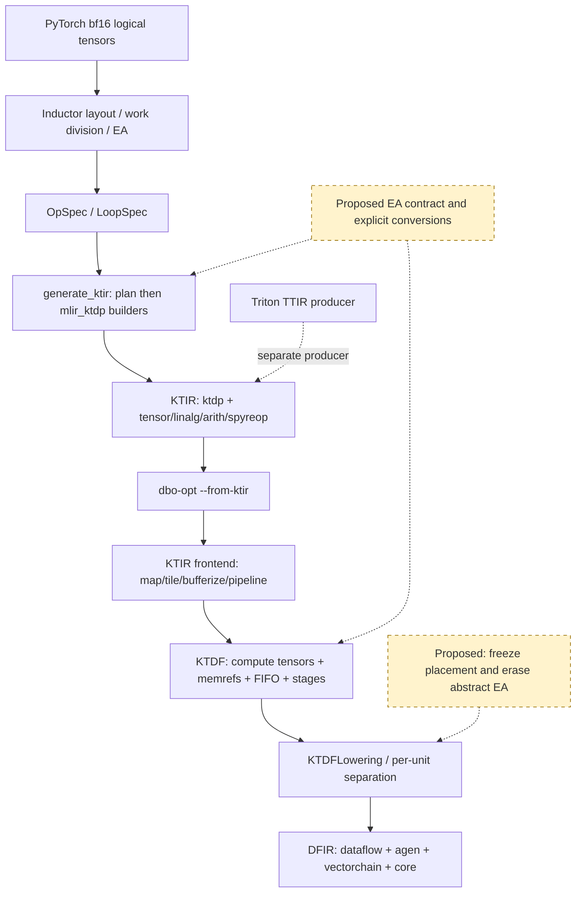

# Element Arrangement: Optimization Design from KTIR to Dataflow

## 1. Summary of Design Decisions

**Retain EA as an arrangement contract on SSA values, and represent numerical casts and arrangement conversions as separate operations.
The conditional recommendation is to use a common encoding for computation tensors in KTIR and KTDF, an arrangement contract on FIFO types for KTDF communication,
and lower these to existing memory accesses, casts, shuffles, packs, and send/receive operations at the boundary where KTDF is concretized.**
This is the combination H10 + H9 + H6 described below, proposal EA-P003.
It does not propose adding operations or attributes to the final `dataflow` dialect.

|Design decision|Recommendation and rationale|
|---|---|
|What EA represents|The correspondence between logical elements and the ordering of lanes within sticks and across multiple vectors. Verify the arrangement contract together with shape, dtype, numerical format, outer tiling, owning core, and the valid extent of padding. Separate the two-value nature of EXX2 from simple permutations (EA-I001/I002/I005).|
|Where to select EA|Import the arrangement already selected in OpSpec and the operation requirements without losing them. Analyze legal alternative arrangements in KTIR, then finalize internal arrangements in KTDF using the actual tiles, execution units, FIFOs, and temporary storage. Fix the external memory ABI earlier (EA-P003/P005).|
|Casts and EA conversions|`numeric_cast` defines the numerical type and rounding rule, and may change values. `convert_ea` changes only the arrangement of the same logical values with the same dtype. Preserve these two meanings upstream even if they can be fused into a single instruction sequence downstream (EA-P001/P002).|
|Conversion optimization|Allow it only when the correspondence of the same logical indices, padding, aliases, multiple uses, FIFO consumption counts, and reduction order are preserved. Do not interchange the cast positions in A and B. Distinguish mathematical commutativity from floating-point equivalence (§4.8).|
|Introduction order|First establish numerical and arrangement contracts and diagnostics, and validate downstream integration of standalone casts. Next resolve the separate frontend obstacles in A–D. Then introduce encoding/FIFO contracts, and finally enable arrangement selection and conversion elimination (§7).|

Prioritize EA-P001/P002/P004/P006 in the short term. Merely removing the current rejections is insufficient.
A and D actually stopped on unregistered `dl16tofp32`, B on mixed work division, and C on arrangement selection for fp32 broadcast.
A standalone downstream cast test passes, but a test fusing cast + square into the same `linalg.generic`
failed. **Do not conclude that the four examples currently work, or that adding EA alone will make them work.**
Execution results are in §8; the first stopping points and subsequent validation tasks are separated in §4.5.

The reason for adopting the medium- to long-term proposal is that EA is also needed on internal SSA values that descriptors alone cannot represent,
while tensor encoding alone cannot survive KTDF conversion to memrefs/FIFOs.
In the current implementation, `KTIRPipeline` builds memrefs using only tensor shapes and element types,
and FIFO types do not carry EA either.[DF-PIPEBUF] [DT-FIFO]
The attribute-only proposal H7 is a strong alternative with a smaller implementation footprint, but it increases the responsibility
for updating attributes at every clone, RAUW, and region boundary.

The proposal depends on four conditions:

1. Separate the numerical contracts of `bfloat16`, `!spyreop.df16`, and IEEE `f16` in EA-P001.
   Do not use attributes alone to change the numerical semantics of an existing 16-bit surrogate from IEEE operations to another format.
2. Have evidence that each shape/arrangement pair being concretized can be implemented with existing Dataflow/VectorChain/Agen operations.
   This investigation confirmed only limited cases such as 64-element f16/f32 conversions; do not generalize this to arbitrary arrangements.
3. Ensure that passes unaware of encoding neither lose nor ignore it, and that vector counts and ordering match at both ends of a FIFO.
4. Compare each of A–D against its own CPU result and meet the specified tolerances, shapes, and required dtypes.

**The minimum additional validation that could change the decision** consists of, with the same pinned configuration: (1) cast → fp32 pointwise,
(2) two uses requiring different EAs, (3) encoded tensor → memref/FIFO → existing DFIR,
and (4) numerical tests of bf16 rounding boundaries. If encoding propagation requires excessive changes or adapting existing passes
proves difficult, migrate with H7 + H6 and concretize to STANDARD earlier in KTIR.
Under the fixed constraints, do not adopt arrangement pairs found to require an extension of the final dialect; choose alternative arrangements
that existing operations can implement.

## 2. Overall Strategy and Processing Overview

### 2.1 Confirmed Path and Proposed Boundaries



Solid lines indicate connections confirmed in the source. The diagram does not show the four examples' generated artifacts reaching the endpoint.
Whether the installed `dbo-opt` matches the specified scheduler branch remains unconfirmed (§3.2).
This path does not insert Triton after OpSpec.[TS-CONFIG] [TS-SCHED] [TS-ASYNC] [DF-PIPE] [TR-PIPE]

### 2.2 Responsibilities at Each Stage

|Stage / owner|Input → output|What the current implementation retains|What the proposal adds or retains / decision responsibility|
|---|---|---|---|
|torch-spyre Inductor|ATen/Loop IR → FixedTiledLayout → OpSpec|device_size, coordinates, dtype, EA, allocation, iteration_space, core division|The correspondence between logical dtype and physical format, valid extent, and per-operation requirements. Check legality first, then compare costs.|
|torch-spyre emitter / frontend bindings|OpSpec → KTIR|Memory views/access tiles, tensor element types, linalg index maps, grid. Interprets STANDARD/EXX2 and rejects staggered arrangements|Attach EA to values and make casts and arrangement conversions explicit. Do not arbitrarily change existing external arrangements.|
|scheduler KTIR frontend|KTIR → Schedule IR|Map/tile, memory space, pipeline, tensor/memref boundaries|Type inference with EA and conversion insertion for each use that requires it. Retain the proof of arrangement through tensor → memref conversion.|
|scheduler KTDF scheduling|Stages, tensors, FIFOs → schedule on execution resources|Units, routes, slots, tokens, throttling, tiles, addresses|Select from internal EA candidates. Finalize FIFO ordering and splitting, register arrangement, and buffer lifetimes together.|
|scheduler KTDF backend|KTDF → KTDFLowering → DFIR|Concrete vector operations, transfers, memory views, units|Fully expand `convert_ea` into existing operations. Fail if abstract EA remains.|
|Final DFIR|Concrete program units and communication|Existing representations such as `dataflow`, `agen`, and `vectorchain`|Add no new EA operations or attributes. Arrangement is embodied in the addresses and lane ordering themselves.|

Recording EA, selecting EA, and converting EA are separate tasks.
Changing encoding alone does not count as changing the arrangement. The sets used by analysis to explore multiple candidates
represent alternatives before a decision, rather than one IR value having multiple EAs simultaneously.
A finalized SSA value has one contract; pass separate conversion results to uses with different requirements.

## 3. Scope, Baselines, Environment, Target Path, and Terminology

### 3.1 Baseline Commits and Local State

Retrieval time: 2026-10-29 15:57:29–15:57:31 UTC.
The common local parent directory is `/home/ishizaki/aiu-src/dt-agents/`.
The GitHub URLs correspond to the repository names in each row. All primary baselines were obtained locally. Only RFC2971 was supplemented with a remote-only source at a different SHA (§9).
Uncommitted and untracked files were preserved and were not used as evidence for the baseline implementation.

|Repository / source|Reference and full SHA investigated|Selection rationale / consistency|Initial local state|
|---|---|---|---|
|[torch-spyre](https://github.com/torch-spyre/torch-spyre) / `torch-spyre/`|`main` / `64870622fc39cda7e344a271decb901e7088c6c6`|Initial HEAD, as requested. SHA also confirmed through the GitHub upstream API.|HEAD as shown. `pass_utils.py` and `test_restickify.py` modified; many untracked files, including earlier EA reports. Baseline Python sources extracted to temporary storage with `git archive`.|
|[RFCs](https://github.com/torch-spyre/RFCs) / `RFCs/`|`KtirSpec_for_td` / `f4f8efd13578b4fe9de70f3f946f751fc32e4b3b`|No corresponding pin. Local HEAD used as reference material.|HEAD as shown. KTIR-V2.pdf, TableGen proposals, STRATEGY documents, etc. untracked. These are not treated as baseline RFCs.|
|[triton](https://github.com/torch-spyre/triton) / `triton/`|`main` / `dc968a093b1346daafd96ddc11a5999f98385702`|No corresponding pin could be identified from torch-spyre; local HEAD used as a reference. A separate producer.|HEAD as shown. Custom tests, EA documents, etc. untracked. No changes to tracked source.|
|[ktir-mlir-frontend](https://github.com/torch-spyre/ktir-mlir-frontend) / `ktir-mlir-frontend/`|torch-spyre pin / `1f96e5790a99b7aaf9a445b039044467c66e4e0a`|`tools/ktir-mlir-frontend.pin:13`. Correspondence with torch-spyre confirmed by the pin specification.|Local `main` HEAD `ed47a3ff691e49f30e4a49e75d7ac19995cff2ea`, clean. Only workflows differ from the pin; implementation and tests are identical.|
|[kiszk/dataflow-scheduler](https://github.com/kiszk/dataflow-scheduler/tree/dl16-fp32-conversion) / `dataflow-scheduler/`|Specified branch `dl16-fp32-conversion` / `233c6bfca10ba55034c1e089ec0470f8972af981`|Local HEAD of the user-specified branch. Pin consistency with torch-spyre unconfirmed.|HEAD as shown. The actual checkout of the `external/dataflow-scheduler-dialects` gitlink differs. No changes to scheduler source itself.|
|[dataflow-scheduler-mlir-dialects](https://github.com/torch-spyre/dataflow-scheduler-mlir-dialects) / same-named directory + scheduler submodule|Scheduler gitlink / `81ed1b9c00b529139df53f82ebccaedb96215584`|Prioritized the pin corresponding to the scheduler. Extracted the pin temporarily for investigation. Consistency with torch-spyre as a whole unconfirmed.|Separate checkout at `main` HEAD `a55523e23abaf6d76c243da4c074ed4ac0686c90`, with `KTDFArchIntrinsics.td` modified. Checkout inside the scheduler at `c3066e3f8d24168765fe25d541136979b6dd1d8b`. Both kept separate from the baseline.|

Dependency differences also matter. The scheduler's frontend gitlink is
`0a4601d7bdba3df33bee7b5a3ab9c18e42930a1a`, which differs from the torch-spyre pin.
Triton's frontend gitlink is `ed47a3ff691e49f30e4a49e75d7ac19995cff2ea`.
Both the frontend pin and Triton specify LLVM
`e9846648fd6183ee6d8cbdb4502213fcf902a211`, but this alone does not guarantee compatibility across all binaries.
[TS-PIN] [DF-SUBMODULE] [TR-CMAKE] [FE-LLVM]

### 3.2 Execution Environment and Scope of Applicability

|Item|Findings and limitations|
|---|---|
|Python|3.12.15, `dt-agents/.venv/bin/python3`.|
|PyTorch|`2.13.0+cpu`, git `cf30153c4c131c8164ee7798e5022d810682e2cb`. Meets torch-spyre's `torch~=2.13.0` requirement. Exact wheel build reproducibility unconfirmed.|
|torch-spyre Python|Archive of the initial HEAD placed first on `PYTHONPATH`. Tracebacks also point to `/tmp/ea17-tC5iTWoc/torch_spyre/`. The existing dirty `pass_utils.py` was not used.|
|C++ extensions|`_C.so` and `_hooks.so` from the original checkout copied temporarily. The source SHAs of the original binaries cannot be proven. Frontend layout execution results are therefore observations from a mixed environment.|
|Runtime|`FLEX_COMPUTE=SENTIENT`, `FLEX_DEVICE=PF`, device_count=1. Input and weight transfers progressed, but no kernel outputs were obtained for the four examples. This is not treated as completed numerical validation on physical hardware.|
|MLIR bindings|`ktir-mlir-frontend=0.1.0`, with direct_url pointing to the frontend checkout inside Triton. `mlir_ktdp` can be imported. The package name is not `mlir-ktdp`. Binary SHA stamp unconfirmed.|
|Triton package|`3.7.0+git77984bea`, local editable installation. Version suffix differs from the baseline HEAD. No claim is made that it was used as a dependency on the OpSpec path.|
|Standalone scheduler|`build/dataflow-scheduler-dev/bin/dataflow-scheduler-opt`, LLVM22.1.3, assertions enabled. CMake source is the specified scheduler, but the actual submodule does not match the pin. Do not equate execution results with those of an exact pinned build.|
|Output location|Work files, logs, generated IR, and CPU references saved under `/tmp/ea17-tC5iTWoc/`. Programs executed sequentially, each with a separate Inductor cache.|

### 3.3 Evidence Identifying the Path

`config.py:117–127` checks at import time whether the environment string is exactly `"1"`.
`scheduler.define_kernel:657–671` emits `async_compile.ktir(...)` into the wrapper.
`SpyreKernel.create_tensor_arg` also fills in buffer names and other fields based on this flag, so the branch changes more than the output extension.
`SpyreAsyncCompile.ktir:616–674` passes the finished OpSpec to `generate_ktir` and writes `.ktir`,
then `_compile_ktir_with_dbo:676–735` launches `dbo-opt --from-ktir --kEmitSpyreCode`.
`TORCH_SPYRE_FRONTEND_ONLY=1` would stop execution here, but it was not set in the four-example tests.
[TS-CONFIG] [TS-SCHED] [TS-ARGS] [TS-ASYNC]

`generate_ktir` proceeds through pure plan derivation → builder generation → emission.
Rejections such as staggered arrangements occur before MLIR is created. The wrappers and stacks for A/B/D demonstrate this branch.
For C, the branch setting was confirmed True, but execution stopped earlier in layout processing and generated no KTIR.
[TS-KTIR] [TS-PLAN]

In the bridge, `dbo-opt.cpp` reads `--from-ktir`,
and `buildKernelToSpyreCodePipeline` calls `buildKTIRFrontendPipeline`,
`buildSchedulerOptimizationPipeline`, and `buildDFIRBackendPipeline`.
CMake also links `DataflowScheduler::Pipeline`.
This confirms **downstream connections in the source**, rather than proving that the four examples reached the endpoint in this investigation.
[DF-PIPE]

### 3.4 Terminology and Claim Categories

|Term|Meaning in this document / distinctions maintained|
|---|---|
|Logical tensor|The shape, indices, dtype, and values visible from PyTorch. For example, A has shape `[1,128,4096]` and dtype bf16.|
|Physical format|SEN169_FP16 (dlfloat16), IEEE_FP32, etc. A mapping from logical dtype, not a synonym for bf16.|
|EA|Element ordering within sticks and across multiple vectors, or the arrangement semantics of two statistical values also represented by the existing enum. The new design distinguishes ordering from payload multiplicity.|
|Layout|The overall mapping from logical indices to device coordinates and storage. EA is one part of it. It may include `device_size`, `stride_map`, allocation, core ownership, etc.|
|Geometry|The shape and width of tiles or vectors handled by a value or operation. For example, 64-element f16 versus 32-element f32. EAs may differ even with the same geometry.|
|Packing|Packing multiple values or partial vectors into one transfer unit. Distinguish cases involving only ordering from the two-value payload of EXX2.|
|Permutation|A one-to-one index permutation over a finite set of valid elements. Excludes replication, added padding, and numerical casts.|
|Restickify|Rebuilding an arrangement involving tile/stick axes, etc. Support for a dtype alone does not imply feasibility for arbitrary shapes or arrangement pairs.|
|Shuffle|An existing VectorChain lane-selection operation. Preserves element type. A concrete implementation mechanism, rather than abstract EA itself.|
|Grid / work division|The outer structure assigning logical work to compute tiles/cores. Separate from EA, but relevant to arrangement legality and transfers.|
|KTIR / KTDP|KTIR is a tile-program representation using mixed MLIR dialects. `ktdp` is the dialect for memory views, access tiles, etc. “KTIR” is not the name of a single dialect.|
|KTDF / Schedule IR|An intermediate representation including the scheduler's dialect for stages, FIFOs, transfers, tokens, etc. tensor/linalg/memref operations remain inside it.|
|DFIR / Dataflow dialect|DFIR is a downstream representation containing multiple dialects. `dataflow` covers its communication, units, and memory views. Casts/shuffles belong to `vectorchain`.|
|Arrangement contract|A term introduced in this document. Collectively, the consistency conditions between a value's EA and the shape, format, valid extent, owner, and stream ordering used to interpret it. Not a new EA Literal.|

All existing EA Literals and their treatment by the KTIR emitter are listed below.[TS-EA] [TS-ARR]

|Literal|Meaning / treatment|Baseline KTIR|
|---|---|---|
|STANDARD|Normal element ordering. An outer layout exists separately.|Handled through shape/strides.|
|DL16_TO_FP32|Staggered arrangement produced by df16 → f32.|Explicitly rejected.|
|FP32_TO_DL16|Staggered arrangement produced by converting STANDARD f32 to df16.|Explicitly rejected.|
|EXX2|Two-value payload containing the mean and mean of squares.|Fused element type. Not merely a lane permutation.|
|QFP8CH|Existing quantized channel arrangement.|Passes arrangement shape/stride processing. Does not imply support for all operations.|
|QFP8WT|Existing quantized weight arrangement, two-dimensional sticks, etc.|No emitter-side rules. Not used in the four examples.|

The following labels are used below: **[C]** = baseline code, **[E]** = execution in this investigation, **[D]** = design intent in RFCs and similar sources,
**[A]** = analysis, **[H]** = historical/ongoing discussion, **[P]** = proposal in this document, and **[U]** = unconfirmed.
Each example explicitly identifies proposed versus generated IR. A closed status in an earlier report or a merged PR is not used as evidence that an issue is resolved.

## 4. Analysis from Eight Perspectives

The request specifically defines perspectives 1–7 but gives no individual description for perspective 8.
As a reasonable addition, perspective 8 covers “optimization legality, numerical semantics, and common acceptance criteria.”
No new implementation work has been added.

### 4.1 Perspective 1: Why EA Is Needed

[C] A 128-byte stick contains 64 elements at 16 bits and 32 elements at 32 bits.
However, a width change alone cannot describe the element ordering of a conversion.
The specified scheduler's 64-element widening sends the first four elements of each group of eight to the first f32 vector, and the last four
to the next vector. For logical index `j=8q+r` (0≤q<8, 0≤r<8),

```text
vector(j) = floor(r / 4)
lane(j)   = 4*q + (r mod 4)
offset(j) when stored in two consecutive vectors = 32*floor(r/4) + 4*q + (r mod 4)

logical: 0 1 2 3 4 5 6 7 | 8 9 10 11 12 13 14 15 | ...
vec 0:   0 1 2 3         | 8 9 10 11             | ... 56 57 58 59
vec 1:           4 5 6 7 |           12 13 14 15 | ... 60 61 62 63
```

This is a local map confirmed in the implementation and generated IR.[DF-CAST] [DF-CONVTEST]
It differs from STANDARD ordering despite having the same `tensor<1x64xf32>` type.
[A] Multiplying by an ordinary weight vector without recording this information risks multiplying values at different indices
even when types and shapes match. This is a legality condition derived from the map, not a claim that an incorrect result was reproduced in an example.

[D] The tiled tensor RFC explains why host sizes/strides cannot fully represent a tiled device layout,
and the KTIR RFC designs explicit access through memory views and access tiles.
[C] torch-spyre's enum further distinguishes `STANDARD`, `DL16_TO_FP32`, `FP32_TO_DL16`, and `EXX2`.
EXX2 carries a two-value statistical payload and does not fit a permutation-only model.[RFC-TILE] [RFC-KTIR] [TS-EA] [FE-TYPE]

Hardware-derived conditions include stick width, conversion-instruction lane ordering, and communication units.
Propagating EA through an enum after dtype changes, placing casts in standalone linalg operations, and choosing when to restore STANDARD
are compiler design choices. Do not treat all current constraints as unavoidable hardware limitations.

### 4.2 Perspective 2: Issues and Invariants

|Issue ID|Concrete example / condition|Required invariant|Consequence of violation|
|---|---|---|---|
|EA-I001|A/B bf16 weights and f32 intermediates, C's f32 buffer, D's f32 output|Track logical dtype, actual format, and rounding points independently. Distinguish SEN169, IEEE f16, and bf16.|Cast movement or optimization of the f16 surrogate changes numerical semantics.|
|EA-I002|64×16bit → 2×32×32bit, two staggered arrangements, EXX2|Define the logical index ↔ lane/vector map, direction, valid extent, and payload count.|Different elements are read despite matching shapes/types. EXX2 is mistaken for a permutation.|
|EA-I003|A/D `dl16tofp32`, A/B `fp32todl16`, C int → float|Import OpSpec numerical casts without omission and represent the required EA effects separately.|Currently rejected during planning before KTIR.|
|EA-I004|C `[1,128,1] * [64]` fp32 broadcast, B weights `[4096]`|Distinguish axes that vary under broadcasting from constant axes. A legal layout preserving both index correspondences must exist.|Arrangement selection fails, or unconditional EA copying mismatches elements.|
|EA-I005|A/B 4096-element mean, D 128-element max/sum, tails 31/33/65|Preserve the reduction set, order, neutral element, padding, and NaN policy.|Padding contamination, precision differences, incorrect neutral element for max, etc.|
|EA-I006|Square and normalization of widened x in A/B, cos/sin in C, two uses with different EAs|Distinguish an SSA value's single contract from per-use requirements. FIFO consumption counts, ordering, and slot capacities must agree at both ends.|Invalid CSE, exhausted values, or mismatched transfer ordering.|
|EA-I007|B's main work uses 32 cores, while weight upcast is undivided|The same kernel grid can represent the work division of every stage.|Rejection by the current `_divisions`. EA types alone cannot solve this.|
|EA-I008|Tensor → memref, FIFO → per-unit separation, mismatched pins|Concretize or preserve arrangement information before it is lost. Producers and consumers use the same contract version.|Implicit dependence on cast patterns, missing propagation, or irreproducibility.|
|EA-I009|C int32 → fp32/cat/cos/sin, D exp/reductions/division|Legal backend processing exists for each numerical operation, precision, and geometry.|An unknown operation stops compilation or precision remains insufficient even after EA is fixed.|
|EA-I010|Repeated full-tensor restickify, repeated conversion of B's weights|Compare transfer volumes, temporary storage, and required conversions among legal candidates.|Excessive transfers or register pressure despite correctness.|

Legality checking is a prerequisite for cost optimization. Do not select unsupported candidates because of a low estimated cost.
An alternative that violates reduction rounding requirements is not legal merely because it has the same EA.

### 4.3 Perspective 3: Current Solutions

#### 4.3.1 OpSpec and EA in Earlier Stages

[C] `TensorArg.element_arrangement` is a Literal corresponding to the C++ enum, stored alongside device dtype, size, coordinates,
and allocation. `DtypeOpTable` maps bf16 → f32 to `dl16tofp32` and the reverse to `fp32todl16`.
The EA transition table maps STANDARD → staggered, and the corresponding inverse conversion → STANDARD. Unary pointwise operations inherit the layout including EA; multiple-input compatibility is checked on the condition of matching EAs or broadcasting along a stick.[TS-PROP-CAST] [TS-PROP-BCAST]
[C] In `types_mapping.h`, host bf16 becomes device SEN169_FP16; its PyTorch bf16 bit representation is not retained.
[TS-OPSPEC] [TS-DTYPE] [TS-HOSTTYPE]

[E] OpSpec excerpt from A's generated wrapper (abbreviated description; values match the actual generated artifact):

```python
OpSpec(
    op="dl16tofp32",
    iteration_space={c0: (128, 32), c1: (4096, 1)},
    args=[
        TensorArg(is_input=True, arg_index=0,
                  device_dtype=DataFormats.SEN169_FP16,
                  device_size=[128, 64, 64], name="arg0_1"),
        TensorArg(is_input=False, arg_index=-1,
                  device_dtype=DataFormats.IEEE_FP32,
                  device_size=[128, 128, 32], name="buf0",
                  element_arrangement=ElementArrangement.DL16_TO_FP32),
    ],
)
# Coordinates / allocations / provenance remain in the original wrapper. c0,c1 are illustrative symbols.
```

At this stage, actual memory size doubles, but logical shape is unchanged.
Rewriting EA to STANDARD alone does not rearrange the staggered values.

#### 4.3.2 Import by the KTIR Emitter

[C] `ElemTypes` maps both SEN169_FP16 and IEEE_FP16 to MLIR `f16`, and EXX2 to a fused element type.
`_arrangement_layout` treats STANDARD as row-major and explicitly rejects both staggered arrangements.
`RECIPES` contains no numerical conversions; A/D reached unknown-op before the EA check.
[TS-ELEMTYPE] [TS-ARR] [TS-RECIPE]

KTIR excerpt from an existing golden test (also executed in this investigation and confirmed to match):

```mlir
// Current syntax. map/set, %addr, and %c0 are defined in the surrounding context.
%mv = ktdp.construct_memory_view %addr,
  sizes: [16, 512, 64], strides: [32768, 64, 1]
  {coordinate_set = #set, memory_space = #ktdp.memory_space<global>}
  : memref<16x512x64xf16>
%at = ktdp.construct_access_tile %mv[%c0, %c0, %c0]
  {access_tile_order = #map, access_tile_set = #set}
  : memref<16x512x64xf16> -> !ktdp.access_tile<16x512x64xindex>
%v = ktdp.load %at : <16x512x64xindex> -> tensor<16x512x64xf16>
```

`!ktdp.access_tile` is a set of indices, not a data tensor.
Storing the EA of computation values after a load only there leaves no information for intermediates that do not pass through memory.
The current LoadOp builder also does not specify encoding, and the load/store verifiers check only shape agreement.
A probe in this investigation also confirmed that loads/stores with differing element dtypes pass verification, but this does not imply correct execution.
[FE-LOAD] [FE-ACCESS]

#### 4.3.3 KTDF and Dataflow Examples

[E] A conversion fixture present on the specified branch was compiled with the standalone scheduler.
It was not generated by any of the four programs. The following excerpt shows the computation stage from the actual KTDF dump, with only SSA names changed for readability.

```mlir
// Current KTDF. Slot allocation, stage tokens, and map definitions exist in the surrounding context.
%x = ktdf.read_from_fifo %src : <"L1LU" -> "SFU", 64xf16>
  -> tensor<1x64xf16>
%y = linalg.generic
  {indexing_maps = [#map, #map], iterator_types = ["parallel", "parallel"]}
  ins(%x : tensor<1x64xf16>) outs(%init : tensor<1x64xf32>)
  attrs = {ktdf_arch.maps_to = "SFU", dataflow_scheduler.throttle = 64 : i64} {
^bb0(%in: f16, %out: f32):
  %cast = arith.extf %in : f16 to f32
  linalg.yield %cast : f32
} -> tensor<1x64xf32>
ktdf.write_to_fifo %y, %dst : tensor<1x64xf32>, <"SFU" -> "L1SU", 64xf32>
```

DFIR excerpt from the same fixture (**DF0**, evidence of an existing concretization target shared by all candidates discussed below):

```mlir
// Actually generated IR, inside dataflow.program_unit. %from/%to are existing unit indices.
%v = dataflow.receive %from : vector<64xf16>
%c0 = vectorchain.cast %v : vector<64xf16>, vector<64xf32>
%a = vectorchain.shuffle input(%c0)
  {indices = [0 : i32, 1 : i32, 2 : i32, 3 : i32], repetition = 8 : i32}
  : vector<64xf32>, vector<32xf32>
dataflow.send %to, %a : vector<32xf32>
%c1 = vectorchain.cast %v : vector<64xf16>, vector<64xf32>
%b = vectorchain.shuffle input(%c1)
  {indices = [4 : i32, 5 : i32, 6 : i32, 7 : i32], repetition = 8 : i32}
  : vector<64xf32>, vector<32xf32>
dataflow.send %to, %b : vector<32xf32>
```

The receiver received two `vector<32xf32>` values in sequence and stored them at offsets 0 and 32 with `agen.vector_store`.
In the reverse direction, it receives two vectors, casts each, and restores 64×f16 with the existing `vectorchain.pack`.
The existing `layout_map` of `dataflow.get_logical_memory_view` is an affine map to element addresses;
do not confuse these with byte addresses.[DF-CAST] [DF-WIDE] [DT-DATAFLOW] [DT-VECTOR]

This conversion pattern requires the narrow type to be f16, the wide type to be f32, the element count to be a multiple of 8, specific FIFO connections, and other conditions.
`isFloatConversion` recognizes only bodies containing a single cast. A general EA type does not already exist downstream.
`!spyreop.df16` exists in the frontend, but this conversion pattern has not been confirmed to accept it.

#### 4.3.4 Current Flow of the Common Evaluation Examples

|Example|Numerical / EA / shape flow (generated artifacts or earlier-stage graph)|Current progress|
|---|---|---|
|A Granite|bf16/SEN169 STANDARD → `dl16tofp32` f32 DL16_TO_FP32 → square with the same EA → mean STANDARD statistic → add/rsqrt STANDARD → row broadcast and multiplication in DL16_TO_FP32 → `fp32todl16` STANDARD → bf16 weight multiplication. x branches to square and normalization.|OpSpec actually generated. Stops at the first cast recipe.|
|B GptOss|Same as A through normalization. Then separately applies `dl16tofp32` to bf16 weights, producing f32 DL16_TO_FP32; multiplies f32 values; and finally applies `fp32todl16` STANDARD. Weight cast has 4096 elements; main computation has 524288.|OpSpec actually generated. Stops earlier on a grid mismatch between the weight stage and main computation.|
|C RoPE|x supplies only bf16 dtype/device. position_ids is int64 (device-side int32 downcast path) → f32 `[1,128,1]`. inv_freq is f32 `[64]` as in the appendix. Broadcast mul → `[1,128,64]` → cat → `[1,128,128]` → cos/sin → bf16 for each.|Stops at layout selection for broadcast mul. EA/OpSpec for the later part has not been generated.|
|D Softmax|bf16 STANDARD → `dl16tofp32` f32 DL16_TO_FP32 → max STANDARD statistic → sub with the same EA → exp with the same EA → sum STANDARD → realdiv with the same EA. Returns f32 with no narrowing.|OpSpec actually generated. Stops at the first cast recipe. External storage of the final staggered f32 output also requires validation.|

C has no bf16 weights. The appendix's f32 `inv_freq` and int64 `position_ids` were retained.
The interpretation of changing every example's inputs uniformly to bf16 was not adopted.
D's `check_dtype=False` is retained as the original numerical comparison specification, but acceptance of the design
also checks the f32 output contract separately. Agreement between the CPU outputs of A and B is not required.

### 4.4 Perspective 4: Difficulties with the Current Approach

**Implicit arrangements are rediscovered from producer patterns.** [C/A]
`isFloatConversion` identifies standalone casts and corrects the wide FIFO's vector count to 2.
Because EA is not distinguished within the same f32 tensor type, changing the producer's form through fusion loses the basis for this information.
The additional test in this investigation inserted the following existing syntax into the same fixture.

```mlir
// Current syntax: the body actually compiled and found to fail.
%cvt = arith.extf %in : f16 to f32
%scaled = arith.mulf %cvt, %cvt : f32
linalg.yield %scaled : f32
```

The diagnostic was `unsupported operation type in linalg.generic body` (extf), followed by a scalar/vector shape mismatch.
This test does not prove that A naturally performed this fusion.
It does, however, directly demonstrate the need both to retain arrangement information after fusion and to provide lowering for mixed bodies.
[FUSE] [DF-WIDE]

**Bufferization is a boundary where information is lost.** [C/A]
KTDP loads create tensors without encoding, and KTIRPipeline constructs memrefs from shapes and element types.
FIFO types carry only src/dst/count/type. Introducing tensor encoding alone would lose information
in these current builders. Conversely, attributes only on access tiles cannot represent SSA values, block arguments, or multiple results during computation.
Both H7 and H10 must include changes to this boundary.[FE-LOAD] [DF-PIPEBUF] [DT-FIFO]

**Numerical type surrogates and EA are intertwined.** [C/A]
The mapping host bf16 → SEN169 → KTIR f16 differs from the IEEE half extension meant by standard MLIR `arith.extf`.
Adding a custom format attribute to `f16` cannot change the numerical semantics of standard arith canonicalization.
A contract is needed that introduces the existing `!spyreop.df16` or treats the format opaquely through an explicit numerical intrinsic.
Even a proposal separating EA from types fails the mandatory correctness conditions without this numerical contract.
[TS-HOSTTYPE] [TS-ELEMTYPE] [FE-TYPE]

**Arrangement changes and execution-resource selection are coupled.** [A]
Converting the full f32 tensors in A/B to STANDARD at every stage simplifies analysis but repeats large transfers.
Retaining staggered arrangements instead requires contracts for broadcast weights, row statistics, reduction trees, and external outputs.
In KTIR alone, the total FIFO/transfer/register cost is not yet fixed; leaving every degree of freedom until KTDF makes search and verification complex.
The compromise is to fix the external ABI and numerical cast positions early, deferring only internal arrangement decisions.

**General optimizations after concretization also require care.** [C/A]
The current `LowerFloatConversionPattern` comments on a code-generator constraint requiring
a separate cast for each of the two shuffles. Unconditionally applying CSE to DF0's two casts is not proposed.
The backend pattern must first be changed and validated. Do not apply the same CSE as for ordinary pure SSA operations to FIFO receives either.
[DF-CAST]

### 4.5 Perspective 5: Unsupported and Unresolved Cases

|Category / ID|Condition / current state|Evidence for the cause / baseline status|Minimum next validation|
|---|---|---|---|
|[C/E] EA-I003 A/D|Stops at the first bf16 → f32 cast|`_stages` reports unknown `dl16tofp32`. No recipe for the conversion name. Staggered rejection also remains.[TS-RECIPE] [TS-ARR]|A positive standalone cast OpSpec → KTIR → DFIR case and explicit rejection of unsupported dtypes.|
|[C/E] EA-I007 B|Different work divisions for weight upcast and main computation|Main divides c0 into 32; weights divide 4096 into 1. `core_divisions` results differ and `_divisions` rejects them.[TS-DIV]|Compare weight preconversion in a separate stage/kernel with correct mapping to a common grid. Also check the numerical and transfer costs of duplicating a side-effect-free cast.|
|[C/E] EA-I004 C|fp32 multiplication selecting different broadcast axes as the stick axis|No legal layout in `beam_global_min_cost`. `compute_restickify_target_layout` returns None if the target stick variable is absent from the input h_coords.[TS-RESTICK]|Isolate `[128,1] * [64]` in fp32 and validate the arrangement and reference values after explicit broadcast/splat.|
|[C/E] EA-I008|Independent fixture with cast and square in the same generic|Dedicated cast recognition is limited to one operation; the general body lowerer lacks extf. A fixture from the specified branch failed when executed with the scheduler in a mixed configuration.[DF-WIDE] [FUSE]|Add separate tests for rejecting/separating fusion and for legal mixed-body lowering.|
|[C] EA-I002|TensorArg carrying either staggered Literal|Explicit NotImplementedError. Existing TestRefusals executed and rejected as expected.[TS-ARR] [TS-TEST]|Both directions of the 64-lane map, tails, different shapes, and distinction from EXX2.|
|[C/E] EA-I008|Element-type mismatch in KTDP load/store|A probe passed verification when shapes matched. Execution correctness unverified.[FE-LOAD]|A verifier specification permitting this only when numerical conversion or reinterpretation is explicit.|
|[C/H] EA-I004|Restickify of non-STANDARD inputs|Baseline `compute_restickify_needed:2554–2560` rejects this for all dtypes. #5729 OPEN. No execution beyond this point through KTIR in this investigation.[TS-RESTICK-GUARD]|After adding map support, positive non-STANDARD → target cases and rejection of unsupported combinations.|
|[C/H/A] EA-I005|EA tags after non-stick reductions|Output STL generation does not specify EA and defaults to STANDARD. #5553 OPEN reports incorrect non-stick sum results. Static inspection confirmed the concern that required EA is lost; no incorrect baseline KTIR result reproduced.[TS-REDUCE-EA]|Sum along axes within and outside the stick, checking values and EA separately.|
|[C/H] EA-I008|D2H of staggered outputs|`ops/eager.py:741–760` has a TODO noting that copy ignores EA; #4393 OPEN reports execution on another path. D's KTIR output has not yet been obtained.[TS-COPY]|Host-side index and numerical agreement for f32 output D and standalone narrow output C.|
|[H] EA-I004/I008|Noncontiguous data transfer, restickify loop order|Scheduler #168 OPEN PR, #192/#199/#204 OPEN issues. No claim that each report was reproduced with the current four examples.|Run each issue's minimal fixture with the same pins. Distinguish the restickify premise of this investigation from the current implementation.|
|[A/U] EA-I005/I009|C's subsequent cat/cos/sin, D's precision and output EA|C stops in an earlier stage. D's numerical computation and host return have not run. The existence of an operation alone does not establish support.|FP32 primitives individually, then A–D in full.|
|[A/U] EA-I006|Two uses with different EAs, encoded buffer aliases|The four baseline examples stop before KTIR, and no downstream incorrect results have been observed.|A diamond graph, one use requiring STANDARD and the other permitting staggered, with FIFO counts checked.|

**Apply the user's premise to all EA-P proposals**: restickify for fp16, dlfloat16, float32, int16, and int32
will be available from `ktdf` onward. The existing epic tracking this is
[triton #229 (OPEN)](https://github.com/torch-spyre/triton/issues/229), which is identified with the premise.
Distinguish this from current implementation and test results. The premise does not imply numerical casts, arbitrary arrangement pairs or shapes,
no additional transfers, or bf16 = df16. It does not automatically remove earlier broadcast/grid/recipe obstacles either.

### 4.6 Perspective 6: Representation and Lowering in Each Dialect

[P] Separate the carrier of arrangement information from conversion operations, and compare H1–H11 in §5 using the same 64-lane cast example.
Every proposal fixes numerical cast positions and uses only existing DF0 and existing memory/vector operations in Dataflow.
Proposals that merely record EA cannot repair arrangements on their own, so combine them with explicit conversion or concretization.
Judge the ability to represent an unsupported arrangement separately from the ability to realize it.

### 4.7 Perspective 7: Improvements Including Design Changes

[P] Section 7 collects the implementation scope, dependencies, acceptance criteria, and PR policy for EA-P001–P006.
The core proposal is EA-P003 (H10 + H9 + H6), but a decision that it satisfies the four examples cannot be made
until the prerequisite numerical contract in EA-P001 and frontend obstacles in EA-P004 are resolved.
Do not create a duplicate of existing #229 as a new restickify epic.

### 4.8 Perspective 8: Optimization Legality and Acceptance

#### 4.8.1 Numerical Semantics and Cast Positions

Write A as `Q_b(w * Q_b(u))` and B as `Q_b(float(w) * u)`.
Here, `u` is the normalization result computed in f32, and `Q_b` denotes rounding to bf16.
This notation describes logical CPU operations; it does not equate conversion to dlfloat16 with `Q_b`.

[E] Minimal CPU counterexample (executed):

```python
u = torch.tensor(1.00390625, dtype=torch.float32)
w = torch.tensor(1.5, dtype=torch.bfloat16)
(w * u.bfloat16()).item()  # 1.5
(w * u).bfloat16().item()  # 1.5078125
```

Therefore, an EA optimization must not move A's cast after weight multiplication.
Precomputing B's weight extension must also preserve the same values, cast rules, and update timing, accounting for weight changes during training and aliases.
Preserve C's integer-to-f32 position conversion and narrowing after trigonometric operations, and D's f32 softmax specification.
A single test agreeing within tolerance does not prove that arbitrary cast interchange or reassociation is allowed.

#### 4.8.2 Conditions for Allowing Optimizations

|Optimization|Conditions for allowing it|Prohibited cases / cases requiring additional validation|
|---|---|---|
|Remove `convert_ea(x,E,E)`|Same format, logical shape/indices, valid extent, owner, and packing. No synchronization or other side effects.|Only the EA name matches, while tile maps or stream contracts differ.|
|Compose EA conversions / remove inverse conversions|Bijections over the same valid elements with matching composed maps. No effect on padding, aliases, or other uses.|An intervening numerical cast. f32 → 16 → f32 is not a rounding-loss-free identity.|
|Move across pointwise operations|All inputs pair the same logical indices, and the operation is element-independent. Each element operation executes with the same rounding and precision.|Combining weights with a different EA without conversion. Aggregation, side effects, random numbers, or index-dependent processing.|
|Move across broadcast|The broadcast mapping and EA map commute. Prove that row scalars are constant within the target row.|Unconditionally ignoring all axes because a size is 1. Confusing C's two varying axes.|
|Move across reduction|Preserve the accumulation tree and ordering as well as the set, or permit changes under an explicit numerical contract. Neutral elements/masks match.|Applying sum associativity as for real numbers. Changing max NaN/signed-zero rules.|
|Share conversions across multiple uses|Pure tensor values with the same input version, map, and placement, satisfying dominance, lifetime, and alias conditions.|Duplicating consumption of or applying CSE to FIFO receives. Only one use has a different EA requirement.|
|Fuse cast + EA conversion during concretization|Numerical values and index maps of the composed result are independently validated, and the downstream pattern supports it.|Fusing merely to reduce the instruction count. The current mixed-linalg failure.|
|Implement using only memory views|The required map is expressible through existing address sets/orders and supported by the transfer unit. Logical values remain the same even if physical data is interpreted differently.|Arbitrarily allowing non-affine/noncontiguous access, or substituting a view change for register-lane rearrangement.|

Insert conversions on edges where the producer's actual EA differs from the use's required EA.
If two consumers of one value require different EAs, compare legal candidates: retain the original value and convert one branch; branch to both consumers
and convert separately; or change the producer's EA and convert for the other consumer.
Reduction and cast positions are not free variables in this search.

#### 4.8.3 Future Acceptance of the Four Examples

|Example|Fixed inputs, CPU reference, and success criteria|Additional IR conditions|
|---|---|---|
|A|seed42, `[1,128,4096]` bf16, bf16 weights, eps1e-5, `dynamic=False`. Compare against its own CPU result with atol=rtol=0.1; matching shape and bf16 dtype.|Narrow after normalization, then multiply by bf16 weights. Check x's two uses, mean/statistic broadcast, and the EA output ABI.|
|B|Same conditions as A; 0.1/0.1 against B's own CPU result. Agreement with A is unnecessary.|Preserve weight widening, f32 multiplication, and final narrowing. Evidence that the differing work divisions have been legalized.|
|C|seed0, batch1/seq128/head128, theta10000, positions0–127. Compare cos/sin separately against their own CPU results at 0.02/0.02; bf16 `[1,128,128]`.|Retain f32 inv_freq, int → float, broadcast/cat, and independent narrowing of cos/sin; x is used only for dtype/device.|
|D|seed0, 128×128 bf16, scale4, f32 softmax. Compare against its own CPU result with atol0.001/rtol0.01; also execute the original code's check_dtype=False. Additionally require actual f32 output.|f32 boundaries for max/sub/exp/sum/div; conversion of output to STANDARD or correct host reconstruction. Row sums/argmax are diagnostics, not substitutes for numerical comparison.|

Set `TORCH_SPYRE_KTIR=1` for every example and preserve the correspondence between wrappers and generated KTIR, KTDF, and DFIR.
Do not substitute skip/xfail for success. These acceptance criteria have not been met in this investigation; they define gates after implementation is complete.

## 5. Detailed Comparison of Design Candidates and Adoption Decisions

### 5.1 Common Problem, Syntax, and Evaluation Conditions

All candidates use the same **E0**. Numerically converting 64 device df16 STANDARD elements to f32
produces DL16_TO_FP32, and the next consumer requires STANDARD.
The same conditions also include fan-out to another consumer using the original DL16_TO_FP32.
The connection to A–D is to apply this contract to widening in A/B, B's weights, standalone narrowing in C, and D's external f32 output;
the cast positions in A–D remain unchanged.

```python
# E0: Illustrative OpSpec. An unexecuted validation candidate including required fields.
c0 = sympy.Symbol("c0", integer=True)
OpSpec(op="dl16tofp32", is_reduction=False,
       iteration_space={c0: (64, 1)}, op_info={}, args=[
    TensorArg(is_input=True, arg_index=0,
              device_dtype=DataFormats.SEN169_FP16, device_size=[1, 64],
              device_coordinates=[0, c0], allocation={"hbm": 0}, name="x",
              element_arrangement=ElementArrangement.STANDARD),
    TensorArg(is_input=False, arg_index=1,
              device_dtype=DataFormats.IEEE_FP32, device_size=[2, 32],
              device_coordinates=[sympy.floor(c0/32), sympy.Mod(c0, 32)],
              allocation={"hbm": 128}, name="y",
              element_arrangement=ElementArrangement.DL16_TO_FP32),
])
# Add the comparison condition that a subsequent use requiring STANDARD needs a same-dtype EA conversion.
# This is not an example of an EA-conversion OpSpec already registered in the current implementation.
```

Except where individually labeled as current syntax, all candidate IR below is **proposed IR with new specifications, not executed**.
It uses MLIR generic operation, type, and attribute syntax. `#S/#U/#N` are aliases, not additions to the EA Literals.

```mlir
// New specification: EA attributes. Abbreviated notation for a 64-lane example with fixed geometry and valid extent.
#S = #ktdp.ea<"STANDARD">
#U = #ktdp.ea<"DL16_TO_FP32">
#N = #ktdp.ea<"FP32_TO_DL16">
```

The complete EA attribute contract includes the enum, logical axis on which it acts, within-tile index map, valid extent, and packing identifier.
These are not new EA kinds. Reuse only the existing enum values `STANDARD`, `DL16_TO_FP32`, `FP32_TO_DL16`,
`EXX2`, `QFP8CH`, and `QFP8WT`. This implementation plan focuses on fp32-related cases and EXX2 regression coverage;
it does not claim to define the currently undefined QFP8WT map.

`ktdp.numeric_cast` / `ktdf.numeric_cast` (new) have one input and one result, preserve logical shape,
and change values according to numerical contracts for element type, rounding, overflow/NaN, etc.
`ktdp.convert_ea` / `ktdf.convert_ea` (new) preserve shape, dtype, and the value at each logical index,
changing only the arrangement. Unpacking EXX2 → ordinary values has two-value payload semantics, so verify it separately from this pure permutation.
The new notation does not mean numerical operations support arbitrary dtypes; a verifier restricts them to a set of legal recipes.

The frontend's KTDP owns EA attributes, and KTDF registers and uses the same attribute dialect.
The full syntax is `#ktdp.ea<"existing EA name", {named geometry/valid attributes}>` (new specification). Permit the abbreviated form only when axis/geometry/valid information is uniquely derivable from the surrounding tile;
otherwise, the verifier rejects it. For large tensors, apply the same local map to each tile formed by splitting the last axis into groups of 64 elements.

```mlir
// New specification: EA name + geometry/valid dictionary. Derive the map uniquely from a table of kinds and geometries.
#U64 = #ktdp.ea<"DL16_TO_FP32", {
  logical_axis = 0 : i64, logical_tile = 64 : i64,
  physical_vectors = 2 : i64, elements_per_vector = 32 : i64,
  valid_begin = 0 : i64, valid_length = 64 : i64, payload_count = 1 : i64
}>
// Existing affine-map syntax used for reference. Shows the table-lookup result for the attribute above.
#map_u64 = affine_map<(j) -> ((j mod 8) floordiv 4,
                            (j floordiv 8) * 4 + j mod 4)>
```

`#U64` maps logical j to (vector,lane). The outer tensor's rank and strides are separate from this local map.
EXX2 and similar cases require a schema extended with payload counts; do not put them into this single-element map while leaving them undefined.

E0 uses the existing `!spyreop.df16` as its element type.
Returning to the current `f16` surrogate requires explicit validation of a numerical-format adapter;
do not use string replacement of the type followed by `arith.extf`.
The `fp32todl16` mapping is common to all candidates: represent the existing transitions as numerical conversion and arrangement effects,
namely numerical narrowing + output STANDARD when input EA = DL16_TO_FP32, and numerical narrowing + output FP32_TO_DL16 when input EA = STANDARD.
If the backend can select a different output EA, compose a separate `convert_ea` preserving the same values.

#### Common KTDF and Dataflow Exits

**K0** is the actually generated standalone-cast generic in KTDF from §4.3.3, and **DF0** is the actually generated cast/shuffle/send sequence in that section.
For numerical widening in every candidate, use this existing implementation as structural evidence for the migration target.
However, an adapter accepting the exact numerical contract of df16 has not been validated.

Call the latter half of E0, `DL16_TO_FP32 → STANDARD`, **N0** (a reference name for the processing, not an EA Literal).
N0 was not generated downstream in this investigation. Candidate concretizations use existing memory/address maps, Agen transfers, and VectorChain shuffle/pack,
but additional tests are required to determine which combinations satisfy the 64-lane map and constraints.
DF0 stores values in staggered order, so **DF0 alone does not demonstrate N0**.

|Boundary|Success criteria / unconfirmed points common to all candidates|
|---|---|
|OpSpec → KTIR|Preserve E0's df16/f32 and EA. Also pass EA-P001 provenance to casts that require the original bf16 logical dtype.|
|KTIR → KTDF|KTIR-only proposals finish concretization before this boundary. Proposals covering both stages verify preservation of the new specifications. Current end-to-end success for E0 is unconfirmed.|
|KTDF → DFIR|Numerical conversions satisfy K0/DF0 constraints, or new lowering expands them into existing operations. Realizing N0 is an additional premise common to every proposal.|
|Final Dataflow|Zero new EA attributes or operations. Only existing `layout_map`, vector operations, send/receive, and register/memory arrangements. Do not leave unresolved N0 as a fictitious operation.|

### 5.2 H1 / EA-P101: New Operations in KTIR Only

The overall approach is to introduce explicit conversion boundaries in KTIR and concretize them before entering KTDF.
Attach contracts to ordinary values, function arguments, and block arguments through a separate def-use analysis.
This targets EA-I002/I003/I006/I008; operations alone do not cover the arrangement information of every value.

```mlir
// New specification H1: two KTIR-only operations. df16 is an existing type.
func.func @h1(%x: tensor<64x!spyreop.df16>) -> tensor<64xf32> {
  %u = "ktdp.numeric_cast"(%x)
    {input_ea = "STANDARD", output_ea = "DL16_TO_FP32"}
    : (tensor<64x!spyreop.df16>) -> tensor<64xf32>
  %s = "ktdp.convert_ea"(%u)
    {input_ea = "DL16_TO_FP32", output_ea = "STANDARD"}
    : (tensor<64xf32>) -> tensor<64xf32>
  return %s : tensor<64xf32>
}
```

The four-stage example is **E0 → the KTIR above → a K0 equivalent + N0 concretization → DF0 + the existing operation sequence for N0**.
A definitive recipe for generating N0 at the KTIR stage has not been confirmed, so its KTDF/DFIR is not presented as generated output.
The assumption of restick support from KTDF onward does not by itself guarantee that early concretization is feasible.

Changes are needed in frontend operation definitions and Python builders, torch-spyre `RECIPES`, scheduler legality and fusion, and the
entry adapter for MapAndTile. Type inference must preserve shape, EA analysis must be recomputed, and every region boundary must be checked.
For multiple uses, retain `%u` and pass `%s` to the uses that require it. Conditions for movement and elimination are in §4.8.
The advantage is that conversions can be handled as patterns; the drawback is losing late selection based on KTDF tiles and routes.
The gates are explicit failure if new operations remain at the boundary, regression checks for existing unencoded tensors, and N0 exact-map tests.
Conditionally adopt this as a short-term aid, not as the final standalone design.

### 5.3 H2 / EA-P102: Attributes on Existing Operations in KTIR Only

The overall approach is to attach EA to the operand/result positions of existing load, linalg, and call operations.
Attributes do not move data, so they cannot repair E0 on their own.
The following combines H2 + H11, giving an existing `func.call` a new reserved-callee contract.

```mlir
module {
  // Newly specified callee ABI. These functions are not implemented in the current backend.
  func.func private @numeric_df16_f32(tensor<64x!spyreop.df16>) -> tensor<64xf32>
  func.func private @ea_materialize(tensor<64xf32>) -> tensor<64xf32>
  func.func @h2(%x: tensor<64x!spyreop.df16>) -> tensor<64xf32> {
    %u = func.call @numeric_df16_f32(%x)
      {ea.inputs = ["STANDARD"], ea.results = ["DL16_TO_FP32"]}
      : (tensor<64x!spyreop.df16>) -> tensor<64xf32>
    %s = func.call @ea_materialize(%u)
      {ea.inputs = ["DL16_TO_FP32"], ea.results = ["STANDARD"]}
      : (tensor<64xf32>) -> tensor<64xf32>
    return %s : tensor<64xf32>
  }
}
```

Four stages: **E0 → H2 + H11 KTIR → K0 + N0 → DF0 + N0**.
A path that passes the callee into KTDF without actually lowering it has not been confirmed; adding declarations alone is insufficient.
Defining a df16 cast by adding attributes to an existing `arith.extf` does not meet the mandatory numerical-semantics requirement.

In addition to the changes for H1, implement attribute propagation for operation replacement, cloning, multiple results, and loop/function boundaries.
This requires validation of operand/result array lengths, broadcast/reduction relations, and contracts for the copy results created for each use.
Type inference itself is lightweight, but a dedicated verifier is essential because EAs can disagree while types remain identical.
Test the risk that identity elimination which ignores unknown attributes could remove the repair.
This is useful only for short-term observation and compatibility bridging. Do not adopt it as the sole long-term representation.

### 5.4 H3 / EA-P103: A New Type in KTIR Only

The approach is to wrap tensors in a new ShapedType carrying EA. This strengthens type identity, but
is not directly compatible with existing linalg/tensor transformations that require `RankedTensorType`.
The `ea_tensor<tensor-type, EA>` below is new type syntax, not an existing type.

```mlir
// New type H3 + explicit conversion H1. The type wrapper itself does not move data.
func.func @h3(%x: !ktdp.ea_tensor<tensor<64x!spyreop.df16>, "STANDARD">)
    -> !ktdp.ea_tensor<tensor<64xf32>, "STANDARD"> {
  %u = "ktdp.numeric_cast"(%x)
    : (!ktdp.ea_tensor<tensor<64x!spyreop.df16>, "STANDARD">)
      -> !ktdp.ea_tensor<tensor<64xf32>, "DL16_TO_FP32">
  %s = "ktdp.convert_ea"(%u)
    : (!ktdp.ea_tensor<tensor<64xf32>, "DL16_TO_FP32">)
      -> !ktdp.ea_tensor<tensor<64xf32>, "STANDARD">
  return %s : !ktdp.ea_tensor<tensor<64xf32>, "STANDARD">
}
```

Four stages: **E0 → H3 + H1 → K0 + N0 after type conversion → DF0 + N0**.
Merely inserting an `unrealized_conversion_cast` to unwrap the type does not prove physical realization.
Conversion to existing KTDF types and the N0 recipe remain unconfirmed. Do not construct a fictional example that applies existing `linalg.mul` directly to the wrapper.

This requires broad changes to frontend type definitions, parsers/printers, load/store, shape inference, scheduler dependencies on RankedTensorType, and
TypeConverter/materialization. Adapting every operation's shape/EA relations to the new type
requires more changes than H5, while retaining the constraint of early finalization imposed by a KTIR-only approach.
Check regressions in existing tensor operations, serialization, and region cloning. Defer until a concrete case demonstrates that encoding is insufficient.

### 5.5 H4 / EA-P104: Extending Existing Types in KTIR Only

Reject this as an overall solution. The existing `!ktdp.access_tile` represents a set of indices,
`!ktdp.tile_future` represents inter-tile communication, and `!spyreop.df16` is a numerical element type.
None covers all f32 computational values. Forking builtin RankedTensorType would extend beyond KTIR,
while using its existing extension point would amount to H5.[FE-ACCESS] [FE-TYPE]

```mlir
// Current syntax. This excerpt shows that H4 targets something other than computational tensors.
func.func @h4_address_only(%at: !ktdp.access_tile<64xindex>) -> tensor<64xf32> {
  %v = ktdp.load %at : <64xindex> -> tensor<64xf32>
  return %v : tensor<64xf32>
}
```

Four stages: **E0 → H4 alone loses the contract on the value after load → KTDF/DFIR cannot be established**.
Do not present full-path IR that cannot work. An auxiliary extension could copy the access_tile contract onto the load result,
but computational values would still need H5/H10 or a similar mechanism. Include the corresponding changes, verifiers, and regression tests under H10's boundary work.

### 5.6 H5 / EA-P105: RankedTensorType Encoding in KTIR Only

The approach is to retain builtin tensors and place EA in their encoding.
Combined with explicit conversion H1, type differences can reveal mismatches at uses.

```mlir
// New encoding specification H5 + new operations H1. #S/#U are defined in §5.1.
func.func @h5(%x: tensor<64x!spyreop.df16, #S>) -> tensor<64xf32, #S> {
  %u = "ktdp.numeric_cast"(%x)
    : (tensor<64x!spyreop.df16, #S>) -> tensor<64xf32, #U>
  %s = "ktdp.convert_ea"(%u)
    : (tensor<64xf32, #U>) -> tensor<64xf32, #S>
  return %s : tensor<64xf32, #S>
}
```

Four stages: **E0 → H5 + H1 → K0 + N0 after encoding concretization → DF0 + N0**.
Because this is KTIR-only, proof is required that the encoding is concretized into accesses, transfers, and related operations before it is dropped.
Simply removing the type information and passing the result into K0 is unacceptable.

Modify frontend LoadOp/StoreOp, inference for empty/reshape/broadcast/reduce, and the scheduler's typed builders.
Some parts of `FuseLinalg` currently exclude encoded tensors, so performance regressions also need checking.[FUSE]
This fits the existing infrastructure better than changing the type itself as in H3, but does not mean encoding support is automatic.
This is a strong alternative that can migrate to H10. Use it if a future constraint prevents changes to KTDF.

### 5.7 H6 / EA-P106: New Operations in KTIR and KTDF

The approach is to retain numerical casts and EA conversions until KTDF resource selection.
The KTIR side is the same as the H1 example; at the boundary, convert `ktdp` operations to their `ktdf` counterparts.

```mlir
// New specification H6. KTDF computation portion. EA analysis for ordinary values is also required.
func.func @h6_ktdf(%x: tensor<64x!spyreop.df16>) -> tensor<64xf32> {
  %u = "ktdf.numeric_cast"(%x)
    {input_ea = "STANDARD", output_ea = "DL16_TO_FP32"}
    : (tensor<64x!spyreop.df16>) -> tensor<64xf32>
  %s = "ktdf.convert_ea"(%u)
    {input_ea = "DL16_TO_FP32", output_ea = "STANDARD"}
    : (tensor<64xf32>) -> tensor<64xf32>
  return %s : tensor<64xf32>
}
```

Four stages: **E0 → H1 KTIR → the KTDF above → DF0 + N0**.
The operations are explicit, but the EAs of ordinary values and FIFOs are still absent from types, so analysis and boundary attributes are needed.
Current KTDF does not recognize these new operations; this is a validation candidate for after the corresponding lowerings are added.

Add KTDP operations to the frontend, KTDF operations to the dialects repository, and legality, tiling, fusion barriers,
bufferization, and lowering to the scheduler. Replace recognition that relies solely on the form identified by `isFloatConversion`.
Separate the effect interfaces for numerical casts and pure tensor arrangement conversions, and attach memory effects once they become physical copies.
Multiple uses, reduction/broadcast, and FIFOs follow the rules in §4.8.
Recommend this in combination with H10/H9, which cover all values.

### 5.8 H7 / EA-P107: Attributes on Existing Operations in KTIR and KTDF

The approach is to retain H2's operand/result contracts through KTDF and attach the same contracts to read/write/data_transfer.
This is a strong alternative with minimal changes, but dedicated verifiers and attribute preservation in every pass must supply the guarantees that types do not provide.
KTIR uses the H2 example; the following illustrates the KTDF attribute contract.

```mlir
// New attribute specification H7. Conversion itself is handled by H11's new callee ABI.
// Validation candidate for the computation portion of a module containing the private declarations below.
func.func private @numeric_df16_f32(tensor<64x!spyreop.df16>) -> tensor<64xf32>
func.func private @ea_materialize(tensor<64xf32>) -> tensor<64xf32>
func.func @h7_ktdf(%x: tensor<64x!spyreop.df16>) -> tensor<64xf32> {
  %u = func.call @numeric_df16_f32(%x)
    {ktdf.ea_inputs = ["STANDARD"], ktdf.ea_results = ["DL16_TO_FP32"]}
    : (tensor<64x!spyreop.df16>) -> tensor<64xf32>
  %s = func.call @ea_materialize(%u)
    {ktdf.ea_inputs = ["DL16_TO_FP32"], ktdf.ea_results = ["STANDARD"]}
    : (tensor<64xf32>) -> tensor<64xf32>
  return %s : tensor<64xf32>
}
```

Four stages: **E0 → H2 KTIR → H7 KTDF → DF0 + N0**.
Pure H7 alone is insufficient because it does not implement new numerical operations or EA repair.
Compare it in combination with H6 or the ABI above. The proposal to change `arith.extf`'s IEEE semantics through attributes is excluded.

Verify that both ends of a slot, block arguments, multiple results, cloning, and bufferization refer to the same EA.
Satisfy operand requirements by inserting a separate conversion result, without changing the actual EA at the definition.
Giving the same existing operation many meanings risks the optimizer ignoring its attributes; representing repair with an identity generic
also requires restrictions on elimination. Use this as the short-term bridge EA-P002 with a limited set of passes, or as an alternative when encoding is too burdensome.

### 5.9 H8 / EA-P108: New Types in KTIR and KTDF

The approach is to introduce H3's wrapper into KTDF as well, retaining a custom shape/EA type throughout the stages.
KTIR uses the H3 example; the KTDF counterpart follows. `!ktdf.ea_tensor` is a **new type** that does not currently exist.

```mlir
// New specification H8 + H6. Support for the new type in computational operations is unimplemented.
func.func @h8_ktdf(%x: !ktdf.ea_tensor<tensor<64x!spyreop.df16>, "STANDARD">)
    -> !ktdf.ea_tensor<tensor<64xf32>, "STANDARD"> {
  %u = "ktdf.numeric_cast"(%x)
    : (!ktdf.ea_tensor<tensor<64x!spyreop.df16>, "STANDARD">)
      -> !ktdf.ea_tensor<tensor<64xf32>, "DL16_TO_FP32">
  %s = "ktdf.convert_ea"(%u)
    : (!ktdf.ea_tensor<tensor<64xf32>, "DL16_TO_FP32">)
      -> !ktdf.ea_tensor<tensor<64xf32>, "STANDARD">
  return %s : !ktdf.ea_tensor<tensor<64xf32>, "STANDARD">
}
```

Four stages: **E0 → H3 KTIR → H8 KTDF → DF0 + N0 after physical realization of the wrapper**.
Do not assume that current linalg/tensor operations and passes accept this wrapper.
This requires type definitions in both repositories, an audit of every use of ShapedType/RankedTensorType, region inference,
and a TypeConverter with actual materialization from the custom type to FIFOs, memrefs, and registers.
A shape interface alone does not provide compatibility with `cast<RankedTensorType>`.
Expressive power is high, but the scope of changes and regression risk are the largest. Choose H10 and defer this approach
until it is demonstrated that encoding cannot naturally represent replication, payloads spanning multiple registers, or similar cases.

### 5.10 H9 / EA-P109: Extending Existing Types in KTIR and KTDF

As an overall approach, this fails to cover computational tensors, just as H4 does.
However, arrangement contracts at both ends of KTDF FIFOs are also essential to H10, so extending `!ktdf.fifo.slot` is recommended. H7 read/write attributes plus owner validation can serve the same responsibility.
The new syntax adds an optional `ea = attr` after the existing src/dst/count/type fields.
Explicitly import old syntax without EA as legacy unknown; do not assume STANDARD unconditionally.

```mlir
// New FIFO type parameter H9. KTIR address types alone do not cover computational EA.
func.func @h9_partial(%slot:
    !ktdf.fifo.slot<"L1LU" -> "SFU", 64xf32, ea = #U>) -> tensor<64xf32> {
  %u = "ktdf.read_from_fifo"(%slot)
    : (!ktdf.fifo.slot<"L1LU" -> "SFU", 64xf32, ea = #U>) -> tensor<64xf32>
  return %u : tensor<64xf32>
}
```

Four stages: **E0 → H4's coverage gap → the partial KTDF above lacks a tensor contract → standalone DFIR cannot be established**.
Do not assume fictional existing types such as `!ktdp.tensor` or `!ktdf.tensor`.
The next section shows a complete boundary example combined with H10.

Modify FifoSlotType's parser/printer/builders/equality in the dialects repository and the scheduler's slot creation, copying,
aliasing, read/write, and data_transfer verifiers. A slot's logical element count is distinct from its packet vector count;
a 64xf32 slot does not necessarily represent a single 64-lane instruction.
Beyond adding an EA literal to the type, derive stream order and capacity from geometry, and test agreement at both ends.
Adopt this partially; do not adopt it alone as the representation for computation.

### 5.11 H10 / EA-P110: RankedTensorType Encoding in KTIR and KTDF

The approach is to use builtin tensor compatibility and retain the same encoding through the early part of KTDF, where computational values still exist.
KTIR uses the H5 example. KTDF combines H6's explicit operations with H9's communication contract.

```mlir
// New specification H10 + H6. Excerpt of a KTDF computation stage expressed as a function.
func.func @h10_ktdf(%x: tensor<64x!spyreop.df16, #S>) -> tensor<64xf32, #S> {
  %u = "ktdf.numeric_cast"(%x)
    : (tensor<64x!spyreop.df16, #S>) -> tensor<64xf32, #U>
  %s = "ktdf.convert_ea"(%u)
    : (tensor<64xf32, #U>) -> tensor<64xf32, #S>
  return %s : tensor<64xf32, #S>
}
// Read connecting the new H9 parameter to H10. FIFO payload order must also be verified.
func.func @h10_read(%slot:
    !ktdf.fifo.slot<"L1LU" -> "SFU", 64xf32, ea = #U>) -> tensor<64xf32, #U> {
  %u = "ktdf.read_from_fifo"(%slot)
    : (!ktdf.fifo.slot<"L1LU" -> "SFU", 64xf32, ea = #U>)
      -> tensor<64xf32, #U>
  return %u : tensor<64xf32, #U>
}
```

Four stages: **E0 → H5 KTIR → the KTDF above + H9 → DF0 + N0**.
With backend evidence for N0 and a df16 numerical adapter, late selection becomes possible while information is retained across all stages.
Actual generated output confirmed the presence of RankedTensor in the current KTDF computation portion.
However, tensor encoding does not automatically propagate to memrefs/FIFOs.[DF-PIPEBUF] [DT-FIFO]

In addition to H5/H6/H9, changes are needed in every shape-inference and bufferization path that rebuilds encoded tensors,
and in operation interfaces that return EA requirements. Resolve differences between input EA and requirements through explicit conversions;
do not directly connect the same value to two uses requiring different EAs. For memory, convert encoding into proven maps and
access order instead of forcing it to remain in the type; for FIFOs, copy it into the slot contract. Eliminate all abstract information before generating existing Dataflow.
This is the core of the conditional recommendation EA-P003.

### 5.12 H11 / EA-P111: Use Constraints, Analysis Side Tables, and Boundary Normalization

The overall approach is to analyze `Value → legal EA candidates` and `OpOperand → requirements` separately from H10/H6's canonical IR,
then select based on cost. Do not make a side table the sole source of information across serialization boundaries.
Update it across RAUW, cloning, dead values, and loops, and make it reconstructible from the IR.
This candidate also includes H2/H7's reserved-callee approach, but the long-term direction is to migrate to explicit dialect operations.

```mlir
// New specification example reflecting H11 analysis results in H10/H6. No fictional MLIR for the side table itself.
func.func @h11_uses(%u: tensor<64xf32, #U>)
    -> (tensor<64xf32, #U>, tensor<64xf32, #S>) {
  %s = "ktdp.convert_ea"(%u)
    : (tensor<64xf32, #U>) -> tensor<64xf32, #S>
  return %u, %s : tensor<64xf32, #U>, tensor<64xf32, #S>
}
```

The four stages are **E0 → H10 KTIR + the use split above → the corresponding two uses in H10 KTDF → DF0 + N0 for the use that requires it**.
Boundary normalization provides a comparison baseline that restores everything to STANDARD, but still requires the N0 recipe.
This is insufficient as an independent representation; adopt it as the analysis and interfaces of EA-P005.

### 5.13 Screening Against Mandatory Conditions and Comparing Fairly

“Conditional” below means a design candidate with explicit requirements for correctness proofs, lowering, and backend assumptions.
It is not a score indicating completion in the current implementation. N0, the df16/bf16 numerical contract, and resolution of
the frontend blockers in A–D are common gates for all candidates. Exclude candidates that require additions to Dataflow.

|Candidate|Can it represent the required information and conversions on its own?|Integration into the target path|Decision and rationale|
|---|---|---|---|
|H1|Conversions yes; contract analysis for ordinary values/arguments is still needed|Requires early concretization|Short-term aid. Loses late resource selection.|
|H2|Attributes alone are insufficient. Requires H11/H1|Possible subject to an audit of attribute preservation|Short-term bridge. Do not change numerical operation semantics through attributes.|
|H3|Types alone are insufficient. Requires H1|Requires adaptation of the entire tensor infrastructure|Deferred. Costly as long as H5 suffices.|
|H4|No; does not cover computational values|Only assists at address boundaries|Rejected as a standalone solution.|
|H5|Yes, combined with H1|Requires concretization within KTIR|Strong alternative. Easy to extend to H10.|
|H6|Yes, combined with contracts for ordinary values|Add operations and lowering in both stages|Conversion representation in the recommended combination.|
|H7|Yes, combined with H6/H11 and dedicated verifiers|Retains existing types; incurs attribute-preservation work|Strong alternative / short-term bridge.|
|H8|Yes, with H6 and broad type adaptation|Largest scope of changes|Deferred. Reassess only if encoding is insufficient for complex payloads.|
|H9|Insufficient alone; useful for FIFOs|Can be introduced as an optional type extension|Partially adopt at FIFO boundaries.|
|H10|Yes, with H6 + H9 + memory concretization|Uses existing RankedTensor|Conditionally recommended.|
|H11|Insufficient alone; requires a canonical IR representation|Possible as interfaces/analysis passes|Adopt as an auxiliary mechanism.|

Next, compare only combinations that meet the mandatory conditions. Compare the required work instead of assigning symbolic scores.

|Comparison axis|H5 + H1 (finalize in KTIR)|H7 + H6 (attributes in both stages)|H10 + H9 + H6 (recommended)|H8 + H6 (new types)|
|---|---|---|---|---|
|Expressive power|Represents tensor values. Finalizes before downstream selection|Represents values/uses but relies on dedicated checks|Expresses agreement through tensor and FIFO types. Memory concretization is separate|Easy to extend to custom payloads|
|Optimization potential|Local elimination and fusion. Late tile/route selection is restricted|Supports late selection. Attribute loss must be prevented|Facilitates retaining late selection and per-use conversions|At least equivalent, but requires adapting existing passes again|
|Runtime cost|Identical for the same realized graph. May increase early normalization|Identical for the same realized graph|Identical for the same realized graph. Late selection can expand the candidate set|Identical for the same realized graph|
|Compilation burden|Early recipe selection and type inference|EA side analysis and attribute checks for all operations|Encoding inference, slot contracts, and candidate search including resources|Custom type inference + adaptation of existing passes + search|
|Implementation and maintenance|Changes concentrated in earlier stages. KTIR-boundary recipes are difficult|Small initial implementation; broad responsibility for attribute updates|Allows schema sharing and clear responsibility boundaries|Broad changes to RankedTensor dependencies|
|Adoption risk|Advantage of leaving KTDF unchanged; performance risk from early finalization|Small initial diff; risk of silent attribute loss|Moderate. Phased migration with versioned import of existing syntax|High. Risk of losing compatibility with existing linalg|

### 5.14 Static Cost Metrics

Wall-clock time and performance improvements have not been measured. The following are **conditional arithmetic estimates**
based on logical element counts, excluding padding and additional synchronization; actual traffic depends on whether each value is materialized in HBM, LX, or a FIFO.

|Target|Metric assuming one full materialization|Use and limitations|
|---|---|---|
|A/B activation N=524288, f32 EA conversion|Read 4N + write 4N = 4,194,304 bytes (4MiB), output buffer 2MiB|Baseline for one conversion. In-place feasibility, tile reuse, and register pressure are separate considerations.|
|B weight N=4096, df16→f32 cast|Read 2N + write 4N = 24,576 bytes (24KiB), output 16KiB|Smaller than the full activation. The number of cores receiving replicas and weight updates affect cost.|
|Each C output N=16384, 16-bit EA conversion|64KiB read/write per output, 128KiB for two outputs, 32KiB buffer per output|Do not assume that the separate cos/sin outputs can share this work.|
|D output N=16384, f32 EA conversion|128KiB read/write, buffer 64KiB|Because the output is f32, a narrowing round trip cannot substitute for an arrangement conversion.|
|E0 numerical widening|Input 128B, output 256B, two 128B packets|Vector count confirmed in actual generated DF0. Additional N0 cost is separate.|

The current torch-spyre optimizer's costs based on dtype weights of 16-bit=1/32-bit=2 and device bytes are
heuristics in the code, not the same units as the table above or KTDF wall-clock time.[TS-COST]
Future comparisons should collect conversion counts, bytes at each memory tier, peak buffer usage, and register counts for the same legal graph,
then measure wall-clock time. Do not assign speed scores based solely on the syntax of the EA representation.

### 5.15 KTIR and KTDF Examples for the Four Programs in the Recommended Design

The following are **schematic IR / unexecuted validation candidates containing new specifications**, not current generated IR.
They are conservative initial forms that explicitly show all casts with EA information retained and all same-dtype arrangement conversions.
Always restoring A/B to STANDARD is not the final performance recommendation. EA-P005 removes
these extra conversions after proving legality. Concretizing `DL16_TO_FP32→STANDARD` and `FP32_TO_DL16→STANDARD`
is an additional backend gate, not something guaranteed solely by #229's dtype assumption.

The notation uses `#S/#U/#N` from §5.1 and the new `numeric_cast`/`convert_ea` operations.
`!spyreop.df16` is an existing numerical format type. `logical_src/dst = "bfloat16"` are **new numerical-contract attributes**
that specify the responsibility to read logical bf16 values from df16 storage or store them in df16 after bf16 rounding.
Writing these attributes does not implement that processing. For bf16 ranges or special values that df16 cannot represent,
EA-P001 must choose rejection, conversion, or an explicit backend numerical policy; do not declare unconditional equivalence.
A's bf16 multiplication also requires the original rounding. Do not replace bf16 boundaries with mere df16 rounding.

The long elementwise/reduction bodies are abbreviated using the `func.call` helpers in the table below.
These are **unimplemented callees with defined semantics**, not examples showing that the scheduler can already lower arbitrary opaque functions.
Function declarations are included to clarify the MLIR types. The implementation expands these into legal bodies using existing linalg/arith/math/spyreop operations,
then maps/tiles them. Do not hide gaps in mean, cos/sin, integer casts, or similar support and count the result as a success.

|Helper|Program semantics preserved|
|---|---|
|`rms_f32`|In f32: square → last-axis mean (divide by 4096) → add eps 1e-5 → rsqrt → multiply by the original f32 input. Each row is independent; verify the reduction tree separately.|
|`mul_bf16_storage`|Broadcast the bf16 weight along the 4096 axis, multiply it by the normalization result already rounded to bf16, apply the original bf16 result rounding, and return it in df16 storage.|
|`mul_f32_weight`|Broadcast the weight already extended to f32 and multiply it by the f32 normalized value in f32.|
|`rope_f32`|pos `[1,128]` → unsqueeze, f32 product with inv_freq `[64]` → last-axis cat(freqs,freqs) → cos/sin × 1.0. Both results are f32.|
|`softmax_f32`|Last-axis max → sub → exp → sum → divide. Input, computation, and output are f32.|

The KTDF examples are **schematic forms that extract the tensor portions of computation stages into functions**, omitting physical tiles, tokens,
FIFO allocation, and core distribution. They do not mean placing a full tensor into a single hardware FIFO packet.
Copy the H9 contract in §5.11 to each FIFO split point, and check agreement between the read and write ends.
The numerical semantics of the helpers remain unchanged between KTIR and KTDF; only explicit operation conversion from `ktdp` to `ktdf` is shown.

#### A: GraniteRMSNorm

KTIR (new specification; schematic IR):

```mlir
#S = #ktdp.ea<"STANDARD">
#U = #ktdp.ea<"DL16_TO_FP32">
#N = #ktdp.ea<"FP32_TO_DL16">
module {
  func.func private @rms_f32(tensor<1x128x4096xf32, #S>) -> tensor<1x128x4096xf32, #S>
  func.func private @mul_bf16_storage(tensor<1x128x4096x!spyreop.df16, #S>, tensor<4096x!spyreop.df16, #S>) -> tensor<1x128x4096x!spyreop.df16, #S>
  func.func @A_ktdp(%x: tensor<1x128x4096x!spyreop.df16, #S>, %w: tensor<4096x!spyreop.df16, #S>) -> tensor<1x128x4096x!spyreop.df16, #S> {
    // New numeric_cast: check the contract between the original bf16 input and physical df16.
    %xu = "ktdp.numeric_cast"(%x) {logical_src = "bfloat16"}
      : (tensor<1x128x4096x!spyreop.df16, #S>) -> tensor<1x128x4096xf32, #U>
    %xs = "ktdp.convert_ea"(%xu)
      : (tensor<1x128x4096xf32, #U>) -> tensor<1x128x4096xf32, #S>
    %norm = func.call @rms_f32(%xs) : (tensor<1x128x4096xf32, #S>) -> tensor<1x128x4096xf32, #S>
    // New numeric_cast: preserve the bf16 rounding point. df16 rounding alone is insufficient.
    %n = "ktdp.numeric_cast"(%norm) {logical_dst = "bfloat16", rounding = "rne"}
      : (tensor<1x128x4096xf32, #S>) -> tensor<1x128x4096x!spyreop.df16, #N>
    %s = "ktdp.convert_ea"(%n)
      : (tensor<1x128x4096x!spyreop.df16, #N>) -> tensor<1x128x4096x!spyreop.df16, #S>
    %out = func.call @mul_bf16_storage(%s, %w)
      : (tensor<1x128x4096x!spyreop.df16, #S>, tensor<4096x!spyreop.df16, #S>) -> tensor<1x128x4096x!spyreop.df16, #S>
    return %out : tensor<1x128x4096x!spyreop.df16, #S>
  }
}
```

KTDF (new specification; schematic IR):

```mlir
#S = #ktdp.ea<"STANDARD">
#U = #ktdp.ea<"DL16_TO_FP32">
#N = #ktdp.ea<"FP32_TO_DL16">
module {
  func.func private @rms_f32(tensor<1x128x4096xf32, #S>) -> tensor<1x128x4096xf32, #S>
  func.func private @mul_bf16_storage(tensor<1x128x4096x!spyreop.df16, #S>, tensor<4096x!spyreop.df16, #S>) -> tensor<1x128x4096x!spyreop.df16, #S>
  func.func @A_ktdf(%x: tensor<1x128x4096x!spyreop.df16, #S>, %w: tensor<4096x!spyreop.df16, #S>) -> tensor<1x128x4096x!spyreop.df16, #S> {
    // New numeric_cast: check the contract between the original bf16 input and physical df16.
    %xu = "ktdf.numeric_cast"(%x) {logical_src = "bfloat16"}
      : (tensor<1x128x4096x!spyreop.df16, #S>) -> tensor<1x128x4096xf32, #U>
    %xs = "ktdf.convert_ea"(%xu)
      : (tensor<1x128x4096xf32, #U>) -> tensor<1x128x4096xf32, #S>
    %norm = func.call @rms_f32(%xs) : (tensor<1x128x4096xf32, #S>) -> tensor<1x128x4096xf32, #S>
    // New numeric_cast: preserve the bf16 rounding point. df16 rounding alone is insufficient.
    %n = "ktdf.numeric_cast"(%norm) {logical_dst = "bfloat16", rounding = "rne"}
      : (tensor<1x128x4096xf32, #S>) -> tensor<1x128x4096x!spyreop.df16, #N>
    %s = "ktdf.convert_ea"(%n)
      : (tensor<1x128x4096x!spyreop.df16, #N>) -> tensor<1x128x4096x!spyreop.df16, #S>
    %out = func.call @mul_bf16_storage(%s, %w)
      : (tensor<1x128x4096x!spyreop.df16, #S>, tensor<4096x!spyreop.df16, #S>) -> tensor<1x128x4096x!spyreop.df16, #S>
    return %out : tensor<1x128x4096x!spyreop.df16, #S>
  }
}
```

#### B: GptOssRMSNorm

KTIR (new specification; schematic IR):

```mlir
#S = #ktdp.ea<"STANDARD">
#U = #ktdp.ea<"DL16_TO_FP32">
#N = #ktdp.ea<"FP32_TO_DL16">
module {
  func.func private @rms_f32(tensor<1x128x4096xf32, #S>) -> tensor<1x128x4096xf32, #S>
  func.func private @mul_f32_weight(tensor<1x128x4096xf32, #S>, tensor<4096xf32, #S>) -> tensor<1x128x4096xf32, #S>
  func.func @B_ktdp(%x: tensor<1x128x4096x!spyreop.df16, #S>, %w: tensor<4096x!spyreop.df16, #S>) -> tensor<1x128x4096x!spyreop.df16, #S> {
    // New numeric_cast: check the contract between the original bf16 input and physical df16.
    %xu = "ktdp.numeric_cast"(%x) {logical_src = "bfloat16"}
      : (tensor<1x128x4096x!spyreop.df16, #S>) -> tensor<1x128x4096xf32, #U>
    %xs = "ktdp.convert_ea"(%xu)
      : (tensor<1x128x4096xf32, #U>) -> tensor<1x128x4096xf32, #S>
    %norm = func.call @rms_f32(%xs) : (tensor<1x128x4096xf32, #S>) -> tensor<1x128x4096xf32, #S>
    %wu = "ktdp.numeric_cast"(%w) {logical_src = "bfloat16"}
      : (tensor<4096x!spyreop.df16, #S>) -> tensor<4096xf32, #U>
    %ws = "ktdp.convert_ea"(%wu)
      : (tensor<4096xf32, #U>) -> tensor<4096xf32, #S>
    %weighted = func.call @mul_f32_weight(%norm, %ws)
      : (tensor<1x128x4096xf32, #S>, tensor<4096xf32, #S>) -> tensor<1x128x4096xf32, #S>
    // New numeric_cast: preserve the bf16 rounding point. df16 rounding alone is insufficient.
    %n = "ktdp.numeric_cast"(%weighted) {logical_dst = "bfloat16", rounding = "rne"}
      : (tensor<1x128x4096xf32, #S>) -> tensor<1x128x4096x!spyreop.df16, #N>
    %s = "ktdp.convert_ea"(%n)
      : (tensor<1x128x4096x!spyreop.df16, #N>) -> tensor<1x128x4096x!spyreop.df16, #S>
    return %s : tensor<1x128x4096x!spyreop.df16, #S>
  }
}
```

KTDF (new specification; schematic IR):

```mlir
#S = #ktdp.ea<"STANDARD">
#U = #ktdp.ea<"DL16_TO_FP32">
#N = #ktdp.ea<"FP32_TO_DL16">
module {
  func.func private @rms_f32(tensor<1x128x4096xf32, #S>) -> tensor<1x128x4096xf32, #S>
  func.func private @mul_f32_weight(tensor<1x128x4096xf32, #S>, tensor<4096xf32, #S>) -> tensor<1x128x4096xf32, #S>
  func.func @B_ktdf(%x: tensor<1x128x4096x!spyreop.df16, #S>, %w: tensor<4096x!spyreop.df16, #S>) -> tensor<1x128x4096x!spyreop.df16, #S> {
    // New numeric_cast: check the contract between the original bf16 input and physical df16.
    %xu = "ktdf.numeric_cast"(%x) {logical_src = "bfloat16"}
      : (tensor<1x128x4096x!spyreop.df16, #S>) -> tensor<1x128x4096xf32, #U>
    %xs = "ktdf.convert_ea"(%xu)
      : (tensor<1x128x4096xf32, #U>) -> tensor<1x128x4096xf32, #S>
    %norm = func.call @rms_f32(%xs) : (tensor<1x128x4096xf32, #S>) -> tensor<1x128x4096xf32, #S>
    %wu = "ktdf.numeric_cast"(%w) {logical_src = "bfloat16"}
      : (tensor<4096x!spyreop.df16, #S>) -> tensor<4096xf32, #U>
    %ws = "ktdf.convert_ea"(%wu)
      : (tensor<4096xf32, #U>) -> tensor<4096xf32, #S>
    %weighted = func.call @mul_f32_weight(%norm, %ws)
      : (tensor<1x128x4096xf32, #S>, tensor<4096xf32, #S>) -> tensor<1x128x4096xf32, #S>
    // New numeric_cast: preserve the bf16 rounding point. df16 rounding alone is insufficient.
    %n = "ktdf.numeric_cast"(%weighted) {logical_dst = "bfloat16", rounding = "rne"}
      : (tensor<1x128x4096xf32, #S>) -> tensor<1x128x4096x!spyreop.df16, #N>
    %s = "ktdf.convert_ea"(%n)
      : (tensor<1x128x4096x!spyreop.df16, #N>) -> tensor<1x128x4096x!spyreop.df16, #S>
    return %s : tensor<1x128x4096x!spyreop.df16, #S>
  }
}
```

#### C: RoPE

KTIR (new specification; schematic IR):

```mlir
#S = #ktdp.ea<"STANDARD">
#U = #ktdp.ea<"DL16_TO_FP32">
#N = #ktdp.ea<"FP32_TO_DL16">
module {
  func.func private @rope_f32(tensor<1x128xf32, #S>, tensor<64xf32, #S>) -> (tensor<1x128x128xf32, #S>, tensor<1x128x128xf32, #S>)
  func.func @C_ktdp(%pos: tensor<1x128xi32, #S>, %inv: tensor<64xf32, #S>) -> (tensor<1x128x128x!spyreop.df16, #S>, tensor<1x128x128x!spyreop.df16, #S>) {
    // Check at entry that int64→device int32 is exact for positions 0–127.
    %p = "ktdp.numeric_cast"(%pos) {logical_src = "int64"}
      : (tensor<1x128xi32, #S>) -> tensor<1x128xf32, #S>
    %cos, %sin = func.call @rope_f32(%p, %inv)
      : (tensor<1x128xf32, #S>, tensor<64xf32, #S>) -> (tensor<1x128x128xf32, #S>, tensor<1x128x128xf32, #S>)
    %cosn = "ktdp.numeric_cast"(%cos) {logical_dst = "bfloat16", rounding = "rne"}
      : (tensor<1x128x128xf32, #S>) -> tensor<1x128x128x!spyreop.df16, #N>
    %coss = "ktdp.convert_ea"(%cosn)
      : (tensor<1x128x128x!spyreop.df16, #N>) -> tensor<1x128x128x!spyreop.df16, #S>
    %sinn = "ktdp.numeric_cast"(%sin) {logical_dst = "bfloat16", rounding = "rne"}
      : (tensor<1x128x128xf32, #S>) -> tensor<1x128x128x!spyreop.df16, #N>
    %sins = "ktdp.convert_ea"(%sinn)
      : (tensor<1x128x128x!spyreop.df16, #N>) -> tensor<1x128x128x!spyreop.df16, #S>
    return %coss, %sins : tensor<1x128x128x!spyreop.df16, #S>, tensor<1x128x128x!spyreop.df16, #S>
  }
}
```

KTDF (new specification; schematic IR):

```mlir
#S = #ktdp.ea<"STANDARD">
#U = #ktdp.ea<"DL16_TO_FP32">
#N = #ktdp.ea<"FP32_TO_DL16">
module {
  func.func private @rope_f32(tensor<1x128xf32, #S>, tensor<64xf32, #S>) -> (tensor<1x128x128xf32, #S>, tensor<1x128x128xf32, #S>)
  func.func @C_ktdf(%pos: tensor<1x128xi32, #S>, %inv: tensor<64xf32, #S>) -> (tensor<1x128x128x!spyreop.df16, #S>, tensor<1x128x128x!spyreop.df16, #S>) {
    // Check at entry that int64→device int32 is exact for positions 0–127.
    %p = "ktdf.numeric_cast"(%pos) {logical_src = "int64"}
      : (tensor<1x128xi32, #S>) -> tensor<1x128xf32, #S>
    %cos, %sin = func.call @rope_f32(%p, %inv)
      : (tensor<1x128xf32, #S>, tensor<64xf32, #S>) -> (tensor<1x128x128xf32, #S>, tensor<1x128x128xf32, #S>)
    %cosn = "ktdf.numeric_cast"(%cos) {logical_dst = "bfloat16", rounding = "rne"}
      : (tensor<1x128x128xf32, #S>) -> tensor<1x128x128x!spyreop.df16, #N>
    %coss = "ktdf.convert_ea"(%cosn)
      : (tensor<1x128x128x!spyreop.df16, #N>) -> tensor<1x128x128x!spyreop.df16, #S>
    %sinn = "ktdf.numeric_cast"(%sin) {logical_dst = "bfloat16", rounding = "rne"}
      : (tensor<1x128x128xf32, #S>) -> tensor<1x128x128x!spyreop.df16, #N>
    %sins = "ktdf.convert_ea"(%sinn)
      : (tensor<1x128x128x!spyreop.df16, #N>) -> tensor<1x128x128x!spyreop.df16, #S>
    return %coss, %sins : tensor<1x128x128x!spyreop.df16, #S>, tensor<1x128x128x!spyreop.df16, #S>
  }
}
```

#### D: Softmax

KTIR (new specification; schematic IR):

```mlir
#S = #ktdp.ea<"STANDARD">
#U = #ktdp.ea<"DL16_TO_FP32">
#N = #ktdp.ea<"FP32_TO_DL16">
module {
  func.func private @softmax_f32(tensor<128x128xf32, #S>) -> tensor<128x128xf32, #S>
  func.func @D_ktdp(%x: tensor<128x128x!spyreop.df16, #S>) -> tensor<128x128xf32, #S> {
    %u = "ktdp.numeric_cast"(%x) {logical_src = "bfloat16"}
      : (tensor<128x128x!spyreop.df16, #S>) -> tensor<128x128xf32, #U>
    %s = "ktdp.convert_ea"(%u)
      : (tensor<128x128xf32, #U>) -> tensor<128x128xf32, #S>
    %out = func.call @softmax_f32(%s) : (tensor<128x128xf32, #S>) -> tensor<128x128xf32, #S>
    // f32 output. Do not insert a narrow/widen round trip to restore EA.
    return %out : tensor<128x128xf32, #S>
  }
}
```

KTDF (new specification; schematic IR):

```mlir
#S = #ktdp.ea<"STANDARD">
#U = #ktdp.ea<"DL16_TO_FP32">
#N = #ktdp.ea<"FP32_TO_DL16">
module {
  func.func private @softmax_f32(tensor<128x128xf32, #S>) -> tensor<128x128xf32, #S>
  func.func @D_ktdf(%x: tensor<128x128x!spyreop.df16, #S>) -> tensor<128x128xf32, #S> {
    %u = "ktdf.numeric_cast"(%x) {logical_src = "bfloat16"}
      : (tensor<128x128x!spyreop.df16, #S>) -> tensor<128x128xf32, #U>
    %s = "ktdf.convert_ea"(%u)
      : (tensor<128x128xf32, #U>) -> tensor<128x128xf32, #S>
    %out = func.call @softmax_f32(%s) : (tensor<128x128xf32, #S>) -> tensor<128x128xf32, #S>
    // f32 output. Do not insert a narrow/widen round trip to restore EA.
    return %out : tensor<128x128xf32, #S>
  }
}
```

#### Validation Candidate with a Concrete Helper Body: One RMS Row

The following illustrates one row of `rms_f32` using existing MLIR syntax. parse/verify=True was confirmed with the installed frontend.
This is the STANDARD logical computation portion with EA encoding removed; backend compilation and a numerical comparison against the CPU have not been run.
The actual reduction tree after mapping/tiling must be verified against the PyTorch tolerances and optimization rules.

```mlir
module {
  func.func @rms_row(%x: tensor<4096xf32>) -> tensor<4096xf32> {
    %square = arith.mulf %x, %x : tensor<4096xf32>
    %zero = arith.constant 0.0 : f32
    %empty_scalar = tensor.empty() : tensor<f32>
    %init = linalg.fill ins(%zero : f32) outs(%empty_scalar : tensor<f32>) -> tensor<f32>
    %sum = linalg.reduce { arith.addf } ins(%square : tensor<4096xf32>) outs(%init : tensor<f32>) dimensions = [0]
    %s = tensor.extract %sum[] : tensor<f32>
    %count = arith.constant 4096.0 : f32
    %mean = arith.divf %s, %count : f32
    %eps = arith.constant 1.0e-5 : f32
    %shift = arith.addf %mean, %eps : f32
    %scale = math.rsqrt %shift : f32
    %empty = tensor.empty() : tensor<4096xf32>
    %out = linalg.generic {
        indexing_maps = [affine_map<(i) -> (i)>, affine_map<(i) -> (i)>],
        iterator_types = ["parallel"]}
        ins(%x : tensor<4096xf32>) outs(%empty : tensor<4096xf32>) {
      ^bb0(%in: f32, %unused: f32):
        %v = arith.mulf %in, %scale : f32
        linalg.yield %v : f32
    } -> tensor<4096xf32>
    return %out : tensor<4096xf32>
  }
}
```

`tensor<f32>` is a row statistic; broadcasting uses the same `%scale` throughout a row.
Broadcasting weight `[4096]` uses a different value for each feature, so it must not be equated with this scalar handling.

## 6. Mapping Issues to Current Solutions, Improvements, and Validation

|Issue|Current solution|Remaining constraints|Main proposal|Validation gate|
|---|---|---|---|---|
|EA-I001|Device dtype table, f16 surrogate, cast names|Logical bf16 rounding; confusion between df16 and IEEE f16|EA-P001|Boundary values for each format, A/B counterexample, D f32 output|
|EA-I002|EA enum; emitter interpretation of STANDARD/EXX2|Rejection of staggered arrangements; clarification of map direction and payload|EA-P001/P003|64-lane bijection, both EAs, EXX2/QFP8 regression|
|EA-I003|DtypeOpTable generates cast OpSpecs|KTIR recipes are unregistered|EA-P002|Standalone cast OpSpec→KTIR→KTDF→DFIR|
|EA-I004|Layout candidate propagation and restick search|C's broadcast axes; restrictions on non-STANDARD restick|EA-P004|Minimal outer-broadcast example and full C|
|EA-I005|STANDARD after reduction; padding/neutral handling|Possible loss of EA in non-stick reductions; rounding order|EA-P001/P004|Sum/mean/max by axis, tails, NaN, A/B/D|
|EA-I006|Buffer names and FIFO pattern recognition|Uses requiring different EAs, multiple vectors, aliasing|EA-P003/P005|Diamond, read/write counts, two uses, C cos/sin|
|EA-I007|Requires matching core divisions for all ops|B's weight cast has different divisions|EA-P004|Legalization onto the same grid versus kernel splitting; full B|
|EA-I008|Standalone cast recognizer and vector-count adjustment|Fusion falls outside the recognizer; dropped encoding; pin differences|EA-P002/P003/P006|Cast-square, dumps at every boundary, pin manifest|
|EA-I009|Existing numerical ops/decompositions|Recipes such as mean, C's later operations, output support|EA-P004|Primitive checks→A–D. Do not widen tolerances|
|EA-I010|Frontend dtype-weighted cost|Insufficient accounting for KTDF routing/register/synchronization costs|EA-P005|Bytes/peak/registers/measured runtime for the same legal graph|

## 7. Implementation Plan (Proposals Only; No Issues or PRs Created)

### 7.1 EA-P001: Establish the Numerical Format and EA Mapping Contracts

**Scope:** EA-I001/I002/I005/I008. Priority P0.
The overall approach is to define which value is where and how it was rounded before optimizing.
Reuse the existing `!spyreop.df16`; do not invent a numerical format to add an EA type.
Distinguish logical dtype/shape, device format, EA, valid extent, outer layout, and owner.

Changes cover torch-spyre's `TensorArg`, `create_tensor_arg`, `DtypeOpTable`, and `ElemTypes`,
and the frontend's numerical cast specification and builders/verifiers. Add the logical dtype and original rounding contract
currently missing from OpSpec, or pass an explicit cast record containing the same information.
Define EA maps as a partial table of legal recipes for each dtype/geometry pair, and reject undefined cases.
Treat `EXX2` as a two-value payload, such as df16_fused/fp32_fused; do not apply ordinary permutation optimizations.

An alternative is to retain the f16 surrogate within restricted, reserved boundaries.
This requires format validation before passing it to standard arith; prefer the actual df16 type in the long term.
If the range/rounding of bf16→df16 cannot meet the numerical requirements of the four examples, reconsider a memory path that preserves bf16,
software emulation, or an explicit unsupported-case diagnostic. Do not claim that EA conversion solves this problem.

Acceptance requires a 64-lane index-pattern input with element-by-element checks of the map and inverse map, 8/32/64 boundaries and tails,
±0/NaN/Inf, rounding boundaries, tests of the bf16/df16 representable-range difference, and preservation of the A/B cast-order counterexample.
Require bit-pattern preservation for pure EA conversions and test them separately from numerical casts.
The additional backend capabilities required are the df16↔f32 numerical contract and logical bf16 rounding; #229 alone does not guarantee them.

### 7.2 EA-P002: Make Cast Boundaries Explicit and Connect Limited Lowering Paths

**Scope:** EA-I003/I008, EA-P102/P106/P107. Priority P0.
The overall approach is to establish a working standalone cast path and reject unsupported fusion with an early diagnostic.
This proposal establishes an operational baseline for numerical semantics and arrangement, rather than the final optimized graph.

Add numerical cast handling to torch-spyre's `RECIPES/build_kernel_plan/KtirBuilder`,
and define explicit numerical operations in the frontend. In the short term, operand/result EA attributes can be used together,
with restrictions on passes that drop them. Use the same support table in the scheduler's `KTIRLegalityCheck`, `FuseLinalg`, `KTIRMapAndTile`,
and `LowerFloatConversionPattern`. Initially handle the existing cast-square failure by
normalizing it to a legal form with the cast separated, or by issuing an explicit diagnostic; do not silently mislower it.

Retain the necessary information until KTDF unit separation, then expand into existing cast/shuffle/pack/send/receive operations in final DFIR.
If N0 has not been demonstrated, connect only to operations that accept staggered arrangements and reject the others.
The alternative of making every output STANDARD is also limited to the scope where N0 is available.

Acceptance covers standalone E0, the standalone reverse conversion, separated and fused cast→square forms, rejection of incompatible formats, two uses,
zero new EA operations/attributes in generated DFIR, and matching two-packet sends and receives for wide slots.
Advancing A/D beyond the current unknown-op error alone does not complete this proposal.

### 7.3 EA-P003: Make Encoding and FIFO Contracts the Canonical Representation

**Scope:** EA-I002/I005/I006/I008, H10 + H9 + H6. Priority P1 (depends on P001/P002).
The overall approach is to retain the EA of semantic values in their types, keep it changeable until KTDF resource decisions,
and convert it into a concrete arrangement immediately before the information would disappear. This enables more static type checking than H7 and reuses more of the existing tensor infrastructure than H8.

Changes cover the frontend's `KTDPAttrs`, `LoadOp::build/verify`, `StoreOp::verify`, and shape/type inference;
tensor→memref generation in the scheduler's `KTIRPipeline`, `KTIRBufferize`, `Via`, and `FuseLinalg`;
KTDF read/write/FifoSlotType, `markWideConversionSlots`, and lowering before unit separation.
The EA requirement interface returns legal relationships from the index maps and valid extents of broadcast/reduction/reshape,
rather than imposing a fixed rule that all inputs have the same EA. Inference, verifiers, and cost search use the same relationships.

Check consistency once during concretization, **after tile/unit/route decisions and before address assignment, finalization of slot packet order, and unit separation**.
In the implementation pipeline, fix the arrangement plan before address assignment in `post_scheduling`,
then expand it into existing operations from `KTDFToKTDFLowering` onward. Do not fix addresses while leaving abstract EA unresolved.
If additional buffers/FIFOs are required, materialize not only the arrangement plan but also the resources, capacities, lifetimes, and transfer graph
before address assignment. If these affect the feasibility of tile selection, reflect them in costs and capacities before that selection.
Only expansion of lane operations using already budgeted resources may be deferred.
If a later pass changes tiles or arrangements after finalization, return to resource planning, allocation, and this check.

The verifier checks canonical encoding form, legality with logical shape/format, source/target maps,
matching contracts at both FIFO ends and alias targets, region arguments/results, and unauthorized changes from unknown to STANDARD.
Prohibit rebuilding encoded tensors with `RankedTensorType::get(shape,type)` and thereby dropping their encoding.
Do not force tensor encoding into memrefs; lower it into verified layouts/access orders and the necessary conversions.

Keep old syntax readable, but explicitly import old IR without EA into a STANDARD region that can be interpreted under legacy semantics.
Do not default unknown staggered producers to STANDARD as well.
Migrate through a feature gate and schema version, and compare the correctness of old and new emitters on the same inputs.

Acceptance covers IR for the four examples, encoding round trips, rejection of same-type values with incompatible EAs, broadcast/reshape/reduce type inference,
two consumers, loop-carried values, memory aliases, two-vector FIFO slots, and old-IR regressions.
If N0 and the numerical contract cannot be established, fall back to H7 + H6 and enable only supported arrangement pairs.

### 7.4 EA-P004: Address Frontend Legalization Required by the Four Examples Separately

**Scope:** EA-I003/I004/I005/I007/I009. Priority P0/P1.
The overall approach is to distinguish changes to EA representation from the problems that currently stop execution earlier.

- A/B: Confirm that the current registration table has no `mean` recipe, and design lowering into existing operations such as sum + scale.
  Check square/mean/rsqrt precision, sparse statistics, and broadcasting together.
- B: Compare placing weight widening in a separate stage/kernel with defining legal weight access on the same grid.
  Do not equate the main row axis with the weight feature axis merely because both are named `c0`.
  If computation is replicated, guarantee the same numerical cast and referenced weight version, and account for transfer costs.
- C: For broadcast axes that `compute_restickify_target_layout` cannot handle, construct explicit splat/broadcast operations and
  a legal target layout. After frontend support is in place, validate int32→fp32, cat, Taylor sin/cos-related operations,
  standalone narrowing, and output destaggering in that order.
- D: Establish an arrangement contract that allows graph outputs to remain f32. Implement output materialization or correct host conversion,
  without relying on the current TODO where D2H ignores EA. Do not substitute a downcast/upcast round trip.

Changes cover torch-spyre's `propagate_layouts`, `optimize_restickify`, `pass_utils`, `_divisions`,
`DtypeOpTable`, `RECIPES`, and, if needed, host-copy boundaries. Changes to a generic pass's `inner_fn` must
follow the existing WrapperHandler convention (no such changes were made in this investigation).
Acceptance requires all conditions in §4.8.3, local minimal examples, and records of any new failures encountered later.
Do not infer completion of A–D from a single successful cast test.

### 7.5 EA-P005: Separate Legality from Cost Search

**Scope:** EA-I006/I010, H11. Priority P2.
The overall approach is to establish a reliable arrangement graph first, then move, share, fuse, and eliminate pure EA conversions
while preserving the same numerical semantics. Start with costs based only on bytes/temporary storage and extend them later using measurements.

Collect use requirements and insert conversions in KTIR, then reconsider the choices in KTDF based on tile/route/owner.
Search can begin with local methods such as DP/beam search, with limits on candidate count and compile time.
For the four fixed-shape examples, compare an all-STANDARD baseline, retained staggered arrangements, and weight-only conversion under the same conditions.
Do not describe the frontend's existing beam cost directly as a KTDF runtime prediction.

Acceptance requires numerical agreement for A–D before and after conversion reduction, unchanged cast positions, evidence of reduction order,
correctness for two uses, unchanged FIFO synchronization, and measured peak memory/register usage and traffic.
CSE of DF0's two casts violates the conditions of the selected pattern and is prohibited until the backend supports it.
If no performance improvement is observed, retain the correct baseline graph; do not enable an optimization solely because its estimated cost is lower.

### 7.6 EA-P006: Establish Reproducible Pinned Configurations and Acceptance

**Scope:** EA-I008 and all proposals. Priority P0.
The overall approach is to fix a SHA manifest for Python, bindings, scheduler, dialects, and LLVM as a single
validation configuration. Do not assume that the current separate HEADs work together merely because each is recent.

Align the torch-spyre tools pin with the scheduler gitlinks, and record build provenance
in the artifacts. Include Triton in shared contract tests as another producer of the same KTIR dialect,
but do not insert Triton passes into the OpSpec path without justification.

Acceptance requires running cast fixtures, A–D, encoded boundaries, and old-IR regressions in CI using the same manifest,
and saving KTIR/KTDF/DFIR/JUnit artifacts. Do not add or remove backend xfails based only on these local results.
Register new tests in shard configs, run `make check-all-configs`, and run the related suites together.
Test deliberate rejection with `pytest.raises(match=...)`/`@expects_raise`; do not stop the test body with an unconditional xfail.

### 7.7 Proposed Breakdown into Epics, Sub-issues, and PRs

The following are **proposals for new issues**; none have been created on GitHub.
Associations with existing issues such as #229, #3380, #4005, #4393, and #5729 are described only in this document.
Use roughly one epic per repository, grouping work into meaningful units of change.

|Repository / proposed epic|Sub-issues and corresponding proposals|Dependencies / acceptance|PR order and essential description points|
|---|---|---|---|
|torch-spyre: “Guarantee numerical type, EA, and four-model-example contracts in OpSpec KTIR”|① Logical/physical cast contract and emitter (P001/P002), ② broadcast/grid/output legalization + A–D (P004), ③ cost selection (P005)|① Depends on the frontend contract; ② on ① and downstream N0; ③ on success for all examples|PR1 metadata/diagnostics, PR2 standalone casts, PR3 meaningful groups of B/C/D frontend fixes, PR4 optimization. Explain the current first failure and the gate after the fix.|
|ktir-mlir-frontend: “KTIR numerical casts and EA value contracts”|① Existing df16 + new numerical/EA ops and schema, ② encoding inference/load/store verifiers|P001→P002→P003. Type-mismatch, shape/EA, and round-trip tests|Put the specification and builders/verifiers in the same PR. Begin with an attribute bridge, then encoding. State that standard arith semantics remain unchanged.|
|dataflow-scheduler-mlir-dialects: “KTDF EA communication contracts”|① KTDF conversion ops and optional FIFO contracts|Depends on the frontend schema. Old/new syntax and read/write/capacity/order checks|Keep type/parser/printer and verifier changes in one PR. Check the diff to confirm that final Dataflow/VectorChain gains no new attributes or operations.|
|dataflow-scheduler: “Scheduling with retained EA and concretization into existing DFIR”|① Cast-boundary/fusion diagnostics, ② N0 and numerical-format lowering, ③ buffer/FIFO preservation + late selection|① First; ② depends on P001; ③ on frontend/dialects schema. DF0, N0, two uses, cast-square, A–D|First current-behavior reproducer tests + diagnostics, then recipes using existing operations, then the optimizer. Explain the stripping boundary and all generated IR.|
|triton: “Producer conformance to the shared KTIR EA contract”|Producer contract tests associated with existing #114/#221/#229; one sub-issue if needed|Independent of the OpSpec implementation, after shared pins/schema. Existing TTIR producer regressions|Make the scope of this separate producer explicit. Do not duplicate #229's restick implementation as another epic.|
|RFCs: “EA numerical semantics, phase responsibilities, and migration specification”; one issue/PR is sufficient|Reconcile RFC2971's temporary-fp32 restriction with the new C/D cases|Depends on P001/P003 decisions. Check terminology, Literals, and constraints against code|Distinguish historical and current states and unimplemented scope; separate measured performance from estimates.|

Each PR should describe which trigger in the original program changes and how, its target shape/dtype/EA, dependency pins,
validation results, and unvalidated areas. Do not combine this work with broad compiler refactoring.
Pre-commit and similar checks before pushing are requirements for future implementation PRs; the full suites were not run for this report.

## 8. Execution Validation Results

### 8.1 Common Execution Method

The four programs were copied into temporary Python files with the same forward methods, input-generation order, seeds, shapes, dtypes, eps, tolerances,
and `torch.compile(..., dynamic=False)` as the appendices. Only whitespace and presentation were adjusted.
No compiler monkeypatches or cast-position changes were made. Each case ran sequentially in a separate process,
with the baseline archive first on the import path to avoid using existing uncommitted Python changes.

```bash
PYTHONPATH=/tmp/ea17-tC5iTWoc PYTHONDONTWRITEBYTECODE=1 \
TORCH_SPYRE_KTIR=1 TORCH_LOGS=+torch_spyre.inductor \
TORCHINDUCTOR_CACHE_DIR=/tmp/ea17-tC5iTWoc/cache/granite_rmsnorm_spyre_vs_cpu \
python3 /tmp/ea17-tC5iTWoc/cases/granite_rmsnorm_spyre_vs_cpu.py
# Use the same conditions for B/C/D, changing the filename and cache to each case name.
```

The actual driver was `/tmp/ea17-tC5iTWoc/run_cases.py`, with results in `case-results.json`.
`config.ktir_emitter=True` and `dialect_available=True` were checked first.
The generated wrappers for A/B/D contain `async_compile.ktir`, and their tracebacks pass through `build_kernel_plan`.
For C, only the configuration that interprets the flag and the frontend failure were confirmed; C is not counted as having passed through KTIR.

### 8.2 Results of Evaluating the Four Programs Separately

|Validation ID / target|Category / expectation|Actual result / key output|What was not established|
|---|---|---|---|
|V-A / I003|Device transfer + target frontend compilation. Expect successful CPU comparison|Exit 1, `op 'dl16tofp32' is not supported yet`, `ktir.py:1710`. OpSpec saved.|KTIR generation, KTDF, Dataflow, and kernel numerical results were not reached.|
|V-B / I007|Same as above; compare B with its own CPU reference|Exit 1, `mixed work division within a kernel is not supported`, `ktir.py:1401`. OpSpec with main32/weight1 saved.|EA/numerical success after fixing the cast recipe.|
|V-C / I004|Same as above; compare cos/sin separately|Exit 1, `buf1 (Pointwise): no mechanism to resolve stick incompatibility`, `optimize_restickify.py:822`. Conflicting stick candidates for pos/freq logged.|Success of OpSpec, KTIR, and subsequent int/cat/cos/sin/narrow operations.|
|V-D / I003|Same as above; compare f32 softmax output|Exit 1, unregistered `dl16tofp32`, as in A. max/sub/exp/sum/div OpSpecs saved.|EA restoration and accuracy of f32 output; actual device values for row sum/argmax.|

Elapsed times for the four examples were approximately 15.74, 16.29, 13.49, and 13.24 seconds, respectively.
These are **times until failure**, not EA performance measurements.
The evidence for the stopping stages matches the baseline Python, but unknown C++ extension and runtime SHAs
limit reproducibility of the complete baseline configuration. Since no hardware outputs were obtained, the four examples are not described as validated on hardware.

CPU-only validation ran in separate processes with `TORCH_DEVICE_BACKEND_AUTOLOAD=0`, recording each forward and
`torch.export.export(..., strict=True)` (this does not substitute for Spyre compilation).

|CPU example|Result|
|---|---|
|A|bf16 `[1,128,4096]`, all values finite, min −11.375 / max 10.5.|
|B|bf16 `[1,128,4096]`, all values finite, min −11.3125 / max 10.5.|
|C|cos/sin each bf16 `[1,128,128]`, finite, each min −1 / max 1.|
|D|f32 `[128,128]`, finite, maximum row-sum error `2.384185791015625e-07`.|

These CPU results can serve as references for future Spyre outputs. The difference between A and B is expected; they are not required to agree with each other.
Results were saved to `ir/{A,B,C,D}-cpu-export.txt`, `*-reference.pt`, and `cpu-results.json`.

### 8.3 Selected Unit and Downstream Tests

|Validation ID / claim|Execution conditions / command summary|Result|Scope limitation|
|---|---|---|---|
|V-T / I002/I008|`TORCH_SPYRE_KTIR=1`, baseline archive + `unittest`: TestRefusals, TestFusedElementType, TestOneBufferViewedAtTwoElementTypes, TestKtirEmitter|14 tests, all OK, no skips.|Guarantees current stagger rejection and STANDARD/EXX2/golden behavior. Does not prove A–D support.|
|V-F1 / frontend|Pinned `test/python/test_basic.py` and `test_check_legality.py`, `TORCH_SPYRE_KTIR=1`|Each exited 0. Legality tests passed.|Installed bindings combined with pinned tests. No device use.|
|V-F2 / I008|Additional probe changing tensor encoding and load/store dtype in an existing module|All three cases—original, encoded, and mismatched dtype—returned parse+verify=True.|Does not establish EA schema/lowering success. Shows the limits of shape-only checks.|
|V-S1 / I003/I008|`dataflow-scheduler-opt --ktir-legality-check .../accept-f16-f32-conversion.mlir`|Exit 0, FileCheck 0.|Limited to f16/f32 casts. df16/bf16 semantics are separate.|
|V-S2 / I001|`--ktir-legality-check --verify-diagnostics --split-input-file .../reject-unsupported-conversion.mlir`|Exit 0; expected diagnostics confirmed.|Rejection of unsupported conversions.|
|V-S3 / I002|`--ktir-map-and-tile --split-input-file .../f16_f32_conversion.mlir`|Exit 0, FileCheck 0. Cast: 64 lanes; ordinary f32: 32 lanes.|Structural test of geometry selection.|
|V-S4 / I008|`--ktir-to-dfir --split-input-file test/dataflow-scheduler-opt/ktir-to-dfir-f16-f32-conversion.mlir`|Exit 0, FileCheck 0. KTDF/DFIR saved.|Standalone downstream test. Does not establish a successful OpSpec connection.|
|V-S5 / I008|Add square to the cast body of the same fixture and run `--ktir-to-dfir`|Exit 1, unsupported generic body (extf).|Minimal failure for a mixed body. Does not imply that A/B fused into that form.|
|V-N / I001|CPU scalar counterexample in §4.8|cast-before=1.5, cast-after=1.5078125.|Evidence against moving casts. Not a complete proof for all numerical optimizations.|

The first V-T `python -m unittest` run imported torch-spyre before torch and failed collection due to
a circular import during backend autoload. Rerunning with `import torch` first in the harness passed all 14 tests.
This was not a compiler change and is not classified as an EA defect.
V-S4's IR dump was obtained with the correct pass name, `--mlir-print-ir-before=ktdf-to-ktdflowering`.
The initial incorrect pass-filter name produced a warning and no dump; it was not a compilation defect.

The first V-S1–S4 runs invoked the standalone tool directly. V-S4 was rerun with `TORCH_SPYRE_KTIR=1` to obtain dumps.
The tool itself does not read this environment variable, so setting the flag is not evidence of traversing the torch-spyre path.
This is why entry-point checks for the four examples are distinguished from downstream-only checks.

Key temporary artifacts:

- `logs/*spyre_vs_cpu.log`, `opspec-summary.json`, `cache/<case>/**/*.py`.
- `logs/ktir-focused-unittest-retry.log`, `triton-frontend-*.log`.
- `scheduler-test-results.json`, `scheduler-conversion-ktdf-dump.txt`, `scheduler-conversion-dfir.mlir`.
- `scheduler-cast-square-candidate.mlir`, `scheduler-cast-square.stderr`.
- `baseline.json`, `initial-hashes.json`. Temporary storage is not a permanent artifact, so the main results were copied into this document.

Supplementary syntax checks were also performed on the proposed IR. After replacing only the new KTDP symbols with an unregistered proposal namespace
and supplying the aliases, all eight examples—four cases × KTIR/KTDF—were accepted syntactically.
All 13 candidate fragments in the final draft were accepted. During drafting, the full EA attribute syntax and H4's external argument declaration were corrected and rechecked.
This confirms only MLIR syntax; it does not show that the original new EA attributes/ops are accepted by the current KTDP verifier.

### 8.4 Unexecuted Validation Candidates

The new specifications in §5 and the recommended IR for the four examples are unimplemented and are not inputs the current compiler can verify/lower.
A pinned configuration consistent with EA-P001–P004 is required. Minimum additional validation covers N0's exact lane-level conversion, bf16 numerical boundaries,
fan-out, reduction order, C's later primitives, and D's D2H path.
Do not claim EA performance gains without measurements or support based on unexecuted IR.

## 9. Unverified Items and Discrepancies Between Sources

|Item|Evidence on both sides and treatment|Effect on the conclusion / remaining work|
|---|---|---|
|Old RFC baseline and the EA RFC|The local RFC baseline does not contain 2971. A draft at remote main `4013fa96799d2d3a6cbfeb4a138ea52b5ded8357` was retrieved through cross-links as supplementary material.|Cited as a separate reference. The remote-only supplement was retrieved during this investigation on 2026-10-29 UTC; no local state is available.|
|RFC2971 policy on temporary fp32 values|The design intent is ephemeral/LX-only fp32 with symmetric cast brackets to convert back. D returns f32, and C narrows independently from native f32.|This policy provides some background for A/B but is insufficient for all four examples. Add output contracts.|
|Emitter comment that the stagger map is unspecified|`ktir.py:730–734` says the numerical map is undefined, while `customops.py:1281–1334` contains a 64-lane FP32_TO_DL16 permutation.|Do not state that no map exists in the repository. A shared specification of all dtype/shape/lane maps for KTIR is still needed.|
|KTIR numerical types|The emitter represents SEN169 as f16. The frontend has a df16 type and an f16→df16 migration FIXME.|Correct this discrepancy in EA-P001 instead of hiding it with attributes.|
|Load/store design and verifiers|The RFC intends numerical-type consistency, while the pinned verifiers focus on shape. The additional probe also accepted a dtype mismatch.|Successful verification of generated IR alone does not guarantee numerical or EA correctness.|
|RMSNorm support documentation|RFC2971 says it was not enabled at the time. The baseline contains A/B-style fp16 tests and related merged changes. The bf16 KTIR cases stopped in this investigation.|Distinguish general paths, dtypes, and dates. Existing fp16 tests are not evidence of bf16 KTIR success.|
|Scheduler #82 OPEN|Historical reports include neutral=0. The baseline's `MapReductionPartials` selects 1 for mul, −inf for max, etc.; PR #130/#143 merges are also ancestors.|Do not assume all historical problems remain because the issue is OPEN. Check remaining cases such as the maxnumf form individually.|
|#2818 CLOSED|Historical report of small-shape standalone downcast problems. The baseline decomposition still describes a restriction on odd numbers of fp32 sticks.|Closed status alone does not establish a fix for all shapes. Reproduction was not confirmed because C stopped earlier.|
|#229 premise|The user-defined future restick capability for five dtypes is separate from the implementation in progress in the issue.|This design adopts the premise, without adding assumptions about N0, numerical casts, arbitrary shapes, or zero cost.|
|Downstream version consistency|The torch-spyre frontend pin, scheduler frontend gitlink, and installed bindings differ.|Source connections were confirmed, but A–D end-to-end execution in one consistent configuration remains unverified. P006 is required.|
|Hardware numerical results for EA paths|The four examples stopped in the frontend. Standalone tests checked only IR structure.|Distinguish report completion from finalized design and hardware validation.|

These unverified items make the recommendation conditional, but current evidence is sufficient to judge the insufficiency of H4/H9 alone,
the invalidity of exchanging cast positions, the inability of type encoding alone to cross FIFO boundaries, and the responsibility boundary
for concretizing into existing operations without extending Dataflow.

## 10. References and Investigation Scope

### 10.1 Investigation and Integration Review Process

The lead investigator established the baselines, environment, and target path, and assigned three investigators to ① torch-spyre/RFCs, ② Triton/frontend,
and ③ scheduler/dialects. After the initial investigation, they shared common baselines, issue IDs, and observations for the four examples,
compared H1–H5/H11 and H6–H10 in parallel, and independently reviewed numerical semantics.
Only the lead investigator edited the final Markdown. Findings were integrated after cross-checking validation and pin evidence.

AGENTS/CLAUDE/skills were treated as development guidance, not authorization for external posts or implementation.
For torch-spyre, project-overview, Inductor overview/logging, and related testing/operation/documentation skills were consulted;
for Triton, AGENTS/CLAUDE were consulted. No applicable instruction/skill files were found in the tracked trees of
RFCs, the frontend pin, scheduler, or dialects pin. This does not imply their absence from every branch.

The investigation stopped once the main calls, numerical-type and arrangement structures, information loss at boundaries, first failures in the four examples,
existing downstream conversions, and relevant discussions had been collected; remaining items were recorded in §9.
Old local EA reports and untracked implementation proposals were not reused as evidence for baseline code.

### 10.2 Search Terms, Retrieval Scope, and Limits

|Scope|Methods, terms, and tracing|Counts / limits|
|---|---|---|
|All six repositories|`rg`, `git ls-tree/show/log/diff/merge-base`. EA/element_arrangement/geometry/layout/packing/permutation/restickify/staggered/shuffle, df16/bf16/f32, dl16tofp32/fp32todl16, cast/reduction/broadcast/grid/encoding|Focused on tracked baselines, following related definitions, callers, consumers, and tests. Not a line-by-line audit of all source.|
|torch-spyre/RFCs GitHub|`gh api search/issues`, without a state filter, including open/closed issues and PRs. element arrangement, dl16tofp32, KTIR, RMSNorm, tiled|50 results / one page per search. Totals 106/26/478/101 (torch), RFC KTIR 6 / tiled 2. Results beyond limits were not covered. Bodies and comments for 31 related items, up to 100 comments / one page, plus PR metadata.|
|Triton/frontend GitHub|Two repositories × six terms, including arrangement/restick/layout/fp32/encoding. Cross-links #114/#165/#221/#229/#56/#70|Up to 30 results per search. Triton layout/fp32 reached the limit. Detailed bodies/comments for 19 items and necessary ancestry checks.|
|scheduler/dialects GitHub|conversion/arrangement/restickify/f16/EA/geometry, both fork and upstream|100 results / one page each. Scheduler combined 26, f16 25, EA 0; fork combined/dl16 0; dialects combined 2. Zero results are not treated as evidence that a feature is absent.|
|Execution|Four examples sequentially, 14 selected unit tests, two frontend tests + probe, four downstream tests + mixed body, CPU exports/counterexample|Full test suites, all CI/nightly JUnit, all shapes, performance measurements, and hardware numerical comparisons were not run.|

There were no access denials for the main source files or issue bodies. Remaining limitations are search caps, incomplete history traversal,
the absence of matching binary provenance, and the inability to execute later stages because the four examples stopped earlier.
Do not generalize a failure to confirm a feature or discussion into a claim that it does not exist.

### 10.3 Issue/PR Evidence and Its Relationship to the Baselines

Statuses are as retrieved on 2026-10-29 UTC. The following are **existing** issues/PRs, separate from the new proposals in §7.
Issue/PR body URLs provide evidence for the corresponding claims; direct comment URLs are included when comments were used.

|Repository / number and status|Relevant content and treatment at the baseline|
|---|---|
|torch-spyre [#3380 OPEN](https://github.com/torch-spyre/torch-spyre/issues/3380), [#4005 OPEN](https://github.com/torch-spyre/torch-spyre/issues/4005)|Independent OpSpec consumer and op-mapping proposals. The latter's cast candidates are not implemented.|
|torch-spyre [#4080 OPEN](https://github.com/torch-spyre/torch-spyre/issues/4080), [#4142 OPEN](https://github.com/torch-spyre/torch-spyre/issues/4142)|EA use cases, separation of legalization from cost selection, and references to RFC2971.|
|torch-spyre [#4393 OPEN](https://github.com/torch-spyre/torch-spyre/issues/4393), [#5187 OPEN PR](https://github.com/torch-spyre/torch-spyre/pull/5187)|D2H permutation report and proposed fix. The baseline copy TODO was confirmed; no numerical reproduction through KTIR was obtained here.|
|torch-spyre [#5729 OPEN](https://github.com/torch-spyre/torch-spyre/issues/5729), [#5553 OPEN](https://github.com/torch-spyre/torch-spyre/issues/5553), [#5580 OPEN](https://github.com/torch-spyre/torch-spyre/issues/5580)|Reports of non-STANDARD restick rejection, non-stick reductions, and EA loss in slice/clone. Distinguish static evidence from reproduction in this investigation.|
|torch-spyre [#5697 OPEN PR](https://github.com/torch-spyre/torch-spyre/pull/5697), [#5495 OPEN PR](https://github.com/torch-spyre/torch-spyre/pull/5495), [#5673 OPEN](https://github.com/torch-spyre/torch-spyre/issues/5673)|KTIR restick and shuffle proposals that do not change numerical dtype. Their implementation is not considered part of the baseline.|
|torch-spyre [#2818 CLOSED](https://github.com/torch-spyre/torch-spyre/issues/2818), [#2843 CLOSED](https://github.com/torch-spyre/torch-spyre/issues/2843)|Historical reports of small-shape downcasts and untagged bf16 EA. The current DtypeOpTable resolves #2843's missing entries. Resolution of #2818 for all shapes remains unconfirmed.|
|torch-spyre [#2508 CLOSED](https://github.com/torch-spyre/torch-spyre/issues/2508), [#3580 CLOSED](https://github.com/torch-spyre/torch-spyre/issues/3580)|[EA explanation for A](https://github.com/torch-spyre/torch-spyre/issues/2508#issuecomment-4690298258), [execution report for B with a different shape](https://github.com/torch-spyre/torch-spyre/issues/3580#issuecomment-5358779478). Neither proves bf16 KTIR success at the baseline.|
|torch-spyre [#4495 CLOSED, unmerged PR](https://github.com/torch-spyre/torch-spyre/pull/4495)|Proposed graph-output destaggering. Closed ≠ merged.|
|Triton [#114 OPEN](https://github.com/torch-spyre/triton/issues/114)|[Descriptors alone are insufficient for internal SSA](https://github.com/torch-spyre/triton/issues/114#issuecomment-5454850638), [discussion of EA as state](https://github.com/torch-spyre/triton/issues/114#issuecomment-5503715855). Not implementation evidence.|
|Triton [#164 MERGED PR](https://github.com/torch-spyre/triton/pull/164), [#165 OPEN PR](https://github.com/torch-spyre/triton/pull/165), [#233 CLOSED, unmerged PR](https://github.com/torch-spyre/triton/pull/233)|EA design documents. #164's merge is an ancestor, but its document was later removed; #165 proposes per-dimension EA without repair; #233 proposes an investigation document.|
|Triton [#221 OPEN](https://github.com/torch-spyre/triton/issues/221)|[Proposal for numeric_cast, convert_ea, encoding, and FIFO contracts](https://github.com/torch-spyre/triton/issues/221#issuecomment-6181418446). Prior design discussions shared with this recommendation were independently evaluated against code and tests.|
|Triton [#229 OPEN](https://github.com/torch-spyre/triton/issues/229), [#232 OPEN](https://github.com/torch-spyre/triton/issues/232)|The former is the assumed restick epic; the latter proposes fused restick + elementwise operations. Do not infer support for arbitrary shapes/EAs.|
|Triton [#128 OPEN](https://github.com/torch-spyre/triton/issues/128), [#236 MERGED PR](https://github.com/torch-spyre/triton/pull/236), [#161 OPEN](https://github.com/torch-spyre/triton/issues/161)|Dtype/stick width, structural verifiers, and CSE issues. #236's merge SHA is the Triton baseline HEAD. A workaround for #161 exists in the other producer.|
|frontend [#56 OPEN](https://github.com/torch-spyre/ktir-mlir-frontend/issues/56), [#70 OPEN](https://github.com/torch-spyre/ktir-mlir-frontend/issues/70)|Discussions of shared canonicalization and memory-space verifiers. Do not treat these as an implemented EA schema.|
|scheduler [#39 OPEN](https://github.com/torch-spyre/dataflow-scheduler/issues/39), [#168 OPEN PR](https://github.com/torch-spyre/dataflow-scheduler/pull/168)|Restick request and transfer-alignment proposal. #168 is not merged into the baseline.|
|scheduler [#192 OPEN](https://github.com/torch-spyre/dataflow-scheduler/issues/192), [#199 OPEN](https://github.com/torch-spyre/dataflow-scheduler/issues/199), [#204 OPEN](https://github.com/torch-spyre/dataflow-scheduler/issues/204)|Reports concerning corelet splitting, loop order, and FIFO prepend. Not all were reproduced in this investigation.|
|scheduler [#36 OPEN](https://github.com/torch-spyre/dataflow-scheduler/issues/36), [#65 OPEN](https://github.com/torch-spyre/dataflow-scheduler/issues/65), [#82 OPEN](https://github.com/torch-spyre/dataflow-scheduler/issues/82)|Opaque ops, symbolic HBM, neutral values, etc. Prioritize current implementation evidence; do not infer complete lack of support solely from historical issue descriptions.|
|dialects [#36 MERGED PR](https://github.com/torch-spyre/dataflow-scheduler-mlir-dialects/pull/36)|Reorganization moving KTDFLowering into the scheduler. Merge `4f920015989f386ed583444d2edb94c00c1e3227` is an ancestor of the dialects pin.|

Key changes whose inclusion in the baseline was confirmed with `merge-base --is-ancestor` and code inspection:

|Repository / PR|Merge SHA|Scope present in the baseline|
|---|---|---|
|torch-spyre [#4110](https://github.com/torch-spyre/torch-spyre/pull/4110)|`8270615c4780109f9f62bd883738ed69d3a227fd`|Reorganization of mixed-EA broadcast candidates|
|torch-spyre [#4169](https://github.com/torch-spyre/torch-spyre/pull/4169)|`bfee1924e9f4d812bd9c84025bb874faf7f541f0`|Staggered-layout preservation|
|torch-spyre [#4238](https://github.com/torch-spyre/torch-spyre/pull/4238)|`191c35bbf3919fca30356b8428a6ee7058f2836c`|fp32 RMSNorm-related changes|
|torch-spyre [#4044](https://github.com/torch-spyre/torch-spyre/pull/4044)|`9a6e8770131bc9714fe633cfd0c7f32ddd9ac05a`|B-style tests|
|torch-spyre [#5486](https://github.com/torch-spyre/torch-spyre/pull/5486)|`b9daa0c3aa7ac7624e3ff6897da5893bb1fa54f4`|Restick dtype/cost|
|torch-spyre [#3571](https://github.com/torch-spyre/torch-spyre/pull/3571)|`381861f9d9403cb7cd9c7407c1126314e1a93d07`|Permutation-matrix customop|
|torch-spyre [#4287](https://github.com/torch-spyre/torch-spyre/pull/4287)|`bbebfe993b908b01ed08dbbbcaf335fdec35f9e0`|Taylor sin/cos|
|scheduler [#130](https://github.com/torch-spyre/dataflow-scheduler/pull/130)|`3e4059f7a0a19675fdac46bff4fdfca2468812a6`|Updated reduction handling|
|scheduler [#143](https://github.com/torch-spyre/dataflow-scheduler/pull/143)|`e80b8df484a86fc900bb3b807b39c6298603b34e`|Neutral/absmax-related updates|

All of these are MERGED, but this does not establish successful KTIR execution for the four examples.

### 10.4 Index of Baseline Code and Design Materials

The links below pin the repository, path, full SHA, and lines.
Symbols and claims appear beside the links and are referenced by their short IDs in the text.

|ID|Repository / path:line / symbol|
|---|---|
|[TS-CONFIG]|torch-spyre/torch-spyre / `torch_spyre/_inductor/config.py:117` — ktir_emitter: strict evaluation of the environment variable|
|[TS-SCHED]|torch-spyre/torch-spyre / `torch_spyre/_inductor/scheduler.py:649` — define_kernel: async_compile.ktir branch|
|[TS-ARGS]|torch-spyre/torch-spyre / `torch_spyre/_inductor/spyre_kernel.py:820` — create_tensor_arg: KTIR names and layout fields|
|[TS-ASYNC]|torch-spyre/torch-spyre / `torch_spyre/execution/async_compile.py:616` — ktir / _compile_ktir_with_dbo: .ktir, dbo-opt|
|[TS-KTIR]|torch-spyre/torch-spyre / `torch_spyre/_inductor/codegen/ktir.py:15` — three stages and responsibilities of generate_ktir|
|[TS-PLAN]|torch-spyre/torch-spyre / `torch_spyre/_inductor/codegen/ktir.py:1549` — KernelPlan.add_specs: fusion/divisions/stages|
|[TS-PIN]|torch-spyre/torch-spyre / `tools/ktir-mlir-frontend.pin:1` — pin selection and SHA on line 13|
|[TS-EA]|torch-spyre/torch-spyre / `torch_spyre/csrc/spyre_tensor_impl.h:36` — ElementArrangement / SpyreTensorLayout|
|[TS-HOSTTYPE]|torch-spyre/torch-spyre / `torch_spyre/csrc/types_mapping.h:58` — host/device dtype mapping|
|[TS-COPYFORMAT]|torch-spyre/torch-spyre / `torch_spyre/csrc/spyre_mem.cpp:389` — generate_dci: device format comes from STL|
|[TS-DTYPE]|torch-spyre/torch-spyre / `torch_spyre/_inductor/dtype_ops.py:51` — EA map, DtypeOpTable:106–154|
|[TS-OPSPEC]|torch-spyre/torch-spyre / `torch_spyre/_inductor/op_spec.py:234` — TensorArg fields / OpSpec|
|[TS-ELEMTYPE]|torch-spyre/torch-spyre / `torch_spyre/_inductor/codegen/ktir.py:191` — ElemTypes storage/value/fused type|
|[TS-ARR]|torch-spyre/torch-spyre / `torch_spyre/_inductor/codegen/ktir.py:701` — _arrangement_layout: rejection of staggered arrangements|
|[TS-RECIPE]|torch-spyre/torch-spyre / `torch_spyre/_inductor/codegen/ktir.py:1709` — _stages: unknown op. Registration table:3247–3564|
|[TS-RECIPES-TABLE]|torch-spyre/torch-spyre / `torch_spyre/_inductor/codegen/ktir.py:3247` — RECIPES: current numeric/intrinsic forms|
|[TS-DIV]|torch-spyre/torch-spyre / `torch_spyre/_inductor/codegen/ktir.py:1382` — _divisions: shared-grid constraints|
|[TS-COREDIV]|torch-spyre/torch-spyre / `torch_spyre/_inductor/codegen/opspec_utils.py:476` — core_divisions: extraction of divisions|
|[TS-RESTICK]|torch-spyre/torch-spyre / `torch_spyre/_inductor/pass_utils.py:2322` — compute_restickify_target_layout|
|[TS-RESTICK-GUARD]|torch-spyre/torch-spyre / `torch_spyre/_inductor/pass_utils.py:2476` — compute_restickify_needed; rejection of non-STANDARD:2554–2560|
|[TS-REDUCE-EA]|torch-spyre/torch-spyre / `torch_spyre/_inductor/propagate_layouts.py:523` — construction of reduction output layouts|
|[TS-PROP-CAST]|torch-spyre/torch-spyre / `torch_spyre/_inductor/propagate_layouts.py:594` — cast EA candidates and dtype rescaling|
|[TS-PROP-BCAST]|torch-spyre/torch-spyre / `torch_spyre/_inductor/propagate_layouts.py:1582` — staggered-arrangement legality for binary/broadcast operations|
|[TS-COST]|torch-spyre/torch-spyre / `torch_spyre/_inductor/optimize_restickify.py:89` — _restickify_cost / bytes and dtype weight|
|[TS-CUSTOM-MAP]|torch-spyre/torch-spyre / `torch_spyre/_inductor/customops.py:1281` — stagger_to_standard_ea: permutation matrix|
|[TS-COPY]|torch-spyre/torch-spyre / `torch_spyre/ops/eager.py:741` — D2H copy and EA TODO|
|[TS-ROPE]|torch-spyre/torch-spyre / `torch_spyre/_inductor/decompositions.py:2890` — fp32 Taylor sin/cos and historical constraints|
|[TS-TEST]|torch-spyre/torch-spyre / `tests/inductor/test_ktir_validate.py:2291` — TestRefusals / staggered assertions|
|[TS-GOLDEN]|torch-spyre/torch-spyre / `tests/inductor/test_ktir_emitter.py:64` — TestKtirEmitter golden KTIR|
|[TS-RMS-TEST]|torch-spyre/torch-spyre / `tests/inductor/test_inductor_normalization_scalars.py:151` — A/B-style fp16 tests|
|[FE-LOAD]|torch-spyre/ktir-mlir-frontend / `lib/Dialect/KTDP/KTDPOps.cpp:1104` — LoadOp builder, load/store verification|
|[FE-ACCESS]|torch-spyre/ktir-mlir-frontend / `include/ktir/Dialect/KTDP/KTDPTypes.td:38` — AccessTileType: index aggregate|
|[FE-TYPE]|torch-spyre/ktir-mlir-frontend / `include/ktir/Dialect/SpyreOp/SpyreOpTypes.td:39` — DF16:1/6/9, fused types|
|[FE-OP]|torch-spyre/ktir-mlir-frontend / `include/ktir/Dialect/SpyreOp/SpyreOp.td:45` — df16 migration FIXME, intrinsic type constraints|
|[FE-LLVM]|torch-spyre/ktir-mlir-frontend / `cmake/llvm-hash.txt:1` — LLVM pin|
|[DF-SUBMODULE]|kiszk/dataflow-scheduler / `.gitmodules:1` — frontend/dialects dependency URLs. Gitlink SHAs were checked in the git tree|
|[DF-PIPE]|kiszk/dataflow-scheduler / `lib/Pipeline.cpp:45` — frontend/scheduler/backend pipelines, AddressAssignment:148|
|[DF-PIPEBUF]|kiszk/dataflow-scheduler / `lib/Conversion/frontend/KTIRToScheduleIR/KTIRPipeline.cpp:176` — Via: creates MemRefType from tensors|
|[DF-LEGAL]|kiszk/dataflow-scheduler / `lib/Conversion/frontend/KTIRToScheduleIR/KTIRLegalityCheck.cpp:63` — limited acceptance of f16/f32 scalar casts|
|[DF-TILE]|kiszk/dataflow-scheduler / `lib/Conversion/frontend/KTIRToScheduleIR/KTIRMapAndTile.cpp:132` — SIMD width based on the narrowest element|
|[DF-CAST]|kiszk/dataflow-scheduler / `lib/Conversion/backend/ScheduleIRToDFIR/KTDFLowToDFIR/LinalgLowering.cpp:572` — LowerFloatConversionPattern, cast/shuffle/pack|
|[DF-WIDE]|kiszk/dataflow-scheduler / `lib/Conversion/backend/ScheduleIRToDFIR/KTDFLowToDFIR/Utils.cpp:229` — isFloatConversion / markWideConversionSlots|
|[DF-LOW]|kiszk/dataflow-scheduler / `lib/Conversion/backend/ScheduleIRToDFIR/KTDFLowToDFIR/KTDFLowToDFIR.cpp:128` — marking wide slots and separating units|
|[DF-NEUTRAL]|kiszk/dataflow-scheduler / `lib/Dialect/KTDF/Transforms/MapReductionPartials.cpp:133` — getNeutralAttr / reduction partials|
|[DF-CONVTEST]|kiszk/dataflow-scheduler / `test/dataflow-scheduler-opt/ktir-to-dfir-f16-f32-conversion.mlir:9` — cast/shuffle, reverse pack FileCheck and input examples|
|[FUSE]|kiszk/dataflow-scheduler / `lib/Conversion/frontend/KTIRToScheduleIR/FuseLinalg.cpp:78` — exclusion of encoded tensors, fusion:163–205/261–275|
|[DT-FIFO]|torch-spyre/dataflow-scheduler-mlir-dialects / `include/dataflow-scheduler/Dialect/KTDF/KTDFTypes.td:75` — FifoSlotType:src/dst/count/elementType|
|[DT-READWRITE]|torch-spyre/dataflow-scheduler-mlir-dialects / `include/dataflow-scheduler/Dialect/KTDF/KTDF.td:139` — read_from_fifo/write_to_fifo/data_transfer|
|[DT-DATAFLOW]|torch-spyre/dataflow-scheduler-mlir-dialects / `include/dataflow-scheduler/Dialect/Dataflow/Dataflow.td:242` — get_logical_memory_view, send/receive:301–339|
|[DT-VECTOR]|torch-spyre/dataflow-scheduler-mlir-dialects / `include/dataflow-scheduler/Dialect/VectorChain/VectorChain.td:226` — pack/cast, shuffle:458–493|
|[TR-PIPE]|torch-spyre/triton / `third_party/spyre/lib/Pipeline.cpp:86` — KTIR and physicalize in the other producer. Downstream:173–214|
|[TR-CMAKE]|torch-spyre/triton / `third_party/spyre/CMakeLists.txt:1` — shared frontend submodule|
|[TR-COMPILER]|torch-spyre/triton / `third_party/spyre/backend/compiler.py:650` — _make_spyrecode: dbo-opt --from-ktir|
|[TR-LAYOUT]|torch-spyre/triton / `third_party/spyre/lib/Dialect/TTS/Transforms/LowerTTSMarkers.cpp:65` — marker→attr and conflict handling|
|[RFC-TILE]|torch-spyre/RFCs / `0047-TiledTensors/0047-TiledTensorsRFC.md:59` — 128-byte sticks, host/device index maps|
|[RFC-KTIR]|torch-spyre/RFCs / `0682-KtirSpec/0682-KtirSpecRFC.md:76` — KTIR as a mix of dialects, memory/access tiles|

Supplementary design material:
[RFC2971 draft, remote-only at a separate SHA](https://github.com/torch-spyre/RFCs/blob/4013fa96799d2d3a6cbfeb4a138ea52b5ded8357/2971-FP32ElementArrangement/2971-FP32ElementArrangementRFC.md).
This is outside the local RFC baseline and was treated as background for an ongoing design.

[TS-CONFIG]: https://github.com/torch-spyre/torch-spyre/blob/64870622fc39cda7e344a271decb901e7088c6c6/torch_spyre/_inductor/config.py#L117
[TS-SCHED]: https://github.com/torch-spyre/torch-spyre/blob/64870622fc39cda7e344a271decb901e7088c6c6/torch_spyre/_inductor/scheduler.py#L649
[TS-ARGS]: https://github.com/torch-spyre/torch-spyre/blob/64870622fc39cda7e344a271decb901e7088c6c6/torch_spyre/_inductor/spyre_kernel.py#L820
[TS-ASYNC]: https://github.com/torch-spyre/torch-spyre/blob/64870622fc39cda7e344a271decb901e7088c6c6/torch_spyre/execution/async_compile.py#L616
[TS-KTIR]: https://github.com/torch-spyre/torch-spyre/blob/64870622fc39cda7e344a271decb901e7088c6c6/torch_spyre/_inductor/codegen/ktir.py#L15
[TS-PLAN]: https://github.com/torch-spyre/torch-spyre/blob/64870622fc39cda7e344a271decb901e7088c6c6/torch_spyre/_inductor/codegen/ktir.py#L1549
[TS-PIN]: https://github.com/torch-spyre/torch-spyre/blob/64870622fc39cda7e344a271decb901e7088c6c6/tools/ktir-mlir-frontend.pin#L1
[TS-EA]: https://github.com/torch-spyre/torch-spyre/blob/64870622fc39cda7e344a271decb901e7088c6c6/torch_spyre/csrc/spyre_tensor_impl.h#L36
[TS-HOSTTYPE]: https://github.com/torch-spyre/torch-spyre/blob/64870622fc39cda7e344a271decb901e7088c6c6/torch_spyre/csrc/types_mapping.h#L58
[TS-COPYFORMAT]: https://github.com/torch-spyre/torch-spyre/blob/64870622fc39cda7e344a271decb901e7088c6c6/torch_spyre/csrc/spyre_mem.cpp#L389
[TS-DTYPE]: https://github.com/torch-spyre/torch-spyre/blob/64870622fc39cda7e344a271decb901e7088c6c6/torch_spyre/_inductor/dtype_ops.py#L51
[TS-OPSPEC]: https://github.com/torch-spyre/torch-spyre/blob/64870622fc39cda7e344a271decb901e7088c6c6/torch_spyre/_inductor/op_spec.py#L234
[TS-ELEMTYPE]: https://github.com/torch-spyre/torch-spyre/blob/64870622fc39cda7e344a271decb901e7088c6c6/torch_spyre/_inductor/codegen/ktir.py#L191
[TS-ARR]: https://github.com/torch-spyre/torch-spyre/blob/64870622fc39cda7e344a271decb901e7088c6c6/torch_spyre/_inductor/codegen/ktir.py#L701
[TS-RECIPE]: https://github.com/torch-spyre/torch-spyre/blob/64870622fc39cda7e344a271decb901e7088c6c6/torch_spyre/_inductor/codegen/ktir.py#L1709
[TS-RECIPES-TABLE]: https://github.com/torch-spyre/torch-spyre/blob/64870622fc39cda7e344a271decb901e7088c6c6/torch_spyre/_inductor/codegen/ktir.py#L3247
[TS-DIV]: https://github.com/torch-spyre/torch-spyre/blob/64870622fc39cda7e344a271decb901e7088c6c6/torch_spyre/_inductor/codegen/ktir.py#L1382
[TS-COREDIV]: https://github.com/torch-spyre/torch-spyre/blob/64870622fc39cda7e344a271decb901e7088c6c6/torch_spyre/_inductor/codegen/opspec_utils.py#L476
[TS-RESTICK]: https://github.com/torch-spyre/torch-spyre/blob/64870622fc39cda7e344a271decb901e7088c6c6/torch_spyre/_inductor/pass_utils.py#L2322
[TS-RESTICK-GUARD]: https://github.com/torch-spyre/torch-spyre/blob/64870622fc39cda7e344a271decb901e7088c6c6/torch_spyre/_inductor/pass_utils.py#L2476
[TS-REDUCE-EA]: https://github.com/torch-spyre/torch-spyre/blob/64870622fc39cda7e344a271decb901e7088c6c6/torch_spyre/_inductor/propagate_layouts.py#L523
[TS-PROP-CAST]: https://github.com/torch-spyre/torch-spyre/blob/64870622fc39cda7e344a271decb901e7088c6c6/torch_spyre/_inductor/propagate_layouts.py#L594
[TS-PROP-BCAST]: https://github.com/torch-spyre/torch-spyre/blob/64870622fc39cda7e344a271decb901e7088c6c6/torch_spyre/_inductor/propagate_layouts.py#L1582
[TS-COST]: https://github.com/torch-spyre/torch-spyre/blob/64870622fc39cda7e344a271decb901e7088c6c6/torch_spyre/_inductor/optimize_restickify.py#L89
[TS-CUSTOM-MAP]: https://github.com/torch-spyre/torch-spyre/blob/64870622fc39cda7e344a271decb901e7088c6c6/torch_spyre/_inductor/customops.py#L1281
[TS-COPY]: https://github.com/torch-spyre/torch-spyre/blob/64870622fc39cda7e344a271decb901e7088c6c6/torch_spyre/ops/eager.py#L741
[TS-ROPE]: https://github.com/torch-spyre/torch-spyre/blob/64870622fc39cda7e344a271decb901e7088c6c6/torch_spyre/_inductor/decompositions.py#L2890
[TS-TEST]: https://github.com/torch-spyre/torch-spyre/blob/64870622fc39cda7e344a271decb901e7088c6c6/tests/inductor/test_ktir_validate.py#L2291
[TS-GOLDEN]: https://github.com/torch-spyre/torch-spyre/blob/64870622fc39cda7e344a271decb901e7088c6c6/tests/inductor/test_ktir_emitter.py#L64
[TS-RMS-TEST]: https://github.com/torch-spyre/torch-spyre/blob/64870622fc39cda7e344a271decb901e7088c6c6/tests/inductor/test_inductor_normalization_scalars.py#L151
[FE-LOAD]: https://github.com/torch-spyre/ktir-mlir-frontend/blob/1f96e5790a99b7aaf9a445b039044467c66e4e0a/lib/Dialect/KTDP/KTDPOps.cpp#L1104
[FE-ACCESS]: https://github.com/torch-spyre/ktir-mlir-frontend/blob/1f96e5790a99b7aaf9a445b039044467c66e4e0a/include/ktir/Dialect/KTDP/KTDPTypes.td#L38
[FE-TYPE]: https://github.com/torch-spyre/ktir-mlir-frontend/blob/1f96e5790a99b7aaf9a445b039044467c66e4e0a/include/ktir/Dialect/SpyreOp/SpyreOpTypes.td#L39
[FE-OP]: https://github.com/torch-spyre/ktir-mlir-frontend/blob/1f96e5790a99b7aaf9a445b039044467c66e4e0a/include/ktir/Dialect/SpyreOp/SpyreOp.td#L45
[FE-LLVM]: https://github.com/torch-spyre/ktir-mlir-frontend/blob/1f96e5790a99b7aaf9a445b039044467c66e4e0a/cmake/llvm-hash.txt#L1
[DF-SUBMODULE]: https://github.com/kiszk/dataflow-scheduler/blob/233c6bfca10ba55034c1e089ec0470f8972af981/.gitmodules#L1
[DF-PIPE]: https://github.com/kiszk/dataflow-scheduler/blob/233c6bfca10ba55034c1e089ec0470f8972af981/lib/Pipeline.cpp#L45
[DF-PIPEBUF]: https://github.com/kiszk/dataflow-scheduler/blob/233c6bfca10ba55034c1e089ec0470f8972af981/lib/Conversion/frontend/KTIRToScheduleIR/KTIRPipeline.cpp#L176
[DF-LEGAL]: https://github.com/kiszk/dataflow-scheduler/blob/233c6bfca10ba55034c1e089ec0470f8972af981/lib/Conversion/frontend/KTIRToScheduleIR/KTIRLegalityCheck.cpp#L63
[DF-TILE]: https://github.com/kiszk/dataflow-scheduler/blob/233c6bfca10ba55034c1e089ec0470f8972af981/lib/Conversion/frontend/KTIRToScheduleIR/KTIRMapAndTile.cpp#L132
[DF-CAST]: https://github.com/kiszk/dataflow-scheduler/blob/233c6bfca10ba55034c1e089ec0470f8972af981/lib/Conversion/backend/ScheduleIRToDFIR/KTDFLowToDFIR/LinalgLowering.cpp#L572
[DF-WIDE]: https://github.com/kiszk/dataflow-scheduler/blob/233c6bfca10ba55034c1e089ec0470f8972af981/lib/Conversion/backend/ScheduleIRToDFIR/KTDFLowToDFIR/Utils.cpp#L229
[DF-LOW]: https://github.com/kiszk/dataflow-scheduler/blob/233c6bfca10ba55034c1e089ec0470f8972af981/lib/Conversion/backend/ScheduleIRToDFIR/KTDFLowToDFIR/KTDFLowToDFIR.cpp#L128
[DF-NEUTRAL]: https://github.com/kiszk/dataflow-scheduler/blob/233c6bfca10ba55034c1e089ec0470f8972af981/lib/Dialect/KTDF/Transforms/MapReductionPartials.cpp#L133
[DF-CONVTEST]: https://github.com/kiszk/dataflow-scheduler/blob/233c6bfca10ba55034c1e089ec0470f8972af981/test/dataflow-scheduler-opt/ktir-to-dfir-f16-f32-conversion.mlir#L9
[FUSE]: https://github.com/kiszk/dataflow-scheduler/blob/233c6bfca10ba55034c1e089ec0470f8972af981/lib/Conversion/frontend/KTIRToScheduleIR/FuseLinalg.cpp#L78
[DT-FIFO]: https://github.com/torch-spyre/dataflow-scheduler-mlir-dialects/blob/81ed1b9c00b529139df53f82ebccaedb96215584/include/dataflow-scheduler/Dialect/KTDF/KTDFTypes.td#L75
[DT-READWRITE]: https://github.com/torch-spyre/dataflow-scheduler-mlir-dialects/blob/81ed1b9c00b529139df53f82ebccaedb96215584/include/dataflow-scheduler/Dialect/KTDF/KTDF.td#L139
[DT-DATAFLOW]: https://github.com/torch-spyre/dataflow-scheduler-mlir-dialects/blob/81ed1b9c00b529139df53f82ebccaedb96215584/include/dataflow-scheduler/Dialect/Dataflow/Dataflow.td#L242
[DT-VECTOR]: https://github.com/torch-spyre/dataflow-scheduler-mlir-dialects/blob/81ed1b9c00b529139df53f82ebccaedb96215584/include/dataflow-scheduler/Dialect/VectorChain/VectorChain.td#L226
[TR-PIPE]: https://github.com/torch-spyre/triton/blob/dc968a093b1346daafd96ddc11a5999f98385702/third_party/spyre/lib/Pipeline.cpp#L86
[TR-CMAKE]: https://github.com/torch-spyre/triton/blob/dc968a093b1346daafd96ddc11a5999f98385702/third_party/spyre/CMakeLists.txt#L1
[TR-COMPILER]: https://github.com/torch-spyre/triton/blob/dc968a093b1346daafd96ddc11a5999f98385702/third_party/spyre/backend/compiler.py#L650
[TR-LAYOUT]: https://github.com/torch-spyre/triton/blob/dc968a093b1346daafd96ddc11a5999f98385702/third_party/spyre/lib/Dialect/TTS/Transforms/LowerTTSMarkers.cpp#L65
[RFC-TILE]: https://github.com/torch-spyre/RFCs/blob/f4f8efd13578b4fe9de70f3f946f751fc32e4b3b/0047-TiledTensors/0047-TiledTensorsRFC.md#L59
[RFC-KTIR]: https://github.com/torch-spyre/RFCs/blob/f4f8efd13578b4fe9de70f3f946f751fc32e4b3b/0682-KtirSpec/0682-KtirSpecRFC.md#L76

### 10.5 Saved-File and Consistency Checks

Final check: 2026-10-29 UTC. After saving, the lead investigator reread the headings, citations, code examples, results, and implementation plan,
and another investigator independently reviewed numerical semantics and downstream constraints. The proposed KTIR/KTDF for the four programs is identical in the detailed and summary versions.
Markdown reference definitions, code fences, and heading structure were checked. Pymarkdown was run with only
MD013 excluded to preserve long types and URLs. `git diff --check` passed.
SHA-256 hashes of files that were modified or untracked at the start were compared, confirming no changes to existing files
and exactly two new files: the requested detailed and summary Markdown documents.
The report is complete, but Spyre numerical acceptance for A–D and design validation with aligned pins remain incomplete.
