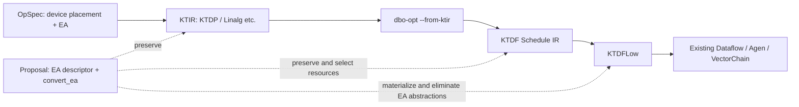

# Element Arrangement: Summary of KTIR–KTDF Design Decisions

## 1. Summary of Design Decisions

**Separate the carrier of EA state from actual EA transformations, and preserve the contracts from KTIR through KTDF.** The medium- to long-term recommendation is EA-P003: H10 + H6, using `RankedTensorType.encoding` for tensor SSA values and an explicit `convert_ea` for transformations. At the FIFO/memref stages, transfer the same descriptor into checked slot/read/write contracts. Adding encoding alone is insufficient: current type reconstruction and flattening preserve only shape and element type.[KF4][S3][S4][D1]

**Do not add new instructions or attributes** to the final Dataflow dialect. Introduce new stages/routes/transfers before PathExpansion, tiling, and parallelization, or rerun the affected planning. Finalize reserved local moves and buffers before CustomLinalgBufferization/AddressAssignment. Only register-local shuffles whose resources have already been reserved may remain until KTDFLow→DFIR, where the unit and sub-SIMD width are fixed. Ultimately, materialize them into existing memory views, agen load/store, send/receive, and vectorchain operations, leaving no EA-specific ops, attributes, or types.[S1][S6]

Numerical casts have a separate contract (EA-P001). `dl16tofp32`/`fp32todl16` combine numerical conversion with output EA constraints; restickify alone must not replace them. Currently, PyTorch bf16 becomes SEN169_FP16 on the device and `f16` in the emitter, but bf16, DLFloat16, and IEEE f16 do not have identical representations or rounding. Mechanically replacing the casts with `arith.extf/truncf` was also rejected by the scheduler in the small IR test that was run.[TS3][TS5][TS11][KF6][S2]

| Timing / proposal | Policy to adopt | Rationale / gate |
| --- | --- | --- |
| P0, EA-P001 | Descriptors and capability contracts that separate logical dtype/shape, physical format, and rounding from EA/order/validity | Validate exact maps, partial sticks, slice/core granularity, and the numerical semantics of dtype pairs |
| P0, EA-P002 | End-to-end casts → B's grid → mean/broadcast → C's fp32 geometry → C/D output EA → integration of all four examples | Resolving one rejection does not complete EA support. Preserve original cast positions and input conditions |
| P1, EA-P003 | H10 + H6. Preserve type contracts and explicit transformations through KTDF | Demonstrate preservation through encoding→FIFO/memref→DFIR with small O/A/D prototypes |
| P1, EA-P004 | H7 + H6. Strong alternative using mandatory op attributes and explicit transformations | Switch if encoding support requires widespread changes to standard passes. Reject missing attributes with boundary verifiers |
| P2, EA-P005 | Transformation sharing, movement, load/store fusion, and cost-based selection over legal candidates only | Enable after establishing correctness for all four examples. Separate byte proxies from measured latency |

Triton [#229](https://github.com/torch-spyre/triton/issues/229) is used as the user-specified **future premise** that downstream restickify is available for fp16, dlfloat16, float32, int16, and int32. It does not imply support for arbitrary EA pairs/shapes, numerical casts, bf16=DL16, or negligible cost. If the required maps or numerical casts cannot be connected to existing DFIR operations, those inputs cannot be legalized, and acceptance of the four examples remains incomplete.

### 1.1 Current Validation and Strength of the Conclusions

CPU results were obtained for all four examples. The Spyre runs, preserving bf16 inputs, bf16 weights in A/B, and `dynamic=False`, stopped as follows. **Completion and successful numerical comparison of the four examples remain unverified.**

| Example | First observed stopping point | Design implication |
| --- | --- | --- |
| A Granite | Unregistered `dl16tofp32` in the KTIR plan | After f32 normalization, round to bf16 before multiplying by the weight |
| B GptOss | Mixed work division in the KTIR plan | Split the upcast of the 4096-element weight into a separate kernel/function, explicitly defining buffer ownership and completion synchronization. Narrow to bf16 after multiplication |
| C RoPE | Incompatible fp32 sticks during layout selection before KTIR | Align the different stick axes on the position and frequency sides. Geometry and EA order are separate issues |
| D Softmax | Unregistered `dl16tofp32` in the KTIR plan | Keep f32 through the output. Do not add a narrowing cast to repair output EA |

All 191 existing KTIR validation and emitter unit tests passed. A separate bf16[1,64] addition executed on the Spyre runtime through the KTIR path and matched the CPU with atol=rtol=0. Independent add IR also confirmed KTIR→KTDF→Dataflow and spyrecode generation. The build-time SHAs of the installed frontend/_C/dbo could not be fully established; these successes must not be generalized to CI or the four examples.

### 1.2 Proposed KTIR and KTDF for the Four Examples

The following makes **EA-P003's proposed IR closer to MLIR syntax**; it is not IR generated by the current compiler from the four programs. `func.func`, `func.call`, `arith`, and `math` use existing MLIR syntax. New ops use the generic forms `"ktdp.numeric_cast"`, `"ktdp.convert_ea"`, and `"ktdf.convert_ea"`, with a **`// NEW OP (proposal)` comment at every use**. Their names, attributes, verifiers, and lowering are unimplemented proposals.

**Reading types and encodings:** encoding is part of a tensor type, but is shown as a third component distinct from shape and element type.

| Notation | Meaning |
| --- | --- |
| `tensor<128x128x32xf32, #XU>` | Device shape `[128,128,32]`, element type `f32`, encoding attribute `#XU` |
| `#XU = {...}` | Attribute alias carrying EA order, logical shape, and references to map/validity contracts |
| `!X32U = tensor<128x128x32xf32, #XU>` | Type alias for the complete tensor type, not a new dialect type |
| `!spyreop.df16` | Existing frontend DLFloat16 element type; neither PyTorch `bf16` nor IEEE `f16` |
| `memref<...xf32>` / `!ktdf.fifo.slot<..., 64xf32>` | No tensor encoding; transfer information into proposed checked contracts such as `ea.contract` |

This does not mean that the current torch emitter's spelling of DL16 as `f16` has been changed. These examples explicitly use the existing `!spyreop.df16` to avoid conflating numerical semantics, and place logical bf16 conversion/rounding in cast attributes and helper contracts. Implementing this requires the numerical contracts and type adapters in EA-P001/P002.[KF6][TS11]

**Scope of shapes and maps:** A/B activations use the confirmed device shapes (16-bit `[128,64,64]`, f32 `[128,128,32]`), and D's f32 shape is `[4,128,32]`. Other weight/reduction shapes and C intermediates are **proposed physical storage envelopes** chosen to make the examples concrete, not claimed as generated shapes. Reduction encodings `#RS/#MS` and C's `#PB` are candidates with one valid scalar per row; exact lanes are specified by the contract referenced by `valid_ref`. A `map_ref` names a concrete map not supplied here; no map has been inferred from shape alone. Implementation must check OpSpec coordinates and backend capabilities and reject lowering if a contract is unresolved. This does not propose replacing device tensor shapes with logical shapes in the initial implementation.

**Boundary of the KTDF examples:** these are structural examples at the stage where tensor values remain. Actual `ktdf.pipeline`/stage/route regions, tiling, and resource allocation are omitted. `func.call @..._stage` and `retain/reload` name **helper functions** standing for omitted bodies; they are neither new stage instructions nor a claim that the current scheduler accepts these calls. FIFO conversion transfers encoding into checked contracts as illustrated by the adapter below. Per-use reloads from retained buffers produce separate channels, not unlimited rereading or CSE of FIFO reads.[D6] Introduce new routes/stages before the affected planning passes and leave no new EA instructions or attributes in final Dataflow.

Common encoding/type aliases (the illustrative dictionary schema is proposed; MLIR alias syntax is existing):

```mlir
// PROPOSED encoding schema: builtin DictionaryAttr, not a current EA attribute.
// map_ref / valid_ref name contracts to be supplied and verified; they are not maps.
#XS = {order = "STANDARD", logical_shape = array<i64: 1, 128, 4096>, map_ref = "X.S64", valid_ref = "all"}
#XU = {order = "DL16_TO_FP32", logical_shape = array<i64: 1, 128, 4096>, map_ref = "X.U32", valid_ref = "all"}
#RS = {order = "STANDARD", logical_shape = array<i64: 1, 128, 1>, map_ref = "R.rows", valid_ref = "one_scalar_per_row"}
#WS = {order = "STANDARD", logical_shape = array<i64: 4096>, map_ref = "W.S64", valid_ref = "all"}
#WU = {order = "DL16_TO_FP32", logical_shape = array<i64: 4096>, map_ref = "W.U32", valid_ref = "all"}

// Existing scalar type !spyreop.df16 denotes physical DLFloat16, NOT bf16.
// !... aliases denote COMPLETE types; #... aliases denote encoding ATTRIBUTES.
!X16S = tensor<128x64x64x!spyreop.df16, #XS>
!X32U = tensor<128x128x32xf32, #XU>
!R32S = tensor<128x1x32xf32, #RS>
!W16S = tensor<64x64x!spyreop.df16, #WS>
!W32U = tensor<128x32xf32, #WU>
!MX32 = memref<128x128x32xf32>  // No tensor encoding on a memref.
!MR32 = memref<128x1x32xf32>
!MW32 = memref<128x32xf32>

#P0 = {order = "STANDARD", logical_shape = array<i64: 1, 128>, map_ref = "P.sequence_stick", valid_ref = "all"}
#P1 = {order = "STANDARD", logical_shape = array<i64: 1, 128, 1>, map_ref = "P.unsqueeze", valid_ref = "all"}
#PB = {order = "STANDARD", logical_shape = array<i64: 1, 128, 1>, map_ref = "P.frequency_stick", valid_ref = "one_scalar_per_row"}
#IS = {order = "STANDARD", logical_shape = array<i64: 64>, map_ref = "inv_freq.S32", valid_ref = "all"}
#FS = {order = "STANDARD", logical_shape = array<i64: 1, 128, 64>, map_ref = "F.S32", valid_ref = "all"}
#ES32 = {order = "STANDARD", logical_shape = array<i64: 1, 128, 128>, map_ref = "E.S32", valid_ref = "all"}
#ED16 = {order = "FP32_TO_DL16", logical_shape = array<i64: 1, 128, 128>, map_ref = "E.D16", valid_ref = "all"}
#ES16 = {order = "STANDARD", logical_shape = array<i64: 1, 128, 128>, map_ref = "E.S16", valid_ref = "all"}
!P0I = tensor<1x4x32xi32, #P0>
!P1I = tensor<1x4x1x32xi32, #P1>
!P1F = tensor<1x4x1x32xf32, #P1>
!PBF = tensor<1x1x128x32xf32, #PB>
!IF = tensor<2x32xf32, #IS>
!F32S = tensor<1x2x128x32xf32, #FS>
!E32S = tensor<1x4x128x32xf32, #ES32>
!E16D = tensor<1x2x128x64x!spyreop.df16, #ED16>
!E16S = tensor<1x2x128x64x!spyreop.df16, #ES16>
!MF32 = memref<1x2x128x32xf32>
!ME32 = memref<1x4x128x32xf32>

#QS16 = {order = "STANDARD", logical_shape = array<i64: 128, 128>, map_ref = "Q.S64", valid_ref = "all"}
#QU32 = {order = "DL16_TO_FP32", logical_shape = array<i64: 128, 128>, map_ref = "Q.U32", valid_ref = "all"}
#QS32 = {order = "STANDARD", logical_shape = array<i64: 128, 128>, map_ref = "Q.S32", valid_ref = "all"}
#MS = {order = "STANDARD", logical_shape = array<i64: 128, 1>, map_ref = "M.rows", valid_ref = "one_scalar_per_row"}
!Q16S = tensor<2x128x64x!spyreop.df16, #QS16>
!Q32U = tensor<4x128x32xf32, #QU32>
!Q32S = tensor<4x128x32xf32, #QS32>
!M32S = tensor<1x128x32xf32, #MS>
!MQ32 = memref<4x128x32xf32>
```

First, the shared f32 portion of A/B. Reduction helpers preserve the logical last axis, valid elements, fp32 accumulation, and original operation order; broadcasting distributes only the corresponding row's scalar along the hidden axis. Epsilon uses a shape-aware helper rather than applying `arith.addf` directly to a scalar and tensor. Syntactic validity of `arith`/`math` does not prove legal lowering for U; no fastmath or reassociation permission is added.

```mlir
// Existing func/arith/math ops. Calls name explanatory helpers, NOT new ops.
// mean_hidden_U: logical last axis, valid elements only, fp32 accumulation,
// original reduction-order contract, division by 4096, one result per row.
func.func @rms_f32_ktir(%x: !X32U) -> !X32U {
  %sq = arith.mulf %x, %x : !X32U
  %v = func.call @mean_hidden_U(%sq) : (!X32U) -> !R32S
  %eps = arith.constant 1.0e-5 : f32
  %ve = func.call @add_epsilon_rows(%v, %eps) : (!R32S, f32) -> !R32S
  %inv = math.rsqrt %ve : !R32S
  %scale = func.call @broadcast_rows_to_hidden(%inv) : (!R32S) -> !X32U
  %n = arith.mulf %x, %scale : !X32U
  return %n : !X32U
}

// KTDF tensor-stage skeleton: helpers stand for stage bodies and transfers.
// PROPOSED ea.contract attributes transfer the descriptor to non-tensor values.
// retain/reload are helper FUNCTIONS, not new KTDF operations or FIFO rereads.
func.func @rms_f32_ktdf(%x: !X32U) -> !X32U {
  %bx = func.call @retain_X(%x) {ea.contract = #XU} : (!X32U) -> !MX32
  %xr = func.call @reload_X(%bx) {ea.contract = #XU} : (!MX32) -> !X32U
  %sq = arith.mulf %xr, %xr : !X32U
  %v = func.call @mean_hidden_U(%sq) : (!X32U) -> !R32S
  %eps = arith.constant 1.0e-5 : f32
  %ve = func.call @add_epsilon_rows(%v, %eps) : (!R32S, f32) -> !R32S
  %inv = math.rsqrt %ve : !R32S
  %bi = func.call @retain_R(%inv) {ea.contract = #RS} : (!R32S) -> !MR32
  // After tiling, reload the matching row scalar for every hidden tile.
  %xn = func.call @reload_X(%bx) {ea.contract = #XU} : (!MX32) -> !X32U
  %ri = func.call @reload_R(%bi) {ea.contract = #RS} : (!MR32) -> !R32S
  %scale = func.call @broadcast_rows_to_hidden(%ri) : (!R32S) -> !X32U
  %n = arith.mulf %xn, %scale : !X32U
  return %n : !X32U
}
```

**A: GraniteRMSNorm.** The eight generated OpSpecs are cast→mul→mean→add→rsqrt→mul→cast→mul. Keep narrowing before weight multiplication.

KTIR (proposed):

```mlir
func.func @granite_ktir(%x: !X16S, %weight: !W16S) -> !X16S {
  // NEW OP (proposal): numerical cast; logical bf16 -> f32, DL16 storage -> IEEE32.
  %x32 = "ktdp.numeric_cast"(%x) {src_logical = bf16, dst_logical = f32}
    : (tensor<128x64x64x!spyreop.df16, #XS>) -> tensor<128x128x32xf32, #XU>
  %n = func.call @rms_f32_ktir(%x32) : (!X32U) -> !X32U
  // NEW OP (proposal): round BEFORE weight multiplication; retain this boundary.
  %h = "ktdp.numeric_cast"(%n) {src_logical = f32, dst_logical = bf16}
    : (tensor<128x128x32xf32, #XU>) -> tensor<128x64x64x!spyreop.df16, #XS>
  // Helper contract includes logical bf16 rounding; not native DL16 mul semantics.
  %y = func.call @weight_mul_bf16(%weight, %h) : (!W16S, !X16S) -> !X16S
  return %y : !X16S
}
```

KTDF tensor stage (proposed; stage bodies omitted):

```mlir
func.func @granite_ktdf_tensor(%x: !X16S, %weight: !W16S) -> !X16S {
  // Helpers contain the numerical-cast stages with the same contracts as KTIR.
  %x32 = func.call @upcast_X_stage(%x) : (!X16S) -> !X32U
  %n = func.call @rms_f32_ktdf(%x32) : (!X32U) -> !X32U
  %h = func.call @narrow_X_stage(%n) : (!X32U) -> !X16S
  %y = func.call @weight_mul_bf16(%weight, %h) : (!W16S, !X16S) -> !X16S
  return %y : !X16S
}
```

`weight_mul_bf16` is a helper contract including logical bf16 rounding; equivalence to native DL16 multiplication remains unproven. Zero additional pure EA transformations is a candidate if computation in U and the reverse cast can return to S.

**B: GptOssRMSNorm.** The nine generated OpSpecs include promotion of the weight to f32. KTIR shows the numerical graph; the KTDF example shows the repair using separate kernels/functions.

KTIR (proposed):

```mlir
func.func @gpt_oss_ktir(%x: !X16S, %weight: !W16S) -> !X16S {
  // NEW OP (proposal): numerical bf16 -> f32 cast, not restickify.
  %x32 = "ktdp.numeric_cast"(%x) {src_logical = bf16, dst_logical = f32}
    : (!X16S) -> !X32U
  %n = func.call @rms_f32_ktir(%x32) : (!X32U) -> !X32U
  // NEW OP (proposal): promote WEIGHT as required by the original multiplication.
  %w32 = "ktdp.numeric_cast"(%weight) {src_logical = bf16, dst_logical = f32}
    : (tensor<64x64x!spyreop.df16, #WS>) -> tensor<128x32xf32, #WU>
  %wb = func.call @broadcast_weight_U(%w32) : (!W32U) -> !X32U
  %p = arith.mulf %n, %wb : !X32U
  // NEW OP (proposal): round AFTER weight multiplication.
  %y = "ktdp.numeric_cast"(%p) {src_logical = f32, dst_logical = bf16}
    : (!X32U) -> !X16S
  return %y : !X16S
}
```

KTDF tensor stage (proposed; stage bodies omitted):

```mlir
// Separate kernel/function 0, with its own grid and buffer owner.
// PROPOSED result contract: preserve EA across the separate-kernel ABI.
func.func @gpt_weight_prepare_ktdf(%weight: !W16S) -> (!MW32 {ea.contract = #WU}) {
  %w32 = func.call @upcast_W_stage(%weight) : (!W16S) -> !W32U
  %bw = func.call @retain_W(%w32) {ea.contract = #WU} : (!W32U) -> !MW32
  return %bw : !MW32
}
// Separate kernel/function 1. Launch only AFTER kernel 0 completes.
// Runtime launch/completion synchronization is required and omitted here;
// func.call alone is NOT a device-kernel launch or a completion barrier.
// PROPOSED argument contract: must match the completed producer buffer.
func.func @gpt_oss_ktdf_tensor(%x: !X16S, %ready_weight: !MW32 {ea.contract = #WU}) -> !X16S {
  %x32 = func.call @upcast_X_stage(%x) : (!X16S) -> !X32U
  %n = func.call @rms_f32_ktdf(%x32) : (!X32U) -> !X32U
  // Independent channel/load per activation tile; do not reuse a consumed FIFO.
  %w32 = func.call @reload_W(%ready_weight) {ea.contract = #WU} : (!MW32) -> !W32U
  %wb = func.call @broadcast_weight_U(%w32) : (!W32U) -> !X32U
  %p = arith.mulf %n, %wb : !X32U
  %y = func.call @narrow_X_stage(%p) : (!X32U) -> !X16S
  return %y : !X16S
}
```

Separate weight preparation requires buffer ownership and completion synchronization; splitting stages within one kernel does not bypass the single-grid check. If additional EA repair is needed, compare W=4096 against activation X=524288, but choosing the smaller side does not establish ownership/broadcast legality. On the CPU, `u=1.00390625f32,w=1.5bf16` gives 1.5 for A and 1.5078125 for B, so no rewrite aligns their cast positions.

**C: RoPE.** The current implementation stopped before OpSpec generation. This proposes the required processing, preserving logical i64 positions (device i32), f32 inv_freq, and the bf16 dtype/device supplied by x.

KTIR (proposed):

```mlir
// x supplies the bf16 output dtype/device only; its tensor values are unused.
// position is logically i64; transfer stores i32. Fixed values 0..127 are exact.
func.func @rope_ktir(%x: !X16S, %position: !P0I, %inv_freq: !IF) -> (!E16S, !E16S) {
  // Existing func.call to a view helper: logical [1,128] -> [1,128,1].
  %pv = func.call @unsqueeze_position(%position) : (!P0I) -> !P1I
  // NEW OP (proposal): numerical conversion after unsqueeze, storage i32 -> f32.
  %p32 = "ktdp.numeric_cast"(%pv) {src_logical = i64, dst_logical = f32,
    input_range = array<i64: 0, 127>} : (!P1I) -> !P1F
  // Helper for checked geometry restickify, NOT an EA-only relabel or a new op.
  %pa = func.call @restick_position_to_frequency_axis(%p32) : (!P1F) -> !PBF
  %f = func.call @position_frequency_mul(%pa, %inv_freq) : (!PBF, !IF) -> !F32S
  %e = func.call @concat_last(%f, %f) : (!F32S, !F32S) -> !E32S
  %c = math.cos %e : !E32S
  %s = math.sin %e : !E32S
  // NEW OP (proposal): preserve the original cos-result rounding position.
  %c16 = "ktdp.numeric_cast"(%c) {src_logical = f32, dst_logical = bf16}
    : (!E32S) -> !E16D
  // NEW OP (proposal): preserve the original sin-result rounding position.
  %s16 = "ktdp.numeric_cast"(%s) {src_logical = f32, dst_logical = bf16}
    : (!E32S) -> !E16D
  // NEW OP (proposal): same element type/logical shape; change EA only.
  %co = "ktdp.convert_ea"(%c16)
    : (tensor<1x2x128x64x!spyreop.df16, #ED16>) -> tensor<1x2x128x64x!spyreop.df16, #ES16>
  // NEW OP (proposal): same pure EA transformation for the other output.
  %so = "ktdp.convert_ea"(%s16) : (!E16D) -> !E16S
  return %co, %so : !E16S, !E16S
}
```

KTDF tensor stage (proposed; stage bodies omitted):

```mlir
func.func @rope_ktdf_tensor(%position: !P0I, %inv_freq: !IF) -> (!E16S, !E16S) {
  %pv = func.call @unsqueeze_position(%position) : (!P0I) -> !P1I
  %p32 = func.call @position_cast_stage(%pv) : (!P1I) -> !P1F
  %pa = func.call @restick_position_to_frequency_axis(%p32) : (!P1F) -> !PBF
  %f = func.call @position_frequency_mul(%pa, %inv_freq) : (!PBF, !IF) -> !F32S
  %bf = func.call @retain_F(%f) {ea.contract = #FS} : (!F32S) -> !MF32
  // Two independent loads/channels for the two concat operands.
  %f0 = func.call @reload_F(%bf) {ea.contract = #FS} : (!MF32) -> !F32S
  %f1 = func.call @reload_F(%bf) {ea.contract = #FS} : (!MF32) -> !F32S
  %e = func.call @concat_last(%f0, %f1) : (!F32S, !F32S) -> !E32S
  %be = func.call @retain_E(%e) {ea.contract = #ES32} : (!E32S) -> !ME32
  %ec = func.call @reload_E(%be) {ea.contract = #ES32} : (!ME32) -> !E32S
  %es = func.call @reload_E(%be) {ea.contract = #ES32} : (!ME32) -> !E32S
  %c = math.cos %ec : !E32S
  %s = math.sin %es : !E32S
  %c16 = func.call @narrow_E_stage(%c) : (!E32S) -> !E16D
  %s16 = func.call @narrow_E_stage(%s) : (!E32S) -> !E16D
  // NEW OP (proposal): keep the EA obligation until existing transfers/shuffles realize it.
  %co = "ktdf.convert_ea"(%c16) : (!E16D) -> !E16S
  // NEW OP (proposal): no numerical conversion at this operation.
  %so = "ktdf.convert_ea"(%s16) : (!E16D) -> !E16S
  return %co, %so : !E16S, !E16S
}
```

`restick_position_to_frequency_axis` is a helper for geometry conversion, not merely an order change. `math.cos/sin` show the required numerical processing; current decomposition primitives, approximation error, and backend support still require validation. Arranging the f32 side before narrowing is an alternative only when the composed maps and numerical semantics agree, without moving the cast before trigonometric operations.

**D: Softmax.** The six generated OpSpecs are upcast→max→sub→exp→sum→realdiv. Restore S at the exit through a same-dtype EA transformation.

KTIR (proposed):

```mlir
func.func @router_softmax_ktir(%logits: !Q16S) -> !Q32S {
  // NEW OP (proposal): numerical bf16 -> f32 cast, retaining its induced EA.
  %u = "ktdp.numeric_cast"(%logits) {src_logical = bf16, dst_logical = f32}
    : (tensor<2x128x64x!spyreop.df16, #QS16>) -> tensor<4x128x32xf32, #QU32>
  %m = func.call @max_last_U(%u) : (!Q32U) -> !M32S
  %mb = func.call @broadcast_last_U(%m) : (!M32S) -> !Q32U
  %a = arith.subf %u, %mb : !Q32U
  %e = math.exp %a : !Q32U
  %z = func.call @sum_last_U(%e) : (!Q32U) -> !M32S
  %zb = func.call @broadcast_last_U(%z) : (!M32S) -> !Q32U
  %p = arith.divf %e, %zb : !Q32U
  // NEW OP (proposal): f32 -> f32; only the encoding changes, with actual movement as needed.
  %out = "ktdp.convert_ea"(%p)
    : (tensor<4x128x32xf32, #QU32>) -> tensor<4x128x32xf32, #QS32>
  return %out : !Q32S
}
```

KTDF tensor stage (proposed; stage bodies omitted):

```mlir
func.func @router_softmax_ktdf_tensor(%logits: !Q16S) -> !Q32S {
  %u = func.call @upcast_Q_stage(%logits) : (!Q16S) -> !Q32U
  %bu = func.call @retain_Q(%u) {ea.contract = #QU32} : (!Q32U) -> !MQ32
  %um = func.call @reload_Q(%bu) {ea.contract = #QU32} : (!MQ32) -> !Q32U
  %us = func.call @reload_Q(%bu) {ea.contract = #QU32} : (!MQ32) -> !Q32U
  %m = func.call @max_last_U(%um) : (!Q32U) -> !M32S
  %mb = func.call @broadcast_last_U(%m) : (!M32S) -> !Q32U
  %a = arith.subf %us, %mb : !Q32U
  %e = math.exp %a : !Q32U
  %be = func.call @retain_Q(%e) {ea.contract = #QU32} : (!Q32U) -> !MQ32
  %ez = func.call @reload_Q(%be) {ea.contract = #QU32} : (!MQ32) -> !Q32U
  %ep = func.call @reload_Q(%be) {ea.contract = #QU32} : (!MQ32) -> !Q32U
  %z = func.call @sum_last_U(%ez) : (!Q32U) -> !M32S
  %zb = func.call @broadcast_last_U(%z) : (!M32S) -> !Q32U
  %p = arith.divf %ep, %zb : !Q32U
  // NEW OP (proposal): lower into existing DFIR memory/transfer/shuffle operations.
  %out = "ktdf.convert_ea"(%p) : (!Q32U) -> !Q32S
  return %out : !Q32S
}
```

The final transformation keeps f32 and the same shape, changing the encoding from U to S. It must still perform any necessary data movement, not merely rewrite an attribute. Adding fp32→DL16→fp32 to restore EA is prohibited. Design acceptance requires f32 output independently of the original script’s `check_dtype=False`.

**Additional FIFO-boundary example.** This is a separate single tile, not the full shapes above. It distinguishes existing read/write ops from the proposed encoding/contracts. `64xf32` specifies FIFO element count and element type, not EA. A verifier must check endpoints, ownership, and tile maps. FIFO and tensor element counts/types must also agree. Adding attributes to existing ops alone does not implement support; encoding-aware verifiers, builders, and bufferization are required.[D1][D6]

```mlir
// Separate one-tile adapter example; endpoint names are illustrative.
// Existing FIFO type has element count/type, NOT RankedTensorType encoding.
#tile_U = {order = "DL16_TO_FP32", map_ref = "tile.U32", valid_ref = "all"}
!TileU = tensor<2x32xf32, #tile_U>
!In = !ktdf.fifo.slot<"L1LU" -> "SFU", 64xf32>
!Out = !ktdf.fifo.slot<"SFU" -> "L1LU", 64xf32>
// PROPOSED argument contracts: verify against channel endpoints and owners.
func.func @checked_tile_adapter(%in: !In {ea.contract = #tile_U},
                                %out: !Out {ea.contract = #tile_U}) {
  // EXISTING op; PROPOSED ea.contract attribute + encoding-aware verification.
  %v = "ktdf.read_from_fifo"(%in) {ea.contract = #tile_U} : (!In) -> !TileU
  // EXISTING op; PROPOSED contract must agree with the output channel/owner.
  "ktdf.write_to_fifo"(%v, %out) {ea.contract = #tile_U} : (!TileU, !Out) -> ()
  return
}
```

**Typed helper declarations.** Place these declarations in the same module as the common aliases. They make `func.call` input/output types traceable, but declarations do not implement the bodies or lowering. Helpers must be inlined/expanded into computation, stages, and transfers before entering the current scheduler path. Retain/reload contracts require owned buffers, completion synchronization, per-use channels, and correct row/tile selection; later passes must not treat them as pure functions eligible for unconditional CSE. Numerical-cast helpers preserve original rounding positions, logical dtypes, and storage formats; buffer loads restore the corresponding tensor encoding. Argument, result, and call-site `ea.contract` attributes must agree with producer/owner contracts; adding an attribute cannot establish EA for an arbitrary buffer. D’s `max_last_U/sum_last_U` reduce all 128 logical experts per row, not just the physical trailing 32 elements. Preserve masks, fp32 accumulation, original order, and NaN/identity semantics.

```mlir
// Explanatory helper symbols, not new ops. Bodies must be expanded before scheduling.
// PROPOSED argument/result contracts below bind memrefs to producer/owner EA.
func.func private @mean_hidden_U(!X32U) -> !R32S
func.func private @add_epsilon_rows(!R32S, f32) -> !R32S
func.func private @broadcast_rows_to_hidden(!R32S) -> !X32U
func.func private @weight_mul_bf16(!W16S, !X16S) -> !X16S
func.func private @broadcast_weight_U(!W32U) -> !X32U
func.func private @unsqueeze_position(!P0I) -> !P1I
func.func private @restick_position_to_frequency_axis(!P1F) -> !PBF
func.func private @position_frequency_mul(!PBF, !IF) -> !F32S
func.func private @concat_last(!F32S, !F32S) -> !E32S
func.func private @max_last_U(!Q32U) -> !M32S
func.func private @sum_last_U(!Q32U) -> !M32S
func.func private @broadcast_last_U(!M32S) -> !Q32U
func.func private @upcast_X_stage(!X16S) -> !X32U
func.func private @narrow_X_stage(!X32U) -> !X16S
func.func private @upcast_W_stage(!W16S) -> !W32U
func.func private @position_cast_stage(!P1I) -> !P1F
func.func private @narrow_E_stage(!E32S) -> !E16D
func.func private @upcast_Q_stage(!Q16S) -> !Q32U
func.func private @retain_X(!X32U) -> (!MX32 {ea.contract = #XU})
func.func private @reload_X(!MX32 {ea.contract = #XU}) -> !X32U
func.func private @retain_R(!R32S) -> (!MR32 {ea.contract = #RS})
func.func private @reload_R(!MR32 {ea.contract = #RS}) -> !R32S
func.func private @retain_W(!W32U) -> (!MW32 {ea.contract = #WU})
func.func private @reload_W(!MW32 {ea.contract = #WU}) -> !W32U
func.func private @retain_F(!F32S) -> (!MF32 {ea.contract = #FS})
func.func private @reload_F(!MF32 {ea.contract = #FS}) -> !F32S
func.func private @retain_E(!E32S) -> (!ME32 {ea.contract = #ES32})
func.func private @reload_E(!ME32 {ea.contract = #ES32}) -> !E32S
func.func private @retain_Q(!Q32U) -> (!MQ32 {ea.contract = #QU32})
func.func private @reload_Q(!MQ32 {ea.contract = #QU32}) -> !Q32U
```

All candidates use the same numerical graphs above. KTIR-only designs must materialize EA at the KTDF entry; EA-P003/P004 retain the illustrated contracts through KTDF. Unresolved shape, map, or cast contracts prevent declaring these examples implementable. The prohibition on adding instructions or attributes to final Dataflow remains in force.

**Syntax check for this revision (2026-10-26):** the combined aliases, helper declarations, and four examples passed the installed mlir_ktdp parser/verifier after temporarily renaming only the three proposed operation kinds into the unregistered `ea_doc` namespace. This checked shape/element-type/encoding notation, SSA, existing arith/math operations, and func.call type consistency. The original `ktdp.numeric_cast` name is rejected as unregistered. This does not validate EA maps, new-op semantics, helper bodies, KTDF scheduling, Dataflow lowering, or execution of the four examples, and does not update the report’s historical execution results. The FIFO adapter also passed parse/verify with `dbo-opt --allow-unregistered-dialect`, which registers existing KTDF, without running passes; this does not validate the meaning or preservation of the new `ea.contract`.

## 2. Overall Policy and Processing Overview

### 2.1 Confirmed Path and Information Preservation



Solid lines are confirmed by source code and generated addition artifacts; dotted lines are proposed. This diagram does not show completed paths for the four examples. `TORCH_SPYRE_KTIR` is enabled when it equals `"1"` at import time, and `SuperDSCScheduling.define_kernel` selects `async_compile.ktir`. KTIR is a language comprising multiple dialects, not an alias for KTDP alone. Triton is a separate producer and does not occur within the direct OpSpec path.[TS1][TS2][TS15][KF1]

| Stage | Information preserved / selected | Responsibilities for changes and verification |
| --- | --- | --- |
| OpSpec | Already selected device geometry/EA, allocation, grid, and numerical cast provenance | Strengthen correspondence to logical dtype/shape. Do not change actual data placement merely by changing its description |
| KTIR | Actual EA, use requirements, and pure EA transformations; candidate sets reside in the analysis | Fix cast semantics and select legal transformations for pointwise operations/fanout. Separate physical shape from the logical map |
| KTDF tensor/FIFO | Transfer the same descriptor from tensor encoding into slot/read/write contracts | Preserve it through bufferization, cloning, and retiling; check broadcast, reduction, and ownership |
| KTDF scheduling | Resources, transfer granularity, tiles, cost, and buffer footprint | Plan additional buffers/stages before allocation. Do not select illegal maps |
| KTDFLow→DFIR | Reserved units/registers and concrete maps | Lower to existing operations, eliminating EA abstractions. Fail if EA-specific information remains; no Dataflow extension |

Current KTDF `splat` leaves an obligation on a FIFO read, then lowers it to an existing `vectorchain.shuffle` immediately after `dataflow.receive`. This precedent supports late materialization, but does not prove the implementation of arbitrary EA transformations.[S5][S6]

| Abstract processing | Existing final representation | Remaining checks |
| --- | --- | --- |
| Correspondence in memory | Existing layout_map of `dataflow.get_logical_memory_view`, agen load/store order/set | Byte/element units, alignment, masks, and maps capable of expressing the target EA |
| Lane reordering/duplication | `vectorchain.shuffle`, existing registers and send/receive | Same element type, indices/widths, and shuffles supported by the hardware |
| Numerical cast | `vectorchain.cast` syntax exists | Implementation of bf16/DL16 semantics, rounding, and dtype pairs. Syntax alone does not establish legality |
| Large restickify | Existing view/agen/transfer and the #229 premise | Connection for the target EA pair/shape, capacity, and cost |

The following operation sequence was confirmed in generated addition DFIR (surrounding definitions omitted). It is not an example of completed Dataflow generation for any of the four programs.

```mlir
%9 = dataflow.receive %8 : vector<64xf16>
%12 = dataflow.receive %11 : vector<64xf16>
%13 = vectorchain.binary %9, %12
  {binary_op = #vectorchain<binary_operator add>,
   op_specific_map = affine_map<(d0) -> (d0)>}
  : vector<64xf16>, vector<64xf16>, vector<64xf16>
dataflow.send %15, %13 : vector<64xf16>
```

### 2.2 Legality Conditions for Transformation Optimization

A pure EA transformation preserves logical dtype, shape, and the bits of valid elements. Identity/inverse-transformation elimination and CSE are allowed only when maps, validity, replication semantics, ownership, timing, and aliases match. Moving a transformation across a pointwise operation applies the same logical correspondence to all non-broadcast inputs and updates broadcast axes. Moving it across a reduction must preserve not only the element set but also the contracts for masks, identity elements, accumulation dtype, and operation order.

Fusion with a cast is allowed only when it preserves the original numerical conversion and the number and positions of rounding steps. Distinguish this from moving a cast before or after arithmetic. Preserve an EA whose map is unknown as an opaque state, and block rewrites requiring that map. EXX2 includes semantic pairs, so not every EA can be treated as a permutation.

### 2.3 Rollout Order and Acceptance

Use P001 to fix numerical/EA contracts and versions, then P002 to implement casts, B's grid, A/B's mean, C's geometry/primitives, and C/D outputs end to end. Prototype P003/P004 on the same graph cuts and compare information preservation to select the carrier. Then use P005 to evaluate transformation counts, bytes, temporary storage, compilation time, and measured latency separately. Sub-issue and PR proposals for each boundary are collected in §7 of the full report.

Acceptance compares each of the four examples against its own CPU result. A/B use atol=rtol=0.1; C's cos and sin each use 0.02/0.02; D uses 0.001/0.01. Preserve the specified seeds, shapes, dtypes, and `dynamic=False`, and inspect IR for A's cast-before-weight, B's cast-after-weight, C's i64 positions/f32 inv_freq, and D's f32 output. Record row sums and argmax as D's diagnostics without introducing thresholds absent from the original.

## 3. Benefits, Drawbacks, and Selection of Design Candidates

### 3.1 Comparing the 11 Candidates Under the Same Conditions

State carriers and transformation carriers are not mutually exclusive. The common evaluation uses `cast→square→fanout(reduce,STANDARD consumer)` and A–D in §1.2, with identical numerical cast positions and backend capabilities for all candidates.

| Hypothesis | Benefits | Drawbacks / conditions | Decision |
| --- | --- | --- | --- |
| H1 New KTIR ops only | bind/convert make operations explicit; local optimization is possible | Verify EA for all values through analysis; materialization required before KTDF | Limited alternative when changing KTDF is difficult |
| H2 Attributes on existing KTIR ops | Preserve types; small initial change | Missing attributes, block arguments, identity-copy elimination, and early commitment | Not the primary standalone candidate |
| H3 New KTIR types | Type all SSA values | Breaks the RankedTensor assumptions of KTDP/Linalg; extensive adapters | Reject |
| H4 Extend existing KTIR types | Partial uses such as access contracts | AccessTile represents only addresses; extending DF16 does not cover f32. Builtin schemas cannot be changed locally | Fails mandatory conditions as a standalone design |
| H5 KTIR encoding | Type actual EA while retaining tensor infrastructure | Materialization before KTDF and updated shape inference required | Combine with H1; strong option if KTDF cannot be changed |
| H6 New ops in both stages | Preserve transformation obligations until resources are fixed; facilitates CSE/fusion | Also needs a carrier for state contracts | Adopt in combination with H10 or H7 |
| H7 Attributes on existing ops in both stages | Natural attachment to uses/FIFOs; splat precedent | Verification obligations for every clone, bufferization, and shape change | **Strong alternative EA-P004 with H6** |
| H8 New types in both stages | Consistent typing from tensors through slots | Largest IR/API migration. No performance advantage from the carrier alone | Reconsider if a comprehensive redesign is independently needed |
| H9 Extend existing types in both stages | KTDF FIFO parameters can be extended | H4's gaps remain on the KTIR side | Insufficient alone. The FIFO portion is an implementation mechanism for H10 |
| H10 Encoding in both stages | Place actual EA in types and retain choices through KTDF | FIFO/memref do not use tensor encoding, so adapters are mandatory | **Conditional recommendation EA-P003 with H6** |
| H11 Analysis tables / use contracts, etc. | Suited to candidate sets, cost, and fanout analysis | A table alone loses semantics across serialization or separate processes | Adopt as a supplement, not the sole semantic carrier |

The mandatory conditions are numerical semantics, verification of required EA and transformations, connection to the target path, no Dataflow extensions, and explicit additional backend assumptions. H4/H9 alone cannot represent the necessary data SSA values. Other candidates are also conditional because final lowering for the four examples is unimplemented; defining a representation alone does not complete acceptance.

### 3.2 Runtime Cost and Evidence for Selection

Attributes and encoding have the same runtime cost for the same concrete schedule. The following is a **static proxy**, counting an independent pure EA read+write as `2*N*bytes`, excluding padding, transfer granularity, per-core replication, and fusion. It is not converted into time or percentage speedups.

| Example | Numerical casts preserved | Candidate EA transformations / logical traffic |
| --- | --- | --- |
| A | Two: x upcast and result narrow | Zero additional transformations if computation stays in U and the reverse cast returns to S |
| B | A's two plus weight upcast | Zero additional transformations if both multiplication inputs use U. If repair is needed, compare 32KiB on W with 4MiB on the activation side, subject to ownership conditions |
| C | Position cast plus cos/sin narrowing | Two D16→S16 transformations after narrowing: 128KiB; total output buffers: 64KiB. Input geometry transformation is separate |
| D | One: x upcast | One U32→S32 transformation: 128KiB; additional buffer: 64KiB |

The minimum validation that could change the selection is to run the same O/A/D cuts through canonicalize/CSE, map/tile, FIFO, memref, and DFIR with both H10 + H6 and H7 + H6. If encoding requires extensive changes to standard passes, introduce the attribute design first. Both must demonstrate preservation at every boundary and materialization into existing final DFIR.

Complete EA maps, the bf16/DL16 numerical cast contract, correspondence between installed builds and baselines, and transformation costs remain unresolved. In the short term, establish concrete failures and capability boundaries; in the medium to long term, move those same contracts into more suitable carriers and optimizers. Completing the report, successfully executing the four examples, and finalizing the design decision are separate milestones.

[D1]: https://github.com/torch-spyre/dataflow-scheduler-mlir-dialects/blob/5df926aa2472d169dfd11a8f3f658387dba361d2/include/dataflow-scheduler/Dialect/KTDF/KTDFTypes.td#L75-L122
[KF1]: https://github.com/torch-spyre/ktir-mlir-frontend/blob/1f96e5790a99b7aaf9a445b039044467c66e4e0a/include/ktir/Dialect/KTDP/KTDPDialect.td#L16-L43
[KF4]: https://github.com/torch-spyre/ktir-mlir-frontend/blob/1f96e5790a99b7aaf9a445b039044467c66e4e0a/lib/Dialect/KTDP/KTDPOps.cpp#L1104-L1137
[KF6]: https://github.com/torch-spyre/ktir-mlir-frontend/blob/1f96e5790a99b7aaf9a445b039044467c66e4e0a/include/ktir/Dialect/SpyreOp/SpyreOpTypes.td#L39-L87
[S1]: https://github.com/torch-spyre/dataflow-scheduler/blob/9ceb2a8279098034c0819cf712fce6146fee2dbd/lib/Pipeline.cpp#L40-L172
[S2]: https://github.com/torch-spyre/dataflow-scheduler/blob/9ceb2a8279098034c0819cf712fce6146fee2dbd/lib/Conversion/frontend/KTIRToScheduleIR/KTIRLegalityCheck.cpp#L52-L81
[S3]: https://github.com/torch-spyre/dataflow-scheduler/blob/9ceb2a8279098034c0819cf712fce6146fee2dbd/lib/Dialect/KTDF/Utils/Utils.cpp#L225-L249
[S4]: https://github.com/torch-spyre/dataflow-scheduler/blob/9ceb2a8279098034c0819cf712fce6146fee2dbd/lib/Conversion/backend/ScheduleIRToDFIR/KTDFLowToDFIR/Utils.cpp#L36-L43
[S5]: https://github.com/torch-spyre/dataflow-scheduler/blob/9ceb2a8279098034c0819cf712fce6146fee2dbd/lib/Transforms/SplatLegalizationPass.cpp#L81-L133
[S6]: https://github.com/torch-spyre/dataflow-scheduler/blob/9ceb2a8279098034c0819cf712fce6146fee2dbd/lib/Conversion/backend/ScheduleIRToDFIR/KTDFLowToDFIR/OperationLowerings.cpp#L111-L175
[TS1]: https://github.com/torch-spyre/torch-spyre/blob/f1e0145364392eab4d5bfe1975429726f30becea/torch_spyre/_inductor/config.py#L117-L127
[TS11]: https://github.com/torch-spyre/torch-spyre/blob/f1e0145364392eab4d5bfe1975429726f30becea/torch_spyre/_inductor/codegen/ktir.py#L205-L258
[TS15]: https://github.com/torch-spyre/torch-spyre/blob/f1e0145364392eab4d5bfe1975429726f30becea/torch_spyre/execution/async_compile.py#L616-L713
[TS2]: https://github.com/torch-spyre/torch-spyre/blob/f1e0145364392eab4d5bfe1975429726f30becea/torch_spyre/_inductor/scheduler.py#L648-L670
[TS3]: https://github.com/torch-spyre/torch-spyre/blob/f1e0145364392eab4d5bfe1975429726f30becea/torch_spyre/csrc/types_mapping.h#L57-L100
[TS5]: https://github.com/torch-spyre/torch-spyre/blob/f1e0145364392eab4d5bfe1975429726f30becea/torch_spyre/_inductor/dtype_ops.py#L51-L154

[D6]: https://github.com/torch-spyre/dataflow-scheduler-mlir-dialects/blob/5df926aa2472d169dfd11a8f3f658387dba361d2/lib/Dialect/KTDF/KTDFOps.cpp#L1073-L1081
