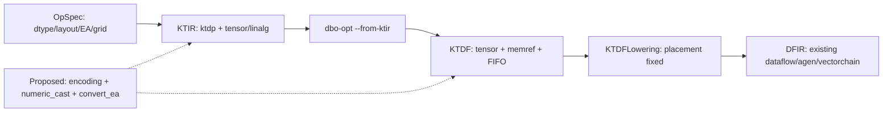

# Element Arrangement: Design Decisions from KTIR to Dataflow

## 1. Summary of Design Decisions

**The recommendation is to attach EA encoding to compute tensors in KTIR and KTDF, combining explicit numerical casts / EA conversions with
arrangement contracts at FIFO boundaries (EA-P003, H10 + H9 + H6).**
EA describes which logical index a value represents in each lane/vector; the encoding itself does not move data.
Distinguish `convert_ea`, which changes EA, from `numeric_cast`, which specifies the numerical type and rounding.

Keep internal EA choices open until the KTDF tiles, units, and routes are known.
Finalize additional buffers/FIFOs, capacities, lifetimes, and the transfer graph before address assignment, then concretize them into existing
memory/access maps, `vectorchain.cast/shuffle/pack`, and `dataflow.send/receive`.
Do not add new EA operations or attributes to final Dataflow.

|Decision|Rationale and conditions|
|---|---|
|Retain EA on compute values through encoding|Descriptors alone cannot cover internal SSA values. Encoding fits the existing RankedTensor infrastructure better than a new tensor wrapper, but requires changes to inference and bufferization.|
|Also retain FIFO boundary contracts|Tensors and memrefs/FIFOs coexist in KTDF, so encoding alone does not propagate to communication. Type extension H9 is recommended; H7 boundary attributes with owner verification are an alternative.|
|Separate numerical casts from EA conversions|A numerical cast may round values. A pure EA conversion preserves the value at each logical index with the same dtype. Cast placement is not a free variable in the arrangement search.|
|Start with limited cast paths in the short term|The current cast recipes, staggered-arrangement acceptance, cast/operation fusion, and frontend broadcast/grid handling have separate gaps. First establish diagnostics and a baseline graph.|
|Conditional recommendation|The df16/bf16 numerical contract, concrete EA conversion recipes, encoding/FIFO propagation, and successful execution of all four examples with the same pins remain incomplete. If these conditions cannot be met, switch to H7 + H6 and limited early concretization.|

Use the existing `!spyreop.df16` (1 sign / 6 exponent / 9 fraction bits) for the numerical format.
The current implementation maps logical bf16 to device SEN169_FP16, which the emitter then maps to builtin f16.
IEEE f16, df16, and PyTorch bf16 are not identical. Do not define the numerical semantics of a different format by adding attributes to `arith.extf`.
Prioritize EA-P001 to preserve the original bf16 rounding boundaries. [Type mapping] [Emitter types] [df16 type]

### 1.1 Results Confirmed So Far

|Appendix|Numerical semantics to preserve|First stopping point in this investigation|
|---|---|---|
|A Granite|Normalize in f32, convert back to bf16, then multiply by the bf16 weight|`dl16tofp32` is not registered for OpSpec→KTIR.|
|B GptOss|Also extend the weight to f32 for multiplication, then convert back to bf16 at the end|Work division mismatch between the 32-core main computation and the 1-core weight cast.|
|C RoPE|position→f32, product with f32 inv_freq / cat / cos / sin, each output in bf16|No arrangement can be selected for the fp32 outer broadcast multiplication. x supplies only dtype/device.|
|D Softmax|bf16 input; softmax computation and output in f32|The same unregistered `dl16tofp32` as in A.|

CPU forward execution and export were confirmed for all four examples, but comparison with Spyre outputs was not reached.
Execution used a temporary copy of the baseline Python sources; the exact SHA correspondence of the C++ extensions, bindings, and downstream binaries remains unverified.
The 14 selected unit tests, frontend parser/legality checks, and four downstream conversion-related tests passed.
Existing Dataflow generation from a standalone downstream cast was confirmed, while an additional test placing cast + square in the same generic failed.
These results do not establish end-to-end success for the four examples.

The design adopts the user's premise of restickify support for five dtypes from KTDF onward,
treating it as the same capability covered by the [existing epic triton #229 (OPEN)](https://github.com/torch-spyre/triton/issues/229).
This does not imply an existing implementation, numerical casts, arbitrary shapes or arrangement conversions, or zero cost.
In particular, the local lane conversion from staggered to STANDARD must be demonstrated separately.

### 1.2 Numerical Semantics and Minimum Gates Before Adoption

The cast positions in A/B cannot be interchanged. On the CPU, with `u=f32(1.00390625)` and `w=bf16(1.5)`,
`w*u.bfloat16()` produces 1.5, while `(w*u).bfloat16()` produces 1.5078125.
A single result within tolerance does not justify arbitrary cast movement.
Allow composition or movement of EA conversions with the same dtype only when they preserve index maps, broadcasting, padding, aliasing, the reduction tree, and FIFO consumption order.

The gates before adoption are (1) df16↔f32 and logical bf16 rounding, (2) exact 64-lane staggered↔STANDARD conversion,
(3) two uses requiring different EAs and both FIFO endpoints, (4) encoding→memory/FIFO→existing DFIR, and (5) comparison of A–D against their respective CPU results.
For A/B, atol=rtol=0.1; for each of C's cos/sin outputs, atol/rtol=0.02/0.02; for D, 0.001/0.01. Input/weight dtypes and
`dynamic=False` follow the appendices. In addition to the original `check_dtype=False` comparison, D must actually output f32.
C's inv_freq remains f32 as in the appendix, and position_ids remain integers.

### 1.3 KTIR and KTDF Examples for the Four Programs in the Recommended Design

The following are **schematic IR / unexecuted validation candidates containing new specifications**, not IR generated by the current implementation.
They show a conservative initial form that makes all casts carrying EA information and all arrangement conversions with the same dtype explicit.
Always normalizing A/B to STANDARD is not the final performance recommendation. EA-P005 removes
these extra conversions after proving legality. Concretizing `DL16_TO_FP32→STANDARD` and `FP32_TO_DL16→STANDARD`
is an additional backend gate, not guaranteed solely by the dtype premise of #229.

The notation uses `#S/#U/#N` and the new `numeric_cast`/`convert_ea` defined in §5.1 of the detailed version.
`#ktdp.ea<"existing EA name">` is shorthand for a new encoding attribute, representing STANDARD, DL16_TO_FP32, or FP32_TO_DL16.
The full contract includes the axis on which it acts, a local 64-element tile, vector and lane counts, and valid extents. Omitted fields must be uniquely inferred from the surrounding tile;
otherwise, reject the IR. All tensor examples are schematic forms applying the local map to each 64-element tile along the last axis.
`numeric_cast` preserves shape and specifies the numerical type and rounding; `convert_ea` preserves shape/dtype and the value at each index.
`!spyreop.df16` is an existing numerical format type. `logical_src/dst = "bfloat16"` is a **new numerical contract attribute**,
specifying the responsibility to read logical bf16 values from df16 storage, or to store them in df16 after bf16 rounding.
Merely writing the attribute does not implement that behavior. For bf16 ranges and special values that df16 cannot represent,
EA-P001 must choose rejection, conversion, or an explicit backend numerical policy, without claiming unconditional equivalence.
A's bf16 multiplication also requires the original rounding. Do not replace bf16 boundaries with df16 rounding alone.

The `func.call` helpers below stand in for lengthy elementwise/reduction bodies.
These are **unimplemented callees with defined semantics**, not examples proving that the scheduler can already lower arbitrary opaque functions.
Function declarations are included to make the MLIR types explicit. The implementation must expand them into legal bodies using existing linalg/arith/math/spyreop operations,
then map/tile them. Do not hide missing support for mean, cos/sin, integer casts, or similar operations and count the examples as successful.

|Helper|Program semantics to preserve|
|---|---|
|`rms_f32`|In f32: square→last-axis mean (divide by 4096)→add eps=1e-5→rsqrt→multiply by the original f32 input. Each row is independent; verify the reduction tree separately.|
|`mul_bf16_storage`|Broadcast the bf16 weight along the 4096 axis, multiply it by the normalized result already rounded to bf16, apply the original bf16 result rounding, and return it in df16 storage.|
|`mul_f32_weight`|Broadcast the weight already extended to f32 and multiply it by the f32 normalized value in f32.|
|`rope_f32`|pos `[1,128]`→unsqueeze, f32 product with inv_freq `[64]`→last-axis cat(freqs,freqs)→cos/sin×1.0. Both results are f32.|
|`softmax_f32`|Last-axis max→sub→exp→sum→divide. Input, computation, and output are f32.|

The KTDF examples are **schematic forms that extract the tensor portions of compute stages into functions**, omitting physical tiles, tokens,
FIFO allocation, and core distribution. They do not mean placing an entire tensor in a single hardware FIFO packet.
At points where data is split into FIFOs, propagate the H9 contract from §5.11 of the detailed version and check both read/write endpoints.
The helpers retain the same numerical semantics in KTIR and KTDF; only the explicit operation conversion from `ktdp` to `ktdf` is shown.

#### A: GraniteRMSNorm

KTIR (new specification; schematic IR):

```mlir
#S = #ktdp.ea<"STANDARD">
#U = #ktdp.ea<"DL16_TO_FP32">
#N = #ktdp.ea<"FP32_TO_DL16">
module {
  func.func private @rms_f32(tensor<1x128x4096xf32, #S>) -> tensor<1x128x4096xf32, #S>
  func.func private @mul_bf16_storage(tensor<1x128x4096x!spyreop.df16, #S>, tensor<4096x!spyreop.df16, #S>) -> tensor<1x128x4096x!spyreop.df16, #S>
  func.func @A_ktdp(%x: tensor<1x128x4096x!spyreop.df16, #S>, %w: tensor<4096x!spyreop.df16, #S>) -> tensor<1x128x4096x!spyreop.df16, #S> {
    // New numeric_cast: check the contract between the original bf16 input and physical df16.
    %xu = "ktdp.numeric_cast"(%x) {logical_src = "bfloat16"}
      : (tensor<1x128x4096x!spyreop.df16, #S>) -> tensor<1x128x4096xf32, #U>
    %xs = "ktdp.convert_ea"(%xu)
      : (tensor<1x128x4096xf32, #U>) -> tensor<1x128x4096xf32, #S>
    %norm = func.call @rms_f32(%xs) : (tensor<1x128x4096xf32, #S>) -> tensor<1x128x4096xf32, #S>
    // New numeric_cast: preserve the bf16 rounding point. df16 rounding alone is insufficient.
    %n = "ktdp.numeric_cast"(%norm) {logical_dst = "bfloat16", rounding = "rne"}
      : (tensor<1x128x4096xf32, #S>) -> tensor<1x128x4096x!spyreop.df16, #N>
    %s = "ktdp.convert_ea"(%n)
      : (tensor<1x128x4096x!spyreop.df16, #N>) -> tensor<1x128x4096x!spyreop.df16, #S>
    %out = func.call @mul_bf16_storage(%s, %w)
      : (tensor<1x128x4096x!spyreop.df16, #S>, tensor<4096x!spyreop.df16, #S>) -> tensor<1x128x4096x!spyreop.df16, #S>
    return %out : tensor<1x128x4096x!spyreop.df16, #S>
  }
}
```

KTDF (new specification; schematic IR):

```mlir
#S = #ktdp.ea<"STANDARD">
#U = #ktdp.ea<"DL16_TO_FP32">
#N = #ktdp.ea<"FP32_TO_DL16">
module {
  func.func private @rms_f32(tensor<1x128x4096xf32, #S>) -> tensor<1x128x4096xf32, #S>
  func.func private @mul_bf16_storage(tensor<1x128x4096x!spyreop.df16, #S>, tensor<4096x!spyreop.df16, #S>) -> tensor<1x128x4096x!spyreop.df16, #S>
  func.func @A_ktdf(%x: tensor<1x128x4096x!spyreop.df16, #S>, %w: tensor<4096x!spyreop.df16, #S>) -> tensor<1x128x4096x!spyreop.df16, #S> {
    // New numeric_cast: check the contract between the original bf16 input and physical df16.
    %xu = "ktdf.numeric_cast"(%x) {logical_src = "bfloat16"}
      : (tensor<1x128x4096x!spyreop.df16, #S>) -> tensor<1x128x4096xf32, #U>
    %xs = "ktdf.convert_ea"(%xu)
      : (tensor<1x128x4096xf32, #U>) -> tensor<1x128x4096xf32, #S>
    %norm = func.call @rms_f32(%xs) : (tensor<1x128x4096xf32, #S>) -> tensor<1x128x4096xf32, #S>
    // New numeric_cast: preserve the bf16 rounding point. df16 rounding alone is insufficient.
    %n = "ktdf.numeric_cast"(%norm) {logical_dst = "bfloat16", rounding = "rne"}
      : (tensor<1x128x4096xf32, #S>) -> tensor<1x128x4096x!spyreop.df16, #N>
    %s = "ktdf.convert_ea"(%n)
      : (tensor<1x128x4096x!spyreop.df16, #N>) -> tensor<1x128x4096x!spyreop.df16, #S>
    %out = func.call @mul_bf16_storage(%s, %w)
      : (tensor<1x128x4096x!spyreop.df16, #S>, tensor<4096x!spyreop.df16, #S>) -> tensor<1x128x4096x!spyreop.df16, #S>
    return %out : tensor<1x128x4096x!spyreop.df16, #S>
  }
}
```

#### B: GptOssRMSNorm

KTIR (new specification; schematic IR):

```mlir
#S = #ktdp.ea<"STANDARD">
#U = #ktdp.ea<"DL16_TO_FP32">
#N = #ktdp.ea<"FP32_TO_DL16">
module {
  func.func private @rms_f32(tensor<1x128x4096xf32, #S>) -> tensor<1x128x4096xf32, #S>
  func.func private @mul_f32_weight(tensor<1x128x4096xf32, #S>, tensor<4096xf32, #S>) -> tensor<1x128x4096xf32, #S>
  func.func @B_ktdp(%x: tensor<1x128x4096x!spyreop.df16, #S>, %w: tensor<4096x!spyreop.df16, #S>) -> tensor<1x128x4096x!spyreop.df16, #S> {
    // New numeric_cast: check the contract between the original bf16 input and physical df16.
    %xu = "ktdp.numeric_cast"(%x) {logical_src = "bfloat16"}
      : (tensor<1x128x4096x!spyreop.df16, #S>) -> tensor<1x128x4096xf32, #U>
    %xs = "ktdp.convert_ea"(%xu)
      : (tensor<1x128x4096xf32, #U>) -> tensor<1x128x4096xf32, #S>
    %norm = func.call @rms_f32(%xs) : (tensor<1x128x4096xf32, #S>) -> tensor<1x128x4096xf32, #S>
    %wu = "ktdp.numeric_cast"(%w) {logical_src = "bfloat16"}
      : (tensor<4096x!spyreop.df16, #S>) -> tensor<4096xf32, #U>
    %ws = "ktdp.convert_ea"(%wu)
      : (tensor<4096xf32, #U>) -> tensor<4096xf32, #S>
    %weighted = func.call @mul_f32_weight(%norm, %ws)
      : (tensor<1x128x4096xf32, #S>, tensor<4096xf32, #S>) -> tensor<1x128x4096xf32, #S>
    // New numeric_cast: preserve the bf16 rounding point. df16 rounding alone is insufficient.
    %n = "ktdp.numeric_cast"(%weighted) {logical_dst = "bfloat16", rounding = "rne"}
      : (tensor<1x128x4096xf32, #S>) -> tensor<1x128x4096x!spyreop.df16, #N>
    %s = "ktdp.convert_ea"(%n)
      : (tensor<1x128x4096x!spyreop.df16, #N>) -> tensor<1x128x4096x!spyreop.df16, #S>
    return %s : tensor<1x128x4096x!spyreop.df16, #S>
  }
}
```

KTDF (new specification; schematic IR):

```mlir
#S = #ktdp.ea<"STANDARD">
#U = #ktdp.ea<"DL16_TO_FP32">
#N = #ktdp.ea<"FP32_TO_DL16">
module {
  func.func private @rms_f32(tensor<1x128x4096xf32, #S>) -> tensor<1x128x4096xf32, #S>
  func.func private @mul_f32_weight(tensor<1x128x4096xf32, #S>, tensor<4096xf32, #S>) -> tensor<1x128x4096xf32, #S>
  func.func @B_ktdf(%x: tensor<1x128x4096x!spyreop.df16, #S>, %w: tensor<4096x!spyreop.df16, #S>) -> tensor<1x128x4096x!spyreop.df16, #S> {
    // New numeric_cast: check the contract between the original bf16 input and physical df16.
    %xu = "ktdf.numeric_cast"(%x) {logical_src = "bfloat16"}
      : (tensor<1x128x4096x!spyreop.df16, #S>) -> tensor<1x128x4096xf32, #U>
    %xs = "ktdf.convert_ea"(%xu)
      : (tensor<1x128x4096xf32, #U>) -> tensor<1x128x4096xf32, #S>
    %norm = func.call @rms_f32(%xs) : (tensor<1x128x4096xf32, #S>) -> tensor<1x128x4096xf32, #S>
    %wu = "ktdf.numeric_cast"(%w) {logical_src = "bfloat16"}
      : (tensor<4096x!spyreop.df16, #S>) -> tensor<4096xf32, #U>
    %ws = "ktdf.convert_ea"(%wu)
      : (tensor<4096xf32, #U>) -> tensor<4096xf32, #S>
    %weighted = func.call @mul_f32_weight(%norm, %ws)
      : (tensor<1x128x4096xf32, #S>, tensor<4096xf32, #S>) -> tensor<1x128x4096xf32, #S>
    // New numeric_cast: preserve the bf16 rounding point. df16 rounding alone is insufficient.
    %n = "ktdf.numeric_cast"(%weighted) {logical_dst = "bfloat16", rounding = "rne"}
      : (tensor<1x128x4096xf32, #S>) -> tensor<1x128x4096x!spyreop.df16, #N>
    %s = "ktdf.convert_ea"(%n)
      : (tensor<1x128x4096x!spyreop.df16, #N>) -> tensor<1x128x4096x!spyreop.df16, #S>
    return %s : tensor<1x128x4096x!spyreop.df16, #S>
  }
}
```

#### C: RoPE

KTIR (new specification; schematic IR):

```mlir
#S = #ktdp.ea<"STANDARD">
#U = #ktdp.ea<"DL16_TO_FP32">
#N = #ktdp.ea<"FP32_TO_DL16">
module {
  func.func private @rope_f32(tensor<1x128xf32, #S>, tensor<64xf32, #S>) -> (tensor<1x128x128xf32, #S>, tensor<1x128x128xf32, #S>)
  func.func @C_ktdp(%pos: tensor<1x128xi32, #S>, %inv: tensor<64xf32, #S>) -> (tensor<1x128x128x!spyreop.df16, #S>, tensor<1x128x128x!spyreop.df16, #S>) {
    // Check at entry that int64→device int32 is exact for positions 0–127.
    %p = "ktdp.numeric_cast"(%pos) {logical_src = "int64"}
      : (tensor<1x128xi32, #S>) -> tensor<1x128xf32, #S>
    %cos, %sin = func.call @rope_f32(%p, %inv)
      : (tensor<1x128xf32, #S>, tensor<64xf32, #S>) -> (tensor<1x128x128xf32, #S>, tensor<1x128x128xf32, #S>)
    %cosn = "ktdp.numeric_cast"(%cos) {logical_dst = "bfloat16", rounding = "rne"}
      : (tensor<1x128x128xf32, #S>) -> tensor<1x128x128x!spyreop.df16, #N>
    %coss = "ktdp.convert_ea"(%cosn)
      : (tensor<1x128x128x!spyreop.df16, #N>) -> tensor<1x128x128x!spyreop.df16, #S>
    %sinn = "ktdp.numeric_cast"(%sin) {logical_dst = "bfloat16", rounding = "rne"}
      : (tensor<1x128x128xf32, #S>) -> tensor<1x128x128x!spyreop.df16, #N>
    %sins = "ktdp.convert_ea"(%sinn)
      : (tensor<1x128x128x!spyreop.df16, #N>) -> tensor<1x128x128x!spyreop.df16, #S>
    return %coss, %sins : tensor<1x128x128x!spyreop.df16, #S>, tensor<1x128x128x!spyreop.df16, #S>
  }
}
```

KTDF (new specification; schematic IR):

```mlir
#S = #ktdp.ea<"STANDARD">
#U = #ktdp.ea<"DL16_TO_FP32">
#N = #ktdp.ea<"FP32_TO_DL16">
module {
  func.func private @rope_f32(tensor<1x128xf32, #S>, tensor<64xf32, #S>) -> (tensor<1x128x128xf32, #S>, tensor<1x128x128xf32, #S>)
  func.func @C_ktdf(%pos: tensor<1x128xi32, #S>, %inv: tensor<64xf32, #S>) -> (tensor<1x128x128x!spyreop.df16, #S>, tensor<1x128x128x!spyreop.df16, #S>) {
    // Check at entry that int64→device int32 is exact for positions 0–127.
    %p = "ktdf.numeric_cast"(%pos) {logical_src = "int64"}
      : (tensor<1x128xi32, #S>) -> tensor<1x128xf32, #S>
    %cos, %sin = func.call @rope_f32(%p, %inv)
      : (tensor<1x128xf32, #S>, tensor<64xf32, #S>) -> (tensor<1x128x128xf32, #S>, tensor<1x128x128xf32, #S>)
    %cosn = "ktdf.numeric_cast"(%cos) {logical_dst = "bfloat16", rounding = "rne"}
      : (tensor<1x128x128xf32, #S>) -> tensor<1x128x128x!spyreop.df16, #N>
    %coss = "ktdf.convert_ea"(%cosn)
      : (tensor<1x128x128x!spyreop.df16, #N>) -> tensor<1x128x128x!spyreop.df16, #S>
    %sinn = "ktdf.numeric_cast"(%sin) {logical_dst = "bfloat16", rounding = "rne"}
      : (tensor<1x128x128xf32, #S>) -> tensor<1x128x128x!spyreop.df16, #N>
    %sins = "ktdf.convert_ea"(%sinn)
      : (tensor<1x128x128x!spyreop.df16, #N>) -> tensor<1x128x128x!spyreop.df16, #S>
    return %coss, %sins : tensor<1x128x128x!spyreop.df16, #S>, tensor<1x128x128x!spyreop.df16, #S>
  }
}
```

#### D: Softmax

KTIR (new specification; schematic IR):

```mlir
#S = #ktdp.ea<"STANDARD">
#U = #ktdp.ea<"DL16_TO_FP32">
#N = #ktdp.ea<"FP32_TO_DL16">
module {
  func.func private @softmax_f32(tensor<128x128xf32, #S>) -> tensor<128x128xf32, #S>
  func.func @D_ktdp(%x: tensor<128x128x!spyreop.df16, #S>) -> tensor<128x128xf32, #S> {
    %u = "ktdp.numeric_cast"(%x) {logical_src = "bfloat16"}
      : (tensor<128x128x!spyreop.df16, #S>) -> tensor<128x128xf32, #U>
    %s = "ktdp.convert_ea"(%u)
      : (tensor<128x128xf32, #U>) -> tensor<128x128xf32, #S>
    %out = func.call @softmax_f32(%s) : (tensor<128x128xf32, #S>) -> tensor<128x128xf32, #S>
    // f32 output. Do not insert a narrow/widen round trip to restore EA.
    return %out : tensor<128x128xf32, #S>
  }
}
```

KTDF (new specification; schematic IR):

```mlir
#S = #ktdp.ea<"STANDARD">
#U = #ktdp.ea<"DL16_TO_FP32">
#N = #ktdp.ea<"FP32_TO_DL16">
module {
  func.func private @softmax_f32(tensor<128x128xf32, #S>) -> tensor<128x128xf32, #S>
  func.func @D_ktdf(%x: tensor<128x128x!spyreop.df16, #S>) -> tensor<128x128xf32, #S> {
    %u = "ktdf.numeric_cast"(%x) {logical_src = "bfloat16"}
      : (tensor<128x128x!spyreop.df16, #S>) -> tensor<128x128xf32, #U>
    %s = "ktdf.convert_ea"(%u)
      : (tensor<128x128xf32, #U>) -> tensor<128x128xf32, #S>
    %out = func.call @softmax_f32(%s) : (tensor<128x128xf32, #S>) -> tensor<128x128xf32, #S>
    // f32 output. Do not insert a narrow/widen round trip to restore EA.
    return %out : tensor<128x128xf32, #S>
  }
}
```

## 2. Overall Strategy and Processing Overview



Solid arrows show connections confirmed in the source. The diagram does not indicate that all four examples ran to completion.
`TORCH_SPYRE_KTIR=1` is checked exactly by the config; the scheduler emits `async_compile.ktir`,
and `generate_ktir` generates a `.ktir` file and passes it to `dbo-opt --from-ktir`.
Triton is a separate producer of the common KTIR, not a set of passes that always runs downstream of OpSpec.
[Branch selection] [Invocation] [Downstream pipeline]

|Stage|Information retained / determined|EA handling|
|---|---|---|
|OpSpec|Logical numerical contract, device format/layout, EA, valid extents, work division|Preserve current choices. Do not infer numerical or arrangement semantics ambiguously from cast names alone.|
|KTIR|Tensor EA and use requirements, numerical cast positions, external memory ABI|Consider internal candidates and make necessary conversions explicit. Provide shape/format/EA verifiers.|
|Early KTDF|Tensor encoding, memref arrangement, FIFO order, unit/tile/route|Select from legal candidates. Plan buffers/FIFOs before allocation.|
|Late KTDF|Finalized memory/stream/register arrangement|Concretize into existing operation sequences. Subsequent changes require replanning.|
|Final DFIR|Address maps, concrete vector values, send/receive, synchronization|Leave no abstract EA and add no new EA operations or attributes.|

Excerpt of existing Dataflow generated by the current standalone cast:

```mlir
// Excerpt of generated IR. The surrounding code defines the %from/%to units.
%v = dataflow.receive %from : vector<64xf16>
%c0 = vectorchain.cast %v : vector<64xf16>, vector<64xf32>
%a = vectorchain.shuffle input(%c0)
  {indices = [0 : i32, 1 : i32, 2 : i32, 3 : i32], repetition = 8 : i32}
  : vector<64xf32>, vector<32xf32>
dataflow.send %to, %a : vector<32xf32>
%c1 = vectorchain.cast %v : vector<64xf16>, vector<64xf32>
%b = vectorchain.shuffle input(%c1)
  {indices = [4 : i32, 5 : i32, 6 : i32, 7 : i32], repetition = 8 : i32}
  : vector<64xf32>, vector<32xf32>
dataflow.send %to, %b : vector<32xf32>
```

`j=8q+r` is placed at `vector=floor(r/4), lane=4q+(r mod4)`.
The first vector contains logical indices 0–3,8–11,…; the next contains 4–7,12–15,….
The receiver stores them at offsets 0 and 32; they have not yet been converted to STANDARD.
This example demonstrates decomposition into existing operations, but does not establish a correct df16/bf16 numerical adapter or general destaggering.
The current selector requires a cast for each shuffle, so CSE of the two casts is not unconditionally allowed either. [Conversion lowering]

Introduce EA-P001 (numerical semantics/maps)→EA-P002 (limited cast integration) and EA-P004 (frontend blockers for the four examples)→
EA-P003 (encoding/FIFO)→EA-P005 (cost optimization), with EA-P006 pin/CI validation in parallel.
Keep the existing #229 separate from the new plan; no issues or posts are submitted to GitHub in this investigation.

## 3. Comparison of Design Candidates and Adoption Decisions

The means of storing arrangement information and the conversion operations are complementary. Attributes and types alone cannot rearrange actual data.
Given the same numerical graph and realized arrangement, the representation alone does not change runtime cost.

|Hypothesis|Advantages|Constraints / drawbacks|Decision|
|---|---|---|---|
|H1 New KTIR operations|Clear conversion boundaries; easy local elimination|Requires recipes for concretization before KTDF; contracts for ordinary values remain separate|Short-term aid|
|H2 KTIR operation attributes|Preserves existing types; small implementation change|Attributes alone do not convert data; audit attribute loss and identity elimination|Short-term bridge only|
|H3 New KTIR type|Expresses EA through type identity|Requires broad changes to existing passes supporting RankedTensor|Defer|
|H4 Extend existing KTIR types|Useful for supplementary contracts at access boundaries|access_tile represents indices and does not cover all compute tensors|Reject as a standalone solution|
|H5 KTIR tensor encoding|Fits the existing tensor infrastructure|KTIR-only scope requires early concretization and constrains late selection|Strong alternative; extend to H10|
|H6 New KTIR/KTDF operations|Retains casts/EA conversions until late selection|Still requires separate contracts for ordinary values and memory/FIFOs|Recommended conversion representation|
|H7 Operation attributes in both stages|Preserves types and enables late selection|Requires dedicated checks for all clone/RAUW/region/buffer boundaries|Strong alternative|
|H8 New types in both stages|Easy to extend to complex payloads|New types require changes to linalg and other components, with the greatest regression risk|Defer until encoding is proven insufficient|
|H9 Extend existing types in both stages|FIFO types can carry contracts for both endpoints|Does not provide a complete representation for compute tensors|Adopt the FIFO portion|
|H10 Tensor encoding in both stages|Preserves internal SSA EA and type consistency; suitable for late selection|Requires a bridge to buffers/FIFOs and an audit of affected passes|Conditionally recommended with H6/H9|
|H11 Use interfaces / side tables, etc.|Separates legal candidates from cost-based selection|Cannot be the sole basis for correctness of persistent IR|Adopt as an analysis aid|

Choose H7 + H6 if encoding imposes too much burden on existing transformations.
If KTDF cannot be changed, consider H5 + H1, but concretization into existing operations must be proven at the KTIR stage.
If the arrangement pair `DL16_TO_FP32→STANDARD` cannot be implemented using existing Dataflow operations, reject the proposal for that pair
and choose a consumer that retains an allowed EA or another existing recipe. Do not work around this by extending the final dialect.

In a static cost comparison, one complete rearrangement of the 524288 f32 elements in A/B, assuming reads and writes to a separate buffer,
requires 4 MiB of traffic and a 2 MiB buffer. In contrast, df16→f32 materialization of B's 4096-element weight requires 24 KiB of traffic.
EA conversion of D's f32 output requires 128 KiB of traffic and a 64 KiB buffer. These are conditional arithmetic estimates,
not measured runtime or improvement rates. Check the destination memory tier, reuse, core replication, and register pressure before choosing.

[Type mapping]: https://github.com/torch-spyre/torch-spyre/blob/64870622fc39cda7e344a271decb901e7088c6c6/torch_spyre/csrc/types_mapping.h#L58
[Emitter types]: https://github.com/torch-spyre/torch-spyre/blob/64870622fc39cda7e344a271decb901e7088c6c6/torch_spyre/_inductor/codegen/ktir.py#L191
[df16 type]: https://github.com/torch-spyre/ktir-mlir-frontend/blob/1f96e5790a99b7aaf9a445b039044467c66e4e0a/include/ktir/Dialect/SpyreOp/SpyreOpTypes.td#L39
[Branch selection]: https://github.com/torch-spyre/torch-spyre/blob/64870622fc39cda7e344a271decb901e7088c6c6/torch_spyre/_inductor/config.py#L117
[Invocation]: https://github.com/torch-spyre/torch-spyre/blob/64870622fc39cda7e344a271decb901e7088c6c6/torch_spyre/execution/async_compile.py#L616
[Downstream pipeline]: https://github.com/kiszk/dataflow-scheduler/blob/233c6bfca10ba55034c1e089ec0470f8972af981/lib/Pipeline.cpp#L45
[Conversion lowering]: https://github.com/kiszk/dataflow-scheduler/blob/233c6bfca10ba55034c1e089ec0470f8972af981/lib/Conversion/backend/ScheduleIRToDFIR/KTDFLowToDFIR/LinalgLowering.cpp#L572
