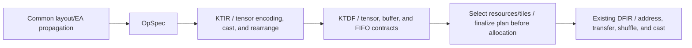

# Element Arrangement: Design Decisions from KTIR to DFIR 

## 1. Summary of Design Decisions

**The preferred medium- to long-term design combines builtin RankedTensorType encoding in KTIR/KTDF, explicit EA conversion operations, and verified attributes at buffer/FIFO boundaries (EA-P003: H10 + H6 + H7).** Keep numerical casts and arrangement conversions semantically separate, combining them during lowering only when they can be fused into the same hardware operation. The choice of EA representation alone does not determine performance: establish legality first, then compare conversion counts, bytes, temporary storage, and inter-core communication among legal candidates.

Treat EA as the mapping between logical indices and arrangement. Distinguish and verify geometry, logical dtype, device format, packing, validity, replication, and core ownership. This does not mean that the current EA enum alone contains validity or replication information. Shorthand: S = STANDARD, U = DL16_TO_FP32, D = FP32_TO_DL16, and R = the valid reduction value for each row (notation introduced by this proposal).

In the short term, establish contracts and verifiers (EA-P001) and the necessary numerical cast, operation, and grid support (EA-P005). Preserve legal U intervals while restoring the required arrangement at consumer/host boundaries (EA-P002). Where retention into KTDF is not yet available, concretize the arrangement by the KTIR exit. Do not require S before and after every operation. If the type migration is too extensive, the H7 attribute approach (EA-P006) is the principal alternative.

**Do not add EA-specific operations or attributes to final DFIR.** Implement arrangements and conversions through `dataflow.get_logical_memory_view`, existing load/store and send/receive operations, vectorchain.shuffle/pack/cast, and related existing operations. The implementation that expands existing KTDF splat into receive + shuffle was confirmed, but this precedent alone does not guarantee arbitrary EA conversions.[D4][D5][D6]

Adopt the user-specified triton#229 premise that restickify for fp16/df16/f32/i16/i32 will be available in the future. This does not imply numerical casts, arbitrary shapes or arrangement pairs, free conversions, or bf16 = df16. A separate premise permits implementing the required numerical conversions; EA-P005 must verify and implement their connection to existing DFIR representations and their numerical contracts.

|Design decision|Rationale|Conditions / validation that could change the decision|
|---|---|---|
|Type encoding + explicit conversions|Use types to distinguish SSA values with different EAs and make conversions for each use visible|Encoding must survive KTDP loads, shape inference, and bufferization. Prioritize H7 if too many passes fail|
|Retain information into KTDF|Select arrangements with visibility into tiles, resources, FIFOs, and liveness|Expose type widths and resource requirements by pre_scheduling; finalize the plan after TileSizeSelection and before allocation|
|Separate casts|Preserve the rounding order in A/B, integer-to-f32 conversion and post-trigonometric bf16 conversion in C, and the f32 output in D|Verify BF16/DF16 ranges and rounding, and the actual EA produced by native casts|
|Expand into existing DFIR|Align responsibilities with the existing splat approach without requiring a new Dataflow ABI|Empirically verify U/D mappings, same-core requirements, groups/offsets/tails, and the corresponding shuffles/transfers|

Currently, A (Granite) and D (Softmax) stopped because `dl16tofp32` is not registered in KTIR; B (GptOss) stopped on a grid mismatch with 32 cores; and C (RoPE) stopped at a stick compatibility check before KTIR. Running B with one core progresses to the missing cast registration. All 191 existing KTIR unit tests and compilation of an existing f16 add through KTIR → KTDF → DFIR → SpyreCode succeeded. Numerical agreement for the four examples and optimization performance remain unverified.

Execution used the baseline Python sources, but matching build SHAs for all C++ extensions and the frontend package have not been confirmed. The scheduler reference version and the installed binary differ in their passes. For `TORCH_SPYRE_KTIR=1`, the config evaluation to True and entry into generate_ktir for A/B/D were recorded; C is not treated as having passed through KTIR.[S1][S1b][S2]

### 1.1 Numerical Contract and How to Read the Proposed IR

Current H2D transfer converts PyTorch bf16 to SEN169_FP16, which the KTIR emitter currently spells f16. In contrast, `!spyreop.df16` uses 1/6/9 bits, while bf16 uses 1/8/7. These formats must not be equated. Adding logical dtype metadata cannot recover values already lost during H2D conversion. Guaranteeing the full BF16 range requires changing the storage boundary. If the current storage format is retained, the supported range and precision contract must be restricted.[S3b][S9][F6]

EA-v1 is a **new proposed specification**. `#ea.layout<S/U/D/R>` is shorthand for encoding; the full form contains group/phase information, a position mapping, validity, and packing, and checks consistency with dtype, shape, and owner. `ea.numeric_cast` preserves logical shape and indices while converting the type using the specified rounding. `rounding="exact_extension"` denotes exact bf16-to-f32 extension, `rounding="rne"` denotes round-to-nearest-even, and integers carry `signedness="signed"`. The result encoding is an arrangement requirement separate from the numerical semantics.

`ea.rearrange` changes EA while preserving the same logical shape, dtype, and payload. It is not merely a type relabeling operation. `ea.payload` links the sequence-order and validity contracts across FIFO producers, writes, and reads; a read-side declaration alone does not change the arrangement. These abstractions are consumed into existing representations by DFIR generation.

A computes `bf16(w * bf16(n32))`; B computes `bf16(f32(w) * n32)`. On the CPU, h = 1.00390625 and w = 1.5 yield A = 1.5 and B = 1.5078125. Agreement within tolerance or cancellation of an EA round trip does not justify exchanging these cast positions.

### 1.2 KTIR and KTDF for the Four Examples (Proposals Including New Specifications)

The following eight examples are **proposed IR containing new specifications; they are not implemented**. Each module uses MLIR type, SSA, and function syntax and explicitly shows numerical ordering and EA boundaries. This is not IR generated by the current compiler. The private helpers invoked by `func.call` define expansion contracts to keep the explanation compact; they are neither new runtime APIs nor existing backend intrinsics. In an implementation, expand them into `linalg.generic/reduce` and related operations defined below before KTIR legality checking and mapping. The helper declarations alone do not make these modules executable.

|Helper group|Definition and lowering contract|
|---|---|
|square_u|f32 `x*x` for each logical element, corresponding to the current decomposition of pow(2)|
|mean_last_4096|Mean over the 4,096 elements of the last axis. Explicitly specify a sum initializer of 0 and divisor of 4096; fix the reduction tree and scaling position through the numerical contract. Do not read an uninitialized tensor as an accumulator|
|add_eps_1e5 / rsqrt_row / mul_rows_u|Add eps = 1e-5 in f32, apply rsqrt, then broadcast the row scalar along the last axis for f32 multiplication. Splat the valid value in R|
|mul_weight_bf16 / mul_weight_f32|Broadcast w[h] across batch/sequence. The former is a bf16 product with bf16 output rounding; the latter is an f32 product. Do not interchange them between A and B|
|outer_freq / duplicate_last|Compute `positions[b,s]*inv_freq[h]`, then concatenate two copies along the last axis. Preserve logical index order and group boundaries|
|cos_f32 / sin_f32 / scale_one|f32 trigonometric operations and multiplication by f32 1.0. Do not move the output bf16 cast into these operations|
|max_last_128 / sum_last_128|Initialize max with −∞ and sum with 0. Define NaN and tie contracts and preserve f32 reductions and masks|
|sub_rows / exp_f32 / div_rows|Broadcast the row maximum and subtract it, compute f32 exp, then divide by the row sum in f32. D has no conversion back to 16 bits|

The combination of logical bf16 and EA-v1 specifies the target semantics. The current H2D SEN169 conversion or KTIR f16 alias must not be treated as an implementation of this IR. Verifying how existing DFIR casts, integer bit operations, or related operations implement BF16 rounding and range is mandatory under EA-P005. C shows the representation after proving that i64-to-device-i32 conversion is exact for positions in 0..127. This does not generalize beyond that range. The values of x are unnecessary, so x is omitted from the IR arguments. inv_freq remains f32.

The KTDF examples are **stage skeletons of computation graphs that retain EA**, not complete schedules mapped to physical resources. Input/output slots describe the entire logical payload; an implementation splits it into legal capacities in KTIRMapAndTile before KTDF generation and in subsequent KTDF tile selection. This does not mean rerunning KTIRMapAndTile on these skeletons. `LXLU/SFP/LXSU` are existing resource names; their use does not imply that bf16, trigonometric operations, or new casts can currently be mapped to those resources. Decompose row dependencies, tokens, and DMA stages, then verify FIFO capacities and ordering before proceeding to executable form. The skeletons compare H10 information retention and numerical operation ordering in A/B/C/D.

#### A: Granite RMSNorm

Proposed KTIR (new specification):

```mlir
// New specification: EA-v1 encoding and ea.numeric_cast / ea.rearrange.
// Specification helpers: func.call expands to linalg, etc., as defined in the text.
#S = #ea.layout<S>
#U = #ea.layout<U>
#D = #ea.layout<D>
#R = #ea.layout<R>
module {
  func.func private @square_u(tensor<1x128x4096xf32, #U>) -> tensor<1x128x4096xf32, #U>
  func.func private @mean_last_4096(tensor<1x128x4096xf32, #U>) -> tensor<1x128x1xf32, #R>
  func.func private @add_eps_1e5(tensor<1x128x1xf32, #R>) -> tensor<1x128x1xf32, #R>
  func.func private @rsqrt_row(tensor<1x128x1xf32, #R>) -> tensor<1x128x1xf32, #R>
  func.func private @mul_rows_u(tensor<1x128x4096xf32, #U>, tensor<1x128x1xf32, #R>) -> tensor<1x128x4096xf32, #U>
  func.func private @mul_weight_bf16(tensor<4096xbf16, #S>, tensor<1x128x4096xbf16, #S>) -> tensor<1x128x4096xbf16, #S>

  func.func @granite_ktir(%x: tensor<1x128x4096xbf16, #S>, %w: tensor<4096xbf16, #S>) -> tensor<1x128x4096xbf16, #S> {
    %xf = "ea.numeric_cast"(%x) {rounding = "exact_extension"} : (tensor<1x128x4096xbf16, #S>) -> tensor<1x128x4096xf32, #U>
    %sq = func.call @square_u(%xf) : (tensor<1x128x4096xf32, #U>) -> tensor<1x128x4096xf32, #U>
    %mean = func.call @mean_last_4096(%sq) : (tensor<1x128x4096xf32, #U>) -> tensor<1x128x1xf32, #R>
    %eps = func.call @add_eps_1e5(%mean) : (tensor<1x128x1xf32, #R>) -> tensor<1x128x1xf32, #R>
    %inv = func.call @rsqrt_row(%eps) : (tensor<1x128x1xf32, #R>) -> tensor<1x128x1xf32, #R>
    %norm = func.call @mul_rows_u(%xf, %inv) : (tensor<1x128x4096xf32, #U>, tensor<1x128x1xf32, #R>) -> tensor<1x128x4096xf32, #U>
    %n16 = "ea.numeric_cast"(%norm) {rounding = "rne"} : (tensor<1x128x4096xf32, #U>) -> tensor<1x128x4096xbf16, #S>
    %y = func.call @mul_weight_bf16(%w, %n16) : (tensor<4096xbf16, #S>, tensor<1x128x4096xbf16, #S>) -> tensor<1x128x4096xbf16, #S>
    return %y : tensor<1x128x4096xbf16, #S>
  }
}
```

Proposed KTDF (new specification; stage skeleton):

```mlir
// New specification: EA-v1 encoding and ea.numeric_cast / ea.rearrange.
// Specification helpers: func.call expands to linalg, etc., as defined in the text.
#S = #ea.layout<S>
#U = #ea.layout<U>
#D = #ea.layout<D>
#R = #ea.layout<R>
module {
  func.func private @square_u(tensor<1x128x4096xf32, #U>) -> tensor<1x128x4096xf32, #U>
  func.func private @mean_last_4096(tensor<1x128x4096xf32, #U>) -> tensor<1x128x1xf32, #R>
  func.func private @add_eps_1e5(tensor<1x128x1xf32, #R>) -> tensor<1x128x1xf32, #R>
  func.func private @rsqrt_row(tensor<1x128x1xf32, #R>) -> tensor<1x128x1xf32, #R>
  func.func private @mul_rows_u(tensor<1x128x4096xf32, #U>, tensor<1x128x1xf32, #R>) -> tensor<1x128x4096xf32, #U>
  func.func private @mul_weight_bf16(tensor<4096xbf16, #S>, tensor<1x128x4096xbf16, #S>) -> tensor<1x128x4096xbf16, #S>

  func.func @granite_ktdf(%x_slot: !ktdf.fifo.slot<"LXLU" -> "SFP", 524288xbf16>, %w_slot: !ktdf.fifo.slot<"LXLU" -> "SFP", 4096xbf16>, %out0: !ktdf.fifo.slot<"SFP" -> "LXSU", 524288xbf16>) {
    ktdf.pipeline {
      ktdf.stage depends_in(none) depends_out(none) {
        %x = ktdf.read_from_fifo %x_slot {ea.payload = #S} : !ktdf.fifo.slot<"LXLU" -> "SFP", 524288xbf16> -> tensor<1x128x4096xbf16, #S>
        %w = ktdf.read_from_fifo %w_slot {ea.payload = #S} : !ktdf.fifo.slot<"LXLU" -> "SFP", 4096xbf16> -> tensor<4096xbf16, #S>
        %xf = "ea.numeric_cast"(%x) {rounding = "exact_extension"} : (tensor<1x128x4096xbf16, #S>) -> tensor<1x128x4096xf32, #U>
        %sq = func.call @square_u(%xf) : (tensor<1x128x4096xf32, #U>) -> tensor<1x128x4096xf32, #U>
        %mean = func.call @mean_last_4096(%sq) : (tensor<1x128x4096xf32, #U>) -> tensor<1x128x1xf32, #R>
        %eps = func.call @add_eps_1e5(%mean) : (tensor<1x128x1xf32, #R>) -> tensor<1x128x1xf32, #R>
        %inv = func.call @rsqrt_row(%eps) : (tensor<1x128x1xf32, #R>) -> tensor<1x128x1xf32, #R>
        %norm = func.call @mul_rows_u(%xf, %inv) : (tensor<1x128x4096xf32, #U>, tensor<1x128x1xf32, #R>) -> tensor<1x128x4096xf32, #U>
        %n16 = "ea.numeric_cast"(%norm) {rounding = "rne"} : (tensor<1x128x4096xf32, #U>) -> tensor<1x128x4096xbf16, #S>
        %y = func.call @mul_weight_bf16(%w, %n16) : (tensor<4096xbf16, #S>, tensor<1x128x4096xbf16, #S>) -> tensor<1x128x4096xbf16, #S>
        ktdf.write_to_fifo %y, %out0 {ea.payload = #S} : tensor<1x128x4096xbf16, #S>, !ktdf.fifo.slot<"SFP" -> "LXSU", 524288xbf16>
      }
    }
    return
  }
}
```

#### B: GptOss RMSNorm

Proposed KTIR (new specification):

```mlir
// New specification: EA-v1 encoding and ea.numeric_cast / ea.rearrange.
// Specification helpers: func.call expands to linalg, etc., as defined in the text.
#S = #ea.layout<S>
#U = #ea.layout<U>
#D = #ea.layout<D>
#R = #ea.layout<R>
module {
  func.func private @square_u(tensor<1x128x4096xf32, #U>) -> tensor<1x128x4096xf32, #U>
  func.func private @mean_last_4096(tensor<1x128x4096xf32, #U>) -> tensor<1x128x1xf32, #R>
  func.func private @add_eps_1e5(tensor<1x128x1xf32, #R>) -> tensor<1x128x1xf32, #R>
  func.func private @rsqrt_row(tensor<1x128x1xf32, #R>) -> tensor<1x128x1xf32, #R>
  func.func private @mul_rows_u(tensor<1x128x4096xf32, #U>, tensor<1x128x1xf32, #R>) -> tensor<1x128x4096xf32, #U>
  func.func private @mul_weight_f32(tensor<4096xf32, #U>, tensor<1x128x4096xf32, #U>) -> tensor<1x128x4096xf32, #U>

  func.func @gpt_oss_ktir(%x: tensor<1x128x4096xbf16, #S>, %w: tensor<4096xbf16, #S>) -> tensor<1x128x4096xbf16, #S> {
    %xf = "ea.numeric_cast"(%x) {rounding = "exact_extension"} : (tensor<1x128x4096xbf16, #S>) -> tensor<1x128x4096xf32, #U>
    %sq = func.call @square_u(%xf) : (tensor<1x128x4096xf32, #U>) -> tensor<1x128x4096xf32, #U>
    %mean = func.call @mean_last_4096(%sq) : (tensor<1x128x4096xf32, #U>) -> tensor<1x128x1xf32, #R>
    %eps = func.call @add_eps_1e5(%mean) : (tensor<1x128x1xf32, #R>) -> tensor<1x128x1xf32, #R>
    %inv = func.call @rsqrt_row(%eps) : (tensor<1x128x1xf32, #R>) -> tensor<1x128x1xf32, #R>
    %norm = func.call @mul_rows_u(%xf, %inv) : (tensor<1x128x4096xf32, #U>, tensor<1x128x1xf32, #R>) -> tensor<1x128x4096xf32, #U>
    %wf = "ea.numeric_cast"(%w) {rounding = "exact_extension"} : (tensor<4096xbf16, #S>) -> tensor<4096xf32, #U>
    %weighted = func.call @mul_weight_f32(%wf, %norm) : (tensor<4096xf32, #U>, tensor<1x128x4096xf32, #U>) -> tensor<1x128x4096xf32, #U>
    %y = "ea.numeric_cast"(%weighted) {rounding = "rne"} : (tensor<1x128x4096xf32, #U>) -> tensor<1x128x4096xbf16, #S>
    return %y : tensor<1x128x4096xbf16, #S>
  }
}
```

Proposed KTDF (new specification; stage skeleton):

```mlir
// New specification: EA-v1 encoding and ea.numeric_cast / ea.rearrange.
// Specification helpers: func.call expands to linalg, etc., as defined in the text.
#S = #ea.layout<S>
#U = #ea.layout<U>
#D = #ea.layout<D>
#R = #ea.layout<R>
module {
  func.func private @square_u(tensor<1x128x4096xf32, #U>) -> tensor<1x128x4096xf32, #U>
  func.func private @mean_last_4096(tensor<1x128x4096xf32, #U>) -> tensor<1x128x1xf32, #R>
  func.func private @add_eps_1e5(tensor<1x128x1xf32, #R>) -> tensor<1x128x1xf32, #R>
  func.func private @rsqrt_row(tensor<1x128x1xf32, #R>) -> tensor<1x128x1xf32, #R>
  func.func private @mul_rows_u(tensor<1x128x4096xf32, #U>, tensor<1x128x1xf32, #R>) -> tensor<1x128x4096xf32, #U>
  func.func private @mul_weight_f32(tensor<4096xf32, #U>, tensor<1x128x4096xf32, #U>) -> tensor<1x128x4096xf32, #U>

  func.func @gpt_oss_ktdf(%x_slot: !ktdf.fifo.slot<"LXLU" -> "SFP", 524288xbf16>, %w_slot: !ktdf.fifo.slot<"LXLU" -> "SFP", 4096xbf16>, %out0: !ktdf.fifo.slot<"SFP" -> "LXSU", 524288xbf16>) {
    ktdf.pipeline {
      ktdf.stage depends_in(none) depends_out(none) {
        %x = ktdf.read_from_fifo %x_slot {ea.payload = #S} : !ktdf.fifo.slot<"LXLU" -> "SFP", 524288xbf16> -> tensor<1x128x4096xbf16, #S>
        %w = ktdf.read_from_fifo %w_slot {ea.payload = #S} : !ktdf.fifo.slot<"LXLU" -> "SFP", 4096xbf16> -> tensor<4096xbf16, #S>
        %xf = "ea.numeric_cast"(%x) {rounding = "exact_extension"} : (tensor<1x128x4096xbf16, #S>) -> tensor<1x128x4096xf32, #U>
        %sq = func.call @square_u(%xf) : (tensor<1x128x4096xf32, #U>) -> tensor<1x128x4096xf32, #U>
        %mean = func.call @mean_last_4096(%sq) : (tensor<1x128x4096xf32, #U>) -> tensor<1x128x1xf32, #R>
        %eps = func.call @add_eps_1e5(%mean) : (tensor<1x128x1xf32, #R>) -> tensor<1x128x1xf32, #R>
        %inv = func.call @rsqrt_row(%eps) : (tensor<1x128x1xf32, #R>) -> tensor<1x128x1xf32, #R>
        %norm = func.call @mul_rows_u(%xf, %inv) : (tensor<1x128x4096xf32, #U>, tensor<1x128x1xf32, #R>) -> tensor<1x128x4096xf32, #U>
        %wf = "ea.numeric_cast"(%w) {rounding = "exact_extension"} : (tensor<4096xbf16, #S>) -> tensor<4096xf32, #U>
        %weighted = func.call @mul_weight_f32(%wf, %norm) : (tensor<4096xf32, #U>, tensor<1x128x4096xf32, #U>) -> tensor<1x128x4096xf32, #U>
        %y = "ea.numeric_cast"(%weighted) {rounding = "rne"} : (tensor<1x128x4096xf32, #U>) -> tensor<1x128x4096xbf16, #S>
        ktdf.write_to_fifo %y, %out0 {ea.payload = #S} : tensor<1x128x4096xbf16, #S>, !ktdf.fifo.slot<"SFP" -> "LXSU", 524288xbf16>
      }
    }
    return
  }
}
```

#### C: RoPE

Proposed KTIR (new specification):

```mlir
// New specification: EA-v1 encoding and ea.numeric_cast / ea.rearrange.
// Specification helpers: func.call expands to linalg, etc., as defined in the text.
#S = #ea.layout<S>
#U = #ea.layout<U>
#D = #ea.layout<D>
#R = #ea.layout<R>
module {
  func.func private @outer_freq(tensor<1x128xf32, #S>, tensor<64xf32, #S>) -> tensor<1x128x64xf32, #S>
  func.func private @duplicate_last(tensor<1x128x64xf32, #S>) -> tensor<1x128x128xf32, #S>
  func.func private @cos_f32(tensor<1x128x128xf32, #S>) -> tensor<1x128x128xf32, #S>
  func.func private @sin_f32(tensor<1x128x128xf32, #S>) -> tensor<1x128x128xf32, #S>
  func.func private @scale_one(tensor<1x128x128xf32, #S>) -> tensor<1x128x128xf32, #S>

  func.func @rope_ktir(%positions: tensor<1x128xi32, #S>, %inv_freq: tensor<64xf32, #S>) -> (tensor<1x128x128xbf16, #S>, tensor<1x128x128xbf16, #S>) {
    %pf = "ea.numeric_cast"(%positions) {rounding = "rne", signedness = "signed"} : (tensor<1x128xi32, #S>) -> tensor<1x128xf32, #S>
    %freqs = func.call @outer_freq(%pf, %inv_freq) : (tensor<1x128xf32, #S>, tensor<64xf32, #S>) -> tensor<1x128x64xf32, #S>
    %emb = func.call @duplicate_last(%freqs) : (tensor<1x128x64xf32, #S>) -> tensor<1x128x128xf32, #S>
    %cv = func.call @cos_f32(%emb) : (tensor<1x128x128xf32, #S>) -> tensor<1x128x128xf32, #S>
    %sv = func.call @sin_f32(%emb) : (tensor<1x128x128xf32, #S>) -> tensor<1x128x128xf32, #S>
    %cs = func.call @scale_one(%cv) : (tensor<1x128x128xf32, #S>) -> tensor<1x128x128xf32, #S>
    %ss = func.call @scale_one(%sv) : (tensor<1x128x128xf32, #S>) -> tensor<1x128x128xf32, #S>
    %cd = "ea.numeric_cast"(%cs) {rounding = "rne"} : (tensor<1x128x128xf32, #S>) -> tensor<1x128x128xbf16, #D>
    %sd = "ea.numeric_cast"(%ss) {rounding = "rne"} : (tensor<1x128x128xf32, #S>) -> tensor<1x128x128xbf16, #D>
    %co = "ea.rearrange"(%cd) : (tensor<1x128x128xbf16, #D>) -> tensor<1x128x128xbf16, #S>
    %so = "ea.rearrange"(%sd) : (tensor<1x128x128xbf16, #D>) -> tensor<1x128x128xbf16, #S>
    return %co, %so : tensor<1x128x128xbf16, #S>, tensor<1x128x128xbf16, #S>
  }
}
```

Proposed KTDF (new specification; stage skeleton):

```mlir
// New specification: EA-v1 encoding and ea.numeric_cast / ea.rearrange.
// Specification helpers: func.call expands to linalg, etc., as defined in the text.
#S = #ea.layout<S>
#U = #ea.layout<U>
#D = #ea.layout<D>
#R = #ea.layout<R>
module {
  func.func private @outer_freq(tensor<1x128xf32, #S>, tensor<64xf32, #S>) -> tensor<1x128x64xf32, #S>
  func.func private @duplicate_last(tensor<1x128x64xf32, #S>) -> tensor<1x128x128xf32, #S>
  func.func private @cos_f32(tensor<1x128x128xf32, #S>) -> tensor<1x128x128xf32, #S>
  func.func private @sin_f32(tensor<1x128x128xf32, #S>) -> tensor<1x128x128xf32, #S>
  func.func private @scale_one(tensor<1x128x128xf32, #S>) -> tensor<1x128x128xf32, #S>

  func.func @rope_ktdf(%positions_slot: !ktdf.fifo.slot<"LXLU" -> "SFP", 128xi32>, %inv_freq_slot: !ktdf.fifo.slot<"LXLU" -> "SFP", 64xf32>, %out0: !ktdf.fifo.slot<"SFP" -> "LXSU", 16384xbf16>, %out1: !ktdf.fifo.slot<"SFP" -> "LXSU", 16384xbf16>) {
    ktdf.pipeline {
      ktdf.stage depends_in(none) depends_out(none) {
        %positions = ktdf.read_from_fifo %positions_slot {ea.payload = #S} : !ktdf.fifo.slot<"LXLU" -> "SFP", 128xi32> -> tensor<1x128xi32, #S>
        %inv_freq = ktdf.read_from_fifo %inv_freq_slot {ea.payload = #S} : !ktdf.fifo.slot<"LXLU" -> "SFP", 64xf32> -> tensor<64xf32, #S>
        %pf = "ea.numeric_cast"(%positions) {rounding = "rne", signedness = "signed"} : (tensor<1x128xi32, #S>) -> tensor<1x128xf32, #S>
        %freqs = func.call @outer_freq(%pf, %inv_freq) : (tensor<1x128xf32, #S>, tensor<64xf32, #S>) -> tensor<1x128x64xf32, #S>
        %emb = func.call @duplicate_last(%freqs) : (tensor<1x128x64xf32, #S>) -> tensor<1x128x128xf32, #S>
        %cv = func.call @cos_f32(%emb) : (tensor<1x128x128xf32, #S>) -> tensor<1x128x128xf32, #S>
        %sv = func.call @sin_f32(%emb) : (tensor<1x128x128xf32, #S>) -> tensor<1x128x128xf32, #S>
        %cs = func.call @scale_one(%cv) : (tensor<1x128x128xf32, #S>) -> tensor<1x128x128xf32, #S>
        %ss = func.call @scale_one(%sv) : (tensor<1x128x128xf32, #S>) -> tensor<1x128x128xf32, #S>
        %cd = "ea.numeric_cast"(%cs) {rounding = "rne"} : (tensor<1x128x128xf32, #S>) -> tensor<1x128x128xbf16, #D>
        %sd = "ea.numeric_cast"(%ss) {rounding = "rne"} : (tensor<1x128x128xf32, #S>) -> tensor<1x128x128xbf16, #D>
        %co = "ea.rearrange"(%cd) : (tensor<1x128x128xbf16, #D>) -> tensor<1x128x128xbf16, #S>
        %so = "ea.rearrange"(%sd) : (tensor<1x128x128xbf16, #D>) -> tensor<1x128x128xbf16, #S>
        ktdf.write_to_fifo %co, %out0 {ea.payload = #S} : tensor<1x128x128xbf16, #S>, !ktdf.fifo.slot<"SFP" -> "LXSU", 16384xbf16>
        ktdf.write_to_fifo %so, %out1 {ea.payload = #S} : tensor<1x128x128xbf16, #S>, !ktdf.fifo.slot<"SFP" -> "LXSU", 16384xbf16>
      }
    }
    return
  }
}
```

#### D: fp32 Softmax

Proposed KTIR (new specification):

```mlir
// New specification: EA-v1 encoding and ea.numeric_cast / ea.rearrange.
// Specification helpers: func.call expands to linalg, etc., as defined in the text.
#S = #ea.layout<S>
#U = #ea.layout<U>
#D = #ea.layout<D>
#R = #ea.layout<R>
module {
  func.func private @max_last_128(tensor<128x128xf32, #U>) -> tensor<128x1xf32, #R>
  func.func private @sub_rows(tensor<128x128xf32, #U>, tensor<128x1xf32, #R>) -> tensor<128x128xf32, #U>
  func.func private @exp_f32(tensor<128x128xf32, #U>) -> tensor<128x128xf32, #U>
  func.func private @sum_last_128(tensor<128x128xf32, #U>) -> tensor<128x1xf32, #R>
  func.func private @div_rows(tensor<128x128xf32, #U>, tensor<128x1xf32, #R>) -> tensor<128x128xf32, #U>

  func.func @softmax_ktir(%x: tensor<128x128xbf16, #S>) -> tensor<128x128xf32, #S> {
    %xf = "ea.numeric_cast"(%x) {rounding = "exact_extension"} : (tensor<128x128xbf16, #S>) -> tensor<128x128xf32, #U>
    %mx = func.call @max_last_128(%xf) : (tensor<128x128xf32, #U>) -> tensor<128x1xf32, #R>
    %shifted = func.call @sub_rows(%xf, %mx) : (tensor<128x128xf32, #U>, tensor<128x1xf32, #R>) -> tensor<128x128xf32, #U>
    %ex = func.call @exp_f32(%shifted) : (tensor<128x128xf32, #U>) -> tensor<128x128xf32, #U>
    %sum = func.call @sum_last_128(%ex) : (tensor<128x128xf32, #U>) -> tensor<128x1xf32, #R>
    %prob = func.call @div_rows(%ex, %sum) : (tensor<128x128xf32, #U>, tensor<128x1xf32, #R>) -> tensor<128x128xf32, #U>
    %y = "ea.rearrange"(%prob) : (tensor<128x128xf32, #U>) -> tensor<128x128xf32, #S>
    return %y : tensor<128x128xf32, #S>
  }
}
```

Proposed KTDF (new specification; stage skeleton):

```mlir
// New specification: EA-v1 encoding and ea.numeric_cast / ea.rearrange.
// Specification helpers: func.call expands to linalg, etc., as defined in the text.
#S = #ea.layout<S>
#U = #ea.layout<U>
#D = #ea.layout<D>
#R = #ea.layout<R>
module {
  func.func private @max_last_128(tensor<128x128xf32, #U>) -> tensor<128x1xf32, #R>
  func.func private @sub_rows(tensor<128x128xf32, #U>, tensor<128x1xf32, #R>) -> tensor<128x128xf32, #U>
  func.func private @exp_f32(tensor<128x128xf32, #U>) -> tensor<128x128xf32, #U>
  func.func private @sum_last_128(tensor<128x128xf32, #U>) -> tensor<128x1xf32, #R>
  func.func private @div_rows(tensor<128x128xf32, #U>, tensor<128x1xf32, #R>) -> tensor<128x128xf32, #U>

  func.func @softmax_ktdf(%x_slot: !ktdf.fifo.slot<"LXLU" -> "SFP", 16384xbf16>, %out0: !ktdf.fifo.slot<"SFP" -> "LXSU", 16384xf32>) {
    ktdf.pipeline {
      ktdf.stage depends_in(none) depends_out(none) {
        %x = ktdf.read_from_fifo %x_slot {ea.payload = #S} : !ktdf.fifo.slot<"LXLU" -> "SFP", 16384xbf16> -> tensor<128x128xbf16, #S>
        %xf = "ea.numeric_cast"(%x) {rounding = "exact_extension"} : (tensor<128x128xbf16, #S>) -> tensor<128x128xf32, #U>
        %mx = func.call @max_last_128(%xf) : (tensor<128x128xf32, #U>) -> tensor<128x1xf32, #R>
        %shifted = func.call @sub_rows(%xf, %mx) : (tensor<128x128xf32, #U>, tensor<128x1xf32, #R>) -> tensor<128x128xf32, #U>
        %ex = func.call @exp_f32(%shifted) : (tensor<128x128xf32, #U>) -> tensor<128x128xf32, #U>
        %sum = func.call @sum_last_128(%ex) : (tensor<128x128xf32, #U>) -> tensor<128x1xf32, #R>
        %prob = func.call @div_rows(%ex, %sum) : (tensor<128x128xf32, #U>, tensor<128x1xf32, #R>) -> tensor<128x128xf32, #U>
        %y = "ea.rearrange"(%prob) : (tensor<128x128xf32, #U>) -> tensor<128x128xf32, #S>
        ktdf.write_to_fifo %y, %out0 {ea.payload = #S} : tensor<128x128xf32, #S>, !ktdf.fifo.slot<"SFP" -> "LXSU", 16384xf32>
      }
    }
    return
  }
}
```

Acceptance criteria for the four examples: compare A and B separately against their own CPU results with atol = rtol = 0.1; compare C's cos and sin separately with 0.02/0.02; and compare D with 0.001/0.01. Check bf16 outputs for A/B/C and an f32 output for D separately. Preserve the original shapes, seeds, bf16 inputs and weights, C's f32 inv_freq and int64 positions, and dynamic=False. The original check_dtype=False in D does not justify dropping its f32 output requirement.

All eight proposed modules passed parsing, SSA type checks, existing KTDF verifiers, and round-trip checks with an empty pipeline and unknown dialects allowed. Semantic verifiers for the new ea.* constructs, actual helper lowering, and device execution remain unimplemented and unverified.

## 2. Overall Approach and Processing Overview



The EA-v1 portions of the diagram are proposals. The current route connects config → scheduler.define_kernel → SpyreAsyncCompile.ktir → generate_ktir → `.ktir`. KTIR combines KTDP, standard dialects, and SpyreOp; this route does not go through Triton. dataflow-scheduler-mlir-dialects owns the KTDF/DFIR definitions, while dataflow-scheduler owns conversion and scheduling.[S1b][S2][D1]

|Stage|Information retained and responsibility|Finalization / verification point|
|---|---|---|
|OpSpec|Logical dtype and device format, EA, geometry, validity, fixed memory/core boundaries, cast rounding|Pass on upstream decisions without losing information. Separate the schema for mixed-format casts from ordinary arithmetic|
|KTIR|Numeric tensors with encoding, consumer requirements, explicit cast/rearrange|Select candidates across operations. Verify loads, broadcasts, reductions, shape transformations, and region arguments|
|Early KTDF|Verified tensor-to-memref/FIFO bridge, resource candidates, transfer widths, temporary storage|Expose numerical cast resources and widths by pre_scheduling and reflect them in MaterializeRegisters/path expansion|
|Late KTDF|Tiles/owners, concrete transfer order, FIFO capacity, concrete implementation plans for rearrange|Finalize in post_scheduling after TileSizeSelection, before CustomLinalgBufferization/OrderFifoSlotsByUse/AddressAssignment|
|KTDFLow → DFIR|Expand already-planned local shuffle and similar obligations into existing operations|Consume all EA-v1 types, attributes, and operations. Do not discover additional required buffers after allocation|

As with the existing `read_from_fifo.splat`, attributes describing already-planned local conversions may be retained into KTDFLow. This differs from performing allocation while arrangement candidates remain unresolved. H10 includes this bridge and the phase contracts; it is not merely a change to encoding.[D2][D3][D4]

Begin optimization with identity elimination for identical mappings, composition of consecutive rearranges, and sharing conversions with the same source and target. Moving a conversion across a pointwise operation requires aligned index mappings for all operands; reductions must preserve masks, initializers, and trees. FIFO reads/writes have effects, so preserve consumption counts and token ordering, and do not globally retag a producer at fan-out. Preserve per-element rounding even when fusing a numerical cast and EA conversion into one instruction.

Implementation order: P001 contracts + P005 numerical/operation foundations → P002 bounded boundary legalization → P003 information retention with optimization disabled → EA-P004 arrangement selection and conversion optimization. If type support requires overly broad changes, use the P006 attribute approach as an intermediate step. Completion requires validating all four examples with aligned repository pins; a CLOSED issue or success on the separate SDSC route is not a substitute.

## 3. Candidate Comparison and Adoption Decisions

|Candidate|Advantages|Disadvantages and mandatory conditions|Decision|
|---|---|---|---|
|H1: New KTIR operations|Visible conversions; retain existing tensor types|Value EA depends on analysis; concretization is required at the KTIR exit|Short-term component|
|H2: Attributes on existing KTIR operations|Limited type changes; express use requirements|Requires attribute preservation and dedicated checks for identity folding and block arguments|Useful for bridges|
|H3: New KTIR type|Enforce EA through types|Standard linalg/KTDP depend on RankedTensorType. Adding a type alone does not establish the connection|Reject as a standalone design|
|H4: Extend existing KTIR types|Strengthen access boundaries|AccessTile is a coordinate type and does not cover numeric SSA values|Reject as a standalone design|
|H5: KTIR encoding|Gain type safety while retaining builtin tensors|Requires bufferization support and early finalization. Tensor extf cannot directly change encoding; scalar casts inside generic, or equivalent handling, are needed|Strong simplified alternative|
|H6: New KTIR + KTDF operations|Retain explicit conversions until resource selection|Requires additional propagation interfaces, costing, and lowering|Recommended operation representation|
|H7: KTIR + KTDF attributes|Cover memrefs/FIFOs; facilitate incremental adoption|Supplement type safety with dedicated verifiers; audit cloning, fusion, and read consumption|P006 principal alternative / P003 bridge|
|H8: New KTIR + KTDF types|Potentially strong type contracts|Requires extensive support in standard operations and KTDF reads/writes|Reject unless a broader IR overhaul is justified|
|H9: Extend existing KTIR + KTDF types|Useful for strengthening FIFO boundaries|AccessTile/FifoSlot alone do not cover compute tensors. No general VariableType exists|Reject as a standalone design|
|H10: KTIR + KTDF encoding|Clear responsibilities for value EA, edge conversions, and selection across stages|Requires H6 and a buffer/FIFO bridge. Encoding itself does not change data|P003 preferred medium- to long-term design|
|H11: Early expansion into views/indices|Facilitates bounded adoption using existing representations|The complete U → S connection is unverified. Expansion loses conversion intent and complicates SSA/fan-out optimization|Bounded lowering / alternative|

Rejection of H3/H4/H8/H9 applies to standalone designs that retain the current standard infrastructure. Supplementing them with new compute operations or H7/H10 produces a different composite design. Do not score runtime based solely on the merits of a type representation. All candidates are subject to the same numerical cast requirements, operation support for the four examples, and DFIR constraint.

|Conditional static comparison|When retaining U is legal|When a separate copy restores S after each cast|
|---|---:|---:|
|A (524,288 elements)|0 additional EA-only payload|6 MiB|
|B (same activation + 4,096 weights)|0|6 MiB + 32 KiB|
|C (16,384 elements × 2 outputs)|128 KiB|128 KiB|
|D (16,384 elements)|128 KiB (output restoration)|128 KiB (restoration after input conversion)|

These are payload totals for one read + one write, excluding padding, core replication, transaction widths, register/LX/HBM placement, and runtime. Numerical casts are a separate common cost. Direct S → S casts would reduce extra copies; expensive U operations could make retention less favorable. The minimum additional validation covers arrangement mappings, BF16 numerical boundaries, actual generated instructions under aligned pins, and the four examples. Use those results to confirm or revise the recommendation.

Report preparation is complete, but device agreement for the four examples, implementation of the proposals, and performance evaluation remain outstanding. See the [full report](element-arrangement-ktir-dfsc-full-15.en.md) for evidence, unverified items, proposed sub-issues and PRs for EA-P001–P006, and validation commands.

[S1]: https://github.com/torch-spyre/torch-spyre/blob/64870622fc39cda7e344a271decb901e7088c6c6/torch_spyre/_inductor/config.py#L117-L127
[S1b]: https://github.com/torch-spyre/torch-spyre/blob/64870622fc39cda7e344a271decb901e7088c6c6/torch_spyre/_inductor/scheduler.py#L648-L667
[S2]: https://github.com/torch-spyre/torch-spyre/blob/64870622fc39cda7e344a271decb901e7088c6c6/torch_spyre/execution/async_compile.py#L615-L740
[S3]: https://github.com/torch-spyre/torch-spyre/blob/64870622fc39cda7e344a271decb901e7088c6c6/torch_spyre/csrc/spyre_tensor_impl.h#L36-L95
[S3b]: https://github.com/torch-spyre/torch-spyre/blob/64870622fc39cda7e344a271decb901e7088c6c6/torch_spyre/csrc/types_mapping.h#L57-L85
[S4]: https://github.com/torch-spyre/torch-spyre/blob/64870622fc39cda7e344a271decb901e7088c6c6/torch_spyre/_inductor/op_spec.py#L234-L386
[S5]: https://github.com/torch-spyre/torch-spyre/blob/64870622fc39cda7e344a271decb901e7088c6c6/torch_spyre/_inductor/dtype_ops.py#L51-L154
[S5b]: https://github.com/torch-spyre/torch-spyre/blob/64870622fc39cda7e344a271decb901e7088c6c6/torch_spyre/_inductor/spyre_kernel.py#L381-L409
[S5c]: https://github.com/torch-spyre/torch-spyre/blob/64870622fc39cda7e344a271decb901e7088c6c6/torch_spyre/_inductor/spyre_kernel.py#L809-L912
[S6]: https://github.com/torch-spyre/torch-spyre/blob/64870622fc39cda7e344a271decb901e7088c6c6/torch_spyre/_inductor/propagate_layouts.py#L523-L704
[S6b]: https://github.com/torch-spyre/torch-spyre/blob/64870622fc39cda7e344a271decb901e7088c6c6/torch_spyre/_inductor/propagate_layouts.py#L1540-L1714
[S7]: https://github.com/torch-spyre/torch-spyre/blob/64870622fc39cda7e344a271decb901e7088c6c6/torch_spyre/_inductor/pass_utils.py#L205-L269
[S8]: https://github.com/torch-spyre/torch-spyre/blob/64870622fc39cda7e344a271decb901e7088c6c6/torch_spyre/_inductor/pass_utils.py#L2544-L2560
[S8b]: https://github.com/torch-spyre/torch-spyre/blob/64870622fc39cda7e344a271decb901e7088c6c6/torch_spyre/_inductor/optimize_restickify.py#L819-L853
[S9]: https://github.com/torch-spyre/torch-spyre/blob/64870622fc39cda7e344a271decb901e7088c6c6/torch_spyre/_inductor/codegen/ktir.py#L203-L258
[S9b]: https://github.com/torch-spyre/torch-spyre/blob/64870622fc39cda7e344a271decb901e7088c6c6/torch_spyre/_inductor/codegen/ktir.py#L502-L518
[S9c]: https://github.com/torch-spyre/torch-spyre/blob/64870622fc39cda7e344a271decb901e7088c6c6/torch_spyre/_inductor/codegen/ktir.py#L701-L763
[S9d]: https://github.com/torch-spyre/torch-spyre/blob/64870622fc39cda7e344a271decb901e7088c6c6/torch_spyre/_inductor/codegen/ktir.py#L1382-L1413
[S9e]: https://github.com/torch-spyre/torch-spyre/blob/64870622fc39cda7e344a271decb901e7088c6c6/torch_spyre/_inductor/codegen/ktir.py#L1686-L1724
[S9f]: https://github.com/torch-spyre/torch-spyre/blob/64870622fc39cda7e344a271decb901e7088c6c6/torch_spyre/_inductor/codegen/ktir.py#L3722-L3753
[S9g]: https://github.com/torch-spyre/torch-spyre/blob/64870622fc39cda7e344a271decb901e7088c6c6/tests/inductor/test_ktir_validate.py#L2291-L2302
[S10]: https://github.com/torch-spyre/torch-spyre/blob/64870622fc39cda7e344a271decb901e7088c6c6/tools/ktir-mlir-frontend.pin#L1-L13
[S10b]: https://github.com/torch-spyre/torch-spyre/blob/64870622fc39cda7e344a271decb901e7088c6c6/pyproject.toml#L26-L51
[S11]: https://github.com/torch-spyre/torch-spyre/blob/64870622fc39cda7e344a271decb901e7088c6c6/torch_spyre/execution/async_compile.py#L403-L407
[S12]: https://github.com/torch-spyre/torch-spyre/blob/64870622fc39cda7e344a271decb901e7088c6c6/torch_spyre/_inductor/customops.py#L1281-L1334
[F1]: https://github.com/torch-spyre/ktir-mlir-frontend/blob/1f96e5790a99b7aaf9a445b039044467c66e4e0a/include/ktir/Dialect/KTDP/KTDPTypes.td#L38-L59
[F2]: https://github.com/torch-spyre/ktir-mlir-frontend/blob/1f96e5790a99b7aaf9a445b039044467c66e4e0a/include/ktir/Dialect/KTDP/KTDP.td#L275-L345
[F3]: https://github.com/torch-spyre/ktir-mlir-frontend/blob/1f96e5790a99b7aaf9a445b039044467c66e4e0a/include/ktir/Dialect/KTDP/KTDP.td#L413-L450
[F4]: https://github.com/torch-spyre/ktir-mlir-frontend/blob/1f96e5790a99b7aaf9a445b039044467c66e4e0a/include/ktir/Dialect/KTDP/KTDP.td#L589-L668
[F5]: https://github.com/torch-spyre/ktir-mlir-frontend/blob/1f96e5790a99b7aaf9a445b039044467c66e4e0a/lib/Dialect/KTDP/KTDPOps.cpp#L1062-L1137
[F6]: https://github.com/torch-spyre/ktir-mlir-frontend/blob/1f96e5790a99b7aaf9a445b039044467c66e4e0a/include/ktir/Dialect/SpyreOp/SpyreOpTypes.td#L39-L87
[F7]: https://github.com/torch-spyre/ktir-mlir-frontend/blob/1f96e5790a99b7aaf9a445b039044467c66e4e0a/include/ktir/Dialect/SpyreOp/SpyreOp.td#L112-L123
[F8]: https://github.com/torch-spyre/ktir-mlir-frontend/blob/1f96e5790a99b7aaf9a445b039044467c66e4e0a/lib/Conversion/ConvertToKTIR/KTIRCheckLegality.cpp#L41-L74
[F9]: https://github.com/torch-spyre/ktir-mlir-frontend/blob/1f96e5790a99b7aaf9a445b039044467c66e4e0a/test/Dialect/KTDP/add.mlir#L33-L94
[F10]: https://github.com/torch-spyre/ktir-mlir-frontend/blob/1f96e5790a99b7aaf9a445b039044467c66e4e0a/CMakeLists.txt#L16-L59
[D1]: https://github.com/torch-spyre/dataflow-scheduler/blob/8893e6c62a8e3cbe159f4e8b446c1ca9b42db2da/lib/Pipeline.cpp#L40-L176
[D2]: https://github.com/torch-spyre/dataflow-scheduler-mlir-dialects/blob/c3066e3f8d24168765fe25d541136979b6dd1d8b/include/dataflow-scheduler/Dialect/KTDF/KTDFTypes.td#L75-L135
[D2b]: https://github.com/torch-spyre/dataflow-scheduler/blob/8893e6c62a8e3cbe159f4e8b446c1ca9b42db2da/lib/Conversion/frontend/KTIRToScheduleIR/KTIRBufferize.cpp#L118-L185
[D2c]: https://github.com/torch-spyre/dataflow-scheduler/blob/8893e6c62a8e3cbe159f4e8b446c1ca9b42db2da/lib/Conversion/frontend/KTIRToScheduleIR/KTIRMapAndTile.cpp#L87-L150
[D3]: https://github.com/torch-spyre/dataflow-scheduler-mlir-dialects/blob/c3066e3f8d24168765fe25d541136979b6dd1d8b/include/dataflow-scheduler/Dialect/KTDF/KTDF.td#L139-L239
[D3b]: https://github.com/torch-spyre/dataflow-scheduler/blob/8893e6c62a8e3cbe159f4e8b446c1ca9b42db2da/lib/Transforms/SplatLegalizationPass.cpp#L81-L132
[D3c]: https://github.com/torch-spyre/dataflow-scheduler-mlir-dialects/blob/c3066e3f8d24168765fe25d541136979b6dd1d8b/lib/Dialect/KTDF/KTDFOps.cpp#L1042-L1081
[D4]: https://github.com/torch-spyre/dataflow-scheduler/blob/8893e6c62a8e3cbe159f4e8b446c1ca9b42db2da/lib/Conversion/backend/ScheduleIRToDFIR/KTDFLowToDFIR/OperationLowerings.cpp#L68-L175
[D5]: https://github.com/torch-spyre/dataflow-scheduler-mlir-dialects/blob/c3066e3f8d24168765fe25d541136979b6dd1d8b/include/dataflow-scheduler/Dialect/VectorChain/VectorChain.td#L226-L260
[D5b]: https://github.com/torch-spyre/dataflow-scheduler-mlir-dialects/blob/c3066e3f8d24168765fe25d541136979b6dd1d8b/include/dataflow-scheduler/Dialect/VectorChain/VectorChain.td#L458-L538
[D5c]: https://github.com/torch-spyre/dataflow-scheduler-mlir-dialects/blob/c3066e3f8d24168765fe25d541136979b6dd1d8b/lib/Dialect/VectorChain/VectorChain.cpp#L186-L250
[D6]: https://github.com/torch-spyre/dataflow-scheduler-mlir-dialects/blob/c3066e3f8d24168765fe25d541136979b6dd1d8b/include/dataflow-scheduler/Dialect/Dataflow/Dataflow.td#L242-L339
[D7]: https://github.com/torch-spyre/dataflow-scheduler/blob/8893e6c62a8e3cbe159f4e8b446c1ca9b42db2da/lib/Conversion/frontend/KTIRToScheduleIR/KTIRLegalityCheck.cpp#L53-L81
[D7b]: https://github.com/torch-spyre/dataflow-scheduler/blob/8893e6c62a8e3cbe159f4e8b446c1ca9b42db2da/lib/Conversion/backend/ScheduleIRToDFIR/KTDFLowToDFIR/LinalgLowering.cpp#L157-L242
[D8]: https://github.com/torch-spyre/dataflow-scheduler/blob/8893e6c62a8e3cbe159f4e8b446c1ca9b42db2da/test/Conversion/frontend/KTIRToScheduleIR/ComputeGroupExtraction/basic.mlir#L163-L223
[T1]: https://github.com/torch-spyre/triton/blob/77984beaaf253d6636da8f1a4f7acd0f32838e93/third_party/spyre/backend/compiler.py#L493-L724
[T2]: https://github.com/torch-spyre/triton/blob/77984beaaf253d6636da8f1a4f7acd0f32838e93/third_party/spyre/include/Dialect/TTS/IR/TTSOps.td#L14-L52
[R1]: https://github.com/torch-spyre/RFCs/blob/f4f8efd13578b4fe9de70f3f946f751fc32e4b3b/0682-KtirSpec/0682-KtirSpecRFC.md#L18-L45
[R2]: https://github.com/torch-spyre/RFCs/blob/f4f8efd13578b4fe9de70f3f946f751fc32e4b3b/0682-KtirSpec/0682-KtirSpecRFC.md#L75-L103
[R3]: https://github.com/torch-spyre/RFCs/blob/f4f8efd13578b4fe9de70f3f946f751fc32e4b3b/0047-TiledTensors/0047-TiledTensorsRFC.md#L54-L142
[R4]: https://github.com/torch-spyre/RFCs/blob/f4f8efd13578b4fe9de70f3f946f751fc32e4b3b/0047-TiledTensors/0047-TiledTensorsRFC.md#L183-L205
[R5]: https://github.com/torch-spyre/RFCs/blob/c2ce6ac7d0a28e31f741bfbcf61daf73a72444d8/2971-FP32ElementArrangement/2971-FP32ElementArrangementRFC.md#L10-L94
[R6]: https://github.com/torch-spyre/RFCs/blob/c2ce6ac7d0a28e31f741bfbcf61daf73a72444d8/2971-FP32ElementArrangement/2971-FP32ElementArrangementRFC.md#L96-L176
[R7]: https://github.com/torch-spyre/RFCs/blob/94a2131e5919d8adb3b02e34c7547eb01da8fdb5/2971-FP32ElementArrangement/2971-FP32ElementArrangementRFC.md#L36-L80
[R8]: https://github.com/torch-spyre/RFCs/blob/94a2131e5919d8adb3b02e34c7547eb01da8fdb5/2971-FP32ElementArrangement/2971-FP32ElementArrangementRFC.md#L109-L132
[I-D65]: https://github.com/torch-spyre/dataflow-scheduler/issues/65
[I-D82]: https://github.com/torch-spyre/dataflow-scheduler/issues/82
[I-R39]: https://github.com/torch-spyre/RFCs/pull/39
[I-F17]: https://github.com/torch-spyre/ktir-mlir-frontend/issues/17
[I-S3423]: https://github.com/torch-spyre/torch-spyre/issues/3423
